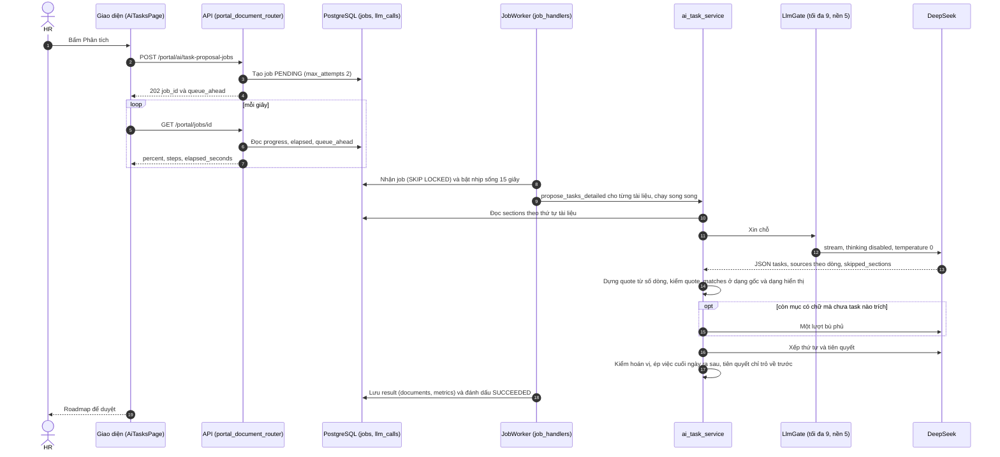
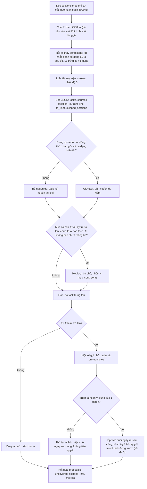
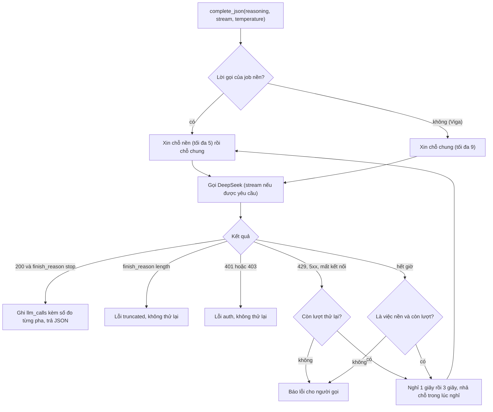
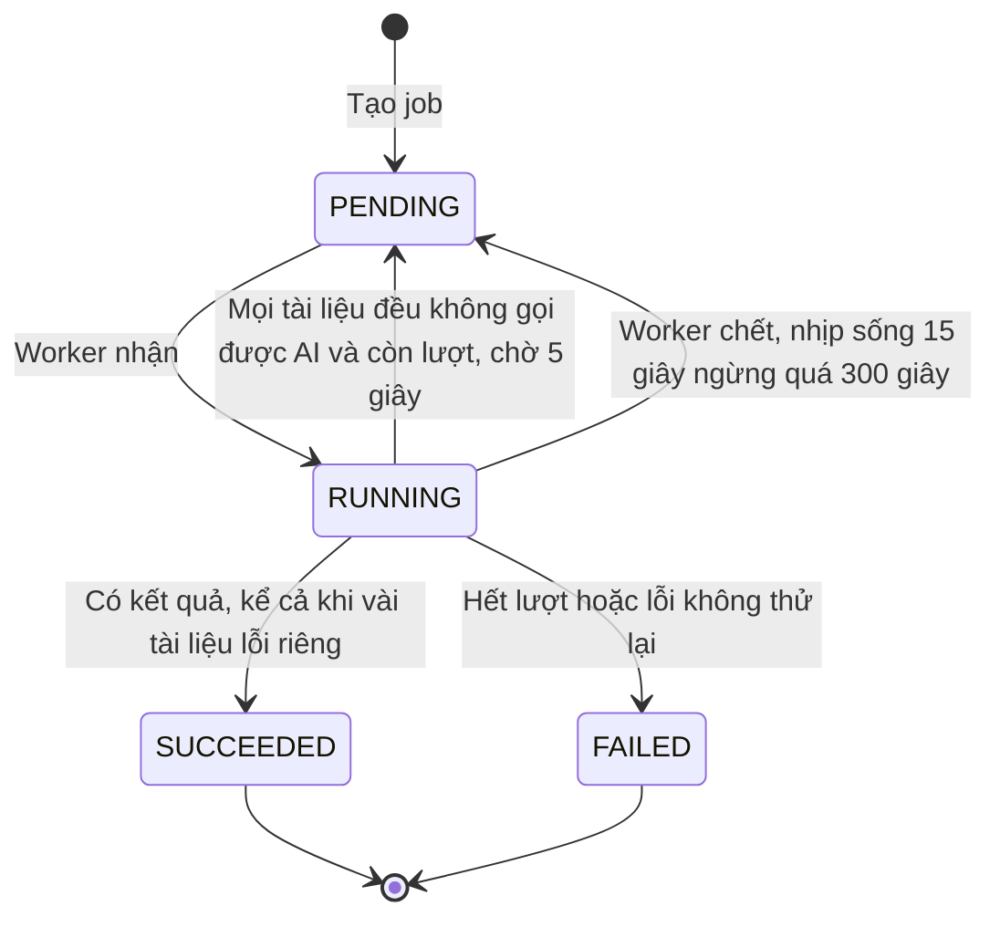
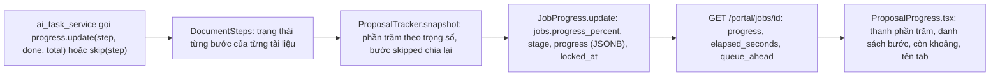
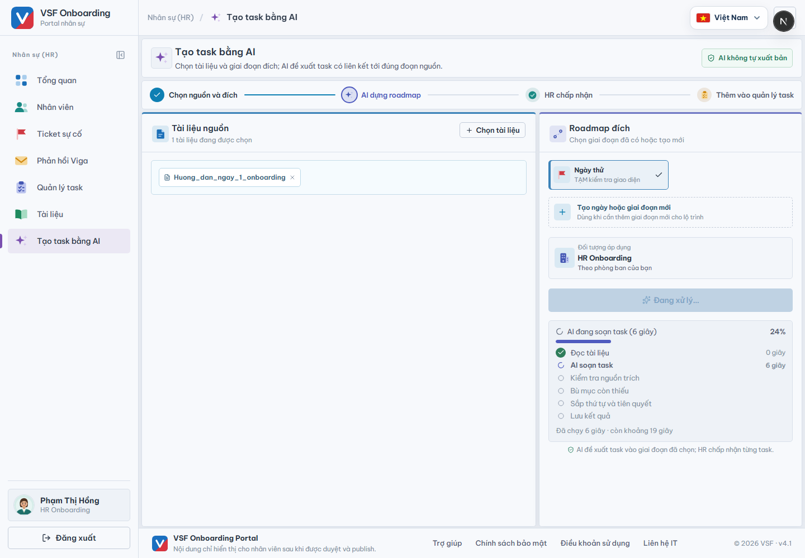
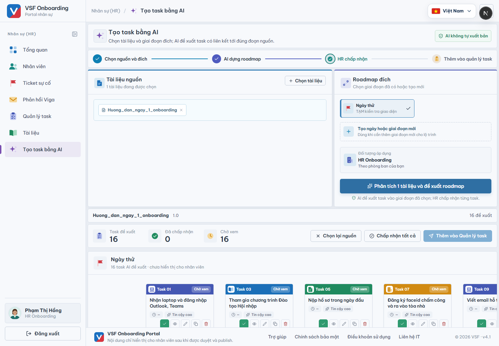

# Báo cáo tối ưu độ trễ "Tạo task bằng AI": đã sửa gì, hàm nào, luồng chạy ra sao, kết quả đo (03/10/2026)

> **Trạng thái: đã làm xong phần cốt lõi của [kế hoạch](ke-hoach-toi-uu-tao-task-bang-ai.md) (P1, P2, một phần mục 13 và 14), đã kiểm thử và đo thật.** Nhánh `feat/ai-task-latency`, chưa push. Mọi con số trong báo cáo được sinh từ file kết quả thô trong [thu-nghiem/](thu-nghiem/) bằng [tong_hop_bang.py](thu-nghiem/tong_hop_bang.py), không gõ tay. Các mục chưa làm và giới hạn của phép đo nằm ở **mục 10**, đọc trước khi tin kết luận.

## 1. Kết luận

| Câu hỏi | Trả lời |
|---|---|
| Độ trễ đã tối ưu chưa? | **Rồi, nhanh hơn khoảng 9 lần.** Trung vị cả bộ đo: **126,8 giây xuống 14,5 giây** (đường cũ 8 lượt, đường nhanh 26 lượt, cùng mô hình DeepSeek, cùng máy). Chậm nhất của đường nhanh là 15,7 giây, nhanh nhất của đường cũ là 91,7 giây. Tài liệu "Hướng dẫn ngày 1" (16 mục): **145,0 giây xuống 14,4 giây**. |
| Vì sao nhanh? | Tắt bước suy luận ẩn của mô hình (đường cũ sinh trung bình 30.000 token suy luận mỗi lượt mà người dùng không thấy, đường nhanh là 0), thêm `temperature = 0`, và để mô hình **chỉ số dòng** khi trích nguồn thay vì chép nguyên văn. Token sinh ra giảm từ khoảng 39.000 xuống khoảng 4.400. |
| Chi phí | Khoảng **0,0065 USD mỗi lượt** thay vì khoảng 0,0486 USD (ước tính theo đơn giá cấu hình 0,30 vào và 1,20 ra mỗi triệu token, không phải hóa đơn thật). |
| Ba người bấm cùng lúc có chậm đi không? | Không: 3 lượt song song đều **14,5 đến 14,7 giây**, chờ chỗ 0 ms, đỉnh 3 lời gọi cùng lúc (giới hạn là 9). |
| Chất lượng có giữ được không? | **Các chỉ số tự động đạt** (quote khớp bản gốc 26/26, tiên quyết chỉ trỏ về task đứng trước 26/26, việc "cuối ngày" xếp cuối 26/26, không trùng tên, chi tiết thật giữ được 15/15 ở mọi lượt trên tài liệu có đáp án). Đọc thử bằng mắt thì nội dung tương đương và đầy đủ hơn ở tài liệu dài. **Nhưng chưa có so sánh mù do người đọc**, nên chưa thể khẳng định "không kém đi" ở mức con người (mục 7 và 10). |
| Có phát hiện lỗi nào không? | Có, **bốn điều tìm ra nhờ chính phép đo** và đã xử lý: lỗi quote đã làm sạch không khớp lại khi HR tạo task (có sẵn ở đường cũ), việc "cuối ngày" không được ép xếp cuối ở đường nhanh, kết quả dao động mạnh khi nhiệt độ mặc định, và đồng hồ DB dev nhảy lệch 101 giây. Chi tiết ở mục 8. |
| Quay lại được không? | Được: đặt `TASK_PROPOSAL_MODE=legacy` rồi khởi động lại backend là về đường cũ (không cần migration ngược). |

Biểu đồ thời gian của một tài liệu 16 mục (1 ký tự = 5 giây, số trung vị đo thật):

```text
Cũ    (145,0 giây): █████████████████████████████  (85% token sinh ra là suy luận ẩn người dùng không thấy)
Nhanh  (14,4 giây): ███
                    └ chờ chữ đầu 1,2 giây · viết JSON 11 giây · xếp thứ tự 1,3 giây
```

## 2. Đã làm gì so với kế hoạch

| Hạng mục (mục trong kế hoạch) | Trạng thái | Ghi chú |
|---|---|---|
| Tắt suy luận cho việc soạn task (8, P1) | **Xong** | tham số `reasoning=False` gửi `"thinking": {"type": "disabled"}` |
| Trích nguồn bằng số dòng, backend dựng quote (7.1, P1) | **Xong** | quote dựng ra vẫn kiểm bằng `quote_matches`, kể cả dạng hiển thị |
| Mục "chỉ là thông tin" không bị hỏi lại (`skipped_sections`) (8.2) | **Xong** | thêm: danh sách mục bị bỏ qua được **trả về cho HR xem**, không bỏ âm thầm |
| Bù phủ tối đa một lượt (8.2) | **Xong** | nhóm 4 mục, chạy song song |
| Lời gọi nhỏ xếp thứ tự và tiên quyết, có kiểm và dự phòng (8.2) | **Xong** | kiểm hoán vị, ép "cuối ngày", tiên quyết chỉ trỏ về trước, tối đa 3 |
| Chia lô theo ngân sách từ, chạy song song (8.2) | **Xong, chưa đo trên tài liệu lớn** | viết và có test đơn vị; 3 tài liệu thử đều dưới 2.500 từ nên luôn một lô |
| Giới hạn đồng thời toàn tiến trình, riêng nền (8.4) | **Xong** | `LlmGate`: tổng 9, nền 5 |
| Thử lại 429, 5xx, mất kết nối, hết giờ (nền) (9) | **Xong** | tối đa 2 lần, nghỉ 1 giây rồi 3 giây, nhả chỗ trong lúc nghỉ |
| Giờ chờ mỗi lời gọi 60 giây, giờ "im lặng" 30 giây, kiểm `finish_reason` (8.4, 14) | **Xong** | |
| Job thử lại một lần khi AI tạm thời không phản hồi (`max_attempts=2`) (9) | **Xong** | chỉ khi mọi tài liệu đều lỗi AI |
| Nhịp sống job tách khỏi tiến độ (13.8) | **Xong** | mỗi 15 giây |
| Tài liệu chạy song song trong một job (8.2) | **Xong** | |
| Tiến độ theo bước thật, công thức trọng số (13) | **Xong** | `ProposalTracker`, `jobs.progress` (JSONB) |
| Giao diện: danh sách bước, còn khoảng bao lâu, hàng đợi, tên tab, "đang tạo task n/tổng" (13.6) | **Xong** | `ProposalProgress.tsx` |
| Nối lại khi tải lại trang (13.7) | **Xong** (khi job còn chạy) | nếu job đã xong lúc vắng mặt thì chưa mở lại được kết quả (P3) |
| Số đo từng pha của lời gọi vào `llm_calls` (14.3) | **Xong** | 9 cột mới, migration 0010 |
| Cổng chất lượng tự động (14.5) | **Một phần** | có 3 tài liệu thử và các chỉ số tự động; **chưa** bộ 30 tài liệu, **chưa** so sánh mù |
| Cài `langfuse` vào image, trace ngoài (14.3) | **Chưa** | số đo từng pha đã nằm trong `llm_calls` nên chưa cần gấp |
| Màn Admin vẽ thác nước từng pha (14.3) | **Chưa** | dữ liệu đã có trong `llm_calls` |
| P3: lưu kết quả đề xuất để mở lại, tạo task hàng loạt một request (10.1) | **Chưa** | |
| `temperature = 0` (ngoài kế hoạch) | **Xong** | thêm sau khi đo thấy kết quả dao động (mục 8.3) |

## 3. Luồng chạy sau khi sửa

### 3.1 Từ lúc HR bấm "Phân tích" đến lúc có roadmap



Khác luồng cũ ở các điểm chính: (1) một lời gọi dài với suy luận bật được thay bằng lời gọi ngắn tắt suy luận, có stream nên đo được từng pha; (2) nguồn trích là số dòng, backend dựng quote và kiểm hai lần; (3) bù phủ chỉ chạy khi thật sự còn mục có chữ mà AI không báo là thông tin; (4) thứ tự và tiên quyết do một lời gọi nhỏ quyết rồi **mã kiểm lại**; (5) các tài liệu của một job chạy song song; (6) thanh tiến độ bám bước thật, không còn đường cong giả; (7) nhịp sống và tiến độ tách rời nhau.

### 3.2 Bên trong một tài liệu (`propose_tasks_detailed` rẽ sang `_propose_fast`)



### 3.3 Bên trong một lời gọi LLM (`DeepSeekChatCompletion.complete_json`)



### 3.4 Vòng đời của job (có thêm nhánh thử lại do AI tạm thời không phản hồi)



### 3.5 Đường đi của con số phần trăm



## 4. Đã sửa gì, ở file nào, hàm nào

### 4.1 Backend (`backend/src/`)

| File | Hàm hoặc lớp | Làm gì |
|---|---|---|
| `infrastructure/ai/deepseek_adapter.py` | `DeepSeekChatCompletion.complete_json(reasoning, stream, temperature)` | Vòng lặp: xin chỗ ở `LlmGate`, gọi, ghi `llm_calls`, thử lại hoặc báo lỗi. Mặc định giữ hành vi cũ (Viga không đổi). |
| | `_complete_stream` | Đọc SSE từng đoạn: ghi thời điểm byte đầu, chữ đầu, pha suy luận, pha viết, token vào, ra, suy luận, cache; kiểm `finish_reason`; giờ "im lặng" 30 giây; tổng giờ bằng `asyncio.timeout`. |
| | `_complete_plain`, `_body`, `_check_status`, `_should_retry`, `_emit`, `_read_usage` | Gọi không stream, dựng thân yêu cầu (`thinking`, `stream_options`, `temperature`), phân loại lỗi (`auth`, `rate_limited`, `http_error`, `timeout`, `network`, `truncated`, `bad_response`), quyết định thử lại, ghi số đo. |
| | `ChatCompletionError(code, retryable)` | Lỗi có mã ngắn để thống kê và cờ cho phép thử lại. |
| `infrastructure/ai/llm_gate.py` (mới) | `LlmGate.slot`, `shared_gate`, `reset_shared_gate` | Hai tầng semaphore (tổng 9, nền 5), trả số mili-giây đã chờ chỗ. Việc nền lấy chỗ nền trước rồi mới lấy chỗ chung nên hàng đợi nền không giữ chỗ của Viga. |
| `infrastructure/ai/chat_completion_port.py`, `fake_chat_completion.py` | `complete_json` | Thêm `reasoning`, `stream`, `temperature` (mặc định như cũ). |
| `infrastructure/observability/call_metrics.py` | `CallRecord`, `current_job_id` | Thêm 9 trường đo pha; `current_job_id()` để biết lời gọi thuộc việc nền. |
| `model/llm_call.py`, `services/portal/metrics_service.py` (`DbCallSink._write`) | cột mới | `first_byte_ms`, `first_token_ms`, `reasoning_ms`, `content_ms`, `reasoning_tokens`, `cached_input_tokens`, `finish_reason`, `attempt`, `queue_wait_ms`. |
| `model/job.py`, `alembic/versions/0010_llm_phase_metrics_job_progress.py` (mới) | cột `jobs.progress` (JSONB) và 9 cột trên | Chỉ thêm cột, có `downgrade`. Đã chạy trên DB dev (0009 lên 0010) và DB test. |
| `config.py` | 6 cài đặt | `llm_max_concurrent=9`, `llm_background_max_concurrent=5`, `llm_max_retries=2`, `task_proposal_mode=fast`, `task_proposal_batch_words=2500`, `task_proposal_call_timeout_seconds=60`. |
| `api/dependencies.py` | `get_chat_completion_port` | Truyền `max_retries` và bộ giới hạn dùng chung. |
| `services/portal/proposal_options.py` (mới) | `ProposalOptions`, `ProposalProgress`, `NullProgress`, `STEP_*`, `STEP_WEIGHTS` | Tùy chọn đường chạy và giao diện báo tiến độ (tách riêng để tránh import vòng). |
| `services/portal/ai_task_service.py` | `_propose_fast` | Điều phối: chia lô, soạn song song, kiểm nguồn, bù phủ một lượt, xếp thứ tự, đếm giây từng bước. |
| | `_numbered_prompt`, `_lines_of` | Đánh số dòng: L0 là tiêu đề, L1 trở đi là dòng nội dung không rỗng. |
| | `_quote_from_lines`, `_number` | Dựng quote từ `from_line` và `to_line` (đọc được cả `3` lẫn `L3`, tự đổi chỗ nếu ngược, cắt về dòng cuối, tối đa 600 ký tự theo ranh giới dòng) rồi kiểm `quote_matches`. |
| | `_parse_fast` | Đọc JSON, dựng nguồn, kiểm quote **hiển thị** (đã làm sạch) khớp lại bản gốc, suy ra `confidence` (không có bước là LOW, có ghi chú thiếu chi tiết là MEDIUM), thu `skipped_sections`. |
| | `_split_batches`, `_run_batches` | Chia lô theo ngân sách từ; chạy song song; lô hỏng được trả về chứ không làm mất lô khác (mục của lô hỏng đi vào bù phủ). |
| | `_order_drafts`, `_apply_order`, `_document_order` | Gọi xếp thứ tự; kiểm hoán vị 1 đến n; **ép việc "cuối ngày" ra sau cùng bằng mã**; chỉ giữ tiên quyết trỏ về task đứng trước (tối đa 3); lỗi thì dùng thứ tự tài liệu và không có tiên quyết. |
| | `ProposalResult` (thêm `order_source`, `timings`, `skipped_info`, `batches`) | Số liệu lượt chạy, không chứa nội dung. |
| | `propose_tasks_detailed` | Nay là bộ rẽ nhánh `fast` hoặc `legacy` và báo bước đọc; đường cũ chuyển nguyên vẹn thành `_propose_legacy`. |
| | `enqueue_proposal_job` | `max_attempts` từ 1 lên 2. |
| `services/portal/proposal_progress.py` (mới) | `DocumentSteps`, `ProposalTracker` (`snapshot`, `flush`, `run_ticker`, `saving`, `saved`) | Gom nhiều tài liệu thành một thanh và danh sách bước; ghi `elapsed_seconds` bằng đồng hồ đơn điệu của worker. |
| `services/portal/job_handlers.py` | `run_ai_task_proposal`, `_propose_for_document`, `_document_title` | Chạy các tài liệu song song, nuôi tracker, lưu `metrics` và `skipped_info_sections` vào kết quả, thử lại cả job một lần khi mọi tài liệu đều lỗi AI. Xóa `_tick_progress` (đường cong giả). |
| `services/portal/job_service.py` | `JobContext.proposal`, `JobProgress.update(steps=...)`, `_heartbeat`, `queue_ahead`, `_run_claimed_job` | Tùy chọn đề xuất đi theo job; ghi tiến độ có cấu trúc; nhịp sống 15 giây tách khỏi tiến độ; đếm việc xếp trước. |
| `api/routers/portal_document_router.py`, `dto/response/portal_response_dto.py` | `job_dto`, `_job_with_extras`, `JobResponseDTO` | Thêm `progress`, `started_at`, `elapsed_seconds`, `queue_ahead` (tương thích ngược). |
| `api/routers/portal_router.py`, `main.py` | điểm cuối đồng bộ, dựng `JobContext` | Truyền `ProposalOptions` theo cài đặt. |
| `services/text_match.py` | `normalize_for_match` (`_LONE_DASH`) | Sửa lỗi quote đã làm sạch không khớp lại (mục 8.1). |

### 4.2 Frontend (`frontend/src/`)

| File | Làm gì |
|---|---|
| `features/portal-hr/ProposalProgress.tsx` và `.module.scss` (mới) | Thanh phần trăm, danh sách 6 bước (xong, đang chạy, chờ, không cần), số lô `1/3`, giây từng bước, "Đã chạy N giây · còn khoảng M giây" (`estimateRemainingSeconds`), "Trước bạn còn N việc đang chờ", phần trăm từng tài liệu khi chọn nhiều, tên tab `40% · Tạo task bằng AI`, thông báo mất kết nối nói rõ việc vẫn chạy nền, và "Đang tạo task n/tổng". |
| `features/portal-hr/AiTasksPage.tsx` | Dùng `ProposalProgress`; **tiếp tục theo dõi job đang chạy khi tải lại trang** (`listActiveJobs`); đếm `creating` khi tạo task; hiện mục AI bỏ qua vì chỉ là thông tin. |
| `features/portal-hr/dto/responseDTO/portal.response.ts`, `messages/vi.json`, `messages/en.json` | Kiểu mới (`JobStepDTO`, `JobProgressDetailDTO`, `skipped_info_sections`, `metrics`) và chuỗi giao diện hai ngôn ngữ; bỏ hai chuỗi không còn dùng. |

## 5. Cách hoạt động của các điểm khó

### 5.1 Trích nguồn bằng số dòng (ví dụ thật)

Mục "Chuẩn bị hồ sơ phải nộp trong ngày đầu" của tài liệu mẫu được đưa vào lời nhắc như sau (L0 là tiêu đề, mỗi dòng nội dung một số):

```text
--- section_id=3 ---
L0: Chuẩn bị hồ sơ phải nộp trong ngày đầu:
L1: * CV.
L2: * Lý lịch tư pháp, hoặc giấy hẹn lấy lý lịch tư pháp.
L3: * Giấy khám sức khỏe
...
L7: * Đầu mối liên hệ: Phòng tuyển dụng.
```

Mô hình trả (rút gọn): `"sources": [{"section_id": 3, "from_line": 0, "to_line": 7}]`. Backend ghép `L0` đến `L7`, làm sạch để hiển thị, rồi kiểm **hai lần** với chữ gốc của mục: một lần cho chuỗi vừa dựng, một lần cho chuỗi sẽ hiển thị và gửi lại khi HR bấm tạo task (xem 8.1). Không còn cảnh mô hình chép sai một chữ làm mất cả đề xuất, và vẫn không thể bịa nguồn vì chữ luôn lấy từ tài liệu.

### 5.2 Mục "chỉ là thông tin" và bù phủ

Mô hình trả thêm `skipped_sections` (mục nó coi là chỉ thông tin). Mục có chữ từ 40 ký tự mà chưa task nào trích **và** không nằm trong `skipped_sections` mới bị hỏi lại, đúng một lượt. Mục bị bỏ qua vẫn được **liệt kê cho HR** ("AI coi N mục là chỉ có thông tin nên không tạo task: ...") vì đo thật có lúc mô hình coi một mục có việc là thông tin (mục "Trường hợp riêng ticket không hỗ trợ" của tài liệu 16 mục, 1 trong 3 lượt song song ở đợt đo đầu).

### 5.3 Thứ tự và tiên quyết do ai quyết, và mã kiểm gì

Lời gọi nhỏ nhận danh sách đánh số (tên, tóm tắt, điều kiện nguyên văn) và trả `order` cùng `prerequisites`. Mã chấp nhận khi `order` là hoán vị đúng của 1 đến n. Sau đó **mã** đẩy mọi việc gắn với "cuối ngày" ra sau cùng (như đường cũ), rồi mới kiểm tiên quyết: chỉ giữ cái trỏ tới task có thật, khác chính nó, **đứng trước** trong thứ tự cuối, tối đa 3, nên không thể tạo vòng. Sai bất kỳ điều kiện nào ở `order` thì dùng thứ tự tài liệu (việc cuối ngày sau cùng) và không có tiên quyết; `metrics.order_source` ghi `ai`, `document` hoặc `single` (một task thì khỏi xếp).

### 5.4 Giới hạn đồng thời và thử lại

Nhà cung cấp chỉ cho 11 lời gọi cùng lúc cho cả tài khoản (đã đo ở kế hoạch), dùng chung cho Viga và việc nền. `LlmGate` giữ tổng 9 và việc nền 5. Thử lại: 429, 5xx, mất kết nối đều thử lại tối đa 2 lần; hết giờ chỉ thử lại với việc nền (người dùng Viga đã chờ đủ lâu). `401`, `403` và `finish_reason = length` không thử lại.

### 5.5 Phần trăm tiến độ

Mỗi tài liệu có 5 bước với trọng số `read` 5, `draft` 65, `verify` 5, `cover` 10, `order` 10 (cộng bước `save` 5 của cả job). Bước bị bỏ qua (không cần bù phủ, chỉ một task nên không cần xếp) thì trọng số của nó chia lại cho các bước còn lại. Bước đang chờ LLM tiến chậm dần theo thời gian thường gặp của bước đó (soạn 15 giây, bù phủ 8, xếp thứ tự 5) nhưng **chỉ tới 90% phần của bước đó**, không bao giờ chạm 100% trước khi bước thật xong. Phần trăm của job là trung bình của các tài liệu nhân 95 cộng bước lưu.

### 5.6 Job

`max_attempts=2`: nếu **mọi** tài liệu đều không gọi được AI và job còn lượt, job xếp lại sau 5 giây; lượt hai vẫn lỗi thì job vẫn SUCCEEDED và lỗi nằm ở dòng của từng tài liệu như trước. Nhịp sống `locked_at` được cập nhật mỗi 15 giây bởi một tác vụ riêng, nên một lời gọi chậm không bị coi là worker chết. `elapsed_seconds` do worker tự đo và ghi vào `jobs.progress`.

## 6. Kết quả đo

Điều kiện: DeepSeek `deepseek-flash` thật, cùng mã nguồn sản phẩm (`propose_tasks_detailed`) cho cả hai đường, máy dev ở Việt Nam. Đường cũ chạy song song 2 đến 3 lượt, đường nhanh chạy **lần lượt** để số đo sạch. Thời gian là cả tài liệu, từ lúc gọi đến lúc có danh sách đã xếp.

**Bảng 1. Tài liệu "Hướng dẫn ngày 1" (16 mục)**

| Cách chạy | Số lần | Giây (nhỏ nhất / giữa / lớn nhất) | Số task | Lần phủ đủ mọi mục | Chi tiết thật giữ được | Quote nguyên văn | Việc cuối ngày đứng sau | Tiên quyết | Lần có task thiếu bước | Token ra | USD mỗi lần |
|---|---|---|---|---|---|---|---|---|---|---|---|
| Cũ (legacy), suy luận bật | 3 | 135.3 / 145.0 / 168.0 | 14 / 14 / 15 | 1/3 | 15–15/15 | 3/3 | 3/3 | 9 / 9 / 11 | 3/3 | 37352 / 39357 / 48116 | 0.0461 / 0.0486 / 0.0587 |
| Nhanh (fast), chạy lần lượt | 10 | 13.5 / 14.4 / 15.2 | 16 / 16 / 17 | 10/10 | 15–15/15 | 10/10 | 10/10 | 2 / 2 / 15 | 0/10 | 4252 / 4433 / 4807 | 0.0062 / 0.0065 / 0.0070 |
| Nhanh, 3 người bấm cùng lúc | 3 | 14.5 / 14.6 / 14.7 | 16 / 16 / 16 | 3/3 | 15–15/15 | 3/3 | 3/3 | 2 / 2 / 9 | 0/3 | 4277 / 4341 / 4354 | 0.0062 / 0.0063 / 0.0063 |

**Bảng 2. Tài liệu "Các trường hợp ngoại lệ" (22 mục, phần lớn là hỏi đáp thông tin)**

| Cách chạy | Số lần | Giây (nhỏ nhất / giữa / lớn nhất) | Số task | Lần phủ đủ mọi mục | Chi tiết thật giữ được | Quote nguyên văn | Việc cuối ngày đứng sau | Tiên quyết | Lần có task thiếu bước | Token ra | USD mỗi lần |
|---|---|---|---|---|---|---|---|---|---|---|---|
| Cũ (legacy), suy luận bật | 2 | 98.4 / 108.3 / 118.3 | 14 / 14 / 14 | 0/2 | không áp dụng | 2/2 | 2/2 | 4 / 5 / 6 | 0/2 | 27828 / 30228 / 32628 | 0.0349 / 0.0378 / 0.0407 |
| Nhanh (fast), chạy lần lượt | 5 | 11.1 / 11.5 / 11.8 | 13 / 13 / 13 | 0/5 | không áp dụng | 5/5 | 5/5 | 6 / 6 / 9 | 0/5 | 3611 / 3678 / 3729 | 0.0056 / 0.0056 / 0.0057 |

Số mục bị coi là chỉ có thông tin, theo từng lần: nhanh 8, 8, 8, 8, 8; đường cũ báo "chưa có task" 7, 7.

**Bảng 3. File docx không tiêu đề "Hướng dẫn ngày 1" (687 từ, ingest suy ra 3 mục có tiêu đề)**

| Cách chạy | Số lần | Giây (nhỏ nhất / giữa / lớn nhất) | Số task | Lần phủ đủ mọi mục | Chi tiết thật giữ được | Quote nguyên văn | Việc cuối ngày đứng sau | Tiên quyết | Lần có task thiếu bước | Token ra | USD mỗi lần |
|---|---|---|---|---|---|---|---|---|---|---|---|
| Cũ (legacy), suy luận bật | 3 | 91.7 / 103.7 / 163.2 | 12 / 14 / 16 | 3/3 | không áp dụng | 3/3 | 3/3 | 3 / 5 / 5 | 1/3 | 27443 / 29500 / 44125 | 0.0342 / 0.0366 / 0.0542 |
| Nhanh (fast), chạy lần lượt | 8 | 13.6 / 14.8 / 15.7 | 16 / 20 / 20 | 8/8 | không áp dụng | 8/8 | 8/8 | 2 / 5 / 10 | 0/8 | 4261 / 4795 / 5043 | 0.0066 / 0.0072 / 0.0076 |

**Cách đọc:** "Lần phủ đủ mọi mục" đếm số lượt mà mọi mục có chữ đều có task; ở tài liệu 22 mục, phần lớn mục là hỏi đáp thông tin nên cả hai đường đều không phủ hết, khác nhau ở chỗ đường nhanh báo "AI coi N mục là thông tin" còn đường cũ báo "chưa có task". "Chi tiết thật giữ được" là 15 chi tiết (tầng 12, tầng 14, 80%, hai email, quick access...) tìm thấy trong chữ của các task.

**Bảng 4. Thời gian từng bước của đường nhanh (giây, nhỏ nhất / giữa / lớn nhất)**

| Tài liệu | Soạn (draft) | Xếp thứ tự (order) | Bù phủ (cover) | Tổng |
|---|---|---|---|---|
| Hướng dẫn ngày 1 | 12.4 / 12.9 / 13.9 | 1.0 / 1.3 / 1.7 | không lần nào cần | 13.5 / 14.4 / 15.2 |
| Các trường hợp ngoại lệ | 10.2 / 10.3 / 10.7 | 1.0 / 1.1 / 1.3 | không lần nào cần | 11.1 / 11.5 / 11.8 |
| docx không tiêu đề | 12.5 / 13.6 / 14.2 | 0.9 / 1.4 / 1.6 | không lần nào cần | 13.6 / 14.8 / 15.7 |

**Chạy thật end-to-end** (tải docx lên, kích hoạt, job nền, DeepSeek thật, đọc tiến độ qua API mỗi 0,5 giây như giao diện). `llm_calls` ghi đúng các pha:

**Bảng 5. Chạy thật end-to-end (API, job, DeepSeek thật, đọc tiến độ mỗi 0,5 giây)**

| Kịch bản | Job | Giây chạy (worker đo) | Mẫu tiến độ | Tài liệu | Số task | Mục bị bỏ qua (thông tin) | Nguồn thứ tự |
|---|---|---|---|---|---|---|---|
| mot-tai-lieu-1 | 978 | 14 | 30 | 1 | 16 | 0 | ai |
| mot-tai-lieu-2 | 979 | 14 | 31 | 1 | 19 | 0 | ai |
| mot-tai-lieu-3 | 980 | 16 | 33 | 1 | 21 | 0 | ai |
| hai-tai-lieu-song-song | 981 | 15 | 32 | 2 | 18 + 14 | 0 + 7 | ai, ai |

**Bảng 6. Các pha của từng lời gọi LLM trong `llm_calls` (mili-giây)**

| Lời gọi | Chờ chỗ | Byte đầu | Chữ đầu | Suy luận | Viết JSON | Tổng | Token vào (cache) | Token ra | Suy luận (token) | Kết thúc |
|---|---|---|---|---|---|---|---|---|---|---|
| #326 (soạn) | 0 | 765 | 1247 | 0 | 11836 | 13084 | 3792 (256) | 4351 | 0 | stop |
| #327 (xếp thứ tự) | 0 | 614 | 1000 | 0 | 414 | 1414 | 1201 (0) | 83 | 0 | stop |
| #328 (soạn) | 0 | 460 | 1087 | 0 | 12278 | 13365 | 3792 (3584) | 4568 | 0 | stop |
| #329 (xếp thứ tự) | 0 | 591 | 1219 | 0 | 276 | 1495 | 1340 (256) | 106 | 0 | stop |
| #330 (soạn) | 0 | 464 | 810 | 0 | 13836 | 14646 | 3792 (3584) | 5179 | 0 | stop |
| #331 (xếp thứ tự) | 0 | 441 | 1014 | 0 | 343 | 1357 | 1519 (128) | 69 | 0 | stop |
| #332 (soạn) | 0 | 610 | 1094 | 0 | 9028 | 10122 | 2848 (256) | 3517 | 0 | stop |
| #333 (xếp thứ tự) | 0 | 413 | 920 | 0 | 323 | 1243 | 1222 (256) | 59 | 0 | stop |
| #334 (soạn) | 0 | 519 | 1005 | 0 | 12479 | 13484 | 3792 (3584) | 4609 | 0 | stop |
| #335 (xếp thứ tự) | 0 | 506 | 1109 | 0 | 384 | 1492 | 1272 (512) | 59 | 0 | stop |

Mốc của thanh tiến độ trong một lượt thật (một tài liệu):

**Bảng 7. Mốc thời gian của thanh tiến độ (một tài liệu, đọc qua API)**

| Giây | Trạng thái | % | read | draft | verify | cover | order | save |
|---|---|---|---|---|---|---|---|---|
| 0.1 | RUNNING | 0 | pending | pending | pending | pending | pending | pending |
| 0.6 | RUNNING | 5 | done | running | pending | pending | pending | pending |
| 2.2 | RUNNING | 12 | done | running | pending | pending | pending | pending |
| 5.2 | RUNNING | 21 | done | running | pending | pending | pending | pending |
| 9.2 | RUNNING | 31 | done | running | pending | pending | pending | pending |
| 13.6 | RUNNING | 83 | done | done | done | skipped | running | pending |
| 14.8 | SUCCEEDED | 100 | done | done | done | skipped | done | done |

Tổng hợp mọi lượt đo cuối:

| Đường | Lượt chạy | Lỗi | Giây (nhỏ nhất / giữa / lớn nhất) | Quote nguyên văn | Tiên quyết chỉ trỏ về trước | Việc cuối ngày đứng sau | Tên task trùng | Phải dùng thứ tự dự phòng | Token suy luận | Lần thử lại | Tổng USD |
|---|---|---|---|---|---|---|---|---|---|---|---|
| Cũ (legacy) | 8 | 0 | 91.7 / 126.8 / 168.0 | 8/8 | 8/8 | 8/8 | 0 | 0 | 243919 | 0 | 0.354 |
| Nhanh (fast) | 26 | 0 | 11.1 / 14.5 / 15.7 | 26/26 | 26/26 | 26/26 | 0 | 0 | 0 | 0 | 0.170 |

**Đọc số đo từng pha:** chờ byte đầu 0,4 đến 1,0 giây, chữ đầu 0,8 đến 1,3 giây, pha suy luận **0 mili-giây** (đã tắt), phần còn lại là sinh JSON (khoảng 370 token mỗi giây). Lời gọi xếp thứ tự chỉ 1,2 đến 1,5 giây. Muốn nhanh hơn nữa thì đòn bẩy là giảm token ra (mỗi task đang sinh 7 trường), không còn là suy luận.

Giao diện thật (chụp bằng Chrome headless trên dev server của anh, tài liệu "Hướng dẫn ngày 1", từ lúc bấm đến lúc có 16 đề xuất mất 15 giây):





## 7. Chất lượng: những gì đã kiểm và những gì chưa

**Cổng tự động (đạt):** quote khớp bản gốc, tiên quyết chỉ về trước, việc cuối ngày xếp sau, không trùng tên, không lỗi, không phải dùng thứ tự dự phòng ở 26 lượt cuối (xem bảng tổng hợp). Chi tiết thật giữ được 15/15 ở mọi lượt của tài liệu có đáp án.

**Đọc thử bằng mắt của tôi (không thay thế người chấm mù):** trên cùng tài liệu 16 mục, hai đường đều giữ đủ liên kết, tầng, email, hạn chót. Đường nhanh tách thêm các việc đường cũ gộp hoặc bỏ sót (ví dụ "Nghe nội quy", "Cập nhật ảnh đại diện và chữ ký slide"). Trên file docx dài, đường cũ gộp "Xử lý các trường hợp ticket ITHD không hỗ trợ" và "Yêu cầu ZTNA" thành hai task, đường nhanh (nhiệt độ 0) cho 20 task ở 6 trên 8 lượt (hai lượt còn lại 18 và 16), tách thêm "Điền form VINSOC SECURITY REQUEST", "Xin phê duyệt qua Team cho máy đã có Ubuntu", "Xử lý trường hợp máy windowns". Câu chữ của hai đường tương đương (đường nhanh tóm tắt ngắn hơn).

**Điểm yếu còn lại, nói thẳng:**

1. **Tiên quyết dao động nhiều** giữa các lần chạy cùng một tài liệu (ví dụ "Hướng dẫn ngày 1": 2 đến 15 quan hệ; docx: 2 đến 10). Mã bảo đảm không tạo vòng và không trỏ sai, nhưng **mức đầy đủ của tiên quyết chưa ổn định**. Đường cũ cũng không cố định (9 đến 11) nhưng ít dao động hơn.
2. **Thứ tự do AI quyết** chưa được chấm bởi người: ví dụ ở một lượt đo docx, hai việc faceid (đứng sớm trong tài liệu) bị xếp gần cuối. Mã chỉ bảo đảm hoán vị hợp lệ và việc cuối ngày, không bảo đảm "hợp lý".
3. **Mức tách task thay đổi:** đường nhanh cho 16 đến 20 task ở file docx, đường cũ 12 đến 16. Nhiều hơn không đồng nghĩa tốt hơn; cần người đọc xem có bị tách vụn không.
4. **Mục bị bỏ qua vì "chỉ là thông tin"** dựa vào phán đoán của mô hình; đã có cơ chế hiển thị cho HR nhưng vẫn là phán đoán.
5. Với các mục nguồn ghi "[CHƯA CÓ QUY ĐỊNH]", đợt đo đầu cho thấy đường nhanh để trống các bước (độ tin cậy LOW, có cảnh báo) trong khi đường cũ viết một bước; ở đợt đo cuối không còn lượt nào thiếu bước, nhưng đây là hành vi mô hình, không phải bảo đảm.

## 8. Bốn điều tìm ra nhờ chính phép đo, và cách xử lý

### 8.1 Quote đã làm sạch không khớp lại khi HR bấm "Thêm vào Quản lý task" (có sẵn từ đường cũ)

Khi chạy file docx, chỉ số "quote nguyên văn" của **cả hai đường** là sai. Tìm ra: `tidy_quote` gộp nhiều dòng thành một nên dấu `-` và `+` đầu dòng nằm lại giữa câu (`- CV. - Lý lịch ...`), còn bản gốc xuống dòng sau mỗi dấu, mà `normalize_for_match` chỉ bỏ dấu đầu dòng. Hệ quả thật: bước kiểm lại ở `create_task_from_proposal` trả **422 INVALID_SOURCE_CHUNK** và giao diện dừng tạo task. Tài liệu mẫu trước đây dùng dấu `*` nên chưa ai gặp. Sửa ở `text_match.py` (`_LONE_DASH`), thêm kiểm quote hiển thị ngay lúc đề xuất, có test hồi quy (mọi dải dòng của một mục thật đều khớp lại sau khi làm sạch; tắt bản sửa thì test bắt được lỗi).

### 8.2 Việc "cuối ngày" không còn được đảm bảo ở đường nhanh

Bộ chỉ số tổng hợp ở đợt đo đầu cho thấy 18 trong 31 lượt của đường nhanh có task cuối cùng không phải việc "cuối ngày" (đường cũ: 8 trên 8, vì **mã** ép). Đường nhanh chỉ nhờ lời nhắc. Sửa: `_apply_order` ép bằng mã trước khi kiểm tiên quyết; có test (tiên quyết trỏ tới việc bị đẩy ra sau tự bị loại). Sau sửa: 26/26 lượt đúng.

### 8.3 Kết quả dao động mạnh khi để nhiệt độ mặc định

Cùng một file docx, 8 lần chạy cho số task từ 12 đến 29. Đo thêm nhiệt độ ([thu_nhiet_do.py](thu-nghiem/thu_nhiet_do.py), [ket-qua-13-nhiet-do.json](thu-nghiem/ket-qua-13-nhiet-do.json)): `temperature = 0` thu hẹp xuống 12 đến 14 (docx) và từ 13 đến 16 xuống 16 đến 17 (tài liệu 16 mục), thời gian trung vị 14,5 giây xuống 14,8 giây ở tài liệu 16 mục, còn ở lượt thử trên file docx là 13,3 giây lên 17,8 giây (kết quả dài hơn đôi chút, đổi lại số task ổn định). Đã đưa vào đường nhanh (`FAST_TEMPERATURE`).

### 8.4 Đồng hồ máy ảo của DB dev nhảy lệch 101 giây

Cột "số giây đã chạy" ban đầu tính từ dấu thời gian DB và cho kết quả 0 hoặc 103 giây thất thường. Đo trực tiếp: `clock_timestamp()` của PostgreSQL trong Docker Desktop **luân phiên lệch −101 giây và 0 giây** so với máy chủ giữa các lần đọc. Đây là lỗi môi trường dev, nhưng làm bài học: `elapsed_seconds` nay do worker đo bằng đồng hồ đơn điệu và ghi vào `jobs.progress`. (Ghi chú: phát hiện việc phát hiện job treo `requeue_stale_jobs` từ trước đã trộn giờ tiến trình và giờ DB; ngưỡng 300 giây vẫn dư so với độ lệch 101 giây nên chưa sửa, nhưng nên chuẩn hóa về sau.)

## 9. Kiểm thử đã chạy

| Kiểm | Kết quả |
|---|---|
| `ruff check`, `ruff format`, `mypy src` | sạch (142 file nguồn) |
| `alembic upgrade head` trên DB dev và DB test, `alembic check` | lên 0010, không còn khác biệt model |
| `pytest tests` (cần PostgreSQL thật) | **471 passed, 1 skipped** (bài chạy thật LLM chỉ chạy khi đặt `VSF_REAL_LLM=1`) |
| `vitest run` | **27 file, 272 test passed**; `tsc --noEmit` và `eslint --max-warnings=0` sạch |
| Chạy thật end-to-end | `tests/integration/test_portal_ai_task_real_llm.py` (đặt `VSF_REAL_LLM=1`): tải docx thật, kích hoạt, chạy job với DeepSeek thật, đọc tiến độ qua API, kiểm `llm_calls`; kết quả ở [ket-qua-11-job-that-tren-db.json](thu-nghiem/ket-qua-11-job-that-tren-db.json) |
| Giao diện thật | Chrome headless điều khiển qua CDP trên dev server của anh: bấm "Phân tích", đọc bước và phần trăm mỗi 0,5 giây, chụp màn hình, xác nhận tên tab đổi theo phần trăm |

Test mới: `test_ai_task_fast.py` (23: dựng quote từ số dòng, nguồn sai bị loại, mục thông tin, bù phủ một lượt, thứ tự và tiên quyết hợp lệ và hỏng, ép cuối ngày, chia lô song song, lô hỏng được bù phủ, mọi lô hỏng báo lỗi thật, tiến độ theo bước, hồi quy quote), `test_llm_adapter_stream_and_gate.py` (9: stream nối đúng, tắt suy luận, mặc định giữ hành vi cũ, `length` không trả nửa chừng, thử lại 429, giới hạn thử lại, hết giờ chỉ thử lại với việc nền, giới hạn đồng thời, hàng đợi nền không giữ chỗ của Viga), `test_proposal_progress.py` (7), `test_text_match.py` (thêm 3), bài kiểm job nhanh qua API (tiến độ, chỉ số, quote, hàng đợi), `proposal-progress.test.tsx` (11). Các test cũ của đường cũ được ghim `mode="legacy"` để vẫn bảo vệ đường quay lại.

## 10. Giới hạn của báo cáo và việc chưa làm

1. **Chưa có so sánh mù do người đọc** và chưa có bộ 30 tài liệu: chất lượng chỉ được chấm bằng chỉ số tự động trên **3 tài liệu mẫu** cộng đọc thử của tôi. Kết luận "chất lượng giữ được" vì vậy là **chưa bị bác bỏ**, chưa phải đã được xác nhận.
2. Cỡ mẫu nhỏ: đường cũ 8 lượt (tốn 2 đến 3 phút mỗi lượt), đường nhanh 26 lượt, e2e 4 job. Khoảng dao động nêu trong bảng là của các mẫu này. Ba đợt đo đường cũ chạy cùng lúc nhau (tối đa 8 lời gọi song song, dưới giới hạn 11) nên thời gian đường cũ có thể cao hơn một chút so với chạy riêng.
3. **Chia lô song song chưa được đo trên tài liệu lớn** (mọi tài liệu thử dưới 2.500 từ nên chỉ một lô); chỉ có test đơn vị. Ngân sách tổng vẫn 6.000 từ.
4. **Tải nhiều người dùng** mới thử 3 lượt đồng thời (đỉnh 3, chờ chỗ 0); chưa thử tải chạm giới hạn 9.
5. Số "còn khoảng N giây" **thô**: bước soạn chiếm gần hết thời gian nhưng chỉ báo tiến độ khi xong, nên ước lượng lệch (ảnh chụp: báo 19 giây còn lại khi thực tế còn khoảng 9).
6. Chưa làm: P3 (lưu kết quả, tạo task hàng loạt), màn Admin vẽ thác nước từng pha (dữ liệu đã có), cài `langfuse` vào image, nối lại khi job đã xong lúc HR vắng mặt.
7. Chưa chạy thử trên môi trường triển khai thật (Vercel, EC2); không đổi gì ở `docker-compose`, `Dockerfile`, deploy.
8. Đã phát hiện nhưng chưa sửa: phát hiện job treo trộn giờ tiến trình và giờ DB (xem 8.4).

## 11. Vận hành và chạy lại

* **Đang chạy trên máy dev của anh:** backend đã được dựng lại (`docker compose build backend migrate` rồi `up -d`), DB dev ở bản 0010, **dữ liệu của anh còn nguyên** (3 tài liệu, 15 task). Khi kiểm giao diện tôi đã tạo 1 job tạo-task (và các dòng `llm_calls` đi kèm) trên DB dev, và một lộ trình nháp tạm đã xóa lại ngay; không tạo task nào.
* **Quay lại đường cũ:** đặt `TASK_PROPOSAL_MODE=legacy` trong `.env` rồi `docker compose up -d`. Điều chỉnh khác: `LLM_MAX_CONCURRENT`, `LLM_BACKGROUND_MAX_CONCURRENT`, `LLM_MAX_RETRIES`, `TASK_PROPOSAL_BATCH_WORDS`, `TASK_PROPOSAL_CALL_TIMEOUT_SECONDS`.
* **Chạy lại phép đo** (cần khóa LLM trong `.env` gốc, tốn khoảng 0,3 USD cho cả bộ):

```text
cd backend
python ../docs/chatbot-vsf/plan/plan-portal/Ai-task/thu-nghiem/do_tren_ma_nguon.py <ngay1|ngoai-le|docx-ngay1> <legacy|fast> <số lần> <song song> <tên-file>
python ../docs/chatbot-vsf/plan/plan-portal/Ai-task/thu-nghiem/tong_hop_bang.py > bang.md
VSF_REAL_LLM=1 pytest tests/integration/test_portal_ai_task_real_llm.py   # cần VSF_TEST_DATABASE_URL
```

## 12. Phụ lục: file kết quả thô

| File | Nội dung |
|---|---|
| `thu-nghiem/ket-qua-14-*` | Đường nhanh, mã cuối (tài liệu 16 mục, 22 mục, docx; 3 người cùng lúc) kèm `-chi-tiet.json` (nội dung các task để đọc thử) |
| `thu-nghiem/ket-qua-15-*` | Đường cũ, cùng đợt đo |
| `thu-nghiem/ket-qua-11-job-that-tren-db.json` | Chạy thật qua API và job: dòng thời gian tiến độ, `llm_calls` |
| `thu-nghiem/ket-qua-13-nhiet-do.json` | Thử nhiệt độ mặc định, 0 và 0,3 |
| `thu-nghiem/dot-do-truoc-khi-sua-loi/` | Các đợt đo trước khi sửa lỗi quote, thứ tự cuối ngày, nhiệt độ và cách nạp docx; giữ lại để truy vết, **không dùng** cho bảng ở trên |
| `thu-nghiem/ket-qua-01 đến 06`, `thu_nghiem_toi_uu.py` | Thí nghiệm của giai đoạn lập kế hoạch |
