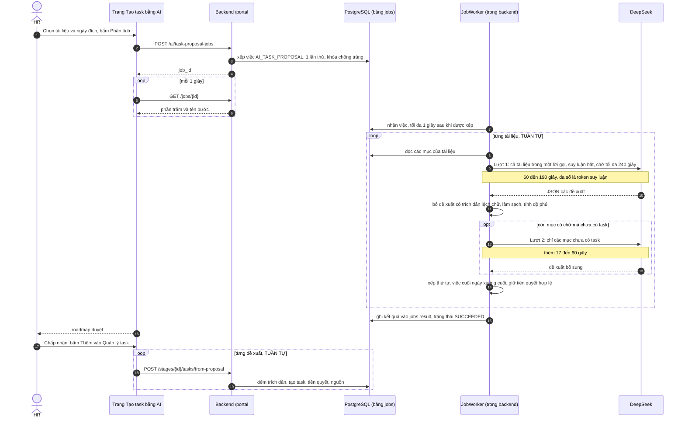
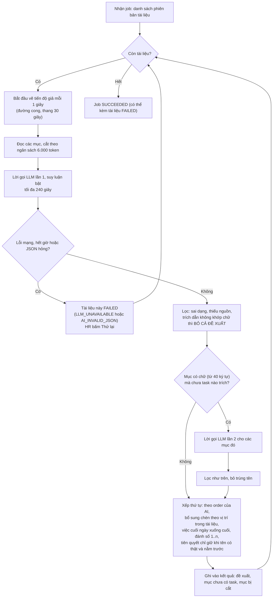
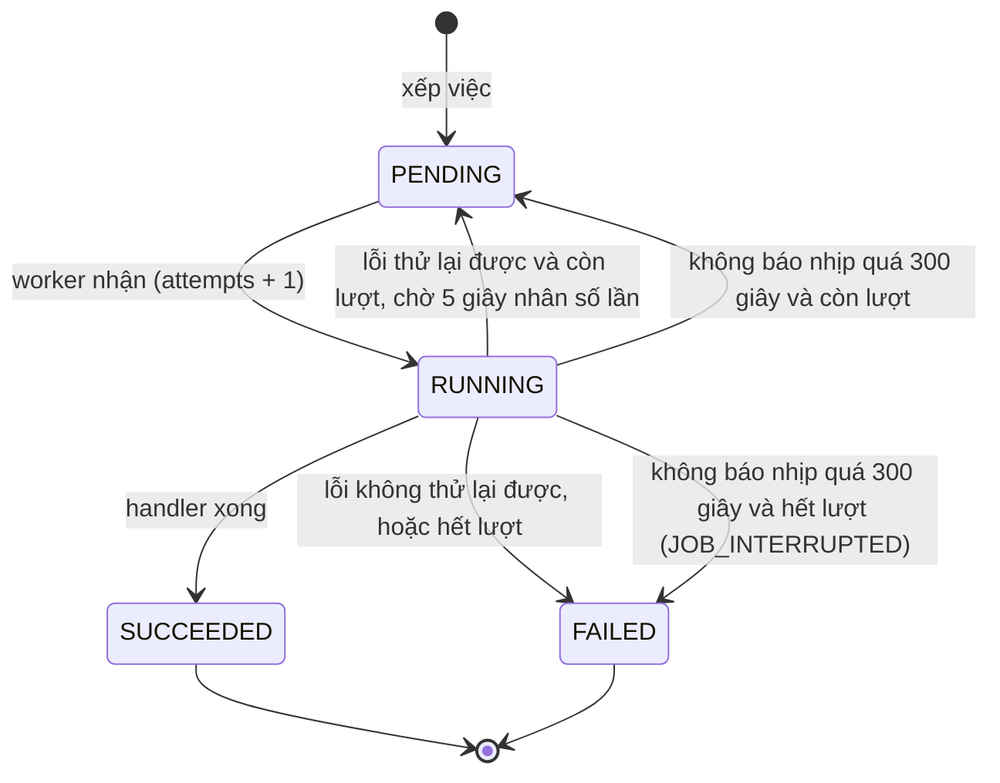
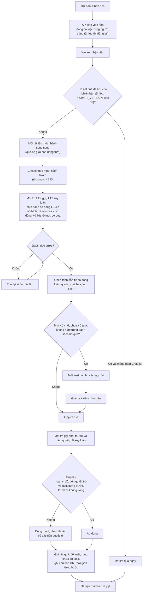
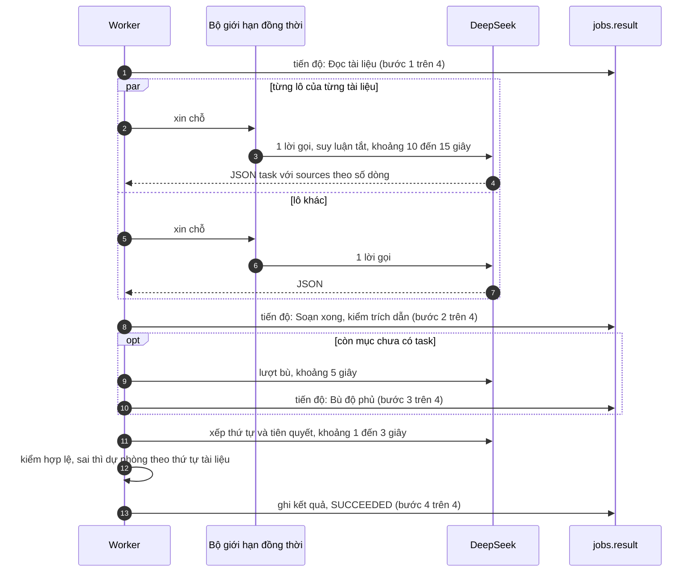
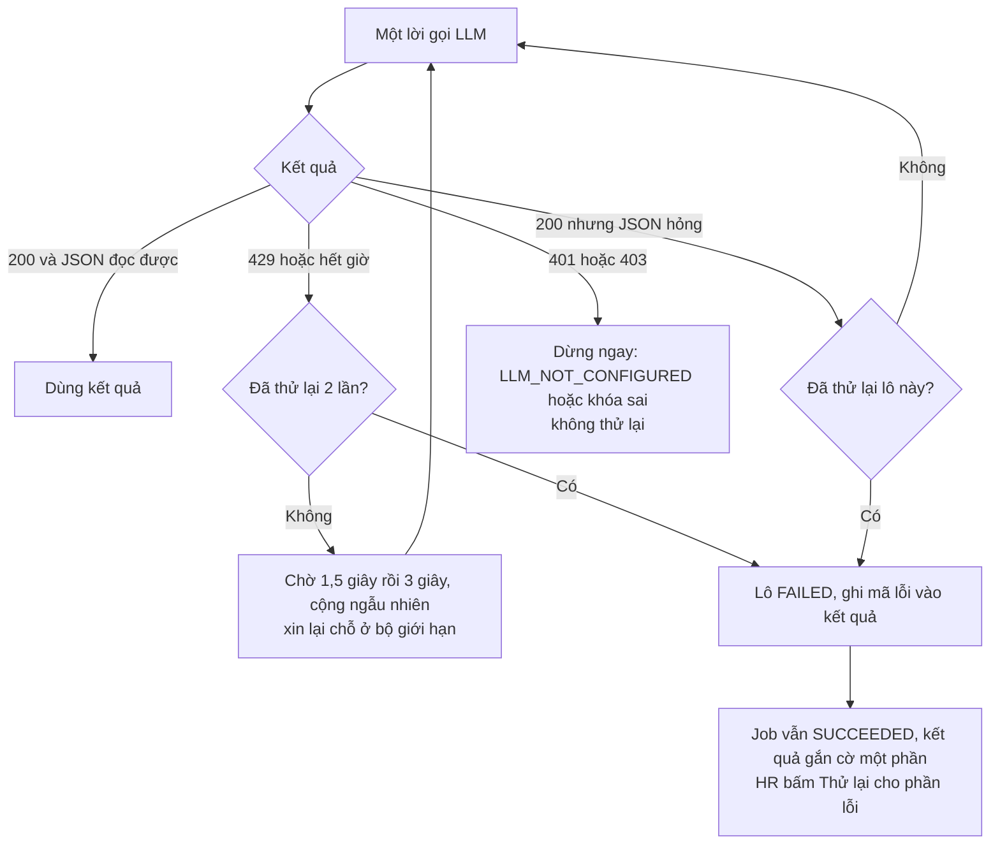
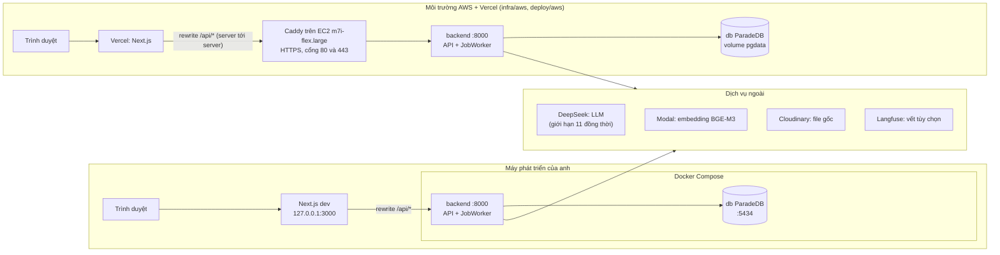
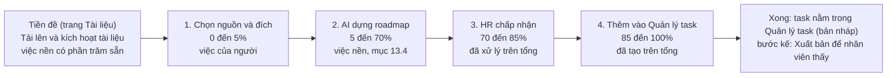
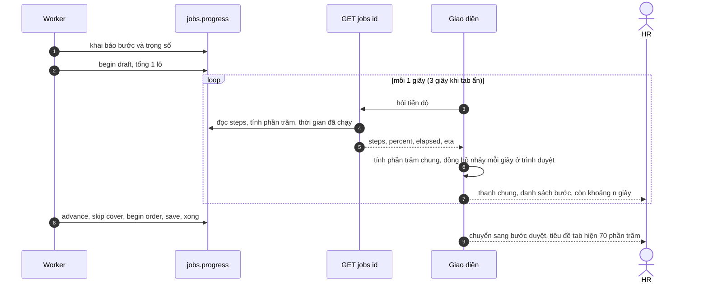
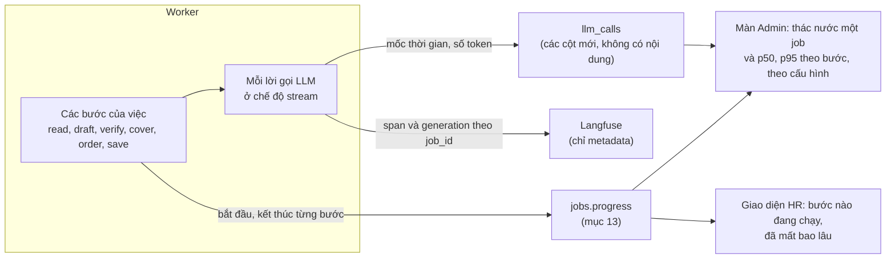

# Kế hoạch tối ưu "Tạo task bằng AI": công nghệ, luồng, mã nguồn, vì sao chậm và cách làm nhanh (03/10/2026)

> **Chỉ là kế hoạch, chưa sửa mã sản phẩm.** Phần "đo" đã chạy thật: gọi LLM thật để đo, **không ghi vào DB**. Số liệu lấy từ hai nguồn: bảng `llm_calls` (bản sao lưu DB dev ngày 02/10, 734 dòng) và các thí nghiệm trong [thu-nghiem/](thu-nghiem/) (chạy lại được bằng [thu_nghiem_toi_uu.py](thu-nghiem/thu_nghiem_toi_uu.py)).
> Tài liệu liên quan: [bao-cao-hoan-thanh-viga-task-ai.md](../bao-cao-hoan-thanh-viga-task-ai.md) (những gì đã làm cho luồng này), [ingest-tai-lieu-va-tao-task-bang-ai.md](../ingest-tai-lieu-va-tao-task-bang-ai.md) (thiết kế gốc, mục 14.5).

## 1. Kết luận ngắn

| Câu hỏi | Trả lời |
|---|---|
| Vì sao một tài liệu mất 2 đến 4 phút? | Đo 18 lần gọi thật: mỗi lần gọi mô hình trung bình **75 giây, chậm nhất 191 giây**. Mô hình sinh khoảng **280 token mỗi giây**, và một lần gọi sinh trung bình **19.000 token**, trong đó **84% là "suy luận nội bộ" (reasoning) mà người dùng không bao giờ thấy**; phần JSON thật chỉ khoảng 5.000 đến 6.000 token. |
| Có tối ưu được không? | **Có, nhanh hơn khoảng 8 lần mà không đổi mô hình hay hạ tầng**: tắt suy luận cho riêng việc này, và để mô hình **chỉ số dòng** khi trích nguồn thay vì bắt chép nguyên văn (backend tự ghép lại đúng nguyên văn). Đo 6 lần liên tiếp trên tài liệu 16 mục: **15,5 đến 17,6 giây** cho cả tài liệu (hiện 115 đến 240 giây), 16/16 mục có task, chi phí khoảng 1/6. |
| Vì sao thanh tiến độ đứng ở 89%? | Thanh chạy theo **đường cong giả** (thang 30 giây) vì chỉ có một lời gọi dài, không biết tiến độ thật. Sau 167 giây đường cong chạm trần 90% của khoảng chờ nên đứng yên. Xem mục 2. |
| Rủi ro chính | (1) Chất lượng văn bản của chế độ tắt suy luận mới được đo thô (độ phủ, 15 chi tiết thật), **chưa có so sánh mù do người đọc**; (2) nhà cung cấp giới hạn **11 lời gọi đồng thời cho cả tài khoản**, dùng chung với Viga; (3) quan hệ tiên quyết do mô hình đưa ra dao động (2 đến 15 quan hệ mỗi lần). Cách xử lý ở mục 8 và 9. |
| Đề xuất | Làm ba pha (mục 10): **P1 tắt suy luận + trích bằng số dòng**, **P2 độ bền và tiến độ thật**, **P3 tiện ích (lưu kết quả, tạo task hàng loạt)**. Không thêm hạ tầng; P1 không cần migration, P2 cần một migration nhỏ (cột tiến độ, mục 13). **Mục 13 là kế hoạch phần trăm tiến độ trên giao diện từ A đến Z** (thanh chung 0 đến 100%, danh sách bước, còn khoảng bao lâu, nối lại khi tải lại trang). **Mục 14 là kế hoạch streaming và truy vết để biết bước nào lâu**, kèm cổng chất lượng để mọi tối ưu không làm kết quả kém đi (đo thử bằng stream: 86% thời gian hôm nay là pha suy luận ẩn). Mười bốn quyết định cần anh chọn ở mục 12. |

Bảng so sánh chính (tài liệu "Hướng dẫn ngày 1", 16 mục; số đo thật, chi tiết mục 6 và 7):

| | Hiện trạng (một lời gọi, suy luận bật) | Đề xuất (một lời gọi, tắt suy luận, trích bằng số dòng) |
|---|---|---|
| Thời gian cả tài liệu | 126 giây (đo thí nghiệm); 115 đến 240 giây (job thật của anh hôm nay) | **15,5 đến 17,6 giây** (6/6 lần) |
| Token sinh ra | 34.825 (29.216 là suy luận) | **4.003 đến 4.719** |
| Mục có task | 16/16 ở lần đo thí nghiệm; ở các job thật là 13 đến 16 task và đôi khi còn 1 đến 3 mục chưa có task dù đã có lượt bù (thêm 17 đến 60 giây) | **16/16 trong 6/6 lần, không lần nào cần lượt bù** |
| Chi phí mỗi lần | 0,02 đến 0,11 USD (8 job thật đo được) | **khoảng 0,007 USD** (ước tính theo đơn giá cấu hình 0,30 vào, 1,20 ra mỗi triệu token) |
| Trích dẫn sai chữ bị loại | Có (cả đề xuất bị bỏ) | **Không còn** (ghép từ số dòng; 631 tham chiếu thử, 1 sai phạm vi và đã bị loại an toàn) |

## 2. Hiện tượng anh gặp (ảnh chụp: "Đang chờ AI 1/1 (167 giây)", 89%)

Thanh tiến độ do hàm `_tick_progress` vẽ, không phải tiến độ thật:

```text
phần trăm = thấp + (cao - thấp) × (1 - e^(-giây / 30))
một tài liệu: thấp = 10, cao = 90      →  sau 167 giây: 10 + 80 × (1 - e^(-5,57)) = 89,7  →  hiện 89%
```

Hằng số 30 giây được chọn khi một lần phân tích còn mất khoảng 48 giây (xem chú thích trong `job_handlers.py`). Từ khi mô hình trả lời chậm hơn nhiều, thanh chạm trần rồi đứng, nhìn như bị treo dù việc vẫn chạy. Ba job gần nhất của anh (số đo từ DB sống): 240 giây, 152 giây, 202 giây từ lúc tạo đến lúc xong, thành công cả ba.

## 3. Công nghệ đang dùng

| Lớp | Công nghệ | Vai trò trong luồng này |
|---|---|---|
| API | FastAPI, Pydantic (DTO), SQLAlchemy bất đồng bộ (asyncpg) | Nhận yêu cầu tạo việc, trả `job_id`, nhận "chấp nhận đề xuất" |
| Hàng đợi việc nền | Bảng PostgreSQL `jobs`, lấy việc bằng `FOR UPDATE SKIP LOCKED`, **worker chạy trong chính tiến trình backend** (`JobWorker`: tối đa 2 job cùng lúc, hỏi hàng đợi mỗi 1 giây, coi job là treo sau 300 giây không báo tiến độ) | Chạy phân tích ngoài request; không có Redis hay Celery |
| LLM | DeepSeek, model `deepseek-flash`, giao diện tương thích OpenAI `POST /chat/completions`, chế độ JSON (`response_format: json_object`), gọi bằng `httpx`; **mặc định bật suy luận** (trả thêm `reasoning_content`, adapter bỏ qua nhưng vẫn tính token) | Sinh bộ task từ các mục tài liệu |
| Kiểm chứng đầu ra | `text_match.py` (chuẩn hóa NFC, bỏ ký hiệu Markdown, so chuỗi con), Pydantic, `_arrange` (thứ tự, tiên quyết hợp lệ) | Bảo đảm mọi trích dẫn là chữ thật của tài liệu (INV13), tiên quyết không tạo vòng |
| Quan sát | `call_metrics` ghi bảng `llm_calls` (thời gian, token, chi phí, `job_id`; không chứa nội dung), Langfuse tùy chọn | Nguồn số đo của tài liệu này |
| Cơ sở dữ liệu | PostgreSQL 16 + ParadeDB (pgvector, BM25). Bảng liên quan: `jobs`, `document_sections`, `task_templates`, `task_dependencies`, `task_source_mappings` | Kết quả đề xuất nằm trong `jobs.result`; task chỉ được tạo khi HR chấp nhận |
| Frontend | Next.js (App Router), React, next-intl, CSS Modules, hỏi tiến độ mỗi 1 giây (`useJob`), roadmap dùng chung `JourneyRoad` | Chọn tài liệu, theo dõi tiến độ, duyệt, thêm vào Quản lý task |

## 4. Bản đồ file code (số dòng tính ngày 03/10/2026, có thể lệch khi sửa)

### 4.1 Backend (`backend/src/`)

| File | Phần chính | Việc |
|---|---|---|
| `services/portal/ai_task_service.py` | `_RULES` (45), `_SYSTEM_PROMPT` (72), `_COVERAGE_PROMPT` (74), `PROPOSAL_TIMEOUT_SECONDS` (81), `PROPOSAL_TOKEN_BUDGET` (84), `MIN_COVERABLE_CHARS` (86) | Lời nhắc và hằng số |
| | `section_text` (118), `_within_budget` (124), `_build_user_prompt` (136) | Dựng đầu vào: tiêu đề + nội dung từng mục, cắt theo ngân sách 6.000 token |
| | `_parse_proposals` (157) | Đọc JSON, **bỏ cả đề xuất nếu một trích dẫn không khớp chữ**, làm sạch trích dẫn |
| | `_missing_detail_warnings` (205), `_arrange` (251) | Cảnh báo chi tiết thiếu cho HR; xếp thứ tự, việc "cuối ngày" xuống cuối, giữ tiên quyết hợp lệ |
| | `propose_tasks_detailed` (296) | **Điều phối**: gọi LLM lần 1, đối chiếu độ phủ, gọi lần 2 cho mục chưa có task, xếp thứ tự |
| | `compose_task_body` (358), `create_task_from_proposal` (397) | Ghép nội dung task; tạo task, tiên quyết, nguồn khi HR chấp nhận |
| | `enqueue_proposal_job` (442) | Xếp việc nền (khóa chống trùng theo người và tài liệu) |
| `services/portal/job_handlers.py` | `LLM_EXPECTED_SECONDS` (54), `_tick_progress` (270), `run_ai_task_proposal` (280), `HANDLERS` (334) | Việc nền: duyệt từng tài liệu **tuần tự**, vẽ tiến độ giả, gom kết quả |
| `services/portal/job_service.py` | `enqueue_job`, `claim_next_job` (158), `_finish_failure` (209), `requeue_stale_jobs` (250), `JobWorker` (292) | Hàng đợi, thử lại, phát hiện job treo |
| `infrastructure/ai/deepseek_adapter.py` | `complete_json` (29) | Gọi DeepSeek, giới hạn thời gian từng lời gọi, ghi `llm_calls` |
| `infrastructure/ai/chat_completion_port.py` | `ChatCompletionPort` | Cổng LLM (có `timeout_seconds` riêng từng lời gọi) |
| `api/routers/portal_document_router.py` | `POST /portal/ai/task-proposal-jobs` (221), `GET /portal/jobs/{id}` | Tạo job, hỏi tiến độ |
| `api/routers/portal_router.py` | `POST /portal/stages/{id}/tasks/from-proposal` (340) | Chấp nhận một đề xuất |
| `services/portal/template_service.py` | `place_in_stage`, `apply_dependencies` | Đánh số thứ tự, kiểm tiên quyết (cùng lộ trình, không vòng) |
| `services/text_match.py` | `normalize_for_match`, `quote_matches`, `tidy_quote`, `unescape_markdown` | So khớp và làm sạch trích dẫn |
| `config.py` | `llm_*`, `llm_price_*`, `job_max_concurrent` (84), `job_poll_seconds` (85), `job_stale_seconds` (87) | Cấu hình |

### 4.2 Frontend (`frontend/src/`)

| File | Phần chính | Việc |
|---|---|---|
| `features/portal-hr/AiTasksPage.tsx` | `mergeProposals` (43), `finishProposalJob` (105), `useJob` (126), `handlePropose` (199), `acceptOne` (217), `handleCreateTasks` (244) | Trang "Tạo task bằng AI": chọn nguồn và đích, tạo job, **tạo task tuần tự từng cái một** |
| `features/portal-hr/useJob.ts` | `useJob` (16), `POLL_MS = 1000` (8) | Hỏi tiến độ job mỗi giây |
| `components/job-progress/JobProgress.tsx` | `JobProgress` | Thanh phần trăm và tên bước |
| `features/portal-hr/AiRoadmapReview.tsx` | `AiRoadmapReview` | Roadmap duyệt: chấp nhận, xem nguồn, sửa, bỏ |
| `features/portal-hr/api.ts` | `createAiTaskProposalJob` (304), `acceptAiTaskProposal` (104) | Gọi API |

### 4.3 Kiểm thử hiện có

`backend/tests/test_services/test_ai_task_proposals.py`, `test_ai_task_ordering.py`, `tests/integration/test_portal_ai_task_proposal_api.py`, `test_portal_ai_task_jobs_api.py`; frontend `features/portal-hr/ai-tasks.test.tsx`, `ai-review.test.tsx`.

## 5. Luồng hiện tại

### 5.1 Từ lúc HR bấm "Phân tích" đến lúc có roadmap



### 5.2 Bên trong một việc nền (`run_ai_task_proposal` và `propose_tasks_detailed`)



### 5.3 Vòng đời của job (đúng với `job_service.py`)



Với việc tạo task bằng AI `max_attempts = 1`, nên nếu backend bị khởi động lại giữa chừng (ví dụ lúc triển khai bản mới) thì sau 300 giây job thành `FAILED: JOB_INTERRUPTED` và HR phải chạy lại. Việc này an toàn để tự chạy lại vì nó **không tạo dữ liệu nào** cho tới khi HR chấp nhận.

## 6. Vì sao lâu: số đo

### 6.1 Toàn bộ lời gọi LLM đã ghi (bản sao lưu 02/10, bảng `llm_calls`)

| Việc | Số lần | Trung bình | Chậm nhất | Token vào TB | Token ra TB |
|---|---|---|---|---|---|
| `task.proposal` (tạo task bằng AI) | 18 | **75,2 giây** | **191,4 giây** | 2.137 | **19.018** |
| `chat.answer` (Viga trả lời) | 124 | 2,4 giây | 12,1 giây | 6.043 | 438 |
| `viga.route` (định tuyến Viga) | 145 | 1,5 giây | 7,5 giây | 1.037 | 186 |
| `chat.rewrite` (viết lại câu hỏi) | 123 | 1,9 giây | 6,5 giây | 391 | 292 |

Tốc độ sinh của các lần gọi `task.proposal` thành công là **246 đến 321 token mỗi giây**. Thời gian gần như bằng `token ra ÷ 280`: 49.855 token là 179 giây, 15.670 token là 61 giây. Hai lần thất bại (lỗi mạng đúng 60,4 giây) xảy ra khi giới hạn thời gian còn là 60 giây, trước khi nâng lên 240 giây.

### 6.2 Thí nghiệm tách nguyên nhân (cùng 16 mục, cùng lời nhắc đang chạy thật)

| | Gọi | Thời gian chờ | Token ra | Trong đó suy luận | Mục có task | Chi tiết thật tìm thấy (tối đa lúc đó 14) |
|---|---|---|---|---|---|---|
| A. Hiện trạng: một lời gọi, suy luận bật | 1 | **125,9 giây** | 34.825 | **29.216 (84%)** | 16/16 | 14/15 |
| B. Một lời gọi, **tắt suy luận** | 1 | **21,2 giây** | 6.224 | 0 | 16/16 | 14/15 |
| C. Chia 4 nhóm song song, suy luận bật | 4 | 131,7 giây | 53.073 | 46.592 | 16/16 | 14/15 |
| D. Chia 4 nhóm song song, tắt suy luận | 4 | **8,0 giây** | 5.797 | 0 | 15/16 | 13/15 |

Đọc kết quả:

1. **Nguyên nhân gốc là suy luận, không phải tài liệu dài hay mạng.** A so với B: cùng nội dung ra, nhưng token ra giảm 5,6 lần và thời gian giảm 5,9 lần.
2. **Chia nhóm chạy song song một mình không giúp** (C): nhóm khó nhất vẫn suy luận 30.823 token nên cả đợt vẫn chờ 131,7 giây. Chia nhóm chỉ có ích khi đã tắt suy luận (D).
3. Lượt bù độ phủ (lời gọi 2) là phần thêm 17 đến 60 giây của job thật; khi tắt suy luận lượt này gần như không còn cần.

(Cột "chi tiết thật" kiểm 15 chuỗi có trong tài liệu: tầng 12, tầng 14, 80%, hai email, Phòng tuyển dụng, Quick access, T3, VinSOC, Outlook, mã đầu mối khối, Ubuntu, "cuối ngày", helpdesk. Bốn lần chạy A đến D dùng bản script còn gõ nhầm một chuỗi (mã đầu mối khối), nên **không dòng nào có thể đạt 15/15**; mức 14/15 của A, B, C là mức tối đa lúc đó. Đã sửa script, và các lần chạy sau (mục 7.2) đạt 15/15. Hệ quả: so sánh A đến D chỉ có ý nghĩa tương đối với nhau.)

### 6.3 Các nguồn chậm khác (đã xét)

| Nguồn | Mức ảnh hưởng | Đã đo? |
|---|---|---|
| Hai tài liệu xử lý **tuần tự** trong một job | Cộng dồn: hai tài liệu mất 4 đến 5 phút | Có (job 6: 4 lời gọi, 318 giây LLM) |
| Lượt bù độ phủ chạy **sau** lượt 1 | Thêm 17 đến 60 giây | Có |
| Worker hỏi hàng đợi mỗi 1 giây; giao diện hỏi tiến độ mỗi 1 giây | Dưới 2 giây | Theo mã nguồn |
| Ghi tiến độ vào DB mỗi giây trong lúc chờ | Một giao dịch nhỏ mỗi giây, không đáng kể | Theo mã nguồn |
| Bước "Thêm vào Quản lý task" tạo từng task bằng một yêu cầu riêng, mỗi yêu cầu đọc toàn bộ bảng tiên quyết | 16 yêu cầu tuần tự, từng cái tính bằng mili giây | **Chưa đo** (DB đã xóa); xếp ưu tiên thấp |
| Mạng tới DeepSeek | Không đáng kể (lời gọi nhỏ trả về dưới 1 giây) | Có (thăm dò nhỏ) |
| CPU máy chủ | Không: toàn thời gian là chờ mạng | Theo mã nguồn |

## 7. Thí nghiệm phương án đề xuất

### 7.1 Ý tưởng đổi cách trích dẫn

Hiện mô hình phải **chép nguyên văn** một câu của tài liệu; lệch một chữ là bị loại cả đề xuất (nguyên nhân khiến chế độ tắt suy luận rơi từ 16 xuống 9 task: đề xuất sinh ra 16 nhưng 7 cái bị loại vì chép lệch). Phương án mới đánh số từng dòng của mục (`L0` là tiêu đề, `L1`, `L2`...) và yêu cầu mô hình chỉ ghi `{section_id, from_line, to_line}`; **backend tự ghép lại đúng nguyên văn** rồi vẫn kiểm bằng `quote_matches`, nên nguyên tắc "mọi trích dẫn là chữ thật" (INV13) giữ nguyên.

### 7.2 Kết quả

| Phương án | Số lần chạy | Thời gian cả tài liệu | Số task | Mục có task | Tiên quyết | Ghi chú |
|---|---|---|---|---|---|---|
| B. Một lời gọi, tắt suy luận, **trích chép nguyên văn** (như cũ) | 5 | 15,6 đến 21,5 giây | **0, 9, 13, 16, 16** | **0, 9, 12, 16, 15 /16** | 1 đến 5 | Không ổn định: một lần JSON không đọc được, hai lần mất nhiều mục do trích lệch chữ |
| E. **4 nhóm song song**, tắt suy luận, trích **bằng số dòng**, bù độ phủ, xếp thứ tự | 6 | 8,1 đến 15,5 giây (TB 11,5) | 18 đến 27 | **16/16 cả 6 lần** | 2, 3, 4, 4, 5, **24** | Nhanh nhất nhưng tách nhỏ nhiều hơn (tới 27 task cho 16 mục) |
| **F. Một lời gọi**, tắt suy luận, trích **bằng số dòng**, xếp thứ tự (**đề xuất**) | 6 | **15,5 đến 17,6 giây** (TB 16,5) | **16, 16, 16, 17, 16, 16** | **16/16 cả 6 lần**, không lần nào cần lượt bù | 5 đến 15 | Ổn định nhất, đúng một task cho mỗi mục; chi tiết thật 14/15 hoặc 15/15; **1 lần trong 6** bước xếp thứ tự trả danh sách không phải hoán vị (cần phương án dự phòng) |

Thí nghiệm thứ hai trên tài liệu **"Các trường hợp ngoại lệ ngày 1" (22 mục, dạng hỏi đáp)** với phương án F, 6 lần: 20,8 đến 30,5 giây, 14 đến 17 task, 14 đến 17/22 mục có task. Phần lớn mục còn lại chỉ là câu hỏi hoặc ghi chú (có mục chỉ 12 ký tự) nên không cần task; **nhưng script vẫn hỏi lại các mục đó 1 đến 2 vòng, tốn 8 đến 16 giây** mỗi lần. Đây là tối ưu thêm đã xác định: yêu cầu mô hình **tự liệt kê mục bỏ qua kèm lý do** ở lượt 1 và chỉ hỏi lại mục vừa chưa có task vừa không được liệt kê bỏ qua (chưa thử, đưa vào P1 để đo).

### 7.3 Giới hạn đồng thời của nhà cung cấp

Thăm dò bằng yêu cầu nhỏ (tắt suy luận): 8 lời gọi cùng lúc đều thành công (chậm nhất 0,9 giây); 24 cùng lúc thì **11 bị từ chối HTTP 429** với thông báo giới hạn đồng thời là **11**; 40 cùng lúc thì 28 bị từ chối. Giới hạn này tính **cho cả tài khoản**, tức dùng chung giữa tạo task, Viga và việc nạp tài liệu. Một lần chạy thử đầu của phương án E có 1 trong 6 lần lỗi hoàn toàn vì chạm giới hạn này (xem log console, chưa lưu file); script nay tự giữ tối đa 9 lời gọi cùng lúc và thử lại khi gặp 429.

### 7.4 Giới hạn của phép đo (nói rõ để không đọc quá mức)

- **Chỉ có hai tài liệu** (16 và 22 mục), một nhà cung cấp, ngày 02 đến 03/10/2026; thời gian của nhà cung cấp thay đổi theo giờ.
- **Chất lượng chỉ đo thô**: độ phủ mục, 15 chuỗi chi tiết thật, số task, tiên quyết hợp lệ. **Chưa có người đọc so sánh mù** nội dung các bước giữa suy luận bật và tắt. Đây là điều kiện bắt buộc trước khi đổi mặc định (mục 10, P1).
- Mô hình không tất định: 6 lần chạy cho thấy khoảng dao động, không phải cam kết.
- Các tệp kết quả: `ket-qua-01` đến `04` ghi tay từ log console (01) hoặc do script cũ sinh ra (02, 03, 04); `ket-qua-05` do script hiện tại (`mot-loi-goi`) sinh ra, `-ngoai-le` là tài liệu 22 mục. Lần chạy lại bằng script sẽ ra số khác chút.

## 8. Phương án đề xuất

### 8.1 Nguyên tắc

1. Nhanh bằng cách **bỏ phần không cần** (suy luận ẩn), không bằng cách đổi hạ tầng hay thêm hàng đợi.
2. **Không nới lỏng kiểm chứng**: trích dẫn vẫn phải là chữ thật của mục, tiên quyết vẫn phải hợp lệ, HR vẫn duyệt và AI không tự xuất bản.
3. Mọi thay đổi có **cờ cấu hình** để quay lại hành vi cũ không cần phát hành lại.
4. Việc nào chưa đo thì ghi là chưa đo, và đo trong pha đầu.

### 8.2 Danh sách hạng mục

| Mã | Hạng mục | Tác dụng (đo hoặc dự kiến) | Công sức ước | Rủi ro | Pha |
|---|---|---|---|---|---|
| O1 | Cổng LLM nhận tham số bật/tắt suy luận; adapter DeepSeek gửi `thinking: {type: disabled}`; chỉ áp dụng cho tạo task | 126 giây xuống 21 giây; token ra giảm 5,6 lần (đo) | nhỏ | Chất lượng văn bản chưa so mù; tham số này đặc thù DeepSeek (kiểm ngày 02/10) | P1 |
| O2 | Trích nguồn bằng số dòng, backend ghép lại và kiểm `quote_matches` | Hết loại đề xuất oan vì chép lệch chữ (đo: 9/16 xuống 16/16) | vừa | Mô hình viết `L3` thay `3`: phải đọc cả hai (đã xử lý trong script); phạm vi sai thì kẹp hoặc loại | P1 |
| O3 | Lời gọi nhỏ thứ hai để xếp thứ tự và tiên quyết, kèm **kiểm hợp lệ và dự phòng** | 1 đến 3 giây; xóa đoạn xếp thứ tự khỏi lời gọi chính | nhỏ | 1/6 lần trả không hợp lệ và có lần 24 tiên quyết: giới hạn tối đa 3 tiên quyết mỗi task, chỉ trỏ về task đứng trước, sai thì dùng thứ tự theo tài liệu | P1 |
| O4 | Lượt bù độ phủ chỉ cho mục "chưa có task **và** không được liệt kê bỏ qua"; mục dưới 40 ký tự không bù; tối đa 1 vòng | Bỏ 8 đến 16 giây thừa ở tài liệu dạng hỏi đáp | nhỏ | Mô hình liệt kê bỏ qua quá tay: vẫn hiện "mục chưa có task" cho HR | P1 |
| O5 | Tiến độ **thật**: chia việc thành các bước có số (đọc mục, soạn, xếp thứ tự, bù độ phủ) và báo "bước n/m" thay đường cong giả; **mở rộng thành phần trăm chung từ A đến Z trên giao diện (mục 13)** | Hết cảm giác treo ở 89%; HR thấy mình đang ở đâu của cả hành trình | vừa (khoảng 3 đến 3,5 ngày gồm cả giao diện) | Cần một migration nhỏ cho cột `jobs.progress` (hoặc dùng tạm `jobs.result`) | P2 |
| O6 | Bộ giới hạn đồng thời toàn tiến trình cho lời gọi LLM (đề xuất tối đa 9 trên 11) + thử lại có ngẫu nhiên khi 429 hoặc hết giờ, tối đa 2 lần; lời gọi tạo task không tranh hết chỗ của Viga | Tránh lỗi 429 khi nhiều người cùng dùng | vừa | Cần chọn con số (mục 12); nếu sau này chạy nhiều bản sao backend thì bộ giới hạn này phải chuyển ra ngoài tiến trình | P2 |
| O7 | Giới hạn thời gian mỗi lời gọi 60 giây (thay 240) khi tắt suy luận; `max_attempts = 2` cho việc tạo task | Backend khởi động lại giữa chừng thì tự chạy lại thay vì báo `JOB_INTERRUPTED`; không còn nguy cơ chạm 240 giây | nhỏ | Việc chạy lại tốn thêm một lượt gọi (an toàn vì chưa ghi dữ liệu) | P2 |
| O8 | Chia lô theo ngân sách token (tài liệu dài chia nhiều lô chạy song song, tối đa 4) thay vì cắt bỏ phần đuôi | Tài liệu dài không bị mất mục (hiện `truncated_sections`); E cho thấy chia lô cho 8 đến 15 giây | vừa | Chia nhiều lô làm sinh nhiều task tách nhỏ hơn (E: 18 đến 27): chỉ chia khi vượt ngân sách | P2 |
| O9 | Tài liệu nhiều tài liệu chạy **song song** (qua bộ giới hạn O6) thay vì tuần tự | Hai tài liệu từ 4 đến 5 phút xuống tương đương một | nhỏ | Phụ thuộc O6 | P2 |
| O10 | Tái dùng kết quả: cùng phiên bản tài liệu, cùng phiên bản lời nhắc, cùng chế độ thì trả kết quả job gần nhất (phiên bản tài liệu đang áp dụng là bất biến) kèm nút "Chạy lại" | Bấm lại là có ngay | vừa | Phải đổi khóa khi đổi lời nhắc: có hằng `PROMPT_VERSION` | P3 |
| O11 | Một yêu cầu "tạo nhiều task" nguyên khối (một giao dịch) thay 16 yêu cầu tuần tự; chỉ đọc bảng tiên quyết của đúng lộ trình | Nhanh hơn, và không còn tình trạng tạo dở dang | vừa | Đổi hợp đồng API (thêm điểm cuối mới, giữ cái cũ) | P3 |
| O12 | Hiện kết quả dần khi từng lô xong (kết quả một phần trong job) | Cảm giác nhanh hơn nữa với tài liệu dài | vừa | Giao diện phức tạp hơn; chỉ làm nếu O8 thật sự cần | P3, tùy chọn |

**Không đề xuất:** đổi sang model khác, thêm Redis hoặc Celery, dùng vector hay RAG cho bước này (đầu vào đã là cả tài liệu và vừa ngân sách), chạy LLM ở nơi khác. Số đo cho thấy nút thắt nằm ở token suy luận, không ở hạ tầng.

### 8.3 Luồng mới





### 8.4 Thiết kế chi tiết các điểm chính

**a. Cổng LLM (O1).** Thêm tham số tùy chọn `reasoning: bool | None` vào `complete_json` (mặc định `None` giữ hành vi hiện tại). Adapter DeepSeek chuyển thành `thinking: {type: disabled}` khi `False`; adapter giả và adapter khác bỏ qua. Ghi vào `llm_calls` loại thao tác riêng (`task.proposal.batch`, `task.proposal.merge`) để so được trước và sau trên chính bảng số đo hiện có.

**b. Trích dẫn bằng số dòng (O2).** Đầu vào mỗi mục có dạng:

```text
--- section_id=412 ---
L0: Chuẩn bị hồ sơ phải nộp trong ngày đầu:
L1: * CV.
L2: * Lý lịch tư pháp, hoặc giấy hẹn lấy lý lịch tư pháp.
```

Mô hình trả `sources: [{section_id, from_line, to_line}]`. Backend: đọc số (chấp nhận `3` và `L3`), đảo nếu ngược, kẹp `to_line` về dòng cuối, **loại nguồn nếu `from_line` ngoài phạm vi**, nối các dòng thành trích dẫn, kiểm `quote_matches` với `section_text`, rồi `tidy_quote`. Khi lưu vẫn là chữ nguyên văn của mục nên giao diện "Nguồn tài liệu" và tô vàng đoạn trích không đổi. Đo: 631 tham chiếu, 1 sai phạm vi (0,16%).

**c. Lô theo ngân sách (O8).** Một lô ≤ khoảng 4.000 token chữ của tài liệu; thường đủ 1 lô. Chỉ khi tài liệu vượt mới chia, tối đa 4 lô song song, mỗi lô giữ các mục liền nhau để không cắt giữa một chuỗi việc.

**d. Thứ tự và tiên quyết (O3).** Lời gọi nhỏ nhận danh sách đánh số kèm "needs" (câu điều kiện nguyên văn) và trả `order` cùng `prerequisites`. Kiểm: (1) `order` là hoán vị đủ; (2) tiên quyết chỉ trỏ tới task đứng **trước** trong thứ tự cuối (nên không thể có vòng); (3) tối đa 3 tiên quyết mỗi task; (4) việc nhắc "cuối ngày" xếp cuối như hiện nay. Sai điều kiện (1) thì dùng thứ tự theo vị trí trong tài liệu và bỏ tiên quyết; sai (2) hoặc (3) thì chỉ bỏ các tiên quyết sai. Đây là điều chỉnh cho kết quả đo: 1/6 lần không hoán vị, một lần 24 tiên quyết, chuỗi tiên quyết thật của tài liệu (T3 đến form VinSOC đến ticket) mô hình chưa nối trọn.

**e. Lượt bù (O4).** Mô hình trả thêm `skipped_sections: [{section_id, reason}]` cho mục thuần thông tin. Chỉ hỏi lại mục: có chữ từ 40 ký tự, chưa có task, không nằm trong `skipped_sections`. Tối đa một vòng. Mục còn lại hiện cho HR trong "mục chưa có task" như hiện nay.

**f. Giới hạn đồng thời và thử lại (O6, O7).** Một bộ giới hạn dùng chung trong tiến trình cho mọi lời gọi LLM. Đề xuất 9 trên 11 cho toàn bộ, trong đó việc nền không dùng quá 5 để Viga luôn còn chỗ. Gặp 429 hoặc hết giờ: thử lại tối đa 2 lần, chờ 1,5 giây rồi 3 giây cộng ngẫu nhiên. Thất bại sau đó: lô này FAILED, các lô khác vẫn giữ; kết quả gắn cờ "một phần" để HR bấm Thử lại.

**g. Tiến độ thật (O5).** Chi tiết đầy đủ ở mục 13. Bỏ `_tick_progress`. Các mốc: đọc mục (0 đến 10%), các lô (10 đến 70%, chia đều theo số lô xong), kiểm và bù (70 đến 85%), xếp thứ tự (85 đến 95%), ghi (99%). Tên bước gồm "n/m" thật.

**h. Lưu và tái dùng kết quả (O10).** Khóa `(document_version_id, content_checksum, PROMPT_VERSION, chế độ suy luận)`. Không cần bảng mới: tìm job `SUCCEEDED` gần nhất khớp khóa trong `jobs.payload` và `jobs.result`. Có nút "Chạy lại" để ép chạy mới.

**i. Tạo nhiều task nguyên khối (O11).** Điểm cuối mới nhận danh sách đề xuất theo thứ tự, tạo trong một giao dịch, đổi tên tiên quyết thành mã **ở phía máy chủ**, trả danh sách task đã tạo. Điểm cuối cũ giữ nguyên cho tương thích. Hết trường hợp tạo dở dang 7 trên 16 task rồi dừng.

**j. Cấu hình (đề xuất tên).** `TASK_PROPOSAL_REASONING` (`off` mặc định mới, `on` để quay lại cũ), `TASK_PROPOSAL_BATCH_TOKENS`, `LLM_MAX_CONCURRENCY`, `LLM_BACKGROUND_MAX_CONCURRENCY`, `TASK_PROPOSAL_TIMEOUT_SECONDS`.

## 9. Xử lý lỗi (flow xử lý)

| Tình huống | Hiện tại | Đề xuất |
|---|---|---|
| Nhà cung cấp trả 429 (vượt 11 đồng thời) | `ChatCompletionError`: tài liệu `FAILED: LLM_UNAVAILABLE`, HR bấm Thử lại | Bộ giới hạn (O6) tránh phần lớn; còn lại thử lại 2 lần có ngẫu nhiên |
| Hết giờ (240 giây) | Như trên; dự phòng mỏng (lần chậm nhất đo được 191 giây) | Giới hạn 60 giây mỗi lời gọi (tắt suy luận mất 5 đến 17 giây), thử lại 1 lần |
| JSON không đọc được | `AI_INVALID_JSON`, cả tài liệu FAILED | Chỉ thử lại lô lỗi một lần; vẫn lỗi thì lô đó FAILED, các lô khác giữ |
| Trích dẫn lệch chữ | **Bỏ cả đề xuất** | Không còn vì ghép từ số dòng; dòng ngoài phạm vi thì loại nguồn |
| Có mục chưa có task | Lượt 2 sau lượt 1 (17 đến 60 giây) | Chỉ mục không phải "bỏ qua có lý do"; tối đa 1 vòng; mục còn lại hiện cho HR |
| Xếp thứ tự hoặc tiên quyết không hợp lệ | Lọc tiên quyết, giữ thứ tự mô hình đưa | Dự phòng theo thứ tự tài liệu, giới hạn 3 tiên quyết |
| Một tài liệu lỗi | Tài liệu đó FAILED, tài liệu khác vẫn xong, có nút Thử lại | Giữ nguyên; thêm mức "một phần" khi chỉ một số lô lỗi |
| Backend khởi động lại giữa chừng | Job treo tới 300 giây rồi `FAILED: JOB_INTERRUPTED` (vì `max_attempts = 1`) | `max_attempts = 2`: tự nhận lại sau khi hết nhịp, an toàn vì chưa ghi dữ liệu |
| HR bấm hai lần | Dùng lại job đang chạy (khóa chống trùng) | Giữ nguyên |
| Thanh tiến độ đứng ở 89% | Đường cong giả | Tiến độ thật "bước n/m" |
| Tạo task dở dang giữa chừng khi một yêu cầu lỗi | Vòng lặp dừng, task đã tạo vẫn còn, phần còn lại giữ trên màn hình | Điểm cuối nguyên khối: tất cả hoặc không gì cả |



## 10. Kế hoạch triển khai và kiểm thử

### 10.1 Các pha

| Pha | Nội dung | Công sức ước | Điều kiện hoàn thành |
|---|---|---|---|
| **P0. Chuẩn bị đo** (trước khi code; chi tiết cổng chất lượng ở mục 14.5) | Chọn tối thiểu 3 tài liệu đại diện (đã có 2: 16 và 22 mục; thêm một tài liệu dài hơn 6.000 token); viết bảng chấm chất lượng cho người đọc (đủ ý, đúng chi tiết, câu bước đọc được, trích đúng đoạn); **chạy so sánh mù suy luận bật và tắt** trên cùng tài liệu; chốt `PROMPT_VERSION = 1` | 0,5 ngày | Anh hoặc HR xác nhận chất lượng tắt suy luận không kém hơn mức chấp nhận; nếu kém thì quay lại bàn (ví dụ chỉ tắt cho bước xếp thứ tự và bù độ phủ) |
| **P1. Tăng tốc lõi** | O1, O2, O3, O4 phía backend; thêm test; giữ nguyên giao diện | 1 đến 2 ngày | Tài liệu 16 mục: thời gian p95 ≤ 30 giây; ≥ 15/16 mục có task trong ≥ 9/10 lần; 0 trích dẫn không khớp chữ được lưu; tất cả test cũ và mới đạt |
| **P2. Bền và minh bạch** | O5 (phần trăm chung từ A đến Z, mục 13), O6, O7, O8, O9; giao diện hiện "bước n/m" và cảnh báo "một phần" | 1 đến 2 ngày | Hai tài liệu cùng lúc xong trong ≤ 40 giây; mô phỏng 429 và khởi động lại không để lại job treo; Viga vẫn trả lời bình thường trong lúc job chạy |
| **P3. Tiện ích** | O10, O11, tùy chọn O12 | 1 đến 2 ngày | Bấm lại cùng tài liệu có kết quả ngay; tạo 16 task một yêu cầu, nguyên tử |

Công sức là ước lượng thô để xếp thứ tự, chưa phải cam kết.

### 10.2 Test cần thêm

- **Đơn vị:** bộ đọc số dòng (`3`, `L3`, `L3-L5`, đảo ngược, ngoài phạm vi, kẹp); ghép trích dẫn khớp `quote_matches` trên **nội dung mục thật** của hai tài liệu mẫu; kiểm hợp lệ xếp thứ tự (không hoán vị, tiên quyết trỏ tới sau, quá 3, vòng); dự phòng theo thứ tự tài liệu; chia lô theo ngân sách; `skipped_sections` không bị bù; bộ giới hạn đồng thời với bộ điều hợp giả trả 429; ánh xạ tiến độ "n/m"; khóa tái dùng kết quả.
- **Tích hợp (PostgreSQL thật, LLM giả có kịch bản):** job hoàn chỉnh một tài liệu và hai tài liệu; một lô lỗi giữa chừng cho kết quả một phần; khởi động lại giữa chừng (đặt `locked_at` cũ) thì chạy lại; điểm cuối tạo nhiều task nguyên tử.
- **Giao diện:** thanh tiến độ hiện "bước n/m"; cảnh báo một phần và nút Thử lại; tạo task bằng điểm cuối mới.
- **Đo thật (chạy tay):** `thu_nghiem_toi_uu.py` trước và sau; bảng chấm chất lượng của P0; so sánh bằng bảng `llm_calls` theo `job_id`.

### 10.3 Phát hành và quay lại

Cờ `TASK_PROPOSAL_REASONING=on` đưa về hành vi cũ ngay (khởi động lại backend, không cần phát hành lại). Mỗi pha là một thay đổi nhỏ có thể tự đứng. P1 không cần migration, P2 cần migration nhỏ đã nêu ở mục 11.2. Sau khi phát hành theo dõi trong `llm_calls`: thời gian, token ra và tỷ lệ lỗi theo `operation` `task.proposal.*`, cảnh báo nếu p95 vượt 45 giây hoặc tỷ lệ 429 vượt 2%.

## 11. Triển khai (deploy)

### 11.1 Sơ đồ triển khai hiện có



Biến thể VPS tự host cả frontend (`deploy/compose.vps.yml`): Caddy, frontend, backend, db cùng một mạng Docker riêng, chỉ Caddy mở cổng; Caddy chặn `/api/v1/ready*` và chuyển `/api/*` thẳng tới backend.

### 11.2 Kế hoạch này ảnh hưởng gì đến triển khai

| Chủ đề | Ảnh hưởng |
|---|---|
| Hạ tầng | **Không thêm dịch vụ**, không đổi Terraform, Caddy hay compose. Chỉ build lại image backend |
| Migration | P1: có thể kèm migration thêm cột đo cho `llm_calls` (mục 14.3, lớp 2). P2: **một migration nhỏ** (cột `jobs.progress` JSONB, cho phép rỗng, chỉ thêm cột nên chạy lại hay quay lại đều an toàn); có thể tránh bằng cách tạm ghi vào `jobs.result` (không khuyến nghị, mục 13.5). P3: không nếu tái dùng `jobs.result` |
| Biến môi trường mới (đề xuất) | Mục 8.4 j, đặt trong `backend.env`; có giá trị mặc định nên không đặt vẫn chạy |
| Worker chạy trong chính backend | Đây là lý do cần bộ giới hạn đồng thời trong tiến trình và `max_attempts = 2`. **Nếu sau này chạy nhiều bản sao backend** thì giới hạn 11 của nhà cung cấp phải được giữ bằng cơ chế dùng chung (ví dụ khóa advisory của PostgreSQL), nội dung này ghi nhận nhưng chưa làm |
| Khởi động lại lúc triển khai | Job đang chạy bị ngắt; hiện thành `JOB_INTERRUPTED` sau 300 giây, sau P2 sẽ tự chạy lại. Nên triển khai lúc không có job (kiểm `GET /portal/jobs?active=true`) |
| Thời gian yêu cầu qua Vercel và Caddy | Không đổi: tạo job và hỏi tiến độ là các yêu cầu ngắn; việc dài chạy nền |
| CPU, bộ nhớ EC2 | Không đáng kể: toàn thời gian là chờ mạng |
| Chi phí | Giảm khoảng 5 đến 6 lần mỗi lần phân tích (ước tính theo đơn giá cấu hình); `llm_calls` vẫn ghi để kiểm lại |
| Phụ thuộc nhà cung cấp | Tham số tắt suy luận là của DeepSeek; nếu đổi nhà cung cấp, cờ `TASK_PROPOSAL_REASONING` và adapter là chỗ chỉnh |

### 11.3 Các bước phát hành đề xuất cho mỗi pha

1. Chạy kiểm tĩnh và test (backend `ruff`, `mypy`, `alembic check`, `pytest`; frontend `tsc`, `eslint`, `vitest`).
2. Chạy `thu_nghiem_toi_uu.py` trên máy phát triển, ghi số vào tài liệu này.
3. Build và đẩy image backend (`scripts/aws/deploy.sh` theo [trien-khai-aws-vercel.md](../../infrastructure/trien-khai-aws-vercel.md)), kiểm không có job đang chạy.
4. Chạy một lần phân tích thật bằng giao diện, so thời gian và `llm_calls` theo `job_id`.
5. Sai lệch thì đặt `TASK_PROPOSAL_REASONING=on` và khởi động lại backend.

## 12. Quyết định cần anh chọn

| # | Câu hỏi | Khuyến nghị | Lý do |
|---|---|---|---|
| 1 | Mặc định **tắt suy luận** cho việc tạo task (vẫn có cờ để bật lại)? | **Có**, sau khi xong P0 (so mù chất lượng) | Nhanh gấp khoảng 8 lần và rẻ hơn khoảng 6 lần; rủi ro duy nhất là chất lượng văn bản mà P0 sẽ kiểm |
| 2 | Mặc định **một lời gọi** cho cả tài liệu hay chia 4 nhóm song song? | **Một lời gọi**; chia lô chỉ khi tài liệu dài hơn ngân sách | Đo: một lời gọi 16,5 giây ổn định, 16 task cho 16 mục; chia 4 nhóm nhanh hơn 5 giây nhưng tách thành 18 đến 27 task |
| 3 | Việc tạo task tự chạy lại một lần khi backend khởi động lại (`max_attempts = 2`)? | **Có** | Việc này chưa ghi dữ liệu nên chạy lại an toàn |
| 4 | Làm P3 (lưu kết quả, tạo nhiều task nguyên khối) hay dừng sau P2? | Làm **O11** (tạo nguyên khối); **O10** tùy nhu cầu bấm lại | O11 sửa tình trạng tạo dở dang; O10 chỉ có ích nếu HR hay chạy lại cùng tài liệu |

| 5 | Hiện **một thanh "Tiến độ chung" 0 đến 100%** xuyên suốt 4 bước (kèm danh sách bước nhỏ), hay chỉ phần trăm của bước đang chạy? | **Thanh chung + danh sách bước** | HR thấy cả hành trình; dễ làm vì bước 2 đã có phần trăm thật từ máy chủ (mục 13) |
| 6 | Trọng số của thanh chung: bước 1 là 5%, bước 2 (AI) 65%, bước 3 (duyệt) 15%, bước 4 (tạo task) 15% có hợp lý? | **Hợp lý để bắt đầu**, chỉnh theo số đo thật sau P1 | Chia theo khối lượng việc, không phải theo thời gian của người (mục 13.3) |
| 7 | Chỗ lưu tiến độ: **cột mới `jobs.progress`** (có migration 0010) hay tạm ghi vào `jobs.result`? | **Cột mới** | Sạch, dễ kiểm thử; `jobs.result` nên chỉ chứa kết quả cuối |
| 8 | Có nút **Hủy** việc đang chạy không? | **Chưa**; ghi nhận làm sau | Cần thêm trạng thái mới và migration; việc chạy chỉ còn khoảng 16 giây sau P1 nên ít cần |
| 9 | Báo khi xong: chỉ đổi **tiêu đề tab**, hay thêm mục trong **chuông thông báo**? | **Tiêu đề tab** trước; chuông tùy chọn | Rẻ, đủ dùng khi chạy chỉ vài chục giây |

| 10 | Bật **streaming** cho việc tạo task trước (để đo từng pha), Viga để sau? | **Có, chỉ tạo task trước** | Lời gọi tạo task dài nên có lợi; Viga chỉ 1 đến 2 giây mỗi lời gọi (mục 14.3) |
| 11 | Ghi các số đo từng pha vào **cột mới của `llm_calls`** (migration) hay chỉ vào `jobs.progress`? | **Cột mới** | Truy vấn p50, p95 theo bước và theo cấu hình dễ; không lưu nội dung |
| 12 | **Cài gói `langfuse`** vào ảnh (hôm nay chưa cài nên tracing tắt) và có **tách tài khoản Langfuse khỏi dự án Ralion** không? | **Cài**; tách tài khoản tùy anh | Không cài thì có khóa cũng không có dấu vết; tài khoản dùng chung chỉ nhận metadata nhưng lẫn dữ liệu hai dự án |
| 13 | Ai **chấm mù** chất lượng (khoảng 30 đến 45 phút cho 3 tài liệu), và đồng ý **chốt các ngưỡng** ở mục 14.5? | Anh hoặc một HR chấm; ngưỡng chốt ở P0 | Đây là cổng duy nhất bảo đảm tắt suy luận không làm văn bản kém đi |
| 14 | Ghi **tín hiệu HR sửa hoặc bỏ** khi tạo task (chỉ số đếm, không nội dung) để giám sát chất lượng sau phát hành? | **Có** | Hôm nay trạng thái duyệt chỉ nằm ở trình duyệt nên không có tín hiệu chất lượng thật nào sau phát hành |

Câu hỏi để sau, cần thí nghiệm riêng, **không nằm trong kế hoạch này**: tắt suy luận cho các bước của Viga (viết lại câu hỏi, định tuyến, trả lời) có làm câu trả lời kém đi không; hiện các bước đó trung bình 1,5 đến 2,4 giây nên lợi ích nhỏ.

## 13. Phần trăm tiến độ trên giao diện: từ A đến Z (kế hoạch, chưa code)

Mục tiêu: lúc HR làm "Tạo task bằng AI", **luôn thấy một con số phần trăm thật** cho cả hành trình, từ lúc chọn tài liệu cho tới khi task nằm trong Quản lý task, kèm bước đang chạy, thời gian đã trôi qua và ước tính còn lại. Hôm nay chỉ có một thanh phần trăm cho đúng bước "AI dựng roadmap", và nó là đường cong giả (mục 2). Các bước còn lại không có con số.

### 13.1 Nguyên tắc

1. **Con số phải thật.** Phần trăm chỉ tăng khi một việc thật đã xong. Chỗ nào buộc phải ước lượng (một lời gọi mô hình không báo tiến độ) thì ghi dấu `~` và nhãn "ước tính".
2. **Không giả tiến độ cho việc của con người.** Bước duyệt đo bằng "đã xử lý bao nhiêu trên tổng", không đoán thời gian.
3. **Không bao giờ lùi và không bao giờ chạm 100% trước khi xong thật** (bỏ bớt đề xuất làm mẫu số đổi thì vẫn giữ giá trị cũ cho tới khi vượt).
4. **Rời trang không mất gì.** Đóng tab hoặc tải lại trang rồi quay lại vẫn thấy việc đang chạy hoặc vừa xong (hôm nay không được: xem 13.8).
5. **Không lộ nội dung tài liệu (INV8).** Tiến độ chỉ chứa mã bước, số đếm và thời gian.
6. **Không im lặng quá 1 giây trên màn hình:** đồng hồ "đã chạy x giây" tự nhảy mỗi giây ở phía trình duyệt, nên người dùng thấy ngay trang còn sống dù phần trăm chưa đổi.

### 13.2 Hành trình A đến Z



Giải thích hai đầu:

- **A (tiền đề):** tài liệu phải ở trạng thái đang áp dụng mới chọn được. Việc kích hoạt tài liệu đã có phần trăm thật (kiểm tra 0 đến 5%, cắt mục 5 đến 20%, embedding 20 đến 80%, ghi DB 90 đến 99%). Kế hoạch **không gộp** vào thanh chung (đây là việc ở trang khác, có thể làm từ hôm trước), chỉ hiện một dòng nhắc trong bước 1 nếu tài liệu anh định chọn **đang kích hoạt**: "Huong_dan_ngay_1 đang kích hoạt 45%, xong mới phân tích được".
- **Z (kết thúc "một task"):** từng task đi qua ba trạng thái ngay trên thẻ roadmap: **Đề xuất → Đã chấp nhận → Đã tạo ✓**. Hoàn thành A đến Z cho một task nghĩa là thẻ của nó đã ✓. Sau đó giao diện gợi bước kế "Mở Quản lý task để xuất bản" (xuất bản không nằm trong thanh vì là một cú bấm riêng, tức thời).

### 13.3 Hai tầng chỉ báo và công thức phần trăm chung

**Tầng 1, tiến độ chung** (một thanh duy nhất ngay dưới thanh các bước hiện có), **tầng 2, chi tiết bước đang chạy** (danh sách bước nhỏ, mục 13.4).

```text
phần trăm chung = đáy của bước + (trần - đáy) × phần đã xong của bước, rồi lấy max với giá trị đã hiện
```

| Bước | Khoảng chung | "Phần đã xong của bước" lấy từ đâu | Vì sao trọng số này |
|---|---|---|---|
| 1. Chọn nguồn và đích | 0 đến 5% | 0 khi chưa chọn gì; 2% khi đã chọn tài liệu; 5% khi đã chọn cả ngày đích (sẵn sàng bấm) | Chỉ là chuẩn bị, vài cú bấm |
| 2. AI dựng roadmap | 5 đến 70% | Phần trăm của việc nền (mục 13.4), lấy **trực tiếp từ máy chủ** | Đây là phần việc nặng nhất của cả hành trình |
| 3. HR chấp nhận | 70 đến 85% | (đã xử lý ÷ tổng đề xuất), trong đó đã xử lý gồm chấp nhận, sửa rồi chấp nhận, hoặc bỏ | Công việc của người, đo bằng số đếm |
| 4. Thêm vào Quản lý task | 85 đến 100% | (đã tạo ÷ tổng cần tạo) | Mỗi task tạo xong thì thẻ ✓ và thanh nhích |

Trọng số theo **khối lượng việc, không theo thời gian**: bước duyệt dài hay ngắn tùy người, nên con số chung chỉ để định vị "đang ở đâu", không dùng để đoán giờ xong. Ví dụ: AI soạn xong là 70%; duyệt 6/16 đề xuất là 70 + 15×6/16 = **76%**; đã tạo 9/16 task là 85 + 15×9/16 = **93%**; tạo xong 16/16 là **100%**.

### 13.4 Bước 2 chi tiết: các bước nhỏ của việc AI

Sau khi làm P1 (mục 10), một lần phân tích chỉ còn khoảng 16 giây, nên chia thành các bước nhỏ có trọng số. Phần trăm của việc nền là tổng trọng số các bước đã xong cộng phần đang làm; bước nào **bị bỏ qua** (ví dụ không cần bù độ phủ) thì trọng số của nó chia lại cho các bước còn lại, để thanh không bị nhảy hay đứng.

| Mã bước | Tên hiện trên giao diện | Trọng số | "Đang làm" đo bằng |
|---|---|---|---|
| `read` | Đọc tài liệu | 5 | số mục đã đọc ÷ tổng |
| `draft` | AI soạn task | 65 | số lô đã xong ÷ tổng lô. **Chỉ một lô thì không biết giữa chừng**: thanh chạy theo thời gian, tối đa tới 95% của bước này, so với thời gian trung vị của các lần trước, và hiện dấu `~` |
| `verify` | Kiểm tra trích dẫn và độ phủ | 5 | tức thời |
| `cover` | Bù mục còn thiếu | 10 | số lô bù đã xong ÷ tổng; bỏ qua nếu đủ |
| `order` | Xếp thứ tự và tiên quyết | 10 | một lời gọi nhỏ (1 đến 3 giây) |
| `save` | Lưu kết quả | 5 | tức thời |

Trọng số này là ước lượng dựa trên số đo ở mục 7: lời gọi soạn chiếm gần hết thời gian, các bước còn lại tính bằng giây. Sẽ **chỉnh lại theo số đo thật** sau khi làm P1.

Khi có **nhiều tài liệu** (mỗi tài liệu một nhánh song song, hạng mục O9), giao diện hiện mỗi tài liệu một danh sách bước và phần trăm của việc là trung bình có trọng số theo số mục của từng tài liệu.

**Nếu chưa làm P1 hoặc bật lại suy luận** (một lời gọi dài 2 đến 4 phút): bước `draft` không có số đo giữa chừng. Giao diện chuyển sang kiểu "đang chạy, chưa biết phần trăm": thanh có sọc chạy, hiện **thời gian đã chạy**, dòng "thường mất 2 đến 4 phút" (lấy từ lịch sử) và **không** vẽ đường cong giả. Có thể nhận phần trăm thật hơn bằng cách gọi LLM ở chế độ phát từng đoạn (`stream`) và đếm token đã nhận so với mức thường gặp; **chưa thử**, chỉ ghi nhận như một lựa chọn nếu anh muốn giữ suy luận bật.

### 13.5 Dữ liệu từ máy chủ (hợp đồng, thêm mới, tương thích ngược)

`GET /portal/jobs/{id}` giữ nguyên các trường cũ (`progress_percent`, `stage`, `status`, `result`, `error`) và **thêm**:

| Trường | Ý nghĩa |
|---|---|
| `steps[]` | Mỗi phần tử: `key` (mã bước, ví dụ `draft`), `state` (`pending`, `running`, `done`, `skipped`, `failed`), `done`, `total` (khi đếm được), `started_at`, `finished_at`, `doc` (số thứ tự tài liệu khi có nhiều tài liệu) |
| `current_step` | Mã bước đang chạy |
| `elapsed_seconds` | Số giây đã chạy tính phía máy chủ |
| `eta_seconds` | Còn khoảng bao nhiêu giây, **chỉ có khi đã có từ 3 lần chạy trước** cùng loại và cỡ tài liệu; lấy trung vị thời gian của 10 lần gần nhất, tính khi đọc (có lưu tạm 60 giây) |
| `queue_ahead` | Chỉ khi chờ lượt (`PENDING`): số việc đang đứng trước |
| `partial` | `true` khi job xong nhưng có lô lỗi |

- Giao diện **tự dịch** theo `key` (khóa dịch tiếng Việt và tiếng Anh), không dùng chuỗi tiếng Việt do máy chủ viết (`stage` hiện là chuỗi tiếng Việt cố định nên chỉ giữ cho tương thích).
- **Chỗ lưu**: đề xuất thêm cột `jobs.progress` kiểu JSONB, cho phép rỗng (một migration nhỏ, `0010`). Cách không cần migration là tạm ghi vào `jobs.result` trong lúc chạy; làm được nhưng lẫn "kết quả cuối" với "tiến độ" nên không khuyến nghị (quyết định ở mục 12).
- Phía worker, `JobProgress` đổi từ `update(percent, tên)` thành các thao tác theo bước: khai báo kế hoạch bước và trọng số, `begin(key, total)`, `advance(done)`, `skip(key)`, `fail(key, mã lỗi)`. Chỉ **ghi khi có thay đổi** và tối đa 2 lần mỗi giây (hôm nay `_tick_progress` ghi DB mỗi giây dù không đổi).
- **Nhịp sống tách khỏi tiến độ:** hôm nay mỗi lần báo tiến độ cũng gia hạn `locked_at`, vì vậy nếu bỏ đường cong giả mà không có việc khác thì một lời gọi dài sẽ trông như job treo sau 300 giây. Cần một nhịp sống riêng mỗi 20 giây.
- Vẫn tuân thủ INV8: chỉ chứa mã bước, số đếm, thời gian; tên tài liệu do giao diện tự tra từ `version_id` đã có.



### 13.6 Giao diện: các trạng thái (bản vẽ tay, chưa phải thiết kế cuối)

**Luôn có ở đầu trang**, dưới tiêu đề, trên thanh các bước đang có:

```text
Tiến độ chung  ████████████░░░░░░░░░░░░░░░░░░░░  34%   ·  Còn khoảng 8 giây
(●) Chọn nguồn và đích ✓ ──── (●) AI dựng roadmap ──── ( ) HR chấp nhận ──── ( ) Thêm vào quản lý task
```

**S1. Chưa chạy** (đã chọn tài liệu và ngày đích): chung 5%, nút "Phân tích" bật. Nếu tài liệu đang kích hoạt: dòng vàng "Huong_dan_ngay_1 đang kích hoạt 45%, xong mới phân tích được" và nút tắt.

**S2. AI đang chạy** (sau P1):

```text
┌ AI dựng roadmap · 44% · đã chạy 8 giây ────────────────────────────────┐
│ ✓ Đọc tài liệu                      16 mục                         1 s │
│ ◐ AI soạn task                      lô 1/1                  ~60% · 7 s │
│ ○ Kiểm tra trích dẫn và độ phủ                                         │
│ ○ Bù mục còn thiếu (nếu cần)                                           │
│ ○ Xếp thứ tự và tiên quyết                                             │
│ ○ Lưu kết quả                                                          │
├─────────────────────────────────────────────────────────────────────────┤
│ Bạn có thể rời trang, việc vẫn chạy nền. Tiêu đề tab: (34%) Tạo task AI │
└─────────────────────────────────────────────────────────────────────────┘
```

(44% của bước ứng với chung 5 + 65×0,44 = 34%. Dấu `~` nghĩa là ước tính theo thời gian, không phải đo thật.)

**S3. Chạy lâu hơn thường lệ** (đã vượt mức 90% của các lần trước): bỏ dòng "còn khoảng", hiện "Lâu hơn thường lệ (đã 45 giây). Việc vẫn đang chạy" kèm nút "Xem chi tiết lỗi" chỉ khi đã có lỗi thật.

**S4. Đang chờ lượt:** "Đang chờ tới lượt, còn 1 việc phía trước" (khi worker đang chạy đủ 2 việc), thanh chung đứng ở 5%, đồng hồ chờ chạy.

**S5. Duyệt** (chung 70 đến 85%):

```text
Tiến độ chung  ████████████████████████░░░░░░░░  76%   ·  Đã xử lý 6/16 đề xuất
```

Mỗi thẻ roadmap hiện chip **Đề xuất / Đã chấp nhận / Đã sửa / Đã bỏ**; nút "Chấp nhận tất cả" làm thanh nhảy một lần (chấp nhận), đúng với việc làm.

**S6. Đang thêm vào Quản lý task** (chung 85 đến 100%): thanh nhích từng task, **từng thẻ đổi trạng thái tại chỗ**:

```text
Tiến độ chung  ███████████████████████████░░░░░  93%   ·  Đã tạo 9/16 task
 Task 01 ✓   Task 02 ✓   …   Task 09 ✓   Task 10 ◐ đang tạo   Task 11 ○ chờ   …
```

Khi hạng mục O11 (tạo nhiều task nguyên khối) xong thì bước này chỉ mất khoảng một giây, thanh có thể nhảy thẳng; vẫn giữ các thẻ ✓ để thấy kết quả.

**S7. Xong, chung 100%:** "Đã tạo 16 task trong Ngày 1 (12 task có tiên quyết)". Hai nút: **Mở Quản lý task** và **Xuất bản lộ trình** (đây là điểm Z; nhân viên chỉ thấy sau khi xuất bản).

**S8. Lỗi hoặc một phần:**

```text
┌ AI dựng roadmap · lỗi ở bước "AI soạn task" ───────────────────────────┐
│ ✓ Đọc tài liệu     ✗ AI soạn task: nhà cung cấp quá tải (429)          │
│ [Thử lại bước này]                                                     │
└─────────────────────────────────────────────────────────────────────────┘
```

Job xong nhưng có lô lỗi: thanh chung vẫn đi tiếp tới bước duyệt với dải vàng "Có 1 trong 2 phần bị lỗi, đề xuất có thể thiếu, bấm Thử lại để bù".

**S9. Quay lại trang khi việc đang chạy:** dải ở đầu trang "Việc phân tích đang chạy (bước 2, 34%) [Theo dõi]"; việc vừa xong trong 30 phút mà chưa duyệt: "Có kết quả mới xong lúc 17:12 [Xem kết quả]".

### 13.7 Chi tiết hành vi

| Chủ đề | Quy tắc |
|---|---|
| Hỏi tiến độ | 1 giây khi tab đang mở, 3 giây khi tab ẩn, thêm đồng hồ cục bộ mỗi giây; ngừng khi job kết thúc |
| Mất kết nối | Không dừng sau 5 lần như hôm nay; chuyển sang thử lại chậm dần (tối đa 10 giây) và hiện "Mất kết nối, đang thử lại" (dòng hiện tại "tải lại trang để xem kết quả" gây hiểu lầm vì trang chưa biết tự nối lại, xem 13.8) |
| Tiêu đề tab | `(34%) Tạo task bằng AI` khi đang chạy; `✓ Tạo task bằng AI` khi xong; trả lại tên cũ khi rời |
| Thông báo khi xong | Tiêu đề tab đổi + (tùy chọn) mục trong chuông thông báo "Phân tích xong"; không tự phát âm thanh |
| Số lần hiển thị | Số làm tròn xuống, không bao giờ giảm trong một lần chạy, chỉ hiện 100% khi bước 4 xong |
| Đổi mẫu số | HR bỏ đề xuất ở bước duyệt: giữ giá trị cao nhất đã hiện cho tới khi tính lại vượt |
| Trợ năng | Thanh dùng `role="progressbar"` với `aria-valuenow`; danh sách bước đọc bằng vùng `aria-live="polite"` **chỉ khi đổi bước**, không đọc mỗi giây; tôn trọng `prefers-reduced-motion` |
| Giao diện sáng tối, đa ngôn ngữ | Dùng màu và khóa dịch sẵn có; không còn chuỗi tiếng Việt từ máy chủ trên giao diện |
| Thành phần dùng lại | Thanh bước nhỏ dùng `JobProgress` hiện có; thanh chung và danh sách bước là thành phần mới |

### 13.8 Thiếu sót hiện tại cần sửa kèm

| # | Thiếu sót (đã đối chiếu mã) | Hướng xử lý |
|---|---|---|
| 1 | **Tải lại trang là mất theo dõi.** `AiTasksPage` chỉ lưu mã job trong state; `api.ts` có `listActiveJobs` nhưng trang không dùng | Khi vào trang: gọi `listActiveJobs("AI_TASK_PROPOSAL")` rồi nối lại; và hiện kết quả vừa xong chưa duyệt (S9). Cần cho cả "rời trang vẫn chạy" ở mục 13.1 |
| 2 | Bước "Thêm vào Quản lý task" không có phần trăm, chỉ khóa nút | Đếm đã tạo ÷ tổng, thẻ đổi trạng thái (S6) |
| 3 | Đường cong giả (xem mục 2) | Thay bằng bước thật (13.4) |
| 4 | Nhịp sống của job gắn với việc báo tiến độ | Tách riêng (13.5) |
| 5 | Chuỗi tiếng Việt cố định do máy chủ viết trong `stage` | Giao diện dịch theo mã bước (13.5) |
| 6 | Thanh các bước dừng ở "Thêm vào quản lý task", không nói tiếp theo là xuất bản | Màn S7 có nút xuất bản và nhắc nhân viên chỉ thấy sau khi xuất bản |

### 13.9 Kế hoạch làm, kiểm thử, nghiệm thu

| Pha | Việc | Công sức ước | Phụ thuộc |
|---|---|---|---|
| **G1. Nền máy chủ** | `JobProgress` theo bước, nhịp sống riêng, ghi khi thay đổi; cột `jobs.progress` (migration 0010); trường mới của `JobResponseDTO`; `eta_seconds`, `queue_ahead`; ghi các mốc vào `run_ai_task_proposal` | 1 ngày | Làm cùng P1 và P2 của mục 10 (các bước thật chỉ có sau khi tách lời gọi) |
| **G2. Giao diện chung** | `pipelineModel.ts` (hàm thuần tính phần trăm chung), thanh chung, danh sách bước, khóa dịch, đồng hồ cục bộ, tiêu đề tab | 1 đến 1,5 ngày | G1 |
| **G3. Nối lại và theo thẻ** | Nối lại job khi vào trang, kết quả vừa xong, trạng thái từng thẻ khi tạo task, màn xong có nút xuất bản, chờ lượt | 1 ngày | G2 |

Công sức là ước lượng thô, tổng khoảng 3 đến 3,5 ngày, tính riêng với các pha ở mục 10.

**Test cần có**
- Đơn vị (máy chủ): tiến độ **không giảm** qua mọi trình tự bước, kể cả bỏ qua một bước; tổng trọng số bằng 100; ghi tối đa 2 lần mỗi giây và chỉ khi đổi; job không bị coi là treo khi chờ một lời gọi dài (nhịp sống); `eta_seconds` chỉ có khi đủ 3 mẫu; `queue_ahead` đúng; trường mới không làm hỏng khách hàng cũ (bỏ qua trường lạ).
- Đơn vị (giao diện): `pipelineModel` cho đúng các ví dụ của 13.3 (5, 34, 76, 93, 100), không giảm khi mẫu số đổi, không hiện 100% trước khi bước 4 xong; ánh xạ `key` sang khóa dịch đủ cho cả tiếng Việt và tiếng Anh.
- Thành phần: các trạng thái S1 đến S9; mất kết nối thì thử lại và hiện thông báo; nối lại job khi mount; tab ẩn thì hỏi 3 giây.
- Tích hợp: job với LLM giả cho ra đúng chuỗi trạng thái bước; lô lỗi cho kết quả `partial`.
- Kiểm bằng Chrome thật trên dev server (cách đã dùng ở các lần trước): chụp S2, S5, S6, S7, S8, S9 với dữ liệu thật.

**Nghiệm thu:** (1) phần trăm chung chỉ tăng, từ 0 đến 100 trong một lần chạy đầy đủ; (2) không có khoảng nào quá 1 giây mà màn hình không đổi gì (đồng hồ chạy); (3) tải lại trang giữa chừng vẫn nối lại đúng job; (4) mọi con số hiện ra trùng với số máy chủ trả (đối chiếu qua `GET /portal/jobs/{id}`); (5) tất cả test cũ và mới đạt, `tsc`, `eslint`, `ruff`, `mypy`, `alembic check` sạch.

## 14. Streaming và truy vết để biết bước nào lâu, tối ưu mà vẫn giữ chất lượng (kế hoạch, chưa code)

Mục đích của phần này **không phải làm giao diện chạy chữ**. Streaming (nhận câu trả lời từng đoạn thay vì chờ xong cả khối) và truy vết (trace) được dùng như **máy đo**: để thấy một lần tạo task tốn thời gian ở đâu, từ đó chọn đúng chỗ tối ưu, và mỗi lần tối ưu phải **qua một cổng chất lượng** trước khi thành mặc định. Nội dung mô hình trả về giữ nguyên (nối các đoạn lại thành đúng khối cũ), nên bản thân streaming không đổi chất lượng.

### 14.1 Hôm nay còn thiếu gì để biết "chậm ở đâu"

| Cái đang có | Giới hạn |
|---|---|
| `llm_calls` ghi thời gian **cả** lời gọi, số token vào, số token ra | Không cho biết trong lời gọi 120 giây thì bao nhiêu là chờ, bao nhiêu là suy luận, bao nhiêu là viết kết quả. Số token suy luận chỉ có từ phản hồi cuối, không có theo thời gian |
| Thanh tiến độ trong `jobs` | Đường cong giả (mục 2), không phản ánh bước thật |
| Langfuse (đã có khóa trong `.env`) | **Gói `langfuse` chưa được cài** trong dependencies và ảnh Docker: log khởi động có `ModuleNotFoundError: No module named 'langfuse'`, nên theo dõi tắt hoàn toàn. Thêm nữa, đường tạo task bằng AI **chưa mở span nào** (chỉ chat và Viga có) |
| Số đo thí nghiệm ở mục 6 và 7 | Đo từ ngoài (tổng thời gian một lời gọi), phải suy ra nguyên nhân |

### 14.2 Đo thử bằng streaming (số thật, ngày 03/10/2026)

Chạy cùng 16 mục của "Hướng dẫn ngày 1", gọi ở chế độ phát từng đoạn và ghi mốc thời gian từng pha (lệnh `stream-do-cham`, kết quả thô [ket-qua-06-stream-do-cham.json](thu-nghiem/ket-qua-06-stream-do-cham.json)):

| Pha của lời gọi | A. Hiện trạng (suy luận bật) | F. Đề xuất (tắt suy luận), 3 lần |
|---|---|---|
| Tổng | **120,9 giây** | **13,0 · 13,4 · 14,0 giây** |
| Chờ byte đầu tiên (mạng + nhà cung cấp) | 1,5 giây | 0,9 đến 1,2 giây |
| Chờ tới chữ đầu của kết quả | **106,0 giây** | 1,2 đến 1,7 giây |
| **Pha suy luận ẩn** | **104,1 giây (86% thời gian)**, 28.773 token, 276 token mỗi giây | Không có |
| Pha viết kết quả (JSON) | 14,9 giây (12%), 5.848 token, 392 token mỗi giây | 11,3 đến 12,4 giây, 4.053 đến 4.504 token, 332 đến 363 token mỗi giây |
| Token vào được dùng lại từ bộ nhớ đệm của nhà cung cấp | 2.944 trên 3.101 (95%) | 2.560 trên 2.722 (94%) |
| Kết thúc | `stop` | `stop` |

Đọc kết quả:

1. **Xác nhận bằng số đo trực tiếp** rằng 86% thời gian hôm nay là pha suy luận ẩn, không phải mạng hay tài liệu dài.
2. **Sau khi tắt suy luận, thời gian còn lại gần như toàn là viết kết quả** (khoảng 12 giây, tốc độ 330 đến 390 token mỗi giây, sát giới hạn của mô hình). Muốn nhanh hơn nữa chỉ có ba cách: **viết ít hơn**, **chia việc chạy song song**, hoặc **mô hình nhanh hơn**. Đầu vào (prompt) không phải vấn đề: 94 đến 95% đã nằm trong bộ nhớ đệm, chờ byte đầu chỉ khoảng 1 giây.
3. **Phần nào làm kết quả dài:** chia theo số chữ của JSON ở ba lần chạy F:

| Trường của task | Tỷ trọng đầu ra |
|---|---|
| `steps` (các bước) | 43,9 đến 45,7% |
| `summary` (vì sao phải làm) | 16,1 đến 18,4% |
| `done_criteria` (điều kiện hoàn thành) | 14,1 đến 16,5% |
| `sources` (số dòng nguồn) | 9,1 đến 10,4% |
| `title` | 7,4 đến 8,6% |
| `needs`, `task_group`, `estimated_minutes`, `warnings` | cộng lại còn 4 đến 7% |

   `steps` là phần cốt lõi nên không cắt. `summary` và `done_criteria` cộng lại khoảng một phần ba đầu ra, và chính chúng được `compose_task_body` đưa vào hai mục "Vì sao phải làm" và "Điều kiện hoàn thành" mà nhân viên đọc, nên **rút gọn chúng là thay đổi nội dung thật, không phải tối ưu miễn phí**: phải qua cổng chất lượng ở 14.5 mới được áp dụng.

(Chỉ ba lần chạy cho phương án F và một lần cho A, một tài liệu; xem giới hạn ở mục 7.4.)

```text
Mỗi ký tự ≈ 2,5 giây.   ░ chờ đầu tiên   █ suy luận ẩn   ▒ viết JSON

Hiện trạng  |░|██████████████████████████████████████████|▒▒▒▒▒▒|   120,9 giây
Đề xuất     |░|▒▒▒▒▒|                                                   13,4 giây (trung bình 3 lần)
```

### 14.3 Cần quan sát thêm gì (bốn lớp)



| Lớp | Nội dung | Ghi chú |
|---|---|---|
| **1. Thời gian theo bước** | `jobs.progress.steps[]` có `started_at`, `finished_at` (đã nằm trong mục 13) | Cho HR và Admin thấy ngay bước nào lâu; không cần stream |
| **2. Chi tiết từng lời gọi LLM** | Adapter gọi `stream: true` rồi **nối các đoạn thành đúng khối cũ** trả cho người gọi (cổng LLM không đổi). Ghi vào `llm_calls` các cột mới: `queue_wait_ms` (chờ ở bộ giới hạn đồng thời), `first_byte_ms`, `first_token_ms`, `reasoning_ms`, `content_ms`, `reasoning_tokens`, `cached_input_tokens`, `finish_reason`, `attempt` (lần thử), `http_status` | Một migration thêm cột (đề xuất `0011`, có thể gộp với `0010`). **Không lưu nội dung** (INV8). Cờ `LLM_STREAM=on` hoặc `off` (off là hành vi cũ). Bật trước cho việc tạo task (lời gọi dài); Viga để sau vì mỗi lời gọi chỉ 1 đến 2 giây, lợi ít |
| **3. Dấu vết trong Langfuse** | Cài gói `langfuse` vào dependencies và ảnh; mở một trace theo `job_id`, một span cho mỗi bước, một generation cho mỗi lời gọi (kèm thời gian từng pha, token, mô hình) | Hiện đường tạo task chưa có span nào và gói chưa cài (14.1). Chỉ gửi metadata; test quét để bảo đảm không có nội dung tài liệu. Tài khoản Langfuse hiện **dùng chung với dự án Ralion** (theo chú thích trong `.env`): nên cân nhắc tách (quyết định ở mục 12) |
| **4. Màn phân tích cho Admin** | Trong trang số liệu hiện có của Admin: **biểu đồ thác nước của một job** (các bước và lời gọi nằm ngang theo thời gian, tô màu theo chờ, suy luận, viết), và bảng p50, p95 theo bước trong 7 và 30 ngày, **tách theo cấu hình** (nhãn `config_hash`: chế độ suy luận, `PROMPT_VERSION`, cỡ lô, bộ trường đầu ra) | Đây là chỗ để so "trước và sau" mỗi lần tối ưu bằng số thật thay vì cảm giác |

Điểm kỹ thuật cần giữ:
- **Hết giờ theo đoạn thay vì theo tổng:** với stream, chỉ cần "30 giây không nhận được đoạn nào" là coi treo (thay vì chờ tổng 240 giây), nên phát hiện treo sớm hơn mà lời gọi dài hợp lệ không bị cắt.
- **`finish_reason` phải là `stop`.** Nếu là `length` (bị cắt do quá dài) thì coi là lỗi, thử lại với lô nhỏ hơn; hôm nay chưa ghi trường này nên không biết đã có lần nào bị cắt.
- Số token (`usage`) chỉ đến ở đoạn cuối; nếu kết nối đứt giữa chừng thì ghi rỗng thay vì đoán.
- "Đoạn" của stream không bằng "token"; mọi số token lấy từ `usage`, số đoạn chỉ để vẽ nhịp.

### 14.4 Đọc số đo rồi làm gì (từ "pha nào lâu" đến "đòn bẩy" và "rủi ro chất lượng")

| Pha chiếm nhiều thời gian | Nguyên nhân thường gặp | Đòn bẩy | Rủi ro chất lượng | Cần kiểm gì |
|---|---|---|---|---|
| Chờ ở bộ giới hạn (`queue_wait_ms`) | Quá nhiều lời gọi cùng lúc (giới hạn 11 cho cả tài khoản) | Chỉnh số lời gọi đồng thời, thứ tự ưu tiên | Không | Không cần cổng chất lượng |
| Chờ byte đầu (`first_byte_ms` trên 3 giây) | Nhà cung cấp quá tải, mạng | Thử lại, hẹn giờ chạy | Không | Không |
| **Suy luận (`reasoning_ms`)** | Suy luận bật | Tắt hoặc giảm | **Có** | **Cổng chất lượng bắt buộc** (14.5) |
| **Viết kết quả (`content_ms`)** | Đầu ra dài | Bỏ trường thừa, rút gọn câu chữ, chia lô song song | **Có** (mất ý, tách vụn task) | **Cổng chất lượng bắt buộc** |
| Kiểm tra, bù mục thiếu, xếp thứ tự | Lời gọi phụ, mục thuần thông tin bị hỏi lại | Chỉ bù mục không được liệt kê "bỏ qua" (O4), giới hạn 1 vòng | Có thể bỏ sót mục | Cổng: độ phủ không giảm |
| Số lần thử (`attempt` lớn hơn 1) | 429, hết giờ | Bộ giới hạn đồng thời, hết giờ theo đoạn | Không | Không |
| Lưu kết quả | Truy vấn DB | Chỉ mục, giảm đọc thừa | Không | Không |

### 14.5 Cổng chất lượng: tối ưu thế nào cũng không được làm kết quả kém đi

**Nguyên tắc.** Mỗi thay đổi về tốc độ là một **cấu hình có tên** (ví dụ: suy luận tắt + `PROMPT_VERSION 2` + một lô). Cấu hình mới chỉ thành mặc định khi qua cổng dưới đây; không qua thì giữ cấu hình cũ hoặc thử phương án trung gian (ví dụ tắt suy luận ở bước xếp thứ tự và bù mục, giữ bật ở bước soạn). Mọi kết quả ghi `config_hash` trong `jobs.result` để biết bản nào sinh ra bản nào và quay lại bằng cờ.

**a. Bộ chuẩn (golden set).** Ít nhất 3 tài liệu (hai tài liệu đã có: 16 mục và 22 mục; thêm một tài liệu dài hơn ngân sách 6.000 token). Mỗi tài liệu có "đáp án kiểm" do người viết sẵn, lưu thành tệp trong repo:
- các chi tiết bắt buộc theo từng mục (ví dụ "tầng 12", "80%", hai email, mã đầu mối);
- các mục **phải** có task, các mục thuần thông tin được phép bỏ;
- các quan hệ tiên quyết bắt buộc (nhận laptop đứng trước các việc IT) và việc "cuối ngày" phải xếp cuối.

**b. Chỉ số tự động** (mỗi cấu hình chạy từ 10 lần, ghi tỷ lệ đạt, chạy bằng một lệnh tay có LLM thật; CI chỉ kiểm phần tính chỉ số bằng LLM giả):

| Chỉ số | Ngưỡng để qua |
|---|---|
| Trích dẫn khớp chữ thật của mục (INV13) | **100%**, không có ngoại lệ |
| `finish_reason` là `stop` | 100% |
| JSON đọc được ngay lần đầu | không thấp hơn cấu hình hiện tại |
| Độ phủ: mục có việc mà có task | không thấp hơn cấu hình hiện tại |
| Đủ chi tiết bắt buộc (recall) | không thấp hơn cấu hình hiện tại |
| Số task trong khoảng [N, 1,3 N] (N là số mục có việc) | trong khoảng ở ≥ 90% lần chạy (không tách vụn) |
| Tiên quyết hợp lệ (trỏ về task đứng trước, không vòng, tối đa 3) và các tiên quyết bắt buộc có mặt | hợp lệ 100%; bắt buộc có mặt ≥ ngưỡng chốt ở P0 |
| Không chép nguyên chữ IN HOA của tiêu đề mục; mỗi task có ít nhất một bước hoặc có cảnh báo | 100% |
| Ổn định: chênh lệch số task giữa các lần chạy | không rộng hơn cấu hình hiện tại |

**c. Chấm mù bởi người** (chỉ cho thay đổi **lớn**: tắt suy luận, đổi lời nhắc, rút trường đầu ra): hai cấu hình, mỗi tài liệu lấy 6 task ngẫu nhiên, ẩn nhãn cấu hình, người chấm cho điểm 1 đến 5 ở bốn tiêu chí: **đủ ý**, **đúng chi tiết**, **các bước đọc được**, **nguồn trỏ đúng đoạn**. Điều kiện qua: **không có câu nào sai thông tin**, và điểm trung bình mỗi tiêu chí không thấp hơn cấu hình hiện tại quá 0,3. Với ba tài liệu là khoảng 18 task mỗi cấu hình, ước 30 đến 45 phút (cần anh hoặc một HR chấm; xem mục 12). Thay đổi nhỏ (chỉnh giới hạn, bộ giới hạn đồng thời) chỉ cần chỉ số tự động.

**d. Cổng.** Mọi chỉ số tự động đạt **và** (với thay đổi lớn) chấm mù đạt thì mới đổi mặc định. Kết quả của mỗi lần qua cổng ghi vào một bảng trong tài liệu này (cấu hình, ngày, số lần chạy, từng chỉ số, kết luận).

**e. Giám sát sau phát hành, không cần nội dung.** Mỗi job ghi: số đề xuất, số bị loại vì trích sai, số mục chưa có task, số ghi chú cho HR, thời gian từng bước. Thêm **tín hiệu từ chính HR**: hôm nay trạng thái duyệt (chấp nhận, sửa, bỏ) chỉ nằm ở trình duyệt và không được ghi lại; kế hoạch ghi **cờ "đã sửa"** khi tạo task và **số đề xuất đã bỏ** khi tạo xong (chỉ là số đếm). Tỷ lệ HR phải sửa hoặc bỏ tăng rõ so với 4 tuần trước là dấu hiệu chất lượng giảm, kể cả khi mọi chỉ số tự động vẫn xanh. Cảnh báo khi tăng quá ngưỡng (chốt ở P0).

### 14.6 Kế hoạch làm, kiểm thử, nghiệm thu

| Pha | Việc | Công sức ước | Ghi chú |
|---|---|---|---|
| **T1. Cổng chất lượng** | Bộ chuẩn và đáp án kiểm cho 3 tài liệu; hàm tính chỉ số tự động; bảng chấm mù; chốt các ngưỡng; chạy lấy số cho **cấu hình hiện tại** làm mốc | 1 ngày | **Làm trước khi đổi bất kỳ mặc định nào** (là phần P0 của mục 10) |
| **T2. Stream và cột đo** | Adapter stream bọc sau cổng LLM, cờ `LLM_STREAM`, hết giờ theo đoạn, kiểm `finish_reason`; cột mới của `llm_calls` (migration); ghi mốc thời gian | 1 đến 1,5 ngày | Làm cùng P1 để có số đo ngay khi tắt suy luận |
| **T3. Langfuse** | Thêm gói vào dependencies và ảnh; trace theo `job_id`, span theo bước, generation theo lời gọi | 0,5 đến 1 ngày | Kiểm bằng một lần chạy thật rồi xem trên Langfuse |
| **T4. Màn Admin** | Thác nước một job, bảng p50 và p95 theo bước và theo `config_hash` | 1 đến 1,5 ngày | Dùng lại thành phần biểu đồ của trang số liệu hiện có |
| **T5. Tín hiệu HR** | Ghi cờ đã sửa và số đã bỏ khi tạo task | 0,5 ngày | Không lưu nội dung |

Công sức là ước lượng thô, tổng khoảng 4 đến 5,5 ngày, tính riêng với các pha ở mục 10 và mục 13.

**Test cần có**
- **Đơn vị (adapter):** máy chủ giả phát SSE: nối đoạn ra đúng khối; mốc chờ byte đầu, chờ chữ đầu, pha suy luận, pha viết tính đúng; `finish_reason=length` bị coi là lỗi; hết giờ theo đoạn khi im 30 giây; đứt giữa chừng thì không ghi token đoán; cờ `off` cho đúng hành vi cũ; tổng các pha bằng tổng thời gian trong sai số 5%.
- **Đơn vị (chỉ số chất lượng):** các hàm chỉ số cho đúng trên ví dụ có đáp án biết trước (phủ, recall, khoảng số task, tiên quyết, chữ IN HOA).
- **Tích hợp:** job với LLM giả ghi đủ cột `llm_calls` và `jobs.progress`; quét bảo đảm không có nội dung tài liệu trong `llm_calls`, `jobs.progress` và dữ liệu gửi Langfuse.
- **Đo thật (chạy tay):** `thu_nghiem_toi_uu.py stream-do-cham` và lệnh cổng chất lượng trước và sau mỗi thay đổi.

**Nghiệm thu:** (1) với bất kỳ job nào, trong vòng 30 giây tìm ra bước chiếm trên 30% thời gian và pha (chờ, suy luận, viết) của lời gọi dài nhất; (2) tổng các pha khớp tổng thời gian trong 5%; (3) kết quả qua stream giống gọi thường về cấu trúc (JSON hợp lệ không thấp hơn, `finish_reason` luôn `stop`); (4) không có nội dung tài liệu trong số đo và Langfuse; (5) cổng chất lượng chạy một lệnh và in bảng đạt hay không cho từng chỉ số; (6) `ruff`, `mypy`, `alembic check`, `pytest`, `tsc`, `eslint`, `vitest` sạch.

### 14.7 Rủi ro và lưu ý

| Rủi ro | Cách giữ |
|---|---|
| Adapter stream phức tạp hơn gọi thường (đọc SSE, đứt giữa chừng) | Bọc sau cổng LLM, cờ `LLM_STREAM=off` quay về cũ; test bằng máy chủ giả |
| Streaming bị hiểu nhầm là đổi cách sinh | Nối đoạn thành đúng khối, test cấu trúc; tối ưu thật chỉ đến từ cấu hình (suy luận, lô, trường) và đều qua cổng |
| Bộ chuẩn nhỏ (3 tài liệu) có thể không đại diện | Ghi rõ giới hạn; bổ sung thêm tài liệu khi HR đưa vào; vẫn có tín hiệu HR sửa hay bỏ sau phát hành (14.5 e) |
| Chấm mù tốn công người | Chỉ bắt buộc cho thay đổi lớn; làm một lần cho "tắt suy luận" ở P0 |
| Langfuse dùng chung tài khoản với Ralion | Quyết định ở mục 12; trong lúc chưa tách vẫn chỉ gửi metadata |
| Cột mới ở `llm_calls` làm bảng to hơn | Chỉ thêm vài cột số, không lưu nội dung |

## 15. Phụ lục: cách chạy lại phép đo

```text
# cần backend venv; khóa LLM đọc từ .env gốc repo và không bao giờ được in ra
cd docs/chatbot-vsf/plan/plan-portal/Ai-task/thu-nghiem
python thu_nghiem_toi_uu.py so-sanh        # A, B, C, D
python thu_nghiem_toi_uu.py tat-suy-luan   # B năm lần song song
python thu_nghiem_toi_uu.py chia-nhom      # E: 4 nhóm song song, trích bằng số dòng, bù phủ, xếp thứ tự
python thu_nghiem_toi_uu.py mot-loi-goi    # F: phương án đề xuất
python thu_nghiem_toi_uu.py stream-do-cham # đo từng pha của một lời gọi bằng stream (A và F, mục 14.2)
# tài liệu 22 mục:
TN_SECTIONS=cac_truong_hop_ngoai_le_sections.json TN_SUFFIX=ngoai-le python thu_nghiem_toi_uu.py mot-loi-goi
```

| Tệp | Nội dung |
|---|---|
| [thu_nghiem_toi_uu.py](thu-nghiem/thu_nghiem_toi_uu.py) | Script đo (dùng đúng lời nhắc và bộ lọc đang chạy thật; chỉ đọc, không ghi DB) |
| [huong_dan_ngay_1_sections.json](thu-nghiem/huong_dan_ngay_1_sections.json), [cac_truong_hop_ngoai_le_sections.json](thu-nghiem/cac_truong_hop_ngoai_le_sections.json) | Nội dung các mục dùng để đo (lấy từ DB dev trước khi xóa) |
| [ket-qua-01-bon-phuong-an.json](thu-nghiem/ket-qua-01-bon-phuong-an.json) | A đến D (ghi lại từ log console) |
| [ket-qua-02-tat-suy-luan-5-lan.json](thu-nghiem/ket-qua-02-tat-suy-luan-5-lan.json) | B năm lần |
| [ket-qua-03-chia-nhom-khong-bu-phu.json](thu-nghiem/ket-qua-03-chia-nhom-khong-bu-phu.json) | 4 nhóm, trích bằng số dòng, chưa có lượt bù |
| [ket-qua-04-chia-nhom-co-bu-phu.json](thu-nghiem/ket-qua-04-chia-nhom-co-bu-phu.json) | E |
| [ket-qua-06-stream-do-cham.json](thu-nghiem/ket-qua-06-stream-do-cham.json) | Mốc thời gian từng pha và tỷ trọng từng trường (mục 14.2) |
| [ket-qua-05-mot-loi-goi-so-dong.json](thu-nghiem/ket-qua-05-mot-loi-goi-so-dong.json), [ket-qua-05-mot-loi-goi-so-dong-ngoai-le.json](thu-nghiem/ket-qua-05-mot-loi-goi-so-dong-ngoai-le.json) | F trên hai tài liệu |
