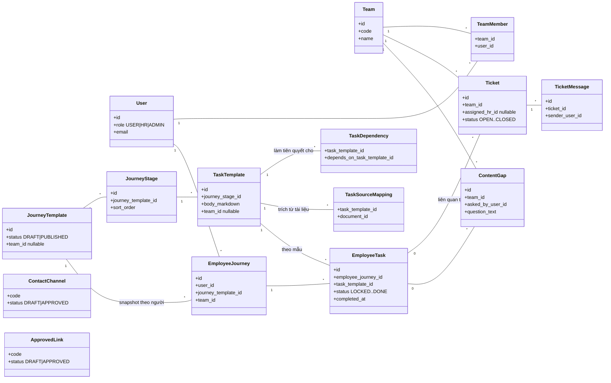
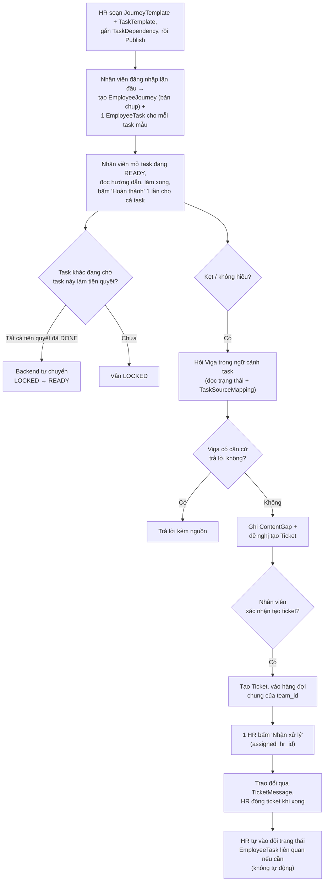

# Portal Onboarding — Sơ đồ entity và luồng hoạt động

> Bản xem trực quan (có thể tương tác): https://claude.ai/artifact/Q6G4fARM8pt3szu9GznrKF
> Đây là bản .md tương ứng, để lưu trong repo và đọc offline. Dựa trên code thật đã tạo ở P1 — xem [bao-cao-p1.md](bao-cao-p1.md) và [P1.md](P1.md).

## 1. Class diagram — các bảng và quan hệ

Bên trái (`JourneyTemplate`/`JourneyStage`/`TaskTemplate`/`TaskDependency`) là **mẫu HR soạn** — dùng chung, có version. Bên phải (`Employee*`) là **bản chụp riêng của từng nhân viên**, sinh ra từ mẫu lúc họ bắt đầu lộ trình, không tự đổi theo khi mẫu có version mới. `Ticket` và `ContentGap` luôn gắn `team_id` để HR chỉ thấy đúng phòng ban mình.

## 2. Vai trò từng bảng

Tổng cộng hệ thống có **22 bảng** (`grep __tablename__ src/model/*.py`). 12 bảng mới cho Portal + 10 bảng có sẵn từ chatbot mà Portal tái dùng hoặc để nguyên không đụng tới.

### 2.1 Bảng mới cho Portal (12)

| Bảng | Dùng để làm gì |
|---|---|
| `JourneyTemplate` | 1 lộ trình mẫu (vd "Onboarding Ngày 1"), HR soạn và publish. Publish version mới **không** đổi lộ trình nhân viên đang chạy. |
| `JourneyStage` | 1 giai đoạn trong lộ trình mẫu (Ngày 1, Tuần 1...). |
| `TaskTemplate` | 1 task mẫu trong giai đoạn — có hướng dẫn (Markdown), không có "loại xác nhận" phức tạp: chỉ tự-hoàn-thành. |
| `TaskDependency` | Task nào phải xong trước task nào (chỉ kiểu AND — cần xong **hết** mới mở task tiếp). |
| `EmployeeJourney` | Bản chụp lộ trình **của riêng 1 nhân viên**, tạo khi họ bắt đầu — không đổi theo mẫu mới nữa. |
| `EmployeeTask` | 1 task cụ thể của 1 nhân viên, có trạng thái riêng (`LOCKED → READY → ... → DONE`). |
| `TaskSourceMapping` | Nối task với đúng đoạn tài liệu đã có — dùng khi AI đề xuất task hoặc khi trích dẫn nguồn. |
| `Ticket` | Nhân viên báo kẹt → vào hàng đợi của team → 1 HR "Nhận xử lý". |
| `TicketMessage` | Trao đổi qua lại giữa nhân viên và HR trong 1 ticket. |
| `ContentGap` | Ghi lại mỗi lần Viga **không** trả lời được, để HR biết tài liệu nào đang thiếu. |
| `ContactChannel` | Đầu mối thật (email, tên người phụ trách...) — chỉ hiện khi đã `APPROVED`. |
| `ApprovedLink` | Link thật (URL form, helpdesk...) kèm mô tả mục đích — chỉ hiện khi đã `APPROVED`. |

### 2.2 Bảng có sẵn từ chatbot — Portal tái dùng hoặc để nguyên (10)

| Bảng | Portal dùng thế nào |
|---|---|
| `users` | Tái dùng thẳng — `role` đã có `USER`/`HR`/`ADMIN`, không thêm role riêng cho Portal. |
| `teams` | Tái dùng thẳng — là "phòng ban" trong toàn bộ mô hình scope của Portal. |
| `team_members` | Tái dùng thẳng — nguồn duy nhất để biết HR/nhân viên thuộc team nào (`require_team_scope` query bảng này). |
| `documents` | Tái dùng — `TaskSourceMapping.document_id` trỏ vào đây khi AI đề xuất task hoặc Viga trích dẫn. |
| `document_versions` | Tái dùng — `TaskSourceMapping.document_version_id`, đảm bảo trích đúng phiên bản còn hiệu lực. |
| `document_sections` | Tái dùng — `TaskSourceMapping.document_section_id` (nullable), trỏ đúng đoạn để tô sáng khi xem tài liệu. |
| `document_categories` | Không đụng tới — Portal không phân loại tài liệu riêng, dùng lại phân loại đã có. |
| `document_chunks` | Không đụng tới — nội bộ pipeline RAG (BM25/vector), Portal không truy vấn trực tiếp bảng này. |
| `jobs` | Không đụng tới ở P1 — hàng đợi ingest hiện tại của chatbot; nếu Portal cần ingest tài liệu riêng cho phòng ban (P4A) sẽ dùng lại cơ chế này, chưa code. |
| `audit_logs` | **Chưa nối** — theo nguyên tắc retention ở [P0A.md §5](../P0A/P0A.md#5-nguyên-tắc-retention-áp-dụng-khi-viết-on-delete-ở-p1), hành động publish/xóa/duyệt của Portal nên ghi audit, nhưng P1 mới có schema, **chưa có code nào insert vào `audit_logs` khi HR publish template hay xử lý ticket** — để lại cho P4B/P4C khi có API thật. |

**Điểm chưa đủ ở P1 (không phải thiếu bảng, mà thiếu code nối):** `audit_logs` đã tồn tại sẵn nhưng chưa có API Portal nào ghi vào đó — vì P1 chỉ có 1 route mẫu (`GET /portal/journeys`, không sinh sự kiện gì để audit), API nghiệp vụ thật (tạo/publish template, đổi trạng thái ticket) mới cần nối `audit_logs`, đó là việc của P4B/P4C/P6 theo đúng nguyên tắc "audit bất biến cho upload, publish, quyền, xóa" (v14 §21).

## 3. Luồng hoạt động thật

**Diễn giải theo bước:**

1. **HR** soạn `JourneyTemplate` + các `TaskTemplate` bên trong, gắn tiên quyết (`TaskDependency`), rồi **Publish**.
2. Nhân viên mới đăng nhập lần đầu → hệ thống tạo `EmployeeJourney` = **bản chụp** của template vừa publish, cộng 1 `EmployeeTask` cho mỗi task mẫu, trạng thái ban đầu `LOCKED` hoặc `READY` (tùy có tiên quyết hay không).
3. Nhân viên mở task đang `READY`, đọc hướng dẫn (Markdown, có thể rẽ nhánh theo địa điểm/loại máy ngay trong chữ) → làm xong → bấm **"Hoàn thành"** 1 lần cho cả task → `DONE`.
4. Backend tự kiểm: task nào đang phụ thuộc task vừa `DONE`, nếu **tất cả** tiên quyết đã xong → tự chuyển từ `LOCKED` sang `READY`.
5. Nếu nhân viên **kẹt hoặc không hiểu** → hỏi Viga trong ngữ cảnh task đó. Viga đọc đúng trạng thái task + tài liệu liên quan (`TaskSourceMapping`) để trả lời.
6. Viga có căn cứ → trả lời kèm nguồn. Viga **không** có căn cứ → ghi 1 dòng `ContentGap` và đề nghị tạo `Ticket` — **chỉ tạo sau khi nhân viên xác nhận**.
7. Ticket vào hàng đợi chung của `team_id` nhân viên đó → mọi HR cùng team thấy → 1 HR bấm **"Nhận xử lý"** (`assigned_hr_id`) để tránh 2 HR làm trùng.
8. HR trao đổi qua `TicketMessage`, xử lý xong thì đóng ticket — **không tự động** đổi trạng thái `EmployeeTask` liên quan, HR phải tự vào đổi nếu cần.
