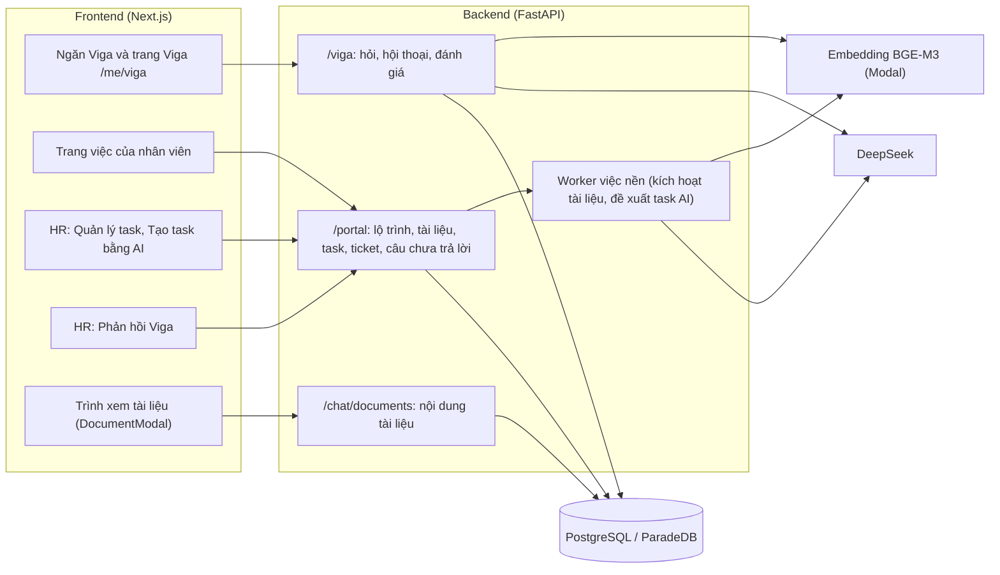
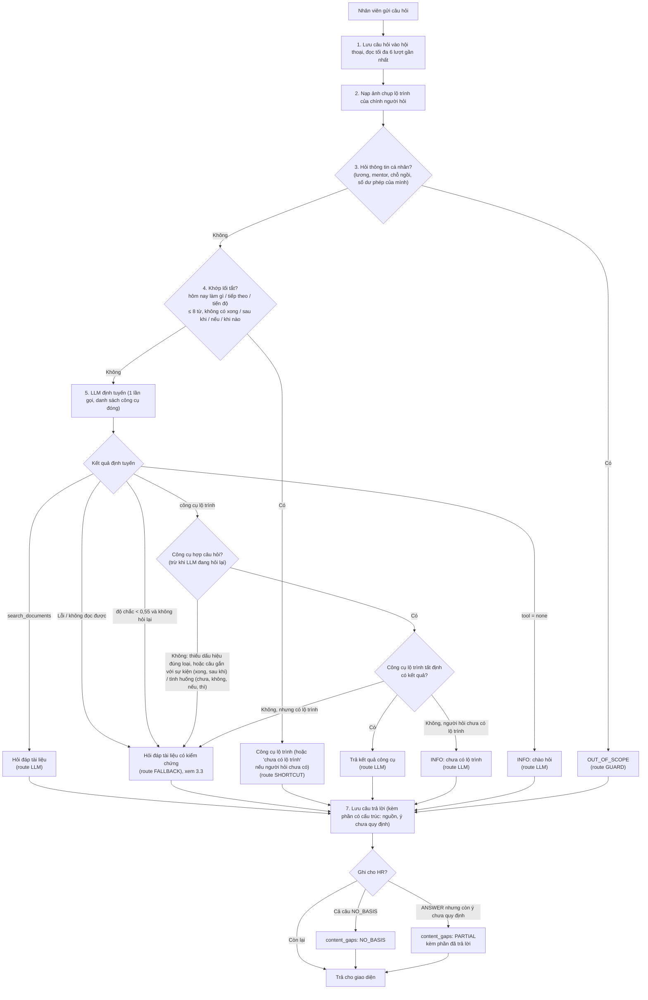
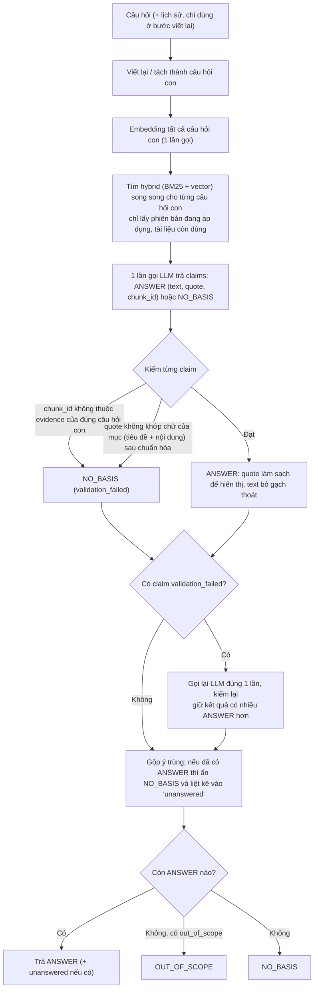
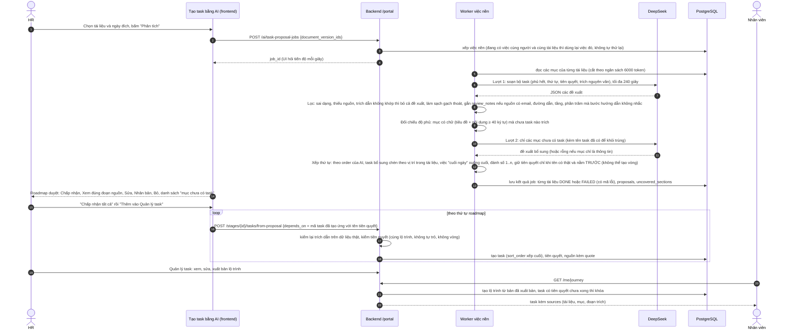
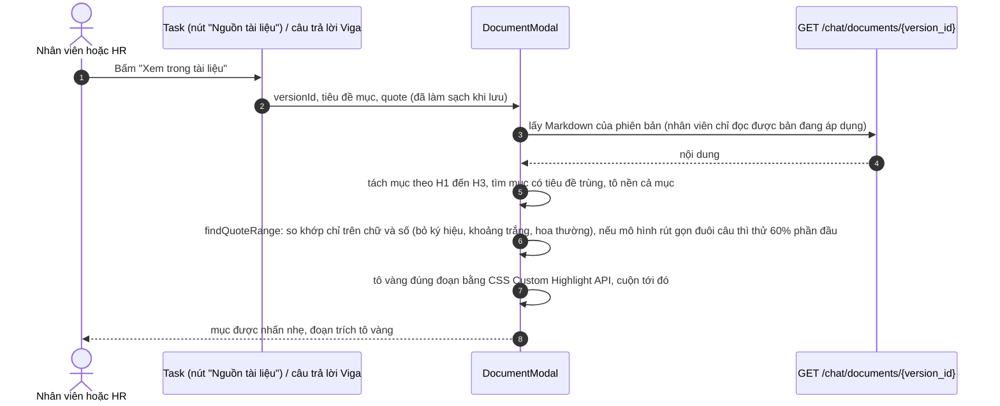
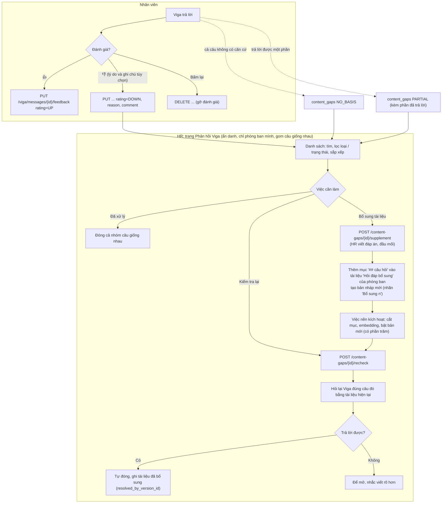
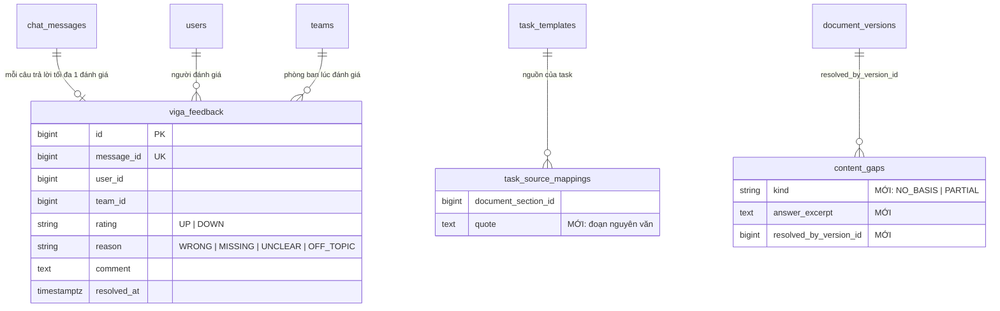

# Báo cáo hoàn thành: sửa Viga, sinh task bằng AI, xem nguồn, phản hồi và luồng hoạt động (02/10/2026)

> Nhánh `feat/portal-plan`. **Toàn bộ thay đổi chưa commit, chưa push.** Đây là phần thực hiện của [bao-cao-kiem-tra-viga-va-task-ai.md](bao-cao-kiem-tra-viga-va-task-ai.md) (báo cáo kiểm tra trước khi sửa).
> Mọi số liệu trong tài liệu này lấy từ lần chạy thật trên backend + DeepSeek + embedding Modal; bảng kết quả được sinh trực tiếp từ file thô trong [eval/](eval/). Sơ đồ vẽ theo đúng mã nguồn hiện tại (đã đối chiếu từng bước).

## 1. Kết luận ngắn

| Hạng mục | Trước | Sau |
|---|---|---|
| Bộ 26 câu hỏi Viga | 8 hài lòng, 12 chưa đạt, 6 sai hoặc không trả lời | **25 hài lòng, 1 chưa đạt, 0 sai** (cả ba lần chạy cuối đều ra đúng con số này) |
| Cùng một câu lúc đúng lúc "chưa có căn cứ" | Câu 1 (hồ sơ) lúc đúng lúc sai do bị loại trích dẫn | **Câu 1 ổn định** (đúng cả 4 lần chạy). Nhóm câu mà tài liệu **chưa quy định** (17, 20, 22, 23) vẫn dao động giữa "chưa có căn cứ" và "chưa có quy định, hỏi Phòng tuyển dụng": cả hai đều trung thực, không bịa (xem 5.1) |
| Trả lời hiện `##`, `*`, `**` | Có | Hết: dựng Markdown; trích dẫn được làm sạch |
| Bộ task AI tạo từ tài liệu "Hướng dẫn ngày 1" | 12 task, thiếu 4 mục, không tiên quyết, `sort_order` đều bằng 0 | **16 task phủ đủ 16 mục có việc**, 12 quan hệ tiên quyết, thứ tự 1 đến 16, việc "cuối ngày" xếp cuối |
| Xem nguồn của task | Không có | Có nút **Nguồn tài liệu** (nhân viên và HR), mở tài liệu **đúng mục và tô vàng đúng đoạn** |
| Roadmap | Hai thẻ cùng hàng chỉ hở ~4px; Quản lý task dựng riêng | Hở ≥ 24px với mọi số task; Quản lý task dùng chung `JourneyRoad` với duyệt AI và lộ trình nhân viên |
| Viga toàn trang kiểu ChatGPT | Chưa có | `/me/viga`: lịch sử bên trái, khung chat rộng; nút **Mở rộng** ở ngăn Viga |
| Phản hồi Viga của HR | Danh sách tĩnh, báo thiếu tài liệu oan, "Bổ sung tài liệu" chỉ là liên kết | Tìm, lọc, sắp xếp; 3 loại (chưa có căn cứ, trả lời một phần, chưa hài lòng); **viết đáp án ngay trên câu hỏi, tự kiểm lại Viga, đạt mới tự đóng** |
| Đánh giá hài lòng của nhân viên | Chưa có | 👍/👎 từng câu trả lời, lý do và ghi chú không bắt buộc; HR xem ẩn danh theo phòng ban |
| Kiểm thử | 353 backend, 233 frontend | **428 backend, 261 frontend**; ruff, mypy, alembic check, tsc, eslint sạch |

Thời gian trả lời trung bình tăng từ 4,1 giây lên khoảng 6,4 đến 7,3 giây mỗi câu: trước đây nhiều câu "đi tắt" bằng cách dán nguyên task (không gọi mô hình trả lời); nay câu hỏi sự kiện đều đi qua hỏi đáp tài liệu có kiểm chứng (viết lại câu hỏi, tìm, trả lời, kiểm trích dẫn). Đây là đánh đổi có chủ đích, xem mục 7.

## 2. Đã làm gì (đối chiếu 11 việc của báo cáo kiểm tra)

| # | Việc | Trạng thái | Nơi làm chính |
|---|---|---|---|
| 1 | So khớp trích dẫn chuẩn hóa (Viga và tạo task AI) | Xong | `services/text_match.py`, `chat/validator.py`, `portal/ai_task_service.py` |
| 2 | Dựng Markdown, làm sạch trích dẫn, gộp ý trùng, ẩn ý không căn cứ khi đã có đáp án | Xong | `components/markdown/MarkdownText.tsx`, `features/viga/VigaReply.tsx`, `viga/service.py` |
| 3 | Định tuyến Viga: câu hỏi sự kiện đi hỏi đáp tài liệu; siết lối tắt | Xong | `viga/guard.py`, `viga/service.py` |
| 4 | Roadmap: khoảng cách thẻ; Quản lý task dùng chung `JourneyRoad` | Xong | `components/roadmap/JourneyRoad.tsx`, `portal-hr/TaskManagementPage.tsx` |
| 5 | Sinh task: phủ đủ mục, tiên quyết, thứ tự, văn phong bước | Xong | `portal/ai_task_service.py`, `portal/job_handlers.py` |
| 6 | Lưu đoạn trích của task; trình xem tô đúng đoạn; nút Nguồn | Xong | migration `0009`, `portal/task_sources.py`, `features/chat/quoteHighlight.ts`, `components/task-sources/TaskSources.tsx` |
| 7 | Viga toàn trang | Xong (nhân viên) | `features/viga/VigaPage.tsx`, `useVigaChat.ts`, route `/me/viga` |
| 8 | Phản hồi Viga: sửa báo oan, tự kiểm lại, form Bổ sung tài liệu, tìm/lọc/sắp xếp, icon | Xong | `viga/gaps.py`, `viga/supplement.py`, `features/viga/VigaFeedbackPage.tsx`, `SupplementModal.tsx` |
| 9 | 👍/👎 từng câu và danh sách "chưa hài lòng" cho HR | Xong | `viga/feedback.py`, `features/viga/ReplyFeedback.tsx`, bảng `viga_feedback` |
| 10 | Đường thoát "trả lời một phần / chưa quy định" | Xong | `viga/service.py` (`unanswered`), `content_gaps.kind = PARTIAL` |
| 11 | Bộ 26 câu thành bộ kiểm thử lặp lại | Xong (chạy tay với dịch vụ thật) và test hồi quy tự động với mô hình giả | [eval/viga_eval.py](eval/viga_eval.py), `tests/test_chat/test_quote_regression.py`, `tests/integration/test_viga_feedback_api.py` |

Quyết định đã áp dụng cho các câu còn bỏ ngỏ trong báo cáo trước (theo khuyến nghị của báo cáo): (c) AI tự đề xuất tiên quyết, được áp dụng khi HR bấm "Thêm vào Quản lý task" và HR sửa lại được ở Quản lý task; (d) "Viết câu trả lời" thêm vào **một tài liệu "Hỏi đáp bổ sung" cho mỗi phòng ban**; (e) lý do khi bấm 👎 **không bắt buộc**. Câu (a) tài liệu thử nghiệm TL2 vẫn chung kho với TL1 (xem mục 7) và (b) Viga toàn trang mới làm cho nhân viên.

## 3. Luồng hoạt động

### 3.1 Bức tranh chung



### 3.2 Viga xử lý một câu hỏi (`ask_viga` và `_decide`)



Công cụ lộ trình: `get_next_tasks`, `get_day_plan`, `get_progress`, `explain_lock`, `get_task_detail`. `tool_fits_question` yêu cầu câu hỏi có dấu hiệu đúng loại (ví dụ `get_task_detail` cần "hướng dẫn / các bước / chi tiết", hoặc "làm thế nào / làm sao" **mà không phải tình huống**). Nhờ vậy "Nhận laptop xong thì làm gì tiếp theo?" và "T3 chưa trả lời email thì tôi làm sao?" đi hỏi đáp tài liệu thay vì dán task.

### 3.3 Hỏi đáp tài liệu có kiểm chứng (`run_document_qa`)



Cách so khớp trích dẫn (`services/text_match.py`), áp dụng cho cả Viga và tạo task AI:

| Bước | Tác dụng |
|---|---|
| Chuẩn hóa NFC | Cùng một chữ có dấu dù gõ kiểu nào |
| Bỏ gạch chéo thoát (`\_`, `\(`, `\*`) | Tài liệu đọc từ Word/PDF bị thêm gạch thoát |
| Bỏ ký hiệu danh sách đầu dòng (`-`, `+`) và các ký tự `*`, `` ` ``, `>`, `#`, `_` (xóa hẳn, không thành khoảng trắng) | `**3 tháng**).` khớp `3 tháng).` |
| `•`, `·` thành khoảng trắng; gộp mọi khoảng trắng và xuống dòng; chữ thường | Trích dẫn liền mạch khớp danh sách nhiều dòng |
| So sánh **chuỗi con** trên chữ của mục = tiêu đề + nội dung | Nhiều mục thật chỉ có việc cần làm ở tiêu đề (Check-in, Ký hợp đồng, Tủ gửi đồ) |

Vẫn **không thể bịa**: đổi một con số hay một chữ thì không còn là chuỗi con và bị loại (có test: "90%" thay "80%", "Hộ chiếu", email khác, tiêu đề email khác đều bị từ chối).

### 3.4 Tạo task bằng AI: từ tài liệu đến lộ trình của nhân viên



### 3.5 Xem nguồn: tô đúng đoạn



Task cũ chưa có `quote` chỉ tô cả mục. Trình duyệt chưa có CSS Custom Highlight API thì chỉ tô mục.

### 3.6 Vòng phản hồi: 👍/👎, câu chưa trả lời, bổ sung tài liệu



Quyền riêng tư giữ nguyên quyết định 8: HR **không** thấy tên người hỏi hay hội thoại; chỉ thấy câu hỏi, phần Viga đã trả lời, lý do, số lần. Nhân viên chỉ đánh giá được câu trả lời của chính hội thoại mình (người khác nhận 404).

### 3.7 Thay đổi dữ liệu (migration `0009_viga_feedback_and_sources`)



## 4. Giao diện và API đã thêm hoặc đổi

| Loại | Nội dung |
|---|---|
| API mới | `PUT` và `DELETE /api/v1/viga/messages/{id}/feedback`; `GET /portal/viga-feedback`, `/portal/viga-feedback/summary`, `POST /portal/viga-feedback/{id}/resolve`; `POST /portal/content-gaps/{id}/recheck` và `/supplement` |
| API đổi (tương thích ngược) | Câu trả lời Viga có `unanswered`; chi tiết hội thoại có `feedback` từng tin; đề xuất AI có `order`, `prerequisites`, `review_notes`, `source_chunks[].heading`; kết quả việc nền có `uncovered_sections`; `from-proposal` nhận `depends_on` và xếp `sort_order`; `/me/journey` và `/journey-templates/mine` trả `sources`; câu chưa trả lời có `kind`, `answer_excerpt`, `resolved_document_title` |
| Cổng LLM | `complete_json(..., timeout_seconds=None)`: việc soạn task dùng giới hạn 240 giây (giới hạn mặc định 60 giây không đủ cho đầu ra dài, đã gây lỗi `LLM_UNAVAILABLE` lúc chạy thử) |
| Trang mới | `/me/viga` (Viga toàn trang) |
| Trang làm lại | Phản hồi Viga của HR; Quản lý task dùng chung roadmap |
| Thành phần dùng chung mới | `MarkdownText`, `TaskSources`, `ReplyFeedback`, `SupplementModal`, `useVigaChat`, `quoteHighlight` |

## 5. Kết quả kiểm tra

### 5.1 Bộ 26 câu hỏi Viga trên hai tài liệu thật

Ký hiệu: ✓ đúng loại và đủ các ý bắt buộc, không dán khối task, không còn ký hiệu Markdown thô; ~ đúng loại nhưng thiếu ý hoặc có dấu hiệu dán khối; ✗ sai loại. Mỗi câu một hội thoại mới, tài khoản `newhire1@vsf-demo.example`, gọi `POST /api/v1/viga/ask`.

| Lần chạy | Nội dung | ✓ | ~ | ✗ | Giây/câu |
|---|---|---|---|---|---|
| Trước khi sửa | 20 câu đầu (6 câu bổ sung chạy riêng: 2 ✓, 2 ~, 2 ✗) | 8 | 12 | 6 | 4.1 |
| Sau lượt sửa đầu (so khớp trích dẫn, thử lại, định tuyến, gộp ý) | 26 câu | 22 | 3 | 1 | 7.3 |
| Thêm: cho phép trích từ tiêu đề mục, siết "làm sao" trong hướng dẫn việc | 26 câu | 25 | 1 | 0 | 7.2 |
| Chạy lại y nguyên để đo độ ổn định | 26 câu | 25 | 1 | 0 | 6.7 |
| Sau khi chỉnh lời nhắc (ưu tiên trích nội dung) và dùng bộ task mới | 26 câu | 25 | 1 | 0 | 6.4 |

Chi tiết từng câu ở lần chạy cuối (kết quả thô: [eval/viga_eval_after4.json](eval/viga_eval_after4.json)):

| # | Câu hỏi | Trước | Sau | Đường xử lý | Câu trả lời sau khi sửa (rút gọn) |
|---|---|---|---|---|---|
| 1 | Hồ sơ cần nộp trong ngày đầu gồm những gì? | ✗ · báo "chưa có căn cứ" (lúc đúng lúc sai) | **✓** | FALLBACK | Hồ sơ nộp trong ngày đầu gồm: CV; lý lịch tư pháp hoặc giấy hẹn lấy lý lịch tư pháp; giấy khám sức khỏe; hình ảnh xác nhận nơi cư… |
| 2 | Nộp hồ sơ ngày đầu thì liên hệ đầu mối nào? | ✓ | **✓** | FALLBACK | Đầu mối liên hệ là Phòng tuyển dụng. |
| 3 | Chương trình Đào tạo Hội nhập có bắt buộc không và điều kiện hoàn thà… | ~ · thiếu "bắt buộc", thừa ý không căn cứ | **✓** | LLM | Có, chương trình Đào tạo Hội nhập là bắt buộc cho CBNV mới. Gồm điểm danh đầu giờ, hoàn thành khảo sát sau chương trình, và đạt t… |
| 4 | Bài test cuối khóa phải đạt bao nhiêu phần trăm? | ✓ | **✓** | LLM | Đạt từ 80% trở lên (>= 80%) ở bài test cuối khóa — đây là một trong các điều kiện hoàn thành chương trình Đào tạo Hội nhập, bắt b… |
| 5 | Đầu mối của chương trình Đào tạo Hội nhập là ai, email gì? | ✓ | **✓** | LLM | Đầu mối là Phòng ĐT&PTVH (Phòng đào tạo và phát triển văn hóa), email liên hệ: v.thudq@vinsmartfuture.tech. |
| 6 | Khi nào tôi ký hợp đồng lao động? | ~ · dán cả khối task | **✓** | FALLBACK | Cuối ngày đầu sẽ có email hướng dẫn ký hợp đồng lao động và bạn phải ký trong thời gian quy định. |
| 7 | Đăng ký faceid chấm công ở đâu? | ~ · dán cả khối task | **✓** | FALLBACK | Đăng ký faceid chấm công tại tầng 14 theo chỉ dẫn của phòng nhân sự (hướng dẫn dành cho văn phòng Vincom Đồng Khởi). |
| 8 | Tôi nhận laptop ở đâu? | ~ · dán cả khối task | **✓** | FALLBACK | Nhận laptop tại tầng 12 theo chỉ dẫn của ITHD và HR tại tầng 12. |
| 9 | Nhận laptop xong thì làm gì tiếp theo? | ✗ · đáp "làm Check-in" (sai) | **✓** | FALLBACK | Đăng nhập Outlook và Teams; chỉ sau khi có laptop và đăng nhập được Outlook, Teams thì mới tiếp tục bước tiếp theo. |
| 10 | Viết email hỗ trợ cho ITHD thì gửi tới địa chỉ nào và đặt tiêu đề thế… | ~ · dán nguyên mẫu email | **✓** | FALLBACK | Gửi tới địa chỉ support@vinsmartfuture.tech. Tiêu đề theo mẫu: ITHD [Địa điểm làm việc] + [vắn tắt yêu cầu]. |
| 11 | Trước khi viết ticket tôi cần kiểm tra gì? | ~ · dán cả khối task | **✓** | FALLBACK | Xem nhu cầu hiện tại của bạn có Quick access không (theo hướng dẫn tại trang helpdesk support.vinsmartfuture.tech). |
| 12 | Muốn dùng VPN hoặc xin exception USB thì cần ai đồng thuận? | ~ · câu trả lời lặp hai lần | **✓** | LLM | Cần sự đồng thuận của T3 (ở Khối KD và VH Vinmec là anh Dương Anh Nghi, v.dir.data3@vinsmartfuture.tech). Exception (bao gồm USB)… |
| 13 | Máy tôi đã dùng sẵn Ubuntu thì xin phê duyệt thế nào? | ~ · dán cả khối task | **✓** | FALLBACK | Nếu đang sử dụng sẵn Ubuntu OS, có thể xin phê duyệt qua Team và chụp ảnh. |
| 14 | Sau khi VinSOC phản hồi email thì tôi làm gì? | ~ · dán cả khối task | **✓** | FALLBACK | Tạo ticket hỗ trợ theo mẫu ở 'CÁCH VIẾT EMAIL HỖ TRỢ ITHD' (ở khối mình là DUCBV5) rồi thực hiện tại phòng ITHD (tầng 14) như bìn… |
| 15 | Yêu cầu tủ gửi đồ như thế nào? | ~ · nguồn tự lặp, chưa có hướng dẫn | **✓** | FALLBACK | Yêu cầu tủ gửi đồ qua đầu mối request tủ gửi đồ (ở khối mình là NGANNK25). |
| 16 | Tôi chưa có lý lịch tư pháp thì sao? | ✓ | **✓** | FALLBACK | Bạn có thể nộp giấy hẹn lấy lý lịch tư pháp thay cho lý lịch tư pháp; đầu mối liên hệ là Phòng tuyển dụng. |
| 17 | Tôi chỉ có CMND, không có căn cước công dân thì thay được không? | ✓ | **✓** | LLM | Mình chưa có căn cứ trong tài liệu để trả lời câu này. |
| 18 | T3 chưa trả lời email phê duyệt thì tôi làm sao? | ✗ · hỏi lại "việc nào?" | **✓** | FALLBACK | Chờ 1 ngày làm việc rồi nhắn nhắc nhẹ. (Đây là mục [BỔ SUNG THỬ NGHIỆM], không phải quy định chính thức, cần HR xác nhận trước kh… |
| 19 | Có bắt buộc làm chuỗi yêu cầu ngoại lệ như Ubuntu, VPN, USB không? | ✗ · ra nội dung task Ubuntu | **✓** | LLM | Không bắt buộc; chỉ làm khi bạn có nhu cầu. Lưu ý: nội dung này mang nhãn [BỔ SUNG THỬ NGHIỆM] — là quy định do người soạn dữ liệ… |
| 20 | Văn phòng của tôi không phải Vincom Đồng Khởi thì đăng ký faceid thế… | ✓ | **✓** | FALLBACK | Chưa có quy định trong tài liệu ngày 1: tài liệu chỉ hướng dẫn đăng ký faceid cho văn phòng Vincom Đồng Khởi, không có hướng dẫn… |
| 21 | tôi ở hồ chí minh checkin ở đâu á | ~ · dán cả khối task | **✓** | FALLBACK | Check-in tại địa điểm làm việc của bạn, theo hướng dẫn tùy nơi onboard (tài liệu không nêu địa điểm cụ thể cho Hồ Chí Minh). |
| 22 | Tôi chỉ có CMND, không có căn cước công dân, có thay được không? | ✗ · lúc đúng lúc "chưa có căn cứ" | **✓** | LLM | Mình chưa có căn cứ trong tài liệu để trả lời câu này. |
| 23 | tôi không có căn cước công dân sài vnid được không | ✗ · "chưa có căn cứ" trơ trọi | **✓** | LLM | Mình chưa có căn cứ trong tài liệu để trả lời câu này. |
| 24 | Check-in ngày đầu làm thế nào? | ~ · dán cả khối task | **~** | LLM | Hướng dẫn “Check-in tại địa điểm làm việc”: ## Vì sao phải làm Check-in tại địa điểm làm việc theo hướng dẫn riêng của từng nơi o… |
| 25 | Tôi làm ở Hà Nội thì check-in ở đâu? | ✓ | **✓** | FALLBACK | Check-in tại địa điểm làm việc của bạn, theo hướng dẫn tùy nơi onboard (tài liệu không nêu địa điểm riêng cho Hà Nội). |
| 26 | Tôi không có VNeID thì nộp giấy xác nhận nơi cư trú thế nào? | ✓ | **✓** | FALLBACK | Không có VNeID thì chuẩn bị bản photo giấy xác nhận nơi cư trú và nộp cho Phòng tuyển dụng trong ngày đầu. |

Cách đọc nhóm câu "tài liệu chưa quy định" (17, 20, 22, 23): bộ chấm coi là đạt khi Viga **không bịa**, tức trả "chưa có căn cứ" (kèm nút gửi HR) hoặc "chưa có quy định, hỏi Phòng tuyển dụng". Qua 4 lần chạy, các câu này đổi qua lại giữa hai cách nói đó (câu 17: 3 lần "chưa có căn cứ", 1 lần "chưa có quy định"; câu 23: 1 lần "chưa có quy định", 3 lần "chưa có căn cứ"; câu 20: 3 lần "chưa có căn cứ", 1 lần "chưa có quy định"; câu 22: cả 4 lần "chưa có căn cứ"). Đây là dao động của mô hình ở loại câu này; **chưa đạt mức lý tưởng** "chưa quy định + chỉ đầu mối" một cách ổn định. Mỗi câu trả "chưa có căn cứ" đều được ghi cho HR để bổ sung đáp án qua nút **Bổ sung tài liệu**.

Câu 24 vẫn là `~` vì Viga chủ ý mở **hướng dẫn việc** "Check-in tại địa điểm làm việc" (câu có "làm thế nào", không phải tình huống); nội dung task nay được dựng Markdown nên không còn hiện `##`, và task này chính là phần tài liệu chỉ nói "theo hướng dẫn tùy nơi onboard". Bộ chấm chỉ gắn `~` vì phát hiện tiêu đề mục trong câu trả lời.

Ví dụ trước và sau:

| # | Câu hỏi | Trước | Sau |
|---|---|---|---|
| 1 | Hồ sơ cần nộp trong ngày đầu gồm những gì? | Mình chưa có căn cứ trong tài liệu để trả lời câu này. | Hồ sơ nộp trong ngày đầu gồm: CV; lý lịch tư pháp hoặc giấy hẹn lấy lý lịch tư pháp; giấy khám sức khỏe; hình ảnh xác nhận nơi cư trú (bản photo, có thể chụp ảnh VNeID định danh mức 2); căn… |
| 6 | Khi nào tôi ký hợp đồng lao động? | Hướng dẫn “Ký hợp đồng lao động”: ## Vì sao phải làm Cuối ngày sẽ có email hướng dẫn ký hợp đồng lao động, ký trong thời gian quy định. Lưu ý: Tài liệu không nêu rõ thời… | Cuối ngày đầu sẽ có email hướng dẫn ký hợp đồng lao động và bạn phải ký trong thời gian quy định. |
| 9 | Nhận laptop xong thì làm gì tiếp theo? | Bạn có thể làm ngay việc “Check-in tại địa điểm làm việc”. | Đăng nhập Outlook và Teams; chỉ sau khi có laptop và đăng nhập được Outlook, Teams thì mới tiếp tục bước tiếp theo. |
| 18 | T3 chưa trả lời email phê duyệt thì tôi làm sao? | Bạn đang hỏi về việc nào trong lộ trình (ví dụ: việc chờ email phản hồi của VinSOC)? | Chờ 1 ngày làm việc rồi nhắn nhắc nhẹ. (Đây là mục [BỔ SUNG THỬ NGHIỆM], không phải quy định chính thức, cần HR xác nhận trước khi dùng thật.) |
| 19 | Có bắt buộc làm chuỗi yêu cầu ngoại lệ như Ubuntu, VPN, USB… | Hướng dẫn “Trường hợp máy đã có Ubuntu sẵn”: ## Vì sao phải làm Trường hợp máy đã có Ubuntu sẵn, có thể xin phê duyệt qua Team và chụp ảnh. ## Các bước 1. đang sử dụng s… | Không bắt buộc; chỉ làm khi bạn có nhu cầu. Lưu ý: nội dung này mang nhãn [BỔ SUNG THỬ NGHIỆM] — là quy định do người soạn dữ liệu thử đặt ra, không phải quy định chính thức, HR phải xác nh… |

### 5.2 Bộ task AI tạo từ "Hướng dẫn ngày 1" (dữ liệu hiện đang có trong DB dev)

Độ phủ theo từng mục của tài liệu (mục 0 và 1 chỉ là tiêu đề tài liệu):

| Mục TL1 | Tiêu đề mục (rút gọn) | Task |
|---|---|---|
| 0 | Ngày đầu onboarding | — (chỉ là tiêu đề tài liệu) |
| 1 | Ngày 1 | — (chỉ là tiêu đề tài liệu) |
| 2 | Chuẩn bị hồ sơ phải nộp trong ngày đầu: | **1.** Nộp hồ sơ ngày đầu |
| 3 | Check-in tại địa điểm làm việc, theo hướng dẫn tùy nơi onbo… | **2.** Check-in tại địa điểm làm việc |
| 4 | Tham gia chương trình Đào tạo Hội nhập cùng Phòng đào tạo p… | **3.** Tham gia chương trình Đào tạo Hội nhập |
| 5 | CUỐI NGÀY SẼ CÓ EMAIL HƯỚNG DẪN KÝ HỢP ĐỒNG LAO ĐỘNG. KÝ TR… | **16.** Ký hợp đồng lao động theo email hướng dẫn |
| 6 | Dành cho văn phòng Vincom Đồng Khởi: | **5.** Đăng ký faceid chấm công và ra vào tòa nhà |
| 7 | NGHE KỸ NỘI QUY CÔNG TY Ở chương trình Đào tạo Hội nhập cùn… | **4.** Nghe nội quy công ty |
| 8 | Nhận laptop tại tầng 12 theo chỉ dẫn của ITHD và HR tại tần… | **6.** Nhận laptop và đăng nhập Outlook, Teams |
| 9 | ẢNH ĐẠI DIỆN CHỮ KÝ SLIDE | **7.** Cập nhật ảnh đại diện, chữ ký và slide |
| 10 | TRƯỚC KHI VIẾT TICKET XEM | **8.** Kiểm tra Quick access trước khi viết ticket |
| 11 | CÁCH VIẾT EMAIL HỖ TRỢ ITHD | **9.** Viết email hỗ trợ ITHD theo mẫu |
| 12 | TRƯỜNG HỢP RIÊNG TICKET KHÔNG HỖ TRỢ | **10.** Viết ticket cho các trường hợp ITHD không hỗ trợ |
| 13 | Trước khi điền form cần phải có sự đồng thuận của T3 theo p… | **11.** Xin phê duyệt T3 qua email trước khi điền form |
| 14 | Trường hợp máy đã có Ubuntu sẵn | **12.** Xin phê duyệt qua Team cho trường hợp máy đã có Ubuntu sẵn |
| 15 | Trường hợp máy windowns | **13.** Upload file phê duyệt và đợi email phản hồi của VinSOC |
| 16 | SAU KHI CÓ EMAIL PHẢN HỒI CỦA VINSOC | **14.** Tạo ticket hỗ trợ ITHD sau phản hồi của VinSOC |
| 17 | Yêu cầu tủ gửi đồ request tủ gửi đồ(khối mình là NGANNK25) | **15.** Yêu cầu tủ gửi đồ |

Thứ tự và tiên quyết của 16 task (`sort_order` 1 đến 16; 12 quan hệ tiên quyết):

| # | Task | Nhóm | Cần xong trước |
|---|---|---|---|
| 1 | Nộp hồ sơ ngày đầu | PROFILE | — |
| 2 | Check-in tại địa điểm làm việc | OFFICE | — |
| 3 | Tham gia chương trình Đào tạo Hội nhập | TRAINING | — |
| 4 | Nghe nội quy công ty | TRAINING | — |
| 5 | Đăng ký faceid chấm công và ra vào tòa nhà | OFFICE | — |
| 6 | Nhận laptop và đăng nhập Outlook, Teams | DEVICE | — |
| 7 | Cập nhật ảnh đại diện, chữ ký và slide | PROFILE | #6 |
| 8 | Kiểm tra Quick access trước khi viết ticket | DEVICE | #6 |
| 9 | Viết email hỗ trợ ITHD theo mẫu | DEVICE | #8, #6 |
| 10 | Viết ticket cho các trường hợp ITHD không hỗ trợ | DEVICE | #8, #6 |
| 11 | Xin phê duyệt T3 qua email trước khi điền form | DEVICE | #6 |
| 12 | Xin phê duyệt qua Team cho trường hợp máy đã có Ubuntu sẵn | DEVICE | #6 |
| 13 | Upload file phê duyệt và đợi email phản hồi của VinSOC | DEVICE | #6 |
| 14 | Tạo ticket hỗ trợ ITHD sau phản hồi của VinSOC | DEVICE | #13, #6 |
| 15 | Yêu cầu tủ gửi đồ | OFFICE | — |
| 16 | Ký hợp đồng lao động theo email hướng dẫn | PROFILE | #6 |

Các lần sinh thử trong ngày (cùng tài liệu, mỗi lần mô hình trả khác nhau; mô hình sinh văn bản không tất định):

| Lần | Thay đổi so với lần trước | Số task | Mục chưa có task | Thời gian |
|---|---|---|---|---|
| 1 | Lời nhắc mới, bổ sung độ phủ; chọn cả 2 tài liệu | 29 (TL1: 16, TL2: 14, gộp trùng tên) | TL1 2 mục, TL2 3 mục | 320 giây |
| 2 | Chỉ TL1 | 13 | 1 | 197 giây |
| 3 | Quy tắc "mỗi mục một task", trích tối đa ~500 ký tự | 13 | 3 | 247 giây |
| 4 | Cho phép trích từ tiêu đề mục | 15 | 1 | 129 giây |
| 5 | Làm sạch gạch thoát, việc "cuối ngày" xếp cuối | 14 | 2 | 121 giây |
| 6 | Chạy qua giao diện thật (mã sinh task không đổi so với lần 5, chỉ khác lần trả lời của mô hình) | **16** | **0** | 115 giây tới lúc hiện kết quả |

Kết quả thô của lần 1 (cả hai tài liệu) lưu ở [eval/regen_result_both_docs.json](eval/regen_result_both_docs.json); bộ task hiện có trong DB ở [eval/regen_result.json](eval/regen_result.json). Bộ hiện có trong DB là kết quả lần 6 (đã xuất bản). Khoảng 13 đến 16 task giữa các lần chạy cùng mã là dao động vốn có của mô hình; chính vì vậy giao diện luôn liệt kê **"mục chưa có task"** và bước duyệt của HR là bắt buộc (AI không tự xuất bản).

Nội dung mẫu của task 1 "Nộp hồ sơ ngày đầu" (các bước đọc được, giữ nguyên đầu mối Phòng tuyển dụng, nguồn là cả danh sách 7 dòng): xem ảnh kiểm tra ở mục 5.3.

### 5.3 Kiểm tra giao diện thật (Chrome headless trên dev server, dữ liệu thật)

| Màn hình | Kiểm tra | Kết quả |
|---|---|---|
| `/me/viga` | Hiện lịch sử bên trái, câu gợi ý ở giữa, hỏi được, có 👍/👎, hộp ghi chú khi 👎, nút Thu nhỏ | Đạt. **Phát hiện và sửa 1 lỗi:** sau khi hỏi, danh sách bên trái kẹt ở "Đang tải…" (đã thêm test hồi quy) |
| Trang việc `/me/tasks/{id}` | Các bước dễ đọc; thẻ **Nguồn tài liệu** hiện đoạn trích; bấm "Xem trong tài liệu" | Đạt: mục được nhấn nhẹ, đúng 7 dòng danh sách hồ sơ tô vàng |
| `/admin/tasks` (HR) | Roadmap dùng chung, 14 và 16 task; canvas rộng `(n+1)×130` px | Đạt: thẻ cùng hàng cách nhau ≥ 24px; có nút Nguồn trên thẻ; hộp xem task có mục "Nguồn tài liệu" |
| `/admin/viga-feedback` (HR) | Danh sách 3 loại, tìm/lọc/sắp xếp, KPI hài lòng, hộp Bổ sung tài liệu | Đạt (đã kiểm với dữ liệu thật của các lần chạy) |
| `/admin/ai-tasks` (HR) | Chọn tài liệu → phân tích → duyệt → thêm vào Quản lý task, chạy **trọn luồng thật** | Đạt: tạo 16 task, tiên quyết đổi từ tên sang mã đúng, nguồn kèm đoạn trích |

### 5.4 Kiểm thử tự động (lần chạy cuối)

| Kiểm tra | Kết quả |
|---|---|
| Backend `pytest` (gồm test tích hợp trên PostgreSQL thật, DB `vsf_test`) | **428 đạt** (trước đợt này 353) |
| Backend `ruff check`, `ruff format --check`, `mypy` (139 file), `alembic check` | Sạch |
| Frontend `vitest run` | **261 đạt**, 26 file (trước đợt này 233) |
| Frontend `tsc --noEmit`, `eslint --max-warnings=0` | Sạch |
| Khóa dịch tiếng Việt và tiếng Anh | Khớp nhau (1385 khóa mỗi bên) |

Test mới đáng chú ý: so khớp trích dẫn trên **nội dung mục thật** (hồ sơ, đào tạo, form T3) cả chiều chấp nhận lẫn chiều từ chối; thử lại đúng một lần khi trích sai; tạo task: phủ độ phủ, thứ tự, tiên quyết hợp lệ, việc cuối ngày, trích từ tiêu đề, cảnh báo thiếu chi tiết; tạo task qua API lưu `quote`, `sort_order` 1..n và tiên quyết; đánh giá 👍/👎 (đổi, gỡ, quyền sở hữu, ẩn danh theo phòng ban); câu trả lời một phần; kiểm lại và bổ sung tài liệu; luồng tạo task bằng AI ở giao diện (mã tiên quyết); trình tô đoạn trích; khoảng cách roadmap.

## 6. Dữ liệu dev đã thay đổi trong đợt này

| Việc | Chi tiết |
|---|---|
| Sao lưu trước khi xóa | `pg_dump -Fc` của DB `vsf`, tệp `C:\Users\DELL\AppData\Local\Temp\claude\d--Intern-VSF-vsf-onboarding-assistant\b4633c15-95e8-4056-babb-9fbfae54bca5\scratchpad\vsf_dev_before_regen.dump` (thư mục tạm, chưa đưa vào repo; cần giữ thì chép đi nơi khác) |
| Xóa theo yêu cầu "xóa hết task và ngày hiện tại" | Toàn bộ task, ngày, lộ trình mẫu, lộ trình của nhân viên và việc nền AI cũ; **giữ nguyên 2 tài liệu** |
| Sinh lại qua luồng thật | HR đăng nhập, tạo lộ trình, việc nền AI cho TL1, chấp nhận theo thứ tự, **xuất bản**; nhân viên `newhire1` có lộ trình 16 task |
| Dọn rác của bộ kiểm tra | Xóa 16 câu chưa trả lời và 132 hội thoại của `newhire1` có tiêu đề trùng 26 câu mẫu (tạo từ 12 giờ trưa nay), và 1 đánh giá thử; giữ lại 6 hội thoại khác |
| Migration | `0009` đã áp dụng cho DB dev và DB test; `alembic check` sạch |

## 7. Giới hạn đã biết và việc anh cần quyết

1. **Kết quả sinh task dao động giữa các lần** (13 đến 16 task cho cùng tài liệu). Đã giảm bằng độ phủ hai lượt và danh sách "mục chưa có task", nhưng không thể bảo đảm tuyệt đối; HR duyệt là bước bắt buộc. Có thể giảm thêm bằng cách cố định nhiệt độ mô hình nếu nhà cung cấp hỗ trợ (chưa thử).
2. **Thời gian sinh task** khoảng 2 đến 4 phút cho một tài liệu (hai tài liệu tuần tự: tới 5 phút). Chạy nền có phần trăm nên không chặn giao diện; chưa chạy song song nhiều tài liệu.
3. **Không nên chọn tài liệu dạng hỏi đáp/ngoại lệ (TL2) làm nguồn sinh task.** Lần chạy 1 với cả hai tài liệu ra 29 task, nhiều cái trùng ý TL1 ("Nhận laptop…", "Tủ gửi đồ…"). Đề xuất: gắn nhãn tài liệu hỏi đáp để giao diện cảnh báo, hoặc gộp trùng theo độ giống nghĩa (chưa làm).
4. **Tiên quyết chưa hoàn hảo:** chuỗi T3 → điền form → VinSOC → ticket chỉ nối được từ "Upload và chờ VinSOC" sang "Tạo ticket" (#13 → #14), chưa nối từ "Xin phê duyệt T3" (#11); mô hình còn gán "sau khi nhận laptop" cho cả việc ký hợp đồng (#16) và ảnh đại diện (#7) vì tài liệu viết chung "sau khi có laptop và đăng nhập Outlook, Teams thì mới tiếp tục bước tiếp theo". HR sửa được ở Quản lý task.
5. **Nguồn của task trỏ vào đúng phiên bản tài liệu lúc tạo.** Khi HR kích hoạt bản mới, bản cũ thành "đã thay thế": nhân viên không mở được bản cũ (hiện thông báo không tải được), HR vẫn mở được. Cần quyết: tự chuyển nguồn sang bản mới (so khớp lại đoạn trích) hay giữ nguyên.
6. **Tài liệu thử nghiệm TL2 vẫn chung kho với TL1** (câu 18 trả lời đúng nhưng kèm nhãn `[BỔ SUNG THỬ NGHIỆM]`). Quyết định (a) của báo cáo trước vẫn mở.
7. **Viga toàn trang mới làm cho nhân viên.** Trang `/chat` của HR/Admin chưa có chế độ mở rộng (quyết định (b)).
8. **Chưa làm** (có trong báo cáo kiểm tra nhưng không nằm trong 11 việc ưu tiên): nút "Thêm vào bộ kiểm thử" từ một câu 👎; hiện "Hài lòng %" ở trang Tổng quan HR và trong số liệu `analytics` (hiện chỉ có ở trang Phản hồi Viga); nút "Đề xuất bổ sung cho các mục này" (lượt bổ sung độ phủ chạy tự động nên không cần bấm); gom câu hỏi giống **nghĩa** (hiện gom theo không dấu, không phân biệt hoa thường).
9. **Độ trễ Viga tăng** (4,1 lên khoảng 7 giây trung bình) do mọi câu hỏi sự kiện đi hỏi đáp tài liệu thay vì dán task. Có thể giảm bằng cách bỏ bước định tuyến LLM cho câu hỏi rõ ràng là hỏi tài liệu (chưa làm vì chưa có số đo đủ để chọn ngưỡng).
10. **Nhóm câu "tài liệu chưa quy định" chưa ổn định về cách nói** (mục 5.1). Hướng xử lý đã có: HR viết đáp án qua "Bổ sung tài liệu" thì câu được trả lời có căn cứ. Hướng chưa làm: thêm mẫu "chưa quy định + đầu mối" cho trường hợp tìm thấy mục liên quan nhưng không có đáp án.
11. Thời gian khởi động embedding (Modal) lần đầu có thể thêm ~20 giây; đã có cơ chế giữ ấm nhưng không áp dụng khi nhiều giờ không có truy vấn.

## 8. Cách chạy lại

```text
# Backend: kiểm tra tĩnh và test (cần PostgreSQL/ParadeDB thật cho test tích hợp)
cd backend
ruff check src tests alembic ; ruff format --check src tests alembic ; mypy src
# đặt DATABASE_URL và VSF_TEST_DATABASE_URL cùng trỏ DB test (postgresql+asyncpg://<user>:<mật khẩu>@localhost:<cổng>/vsf_test)
alembic upgrade head
alembic check
pytest tests -q

# Frontend
cd frontend
npx tsc --noEmit ; npx eslint src --max-warnings=0 ; npx vitest run

# Bộ 26 câu Viga với dịch vụ thật (backend đang chạy, mật khẩu đọc từ registry dev)
python docs/chatbot-vsf/plan/plan-portal/eval/viga_eval.py --out viga_eval_sau.json

# Sinh lại lộ trình bằng AI qua đúng luồng thật (chỉ tài liệu mã 1, xuất bản luôn)
python docs/chatbot-vsf/plan/plan-portal/eval/regen_tasks.py --doc=1 --publish
```

Áp dụng migration lên DB dev đang chạy trong Docker: `docker compose build backend migrate && docker compose up -d` (dịch vụ `migrate` chạy `alembic upgrade head`).
