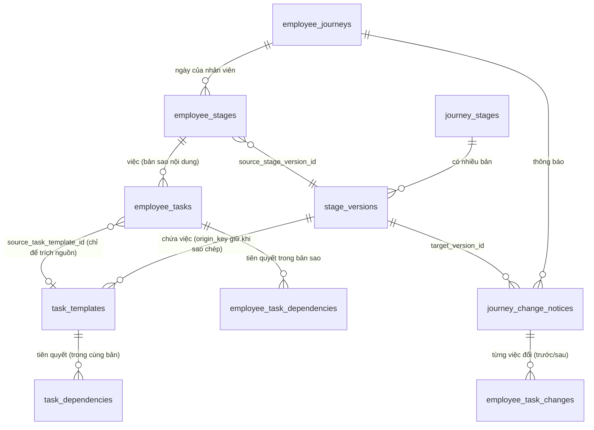
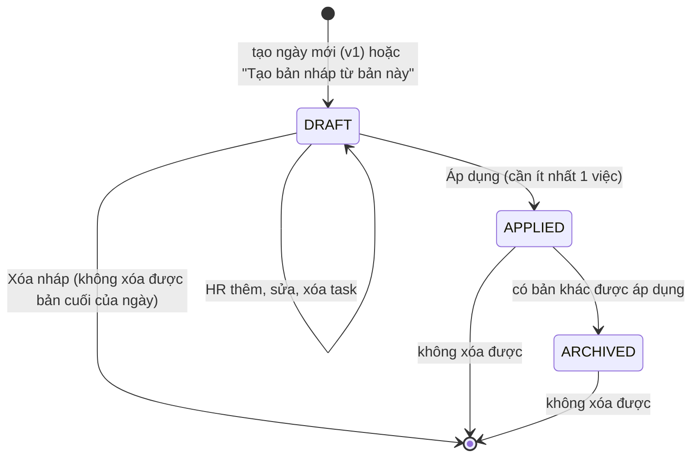
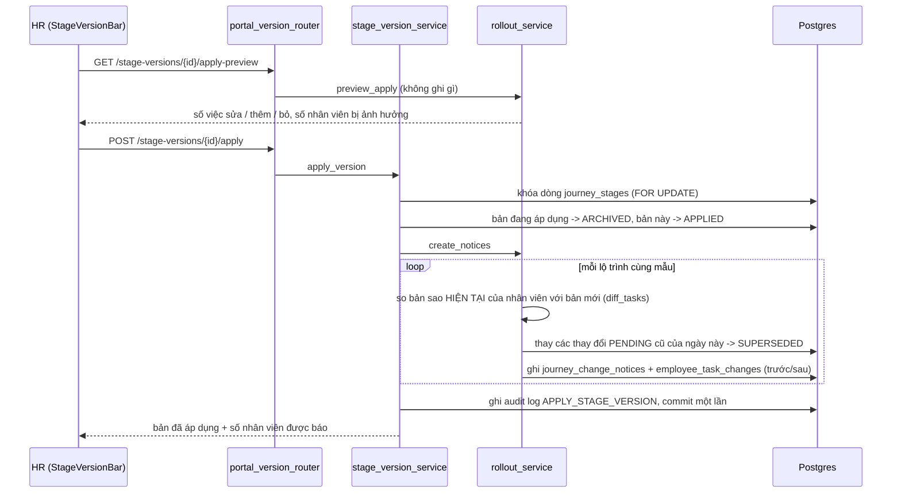
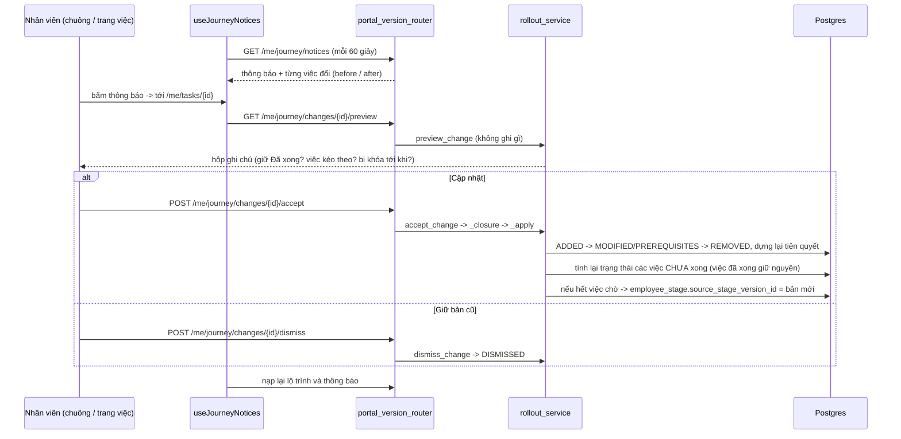
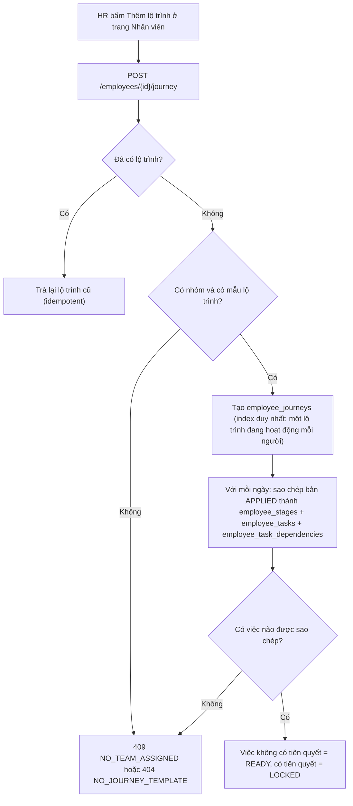

# Báo cáo triển khai: phiên bản theo từng ngày, lộ trình riêng của nhân viên và thông báo thay đổi (04/10/2026)

> Thực hiện đúng `ke-hoach-phien-ban-ngay-va-lo-trinh-rieng-nhan-vien.md` (bản 5). Báo cáo này ghi **những gì đã làm trong code, chạy ra sao, đã kiểm chứng bằng gì và còn thiếu gì**. Mọi con số lấy từ lần chạy thật hôm nay (test, DB dev, trình duyệt), không ước lượng. **Chưa commit**, đang nằm trong working tree của nhánh `feat/ai-task-latency`.

## 1. Kết luận

| Mục | Kết quả |
|---|---|
| Mỗi **ngày** có nhiều phiên bản (`DRAFT` / `APPLIED` / `ARCHIVED`), mỗi ngày đúng **một** bản đang áp dụng, chỉ **nháp** mới sửa được | **Xong**, có index duy nhất ở DB chặn hai bản áp dụng cùng lúc |
| **HR bấm "Thêm lộ trình"** cho nhân viên (trang Nhân viên) → nhân viên nhận **bản sao riêng** của các bản đang áp dụng, **có hiệu lực ngay** | **Xong**; lộ trình không còn tự tạo khi mở trang (`GET /me/journey` trả `404 NO_JOURNEY` khi chưa tạo) |
| HR sửa / áp dụng bản mới **không đổi** lộ trình đã có của ai | **Xong**, có test và đã thử trên giao diện thật |
| Mọi việc thay đổi (chưa làm hay đã làm) → **thông báo chuông** có trước/sau, bấm vào tới đúng việc, nhãn **"Có chỉnh sửa"**, hộp ghi chú nói bấm *Cập nhật* sẽ làm gì | **Xong** |
| **Cập nhật** = thay nội dung bằng bản mới nhất, **giữ trạng thái** (việc đã xong vẫn là đã xong); **Giữ bản cũ** = không đổi gì | **Xong** |
| HR có **bảng theo dõi triển khai** (chưa xem / đã xem / đã cập nhật / giữ bản cũ) | **Xong** |
| Migration `0011` áp vào **DB dev thật**, dữ liệu cũ được chuyển, backend Docker dựng lại | **Xong** (mục 7.2) |
| Kiểm thử | Backend **490 qua, 1 bỏ qua**; frontend **288 qua**; `ruff`, `mypy`, `alembic check`, `tsc`, `eslint` sạch |

### Điều chỉnh sau góp ý (04/10/2026, buổi chiều)

| Anh góp ý | Đã làm |
|---|---|
| "Chỉ nhân viên nào được HR thêm thì mới có lộ trình" | Trang **Nhân viên** của HR có nút **"Thêm lộ trình"** ở mỗi nhân viên chưa có lộ trình (`POST /api/v1/portal/employees/{user_id}/journey`; HR chỉ thêm được cho nhân viên **cùng team**, người khác team bị 403, không phải nhân viên thì 404; bấm lần hai không tạo lại). **Nhân viên không còn nút tự tạo**: chưa có thì thấy lời báo "HR sẽ thêm lộ trình cho bạn". |
| "Ảnh 3 bỏ lên chỗ Ngày 1" | Thanh phiên bản (chip bản + Tạo bản nháp / Áp dụng / Xóa nháp / Theo dõi triển khai) nằm **ngay dưới tên ngày** trong khối "Ngày 1", một hàng gọn; câu giải thích chuyển vào tooltip của từng chip. |

Lưu ý thẳng: điểm cuối `POST /me/journey` (nhân viên tự tạo) **vẫn còn trong backend** (giao diện không gọi nữa; các test cũ dựa vào nó). Muốn khóa hẳn để chỉ HR tạo được thì cần thêm một bước nhỏ ở backend; chưa làm vì anh chưa yêu cầu. Các mục 3.5, 4.2, 5, 7.3 và ảnh `01-…` bên dưới mô tả bản **trước** góp ý (nhân viên tự bấm tạo); phần còn lại của luồng (áp dụng, thông báo, Cập nhật, theo dõi) không đổi.

Kiểm chứng phần điều chỉnh: thêm 1 test backend (HR thêm lộ trình đúng team, idempotent, HR khác team 403, không phải nhân viên 404): `test_hr_adds_a_journey_for_an_employee_of_their_team_only`; trên giao diện thật, bấm "Thêm lộ trình" ở `newhire2` thì lộ trình có 16 việc, rồi tôi xóa lộ trình thử đó (DB dev trở lại 1 lộ trình, 16 việc, 1 ngày).

Điều anh cần biết ngay: ba điểm trong kế hoạch còn là **mặc định chưa được anh xác nhận** (mục 8): phiên bản tính **theo từng ngày** (Q1), tiên quyết chỉ có **trong cùng một phiên bản** (Q2), và khi bấm Cập nhật thì **kéo theo các việc mới liên quan** (Q3).

## 2. Hành vi cuối cùng (bảng quyết định anh đã chốt → code làm gì)

| Anh chốt | Code thực hiện ở đâu |
|---|---|
| HR chỉ sửa **bản nháp**; áp dụng thì bản cũ thành lưu trữ | `stage_version_service.ensure_editable` chặn mọi sửa/xóa task ngoài nháp (`VERSION_NOT_EDITABLE`); `apply_version` đổi trạng thái trong **một transaction** |
| Nhân viên tạo lộ trình = sao chép bản đang áp dụng, hiệu lực ngay | `journey_service.create_journey` → `_copy_applied_stages` |
| HR áp dụng **không** đổi lộ trình đang có | `apply_version` chỉ ghi `journey_change_notices` + `employee_task_changes`; không `UPDATE` bảng `employee_*` nội dung |
| Việc đổi nào cũng báo; việc đã làm báo y như chưa làm | `rollout_service.create_notices` (không phân biệt trạng thái khi tạo thông báo) |
| Bấm **Cập nhật**: nội dung thay mới nhất, trạng thái giữ nguyên | `rollout_service._apply` (không đụng `status` của việc đã xong; `_recompute_status` chỉ tính lại việc chưa xong) |
| Không có trạng thái "đang làm"; không nhắc tự động (Q13 bỏ) | Không thêm gì; không có job nhắc |
| Cập nhật kéo theo việc mới liên quan (Q3 mặc định) | `rollout_service._closure` |
| HR có bảng theo dõi | `GET /stage-versions/{id}/rollout` + `RolloutModal` |

## 3. Luồng chạy

### 3.1 Dữ liệu

- `task_templates.origin_key` (UUID) **không đổi** khi HR tạo nháp mới từ bản cũ, và `employee_tasks.origin_key` copy đúng giá trị đó. Nhờ vậy hệ thống biết "việc A ở bản 1" và "việc A ở bản 2" là **cùng một việc** kể cả khi HR đổi tên.
- `employee_tasks` giờ giữ **nội dung riêng** (tên, hướng dẫn, bắt buộc, nhóm, thứ tự) và `employee_task_dependencies` giữ tiên quyết riêng. Cột `source_task_template_id` chỉ còn dùng để Viga và "xem nguồn" tìm trích dẫn.
- Cột cũ `task_templates.journey_stage_id` được **giữ lại** để các truy vấn cũ vẫn chạy (xem giới hạn 8).

### 3.2 Vòng đời một phiên bản

### 3.3 HR áp dụng một bản

Điểm đáng chú ý: so sánh luôn tính giữa **bản sao hiện tại của chính nhân viên** và bản mới (không phải "bản áp dụng liền trước"). HR áp dụng v3 rồi v4 thì nhân viên chỉ thấy **một** thay đổi đúng, các thay đổi v3 chưa xử lý được đánh dấu `SUPERSEDED`.

### 3.4 Nhân viên nhận thông báo và bấm Cập nhật

### 3.5 Tạo lộ trình

## 4. Đã sửa gì, ở file nào

### 4.1 Backend (`backend/`)

| Nhóm | File | Nội dung |
|---|---|---|
| Migration | `alembic/versions/0011_stage_versions_employee_journey_copy.py` (387 dòng) | Thêm 5 bảng, cột mới, backfill dữ liệu cũ, có `downgrade` |
| Model mới | `model/stage_version.py`, `employee_stage.py`, `employee_task_dependency.py`, `journey_change_notice.py`, `employee_task_change.py` | Bảng phiên bản, ngày/tiên quyết của nhân viên, thông báo, từng thay đổi |
| Model sửa | `task_template.py` (+`stage_version_id`, `origin_key`), `employee_task.py` (nội dung riêng + `origin_key`, unique (journey, origin_key) khi chưa xóa), `employee_journey.py` (unique một lộ trình hoạt động mỗi người), `enums.py`, `__init__.py` | |
| Service mới | `services/portal/version_diff.py` (hàm thuần `diff_tasks`), `stage_version_service.py`, `rollout_service.py` | So sánh, vòng đời phiên bản, thông báo / cập nhật / theo dõi |
| Service sửa | `journey_service.py` (viết lại: `create_journey`, `get_journey`), `template_service.py` (theo phiên bản), `ai_task_service.py`, `employee_service.py`, `profile_service.py`, `analytics_service.py`, `ticket_service.py`, `admin_service.py`, `viga/snapshot.py` | `load_snapshot` không còn tự tạo lộ trình |
| API | `api/routers/portal_version_router.py` (mới), `portal_router.py`, `main.py`, hai file DTO | Mục 5 |

### 4.2 Frontend (`frontend/src/`)

| File | Nội dung |
|---|---|
| `features/portal-employee/useMyJourney.ts` | Trạng thái `needsCreate`/`noJourney`/`unavailable`, `createJourney`, `createFailed` (lỗi tạm vẫn giữ nút bấm lại) |
| `useJourneyNotices.ts` (mới) | Hỏi thông báo mỗi 60 giây; xem trước, cập nhật, giữ bản cũ, cập nhật tất cả; **ẩn thông báo mà mọi thay đổi đã bị bản mới hơn thay thế** |
| `JourneyProvider.tsx`, `notifications.ts`, `EmployeeShell.tsx` | Thông báo kiểu `change` vào chuông (đọc/chưa đọc lưu ở **máy chủ**), nhãn "Có chỉnh sửa" |
| `ChangeCard.tsx`, `changeModel.ts`, `ChangesPage.tsx`, route `/me/changes` (mới) | Thẻ trước/sau, hộp ghi chú, hai nút; trang gom thông báo |
| `JourneyProblemNotice.tsx`, `PendingChangesBanner.tsx` (mới), `OverviewPage`, `TasksPage`, `ProgressPage`, `TaskPage` | Thẻ "Tạo lộ trình", banner "có chỉnh sửa", chip ở danh sách việc, thẻ thay đổi ngay trang việc |
| `features/portal-hr/StageVersionBar.tsx`, `RolloutModal.tsx` (mới), `TaskManagementPage.tsx` | Chọn phiên bản, tạo nháp, **Áp dụng có xem trước**, xóa nháp, theo dõi triển khai; bản không phải nháp thì **chỉ xem**; bỏ nút "Xuất bản" |
| `features/app-shell/TasksSidebar.tsx`, `portal-hr/AiTasksPage.tsx` | Nhãn ngày theo phiên bản; ô chọn ngày của "Tạo bằng AI" ghi rõ task vào bản nháp nào |
| `messages/vi.json`, `en.json` | Chuỗi cho mọi màn mới (bỏ các chuỗi "Xuất bản" không còn dùng) |

## 5. API

| Phương thức và đường dẫn | Ai gọi | Việc làm |
|---|---|---|
| `POST /stages/{id}/versions` | HR | Tạo nháp từ bản chỉ định (mặc định bản đang áp dụng) |
| `PATCH /stage-versions/{id}` | HR | Sửa ghi chú |
| `DELETE /stage-versions/{id}` | HR | Xóa nháp (không xóa bản cuối của ngày) |
| `POST /stage-versions/{id}/tasks` | HR | Thêm việc vào nháp |
| `GET /stage-versions/{id}/apply-preview` | HR | Xem trước, **không ghi** |
| `POST /stage-versions/{id}/apply` | HR | Áp dụng, trả số nhân viên được báo |
| `GET /stage-versions/{id}/rollout` | HR | Bảng theo dõi |
| `GET /me/journey` / `POST /me/journey` | Nhân viên | Xem (404 `NO_JOURNEY` khi chưa tạo) / tạo lộ trình |
| `GET /me/journey/notices` | Nhân viên | Thông báo và từng thay đổi |
| `POST /me/journey/notices/{id}/read`, `.../accept-all` | Nhân viên | Đánh dấu đã đọc; cập nhật hết |
| `GET /me/journey/changes/{id}/preview` | Nhân viên | Hộp ghi chú, **không ghi** |
| `POST /me/journey/changes/{id}/accept`, `.../dismiss` | Nhân viên | Cập nhật / giữ bản cũ |

Giữ tương thích: `POST /stages/{id}/tasks`, `/from-proposal` (AI) và `/journey-templates/{id}/publish` vẫn chạy, ánh xạ sang bản nháp làm việc / "áp dụng các nháp mới nhất". Vì vậy luồng "Tạo bằng AI → Thêm vào Quản lý task" không cần đổi: task AI rơi vào **bản nháp** và chỉ tới nhân viên khi HR bấm Áp dụng.

## 6. Cách hoạt động các điểm khó

### 6.1 So sánh trước/sau (`version_diff.diff_tasks`)

- Khớp việc theo `origin_key`, **không** theo tên → đổi tên vẫn là "sửa", không phải "xóa + thêm".
- Chỉ so các trường: tên, hướng dẫn, bắt buộc, nhóm, tiên quyết. **Thứ tự (`sort_order`) bị loại**: chèn một việc vào giữa làm số thứ tự mọi việc sau đổi theo, nhưng không được sinh thông báo thừa (test `test_reordering_only_is_not_a_change`).
- Tiên quyết so theo `origin_key`, bỏ qua tiên quyết trỏ tới việc không còn trong bản sao của nhân viên (nếu không sẽ báo "đã đổi" mãi).
- Việc đã **làm xong** mà HR bỏ ở bản mới: **giữ nguyên trong lộ trình**, chỉ ghi một dòng thông tin (`informational`, lưu sẵn trạng thái `DISMISSED`, `after={"note": "kept_done"}`), không có nút.

### 6.2 Cập nhật một việc (`_closure`, `_apply`)

- `_closure` gom việc đang chờ có liên quan (việc mới mà việc này phụ thuộc) để **cập nhật cùng nhau**, tránh để lại việc trỏ tiên quyết vào chỗ chưa tồn tại.
- `_apply` chạy theo thứ tự **ADDED → MODIFIED/PREREQUISITES → REMOVED**, rồi dựng lại cạnh tiên quyết, rồi `_recompute_status` cho việc **chưa xong** (việc đã xong **không bao giờ** bị đưa về chưa làm).
- Khóa dòng (`FOR UPDATE`) các việc của lộ trình trước khi phân loại "đã làm hay chưa" để không lệch nếu nhân viên vừa bấm hoàn thành.
- Chỉ khi **không còn** dòng chờ hoặc dòng "giữ bản cũ" thì `employee_stage.source_stage_version_id` mới nhảy lên bản mới; nghĩa là ngày đó thật sự đã theo kịp.

### 6.3 Đồng thời

| Tình huống | Cách chặn |
|---|---|
| Hai HR áp dụng cùng lúc hai nháp của một ngày | Khóa dòng ngày `FOR UPDATE` + index duy nhất `uq_stage_versions_one_applied_per_stage` |
| Nhân viên bấm "Tạo lộ trình" hai lần cùng lúc | Index duy nhất một lộ trình hoạt động mỗi người + bắt `IntegrityError`, bên thua lấy lại cái của bên thắng |
| Bấm Cập nhật hai lần | Dòng đã `ACCEPTED` thì trả lại kết quả cũ; việc đã có theo `origin_key` không bị nhân đôi |

### 6.4 Điều quan sát được: ngày thêm sau

Nếu HR **thêm một ngày mới** khi nhân viên đã có lộ trình (lộ trình chụp lúc nhân viên bấm tạo nên không có ngày đó), thì lúc áp dụng ngày mới, nhân viên nhận thông báo với các việc **"Việc mới"**, bấm Cập nhật mới có ngày đó. Đây là hệ quả của nguyên tắc "không ai bị đổi mà không biết", và đã thấy ở lần chạy thật (mục 7.3). Có test: `test_a_day_added_after_journeys_exist_reaches_employees_as_a_notice`.

## 7. Kết quả kiểm chứng

### 7.1 Kiểm tra tĩnh và bộ test

| Lệnh | Kết quả |
|---|---|
| `ruff format --check` / `ruff check` (`src tests alembic`) | Sạch (sau khi tự format 1 file) |
| `mypy src` | `Success: no issues found in 151 source files` |
| `alembic upgrade head` rồi `alembic check` (DB test) | `No new upgrade operations detected` |
| `pytest tests -q` | **490 passed, 1 skipped** (113 giây) |
| `tsc --noEmit`, `eslint src` | Sạch |
| `vitest run` | **288 passed** (29 file) |

Test mới của tính năng:

| File | Số test | Kiểm gì |
|---|---|---|
| `tests/test_services/test_version_diff.py` | 8 | Giống nhau thì không đổi; chỉ đổi thứ tự không tính; sửa/thêm/bỏ đúng thứ tự; đổi tên vẫn là sửa; tiên quyết so theo khóa; tiên quyết mồ côi bị bỏ qua; việc đã xong bị bỏ chỉ báo thông tin; trạng thái đi cùng thay đổi |
| `tests/integration/test_portal_journey_versions_api.py` | 11 | Nhân bản giữ `origin_key`, chỉ nháp sửa được; áp dụng lưu trữ bản cũ và chặn trạng thái sai; phạm vi HR/vai trò; tạo lộ trình do nhân viên bấm và idempotent; áp dụng **không đổi** lộ trình có sẵn; việc chưa làm giữ nội dung tới khi bấm Cập nhật và có thể bị khóa lại; bản mới hơn thay thế thay đổi chờ và tính từ bản sao của nhân viên; thông báo riêng tư theo chủ; bỏ tiên quyết thì mở khóa, việc đã xong không bị bỏ; ngày thêm sau; áp dụng đồng thời và tạo lộ trình đồng thời |
| `frontend/.../changeModel.test.ts` | 6 | Trường hiển thị, bỏ `#` markdown, chỉ báo thông tin |
| `frontend/.../employee.test.tsx` (thêm 4) | 4 | Nút Tạo lộ trình; chuông báo và banner; trang việc hiện trước/sau, ghi chú, bấm Cập nhật gọi API rồi nạp lại; Giữ bản cũ chỉ gọi dismiss |
| `frontend/.../stage-versions.test.tsx` | 6 | Thanh phiên bản, theo dõi triển khai, tạo nháp, xem trước rồi mới áp dụng |

Các test cũ bị đổi (cố ý, vì hành vi đổi): fixture phải có `stage_version_id`; lộ trình phải tạo tường minh; việc xuất bản lại không còn 409. Ghi ở mục 9.

### 7.2 Migration thật trên DB dev

Trước khi chạy: `pg_dump` ra `vsf_dev_before_migration_0011.dump`; không có job nào đang chạy. Kết quả sau `0010 → 0011`:

| Kiểm | Giá trị thật |
|---|---|
| `alembic_version` | `0011` |
| Ngày (journey_stages) và phiên bản | 1 ngày → 1 phiên bản `APPLIED`, **16 việc** |
| Lộ trình nhân viên đang có | 1 `employee_stages`, **16** `employee_tasks` với **16** `origin_key` khác nhau, **2** cạnh tiên quyết |
| Việc thiếu tên/trạng thái | 0 |

Migration cũng đã được thử trước đó trên DB tạm có dữ liệu giả lập, **gồm cả `downgrade`**; DB tạm đã xóa.

### 7.3 Chạy thật trên giao diện (trình duyệt headless, dev server của anh)

Dùng một **ngày tạm "Ngày TMP"** và nhân viên `newhire2` (chưa có lộ trình) để không đụng dữ liệu thật; làm xong **dọn bằng SQL** và đối chiếu lại số liệu gốc (mục 7.4). Kết quả thật:

| Bước | Kết quả thật |
|---|---|
| Nhân viên mở `/me/tasks` khi chưa có lộ trình | Hiện thẻ **"Bạn chưa có lộ trình"** + nút **Tạo lộ trình**; không còn khối "chưa có lộ trình" trùng bên dưới |
| Bấm Tạo lộ trình | Lộ trình có Việc A, Việc B; A = `READY`, B = `LOCKED`; nhân viên làm xong A thì B = `READY` |
| HR bấm "Tạo bản nháp từ bản này" | Có **bản 2 (nháp)** với 2 việc sao chép |
| HR sửa A, sửa B, thêm C (nháp) | Nhân viên **không thấy** gì (lộ trình giữ nội dung bản 1) |
| HR bấm Áp dụng | Hộp xem trước: *"Việc sửa: 2, việc thêm: 1, việc bỏ: 0 … Lộ trình của 2 nhân viên đã tạo KHÔNG tự đổi"* |
| Sau khi áp dụng | Nhân viên có **1 thông báo, 3 thay đổi**: A `MODIFIED` (trạng thái hiện tại **DONE**), B `MODIFIED` (`READY`), C `ADDED`; **lộ trình vẫn là bản 1** |
| Chuông và trang Nhiệm vụ | Chuông có **"Ngày TMP có chỉnh sửa"**; banner "3 việc đang chờ bạn quyết định" |
| Bấm Cập nhật ở Việc A (đã xong) | Nội dung thành bản 2, **trạng thái vẫn `DONE`** |
| Bấm Giữ bản cũ ở Việc B | Nội dung **vẫn bản 1**, trạng thái `READY` |
| Bấm Cập nhật ở Việc C (mới) | C xuất hiện, **`LOCKED`** (vì tiên quyết B chưa xong; đúng) |
| HR mở "Theo dõi triển khai" | `Lê Văn Khang: Đã cập nhật (0 chờ, 2 đã cập nhật, 1 giữ bản cũ)`; `Hoàng Thị Yến: Chưa xem (3 chờ)` |

Dòng cuối là một điều quan trọng: `Hoàng Thị Yến` (`newhire3`) là nhân viên **có lộ trình thật** trong DB dev. Cô không có "Ngày TMP" trong lộ trình nên nhận thông báo "việc mới" theo mục 6.4. Tôi đã xóa các thông báo đó khi dọn.

Ảnh chụp (cùng thư mục `anh-trien-khai/`):

| Ảnh | Nội dung |
|---|---|
| `01-nhan-vien-chua-co-lo-trinh.png` | Thẻ Tạo lộ trình |
| `02-hr-ban-nhap-2.png` | HR: các phiên bản của ngày, nút Tạo bản nháp / Áp dụng / Xóa nháp |
| `03-hr-ap-dung-xem-truoc.png` | Hộp xem trước khi áp dụng |
| `04-nhan-vien-chuong-va-banner.png` | Chuông "Có chỉnh sửa" và banner |
| `05-nhan-vien-trang-viec-co-chinh-sua.png` | Trang việc: nhãn "Có chỉnh sửa", trước/sau, ghi chú, hai nút |
| `06-nhan-vien-trang-chinh-sua.png` | Trang gom các chỉnh sửa, nút "Cập nhật cả 3 việc" |
| `07-hr-theo-doi-trien-khai.png` | Bảng theo dõi triển khai |

### 7.4 Dữ liệu dev sau khi dọn

| Bảng | Trước khi thử | Sau khi dọn |
|---|---|---|
| journey_stages | 1 | 1 |
| stage_versions | 1 | 1 |
| task_templates | 16 | 16 |
| employee_journeys | 1 | 1 |
| employee_stages / employee_tasks | 1 / 16 | 1 / 16 |
| journey_change_notices / employee_task_changes | 0 / 0 | 0 / 0 |

Có hai bản sao lưu (`vsf_dev_before_migration_0011.dump` và `vsf_dev_before_ui_verify.dump`) trong thư mục tạm của phiên làm việc.

## 8. Giới hạn và việc chưa làm (nói thẳng)

| Mục | Tình trạng |
|---|---|
| **Q1** phiên bản theo **từng ngày** (không theo cả lộ trình) | Mặc định, **anh chưa xác nhận** |
| **Q2** tiên quyết chỉ trong **cùng một phiên bản** | Mặc định, chưa xác nhận. Chuyển một việc sang ngày khác sẽ **bỏ tiên quyết cũ** của nó |
| **Q3** Cập nhật kéo theo việc mới liên quan | Mặc định, chưa xác nhận; hộp ghi chú nói rõ việc kéo theo |
| Chưa **co hẹp** schema (migration `0012`: bỏ `task_templates.journey_stage_id`, cột cũ của `employee_tasks`) | Cố ý để lại cho một đợt sau khi mọi truy vấn cũ đã chuyển hẳn; hiện cột dư vẫn còn |
| HR **không sửa riêng** lộ trình của từng nhân viên | Đúng kế hoạch, chưa làm |
| Không có **nhắc tự động** nhân viên chưa cập nhật (Q13 anh đã bỏ) | Chỉ có bảng theo dõi cho HR |
| Chuông: thông báo "có chỉnh sửa" lưu đã đọc ở **máy chủ**; các thông báo khác (việc mở khóa, đã xong, nhắc, chào, ticket) **vẫn suy ra và lưu ở trình duyệt** như cũ | Chưa thống nhất |
| Thanh bên trái của Quản lý task: `%` hiện là 100% khi ngày có bản đang áp dụng, 0% nếu chỉ có nháp (không phải tiến độ thật) | Chỉ đổi nhãn, chưa thiết kế lại chỉ số |
| Trạng thái `JourneyTemplate.status` (`DRAFT/PUBLISHED`) vẫn còn và được đặt `PUBLISHED` khi áp dụng bản đầu | Chỉ để tương thích |
| Giao diện tiếng Anh | Có chuỗi `en.json` và test chuỗi đủ khóa; **chưa xem trực tiếp bằng trình duyệt** |
| Test lặp lại `test_analytics_api::test_hr_overview_is_scoped_to_their_team_and_adds_up` | **Chập chờn** (1 lần trong 3 lần chạy riêng), liên quan thời gian phản hồi ticket do đồng hồ DB dev nhảy ±101 giây (đã biết từ trước); không liên quan tính năng này, toàn bộ suite cuối cùng qua |
| Log backend có dòng "Không khởi tạo được Langfuse … No module named 'langfuse'" | Quan sát thấy khi dựng lại image; không do tính năng này; chưa điều tra |
| Dữ liệu dev | Trong lúc kiểm thử tôi **tạm** thêm một ngày, một lộ trình và thông báo vào DB dev (kể cả thông báo cho `newhire3`); đã xóa và đối chiếu số liệu ở 7.4 |

## 9. Hành vi đã đổi so với trước (cần biết khi viết test hoặc gọi API)

1. `GET /me/journey` **không còn tự tạo** lộ trình; chưa tạo thì `404 NO_JOURNEY`. Viga (`viga/snapshot.load_snapshot`) cũng không tự tạo.
2. Việc "xuất bản lại một lộ trình đã xuất bản" không còn trả 409: giờ là "áp dụng các nháp mới nhất", không có nháp thì không làm gì.
3. Mọi task mẫu phải thuộc một phiên bản (`stage_version_id` NOT NULL); sửa / xóa task ngoài bản nháp trả `VERSION_NOT_EDITABLE`.
4. Nội dung việc của nhân viên là **bản sao**: HR sửa task mẫu **không còn** làm đổi ngay những gì nhân viên thấy.

## 10. Vận hành

- Dựng lại: `docker compose build backend migrate && docker compose up -d` (đã làm; `migrate` chạy `0010 → 0011`, backend healthy).
- Quay lại: `alembic downgrade 0010` có sẵn (đã thử trên DB tạm có dữ liệu) nhưng **bỏ các bản sao riêng và thông báo**, nên chỉ dùng khi thật cần; khôi phục an toàn hơn bằng file `.dump` ở trên.
- Chạy kiểm thử backend: trong `backend/` dùng `.venv/Scripts/python.exe -m pytest tests -q` với `VSF_TEST_DATABASE_URL` trỏ DB `vsf_test` đã `alembic upgrade head`.
