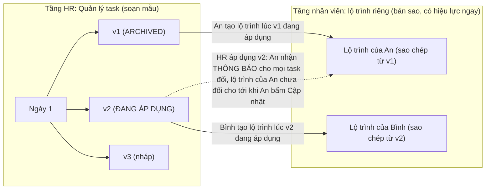
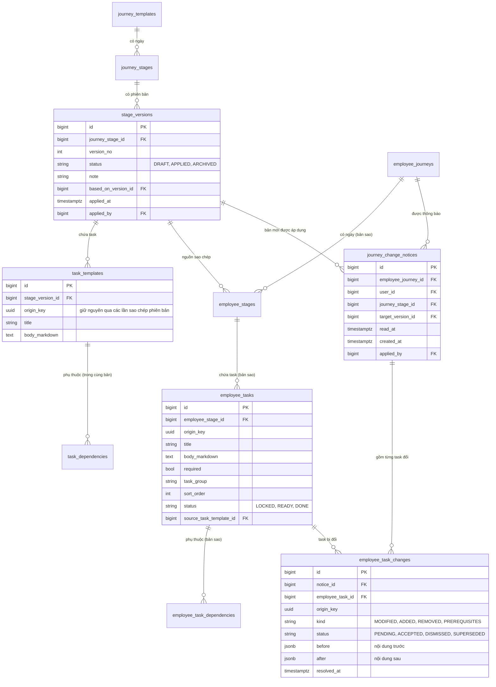
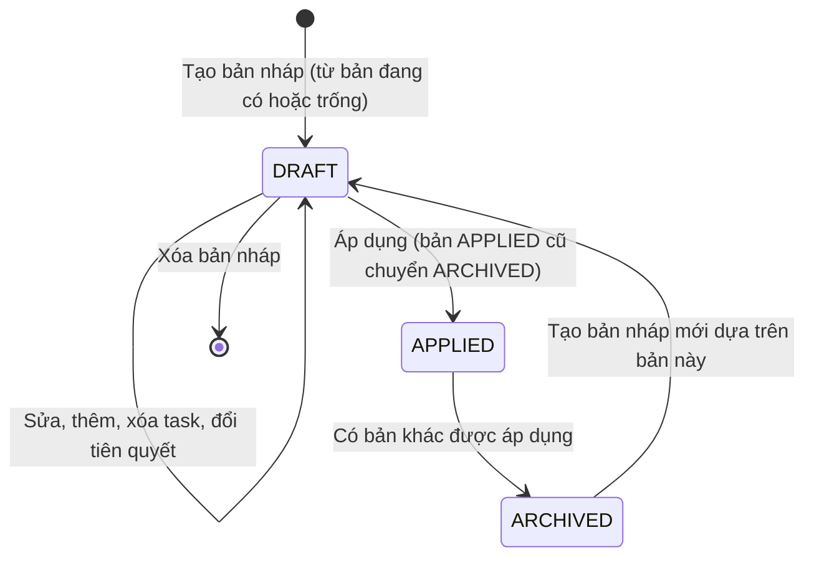
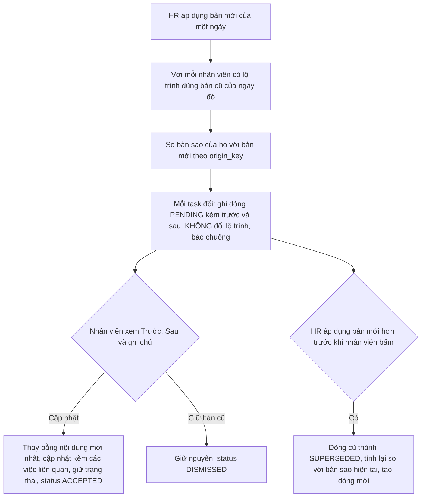
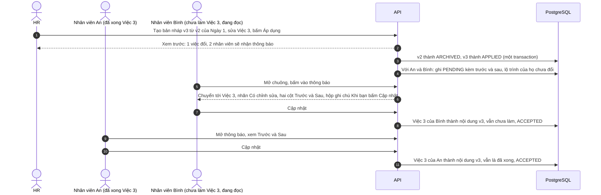

# Kế hoạch: phiên bản theo từng ngày, lộ trình riêng cho từng nhân viên và thông báo thay đổi (bản 5, 04/10/2026)

> **Đã triển khai ngày 04/10/2026**, kết quả và các giới hạn còn lại nằm ở [bao-cao-trien-khai-phien-ban-ngay-va-lo-trinh-rieng.md](bao-cao-trien-khai-phien-ban-ngay-va-lo-trinh-rieng.md). Q1, Q2, Q3 ở mục 11 vẫn là mặc định chưa được xác nhận. Nội dung bên dưới giữ nguyên như lúc lên kế hoạch.
>
> Đối chiếu code hiện tại của `vsf-onboarding-assistant` với mẫu `D:\Intern-VSF\P-040` (bản chuẩn có phiên bản, mỗi người được cấp một **bản sao** riêng).
>
> **Bản 5 khác bản 4 ở chỗ không còn tự cập nhật:** **mọi task thay đổi** (chưa làm hay đã làm) đều **báo vào chuông**, nhân viên bấm vào tới đúng task, đọc **ghi chú "khi bạn bấm Cập nhật sẽ xảy ra gì"**, rồi bấm **Cập nhật** để thay bằng nội dung mới nhất và làm tiếp. Việc đã làm bấm Cập nhật vẫn là đã xong (Q8 đã chốt). Các điểm còn lại cần anh chốt ở mục 11.

## 1. Anh muốn gì (viết lại cho chắc đã hiểu đúng)

1. Ở **Quản lý task**, mỗi **ngày** có **nhiều phiên bản**: tạo bản nháp từ bản đang có, sửa thoải mái, rồi **áp dụng** một bản. Mỗi ngày chỉ có **một bản đang áp dụng**.
2. Nhân viên bấm **"Tạo lộ trình"** thì tạo lộ trình **riêng cho người đó** từ các bản đang áp dụng, và **có hiệu lực ngay** (không nháp, không chỉnh lúc tạo).
3. Lộ trình của nhân viên là **bản sao độc lập**. HR sửa hay áp dụng bản mới thì hệ thống xử lý theo trạng thái từng task của từng người:

| Task của nhân viên lúc HR áp dụng | Hệ thống làm gì |
|---|---|
| **Chưa làm** (chưa xong: đang khóa hoặc làm được) | **Không tự đổi.** Thông báo vào chuông (ngày, tên việc, đổi gì); bấm vào thì **tới đúng task đó**, nhãn "có chỉnh sửa", **trước và sau**, kèm **ghi chú cho biết bấm Cập nhật sẽ xảy ra gì**; bấm **Cập nhật** thì nội dung task được **thay bằng bản mới nhất** và nhân viên **làm tiếp** theo nội dung mới (task vẫn chưa làm) |
| **Đã làm** (đã bấm hoàn thành) | **Giống hệt**: không tự đổi, báo chuông, tới đúng task, trước và sau, ghi chú; bấm **Cập nhật** thì đổi nội dung nhưng task **vẫn là đã xong**, không bắt làm lại |

**Tôi thấy hướng này hợp lý**, vì không ai bị đổi nội dung mà không biết hay không đồng ý, kể cả người đang đọc dở một task. Cái giá phải chấp nhận: nhân viên không bấm thì giữ nội dung cũ, nên HR cần bảng theo dõi ai đã cập nhật. Hai điều chỉnh đã đưa vào thiết kế:

- **Thông báo phải có bảng thật ở backend.** Hiện chuông **không có API**, chỉ được suy ra trong trình duyệt và lưu "đã đọc" ở `localStorage` (`frontend/.../notifications.ts`), nên không thể mang nội dung "trước và sau" và trạng thái chờ cập nhật.
- **So sánh tính theo chính bản sao hiện tại của nhân viên** so với bản mới (không so với "bản áp dụng liền trước"). HR áp dụng liên tiếp v3 rồi v4 thì nhân viên chỉ thấy một thay đổi đúng, không phải xem hai lớp.

## 2. Hiện trạng trong code (đã đọc thật)

| Điều tìm thấy | Ở đâu | Hệ quả |
|---|---|---|
| Lộ trình mẫu chỉ có `DRAFT` rồi `PUBLISHED`, một chiều. Cột `version` có nhưng **không dùng**. | `model/journey_template.py`, `template_service.publish_template` | Không có "nhiều bản của Ngày 1". |
| `update_task_template` **không kiểm trạng thái** (chỉ việc thêm task mới mới bị chặn khi đã xuất bản). | `template_service.update_task_template` | HR sửa một task là **mọi nhân viên thấy đổi ngay, không ai được báo**, kể cả người đang làm dở. |
| `EmployeeJourney` ghi là "bản chụp" nhưng `EmployeeTask` chỉ giữ `task_template_id` trỏ tới **task mẫu dùng chung**; tên, nội dung, tiên quyết, thứ tự đều **JOIN trực tiếp** lúc đọc. | `model/employee_task.py`, `journey_service.list_task_details`, `list_prerequisites`, `employee_service`, `viga/snapshot.py` | Không có bản chụp thật. |
| Lộ trình **tự tạo** khi nhân viên mở trang lần đầu (`get_or_start_journey`), chọn template `PUBLISHED` đầu tiên của team, không thì template dùng chung. Không có nút "Tạo lộ trình". | `journey_service.get_or_start_journey`, `_find_journey_template` | Mọi người trong team nhận chung một lộ trình. |
| Khóa task sinh từ bảng `task_dependencies` trên task mẫu. | `journey_service._start_journey`, `_unlock_dependents` | Phải chuyển sang phụ thuộc **của bản sao**. |
| **Chưa có API thông báo.** Chuông của nhân viên suy ra từ lộ trình ngay trong trình duyệt (việc vừa mở khóa, đã xong, nhắc việc, ticket), lưu đã đọc ở trình duyệt. | `frontend/src/features/portal-employee/notifications.ts`, `JourneyProvider.tsx`, `EmployeeShell.tsx` | Cần bảng và API thông báo thật cho loại "task thay đổi". |

**Kết luận:** yêu cầu của anh vừa là tính năng mới, vừa **vá lỗ hổng có thật** (sửa task mẫu làm đổi lộ trình của người đang làm mà không ai biết).

## 3. Mẫu tham khảo P-040 và cách áp dụng

| P-040 | Ý nghĩa | Ở dự án này |
|---|---|---|
| `TemplateVersion` (`DRAFT`, `APPROVED`), index duy nhất "tối đa 1 bản `APPROVED` mỗi template" | Phiên bản, một bản đang áp dụng | **`stage_versions`** (`DRAFT`, `APPLIED`, `ARCHIVED`), tối đa 1 `APPLIED` mỗi ngày |
| `OnboardingPlan` của từng kỹ sư là **bản sao riêng**; "sửa bản chuẩn không đụng plan đã cấp (snapshot)" | Mỗi người một bản sao | **Lộ trình riêng** của từng nhân viên |
| `PlanTask` có `title`, `instruction` **của riêng nó**, giữ `template_task_id` | Nội dung nằm trong bản sao | `employee_tasks` có cột nội dung riêng, giữ `source_task_template_id` |
| Cấp plan là thao tác **chủ động**; mỗi người đúng một plan đang mở | Không tự tạo, không trùng | Nút **"Tạo lộ trình"**; mỗi người đúng một lộ trình đang chạy |

Khác P-040: (a) P-040 đặt phiên bản ở cấp **cả template**, anh muốn **theo từng ngày**; (b) lộ trình **áp dụng luôn** (P-040 có `DRAFT` rồi `APPROVED`); (c) **thông báo và cập nhật thay đổi** là phần thêm, P-040 không có.

## 4. Thiết kế đề xuất

### 4.1 Hai tầng, hai vòng đời

Quy tắc cốt lõi: **bản đã áp dụng là bất biến** (muốn sửa thì tạo bản nháp mới). Mọi chữ nhân viên thấy nằm trong **bản sao của họ**, không đọc ngược từ mẫu.

### 4.2 Dữ liệu

Điểm chính:

- **`stage_versions`**: index duy nhất từng phần "tối đa 1 dòng `APPLIED` mỗi `journey_stage_id`" (như P-040). Bản `ARCHIVED` **không bao giờ xóa**; bản `DRAFT` xóa được.
- **`task_templates`**: chuyển từ `journey_stage_id` sang `stage_version_id`; thêm **`origin_key`** (UUID) **giữ nguyên khi sao chép phiên bản**, nên một việc ở v1, v2, v3 có cùng mã. Đây là khóa so sánh "trước và sau". Tiên quyết chỉ cho phép **trong cùng một phiên bản** (Q2).
- **Bản sao của nhân viên**: `employee_stages`, `employee_task_dependencies` mới; `employee_tasks` thêm cột nội dung riêng, `origin_key`, và `task_template_id` đổi thành `source_task_template_id` (cho phép NULL). Bản đã áp dụng bất biến và không bị xóa nên trích dẫn nguồn (Viga, "xem đúng đoạn nguồn") đọc qua `source_task_template_id`, **không cần sao chép** `task_source_mappings`.
- **Thông báo gồm hai bảng**: `journey_change_notices` (một dòng cho mỗi nhân viên và mỗi lần áp dụng, dùng cho chuông và "đã đọc" ở server) và **`employee_task_changes`** (mỗi task đổi một dòng, giữ `before`, `after`, `status`). Tách như vậy để **mỗi task có trạng thái riêng** (đã cập nhật, giữ bản cũ, đang chờ), và để HR đối chiếu nội dung cũ khi cần.
- **`employee_journeys`**: đúng **một lộ trình chưa xóa mỗi người** (index duy nhất từng phần). **Không có `DRAFT`**: tạo ra là chạy luôn.

### 4.3 Vòng đời phiên bản của một ngày

- **Chỉ `DRAFT` mới sửa được** (409 `VERSION_NOT_EDITABLE` cho bản khác). Đây là chỗ vá lỗ hổng ở mục 2.
- **Áp dụng** làm trong một transaction: bản cũ thành `ARCHIVED`, bản này thành `APPLIED`, rồi **phân loại và xử lý task của từng nhân viên** (4.5), ghi audit.

### 4.4 Nhân viên tạo lộ trình: có hiệu lực ngay

- Nhân viên bấm **"Tạo lộ trình của tôi"** (`POST /me/journey`, idempotent: đã có thì trả lại lộ trình hiện tại). **Không có bản nháp, không có bước chỉnh sửa.**
- Hệ thống đọc các bản `APPLIED` của các ngày tại một thời điểm, trong **một transaction**, sao chép: ngày, task (tên, nội dung, bắt buộc, nhóm, thứ tự, `origin_key`), tiên quyết (đổi id mẫu sang id bản sao).
- Trạng thái ban đầu: có tiên quyết thì `LOCKED`, không thì `READY`. Khóa và mở khóa chạy trên `employee_task_dependencies` của bản sao.
- Team chưa có ngày nào đang áp dụng thì dùng lộ trình dùng chung của ADMIN (như hiện nay); không có thì báo `NO_JOURNEY_TEMPLATE`.
- **HR sửa riêng lộ trình của từng nhân viên không làm đợt này** (Q5), nên bản sao của mọi người **luôn giống bản nguồn** và việc cập nhật dưới đây không phải xử lý "chỉnh riêng".

### 4.5 HR áp dụng bản mới: mọi thay đổi đều báo, nhân viên tự bấm "Cập nhật"

**Nguyên tắc: hệ thống không tự đổi lộ trình của ai.** Mọi task thay đổi, dù **chưa làm** hay **đã làm**, đều tạo thông báo. Nhân viên xem rồi bấm **Cập nhật** thì nội dung task được **thay bằng bản mới nhất**; chưa bấm thì họ vẫn thấy và làm theo nội dung cũ của mình.

Chỉ có **hai loại task**, đúng máy trạng thái hiện có (`LOCKED`, `READY`, `DONE`), không có trạng thái "đang làm": **chưa làm** là `LOCKED` hoặc `READY`; **đã làm** là `DONE`.

**Ai nhận thông báo:** mỗi nhân viên có lộ trình chưa xóa mà ngày đó **không** đến từ bản vừa áp dụng. Nhân viên tạo lộ trình **sau** khi áp dụng đã nhận bản mới nên không có thông báo. Thay đổi được tính bằng cách so `origin_key` giữa **bản sao hiện tại của chính nhân viên** và bản mới.

**Từng loại thay đổi và điều gì xảy ra khi nhân viên bấm "Cập nhật":**

| Loại | Task chưa làm | Task đã làm |
|---|---|---|
| **Đổi nội dung** (tên, nội dung, bắt buộc, nhóm, thứ tự) | Thay bằng nội dung mới; **vẫn chưa làm** | Thay bằng nội dung mới; **vẫn là đã xong**, không bắt làm lại (Q8, đã chốt) |
| **Đổi tiên quyết** | Đổi tiên quyết rồi tính lại khóa: mọi tiên quyết mới đã xong thì `READY`, ngược lại `LOCKED` | Đổi tiên quyết; việc đã xong **không bị khóa lại** |
| **Thêm việc mới** | Thêm vào lộ trình (chưa làm), khóa hay mở theo tiên quyết | (không áp dụng, việc mới luôn là chưa làm) |
| **Bỏ việc** | Bỏ khỏi lộ trình (xóa mềm) | **Giữ nguyên**, chỉ hiện trong thông báo như thông tin, không có nút |

**Ghi chú nhân viên đọc trước khi bấm "Cập nhật"** (hộp hiện cạnh hai cột Trước và Sau; phần "sẽ xảy ra" do máy chủ tính cụ thể cho đúng task đó, không viết chung chung):

> **Khi bạn bấm Cập nhật:**
> - Nội dung task này sẽ được **thay bằng bản mới nhất** (cột Sau). Bạn **tiếp tục làm theo nội dung mới**.
> - Những gì bạn đã làm **không bị mất**. Trạng thái **giữ nguyên**: việc đã xong vẫn là đã xong, việc chưa làm vẫn chưa làm.
> - *(chỉ hiện khi đúng)* Việc này sẽ **bị khóa** cho tới khi bạn xong "…" (tiên quyết mới).
> - *(chỉ hiện khi đúng)* Hệ thống sẽ **cập nhật thêm** các việc liên quan: "…", "…".
> - Nội dung cũ vẫn được lưu lại để HR đối chiếu khi cần.
> - Nếu **chưa muốn** đổi, bấm **Giữ bản cũ** và bạn tiếp tục như hiện tại.

**Việc kéo theo (cập nhật cùng nhau):** vài thay đổi buộc phải đi cùng nhau để lộ trình không bị hỏng (một việc mới là tiên quyết của việc đang cập nhật; việc bị bỏ mà việc khác phụ thuộc). Khi bấm "Cập nhật" ở một task có thay đổi kéo theo, hệ thống **cập nhật luôn các việc đó** và liệt kê trong ghi chú ở trên (Q3). Thay đổi chỉ đổi nội dung thì cập nhật **độc lập từng task**.

**Thông báo vào chuông:** mỗi nhân viên một thông báo cho mỗi lần áp dụng, gộp theo ngày, ví dụ **"Ngày 1: 3 việc thay đổi"**. Mỗi dòng nêu **ngày, tên việc, đổi gì** (tóm tắt, ví dụ "Nội dung bước 2 và hạn nộp") và nhãn **"đã làm"** hoặc **"chưa làm"** để biết việc đó của họ đang ở đâu.

**Nhân viên bấm vào một dòng thì:**

1. Chuyển tới **đúng task đó** (trang chi tiết, hoặc ngày chứa nó với task được làm nổi).
2. Task có nhãn **"Có chỉnh sửa"**; hiện hai cột **Trước** (của chính họ) và **Sau** (bản mới), tô khác biệt, kèm **hộp ghi chú** ở trên và hai nút **"Cập nhật"**, **"Giữ bản cũ"**.
3. Có nút **"Cập nhật tất cả"** ở thông báo cho người đồng ý hết.

**Áp dụng liên tiếp:** HR áp dụng v3 rồi v4 khi nhân viên chưa bấm. Các dòng `PENDING` của v3 thành `SUPERSEDED`, tính lại dòng mới của v4 **so với bản sao hiện tại**, nên nhân viên chỉ thấy một thay đổi đúng.

**Va chạm đồng thời:** lúc bấm "Cập nhật", hệ thống khóa các dòng `employee_tasks` liên quan (`FOR UPDATE`) và **tính lại tại thời điểm đó** (task vừa được hoàn thành thì xử lý theo cột "đã làm"), không dùng số liệu lúc tạo thông báo.

**Quy mô:** lúc áp dụng chỉ **ghi các dòng thông báo**, không đổi dữ liệu lộ trình của ai nên nhanh; làm ngay trong transaction áp dụng. Chỉ khi có hàng nghìn lộ trình mới cần chuyển sang việc nền bằng bảng `jobs` có sẵn (Q9).

**Hệ quả cần biết:** vì không tự đổi, nhân viên **không bấm thì giữ nội dung cũ mãi**. Do đó HR có **bảng theo dõi triển khai** (mục 5) để biết ai chưa cập nhật và tự nhắc. **Không có nhắc tự động** (Q13, đã chốt).

### 4.6 Luồng chính theo thời gian

## 5. Giao diện

**Quản lý task (HR)**
- Mỗi ngày có **bộ chọn phiên bản**: `v1 · Lưu trữ`, `v2 · Đang áp dụng`, `v3 · Nháp`, kèm số task và ngày áp dụng.
- Nút: **"Tạo bản nháp từ bản này"**, **"Áp dụng bản này"**, **"Xóa bản nháp"**. Bản đã áp dụng hoặc lưu trữ **chỉ đọc**, có dải "Tạo bản nháp để chỉnh sửa".
- **Hộp xác nhận Áp dụng có xem trước thật** (không ghi gì): "Áp dụng v3 cho Ngày 1: 2 việc đổi, 1 thêm, 0 bỏ. **12 nhân viên đang dùng bản cũ sẽ nhận thông báo; lộ trình của họ chưa đổi cho tới khi họ bấm Cập nhật.**"
- **Theo dõi triển khai** cho mỗi lần áp dụng: bảng nhân viên và việc với trạng thái `Chưa xem`, `Đã xem`, `Đã cập nhật`, `Giữ bản cũ`, để HR biết ai chưa nhận bản mới và nhắc.
- Số liệu đầu ngày theo phiên bản đang xem; nút "Xuất bản" cũ thay bằng "Áp dụng".

**Tạo task bằng AI:** ô "Roadmap đích" chọn **ngày và bản nháp** (ngày chưa có nháp thì tạo nháp mới từ bản đang áp dụng). Task AI tạo vào bản nháp đó, không đụng bản đang áp dụng.

**Nhân viên**
- Chưa có lộ trình: trang Nhiệm vụ hiện nút **"Tạo lộ trình của tôi"**; bấm là có lộ trình chạy ngay.
- **Chuông**: loại thông báo mới "Lộ trình có thay đổi" (từ backend, đã đọc lưu ở server). Dòng thông báo nêu **ngày, tên việc, đổi gì** và nhãn đã làm hoặc chưa làm. Bấm vào **chuyển tới đúng task**. Thông báo chưa xử lý vẫn nằm trong chuông, không có nhắc tự động.
- **Thẻ task** trên roadmap và danh sách có nhãn **"Có chỉnh sửa"** khi đang chờ nhân viên xem.
- **Trang chi tiết task**: dải thông báo, hai cột **Trước và Sau** tô khác biệt, **hộp ghi chú "Khi bạn bấm Cập nhật"** (4.5), nút **"Cập nhật"** và **"Giữ bản cũ"**. Task đã xong vẫn xem được thay đổi và bấm cập nhật mà không bị mở lại.

## 6. API (đề xuất)

| Việc | Điểm cuối | Ghi chú |
|---|---|---|
| Cây kèm phiên bản | `GET /portal/journey-templates/mine` (mở rộng) | mỗi ngày có `versions[]` |
| Tạo bản nháp | `POST /portal/stages/{stage_id}/versions` (`from_version_id`, `note`) | sao chép task, `origin_key`, tiên quyết |
| Sửa ghi chú, xóa nháp | `PATCH`, `DELETE /portal/stage-versions/{id}` | xóa chỉ khi `DRAFT` |
| **Xem trước áp dụng** | `GET /portal/stage-versions/{id}/apply-preview` | số việc đổi, thêm, bỏ; số nhân viên sẽ nhận thông báo; **không ghi gì** |
| Áp dụng | `POST /portal/stage-versions/{id}/apply` | một transaction (hoặc việc nền khi nhiều lộ trình); trả số liệu rải |
| Theo dõi triển khai | `GET /portal/stage-versions/{id}/rollout` | trạng thái từng nhân viên và việc |
| Sửa task | giữ `PATCH /portal/task-templates/{id}` **thêm kiểm bản `DRAFT`**; tạo task: `POST /portal/stage-versions/{id}/tasks`, `.../tasks/from-proposal` | 409 `VERSION_NOT_EDITABLE` |
| Tạo lộ trình | `POST /portal/me/journey` (idempotent); `GET /me/journey` trả `404 NO_JOURNEY` thay vì tự tạo | có hiệu lực ngay |
| Thông báo thay đổi | `GET /portal/me/journey/notices`, `POST .../{id}/read` | kèm danh sách `employee_task_changes` |
| Xem trước hậu quả của nút Cập nhật | `GET /portal/me/journey/changes/{change_id}/preview` | trả nội dung ghi chú: việc có bị khóa không, việc nào được cập nhật kèm; **không ghi gì** |
| Xử lý một việc đổi | `POST /portal/me/journey/changes/{change_id}/accept`, `.../dismiss`; `POST /portal/me/journey/notices/{id}/accept-all` | `accept` tính lại tại thời điểm bấm; cập nhật kèm các việc liên quan |
| Tương thích cũ | `POST /portal/journey-templates/{id}/publish` giữ tạm: áp dụng bản nháp mới nhất của mọi ngày | bỏ sau một bản phát hành |

## 7. Chỗ trong code phải đổi (đã tìm bằng grep)

| File | Việc |
|---|---|
| `model/`: `stage_version.py`, `employee_stage.py`, `employee_task_dependency.py`, `journey_change_notice.py`, `employee_task_change.py` (mới); `task_template.py`, `employee_task.py`, `employee_journey.py` | Bảng và cột mới (mục 4.2) |
| `alembic/versions/0011_*.py`, `0012_*.py` | Mục 8 |
| `services/portal/template_service.py` | Tạo, sao chép, xem trước, áp dụng, xóa phiên bản; `update_task_template`, `create_task_manual`, `delete_task_template`, `apply_dependencies` chuyển sang phạm vi **phiên bản** và kiểm `DRAFT`; `list_my_templates` có phiên bản; `publish_template` thành lớp tương thích |
| **`services/portal/version_diff.py` (mới)** | Hàm thuần so hai tập task theo `origin_key`: trả thay đổi (đổi nội dung, thêm, bỏ, đổi tiên quyết) kèm `before`, `after`. Dùng chung cho xem trước, tạo thông báo, cập nhật; dễ test |
| **`services/portal/rollout_service.py` (mới)** | Khi áp dụng: tìm lộ trình bị ảnh hưởng và **ghi các dòng thông báo `PENDING`** (không đổi dữ liệu lộ trình), đánh `SUPERSEDED`; `preview` hậu quả; `accept` (thay nội dung, cập nhật kèm việc liên quan, tính lại khóa, giữ trạng thái), `dismiss`, `accept_all`; tổng hợp triển khai |
| `services/portal/ai_task_service.py` | `create_task_from_proposal` nhận bản nháp đích |
| `services/portal/journey_service.py` | `_start_journey` (sao chép), tách `get_journey` và `create_journey`, `_find_journey_template` chọn bản `APPLIED`, `complete_task`, `_unlock_dependents`, `list_task_details`, `list_prerequisites` đọc từ bản sao |
| `services/portal/employee_service.py`, `get_hr_dashboard`, `services/viga/snapshot.py` | Đọc nội dung và tiên quyết từ bản sao; nguồn trích qua `source_task_template_id` |
| `services/portal/admin_service.py` (`_copy_shared_template`) | Chép lộ trình dùng chung sang team: tạo ngày kèm `v1` ở trạng thái nháp (Q6) |
| `services/portal/job_handlers.py`, `job_service.py` | Chỉ khi quy mô rất lớn: loại việc nền để ghi thông báo (Q9) |
| `api/routers/` (router mới cho phiên bản, thông báo, xử lý thay đổi), `portal_router.py`, `dto/` | Điểm cuối ở mục 6 |
| Frontend: `features/portal-hr/` (Quản lý task, AiTasksPage, theo dõi triển khai), `features/portal-employee/` (`notifications.ts` đọc thêm từ API, `JourneyProvider.tsx`, `EmployeeShell.tsx`, thẻ task có nhãn, chi tiết task có hai cột Trước và Sau, nút Tạo lộ trình), `messages/vi.json`, `en.json` | Mục 5 |

## 8. Di chuyển dữ liệu (không mất dữ liệu đang có)

Hai bước (mở rộng, rồi thu hẹp):

1. **0011 (mở rộng):** tạo bảng mới; thêm cột mới cho phép NULL; **điền**: mỗi `journey_stage` có `stage_version` v1 (`APPLIED` nếu template đang `PUBLISHED`, ngược lại `DRAFT`); mỗi `task_template` nhận `origin_key` mới và `stage_version_id`; mỗi `employee_journey` hiện có được **sao chép** nội dung task mẫu hiện tại thành bản sao riêng cùng `origin_key`.
2. **Sau khi code mới chạy ổn: 0012 (thu hẹp):** NOT NULL cho cột mới, bỏ `task_templates.journey_stage_id`, bỏ ràng buộc duy nhất cũ của `employee_tasks`, thêm các index duy nhất từng phần.

Có `downgrade`. DB dev hiện trống nội dung nên rủi ro thấp, nhưng migration vẫn được thử trên bản sao lưu có dữ liệu.

## 9. Tác động chéo cần xử lý

- **Viga** đọc nội dung việc để trả lời: chuyển sang bản sao. Việc chờ cập nhật thì Viga vẫn trả lời theo nội dung cũ mà nhân viên đang thấy; sau khi bấm Cập nhật thì theo nội dung mới.
- **Bảng điều khiển HR, danh sách nhân viên, analytics** đếm theo task: đếm trên bản sao, bỏ dòng đã xóa mềm.
- **Chuông thông báo**: giữ các thông báo suy ra từ lộ trình như hiện nay, **cộng thêm** loại thay đổi từ API; phần "đã đọc" của loại mới lưu ở server (`read_at`).
- **Ticket đã gắn vào task bị xóa mềm** vẫn mở được vì chỉ xóa mềm.
- **Xóa bản nháp**: chỉ bản `DRAFT` (chưa ai sao chép) xóa được; `RESTRICT` giữ vững điều này.
- **Kiểm thử cũ**: test hành trình dựa vào `publish` và tự tạo journey phải viết lại theo luồng mới.

## 10. Kế hoạch làm và kiểm thử

| Pha | Nội dung | Kiểm thử chính |
|---|---|---|
| P1 | Mô hình, migration 0011, phiên bản (tạo, sửa chỉ khi nháp, áp dụng, xóa nháp), `origin_key`, vá `update_task_template` | Hai bản áp dụng cùng lúc bị chặn; sửa bản đã áp dụng trả 409; áp dụng giữ bản cũ `ARCHIVED`; tiên quyết chéo phiên bản bị từ chối; `origin_key` giữ nguyên qua lần sao chép |
| P2 | Lộ trình riêng có hiệu lực ngay: tạo, đọc, hoàn thành, mở khóa trên bản sao; chuyển Viga, danh sách nhân viên, dashboard | **Sửa hoặc áp dụng bản mới ở Quản lý task không làm đổi lộ trình đã tạo** (test chính); tạo hai lần chỉ ra một lộ trình; người ngoài team không xem được |
| P3 | `version_diff` và `rollout_service`: xem trước, ghi thông báo `PENDING` cho mọi task đổi, `SUPERSEDED`, đọc, theo dõi triển khai | **Áp dụng bản mới không làm đổi bất kỳ dòng nào của lộ trình nhân viên** (cả task chưa làm và đã làm); nhân viên tạo lộ trình **sau** khi áp dụng không có thông báo; áp dụng liên tiếp chỉ còn một dòng chờ đúng; nội dung "trước" lấy từ bản sao của chính nhân viên |
| P4 | `preview`, `accept`, `dismiss`, `accept_all` | `accept` thay nội dung và giữ nguyên trạng thái (đã xong vẫn đã xong, chưa làm vẫn chưa làm); tiên quyết mới thì khóa lại việc chưa làm, không khóa lại việc đã xong; việc liên quan được cập nhật kèm đúng như ghi chú đã hiện; `accept` hai lần không nhân đôi; tính lại tại thời điểm bấm (task vừa xong thì xử lý đúng); bỏ việc đã làm thì giữ nguyên; tiên quyết không tạo vòng |
| P5 | Giao diện: Quản lý task có phiên bản và xem trước, AI chọn bản nháp, nút Tạo lộ trình, chuông có nội dung thay đổi, bấm chuông tới đúng task có nhãn và hai cột Trước và Sau, theo dõi triển khai | vitest, kiểm bằng Chrome điều khiển thật |
| P6 | Migration 0012, bỏ lớp tương thích, báo cáo | Thử migration trên bản sao lưu có dữ liệu thật |

**Nghiệm thu** (bằng giao diện thật, chứng minh bằng DB): tạo hai nhân viên; An hoàn thành Việc 3, Bình chưa làm và đang đọc Việc 3; HR sửa Việc 3 và áp dụng; **lộ trình của cả hai chưa đổi**, cả hai có thông báo; bấm vào tới đúng Việc 3 thấy Trước, Sau và hộp ghi chú; Bình bấm Cập nhật thì Việc 3 của Bình đổi nội dung và vẫn chưa làm; An bấm Cập nhật thì Việc 3 của An đổi nội dung và vẫn là đã xong.

## 11. Các điểm cần anh chốt

| # | Câu hỏi | Đề xuất mặc định (tôi chọn nếu anh không có ý khác) |
|---|---|---|
| Q1 | Phiên bản theo **từng ngày** (như anh nói) hay theo **cả lộ trình** (như P-040)? | **Theo từng ngày**. Cái giá: mỗi ngày độc lập. |
| Q2 | Tiên quyết có được trỏ **sang task ở ngày khác** không? | **Không**, chỉ trong cùng một bản của một ngày. Nếu cần chéo ngày thì phải đổi sang phiên bản theo cả lộ trình. |
| Q3 | Bấm "Cập nhật" ở một task có thay đổi **kéo theo** việc khác (tiên quyết mới, việc mới là tiên quyết) thì sao? | **Cập nhật luôn các việc liên quan** và liệt kê trong ghi chú trước khi bấm, để lộ trình không bị hỏng. Thay đổi chỉ đổi nội dung thì cập nhật độc lập từng task. |
| Q4 | ~~Việc chưa làm có tự đổi ngay không?~~ | **Đã chốt: không tự đổi.** Mọi task thay đổi đều báo, nhân viên bấm Cập nhật để thay bằng nội dung mới nhất, có ghi chú giải thích trước khi bấm (4.5). |
| Q5 | HR có cần **sửa riêng** lộ trình của từng nhân viên không? | **Không làm đợt này.** Nếu sau này cần, phải thêm cờ "đã chỉnh riêng" để việc cập nhật không ghi đè. |
| Q6 | Lộ trình dùng chung của ADMIN khi chép sang team? | Chép thành `v1` ở trạng thái **nháp** để HR team duyệt rồi áp dụng. |
| Q7 | Nhân viên đã có lộ trình ở DB hiện tại xử lý sao? | Sao chép nội dung hiện tại thành bản sao riêng, đóng băng như đang thấy (mục 8). |
| Q8 | ~~Việc đã làm bấm Cập nhật có mở lại không?~~ | **Đã chốt: không mở lại**, vẫn là đã xong, chỉ đổi nội dung. |
| Q9 | Rải thông báo cho nhiều nhân viên: làm trong lúc bấm Áp dụng hay chạy nền? | **Làm ngay trong transaction** vì chỉ ghi dòng thông báo, rất nhanh; chỉ khi có hàng nghìn lộ trình mới chuyển sang việc nền. |
| Q10 | Việc đổi **thứ tự** (không đổi nội dung) có cần báo hoặc cần nhân viên duyệt không? | **Tự áp dụng cho mọi task, chỉ nêu trong thông báo**, vì không đổi cách làm việc. |
| Q11 | Thông báo có cần kênh khác ngoài chuông (email)? | **Chưa**, chỉ chuông, nhãn trên task và huy hiệu trong portal. |
| Q12 | HR có cần **xem ai chưa cập nhật** sau mỗi lần áp dụng? | **Có** (bảng theo dõi triển khai ở mục 5). |
| Q13 | ~~Chuông nhắc lại việc chưa cập nhật sau 3 ngày?~~ | **Đã chốt: không làm.** Nhân viên không bấm thì giữ nội dung cũ; HR theo dõi ở bảng triển khai. Không tự ép cập nhật, không nhắc tự động. |
