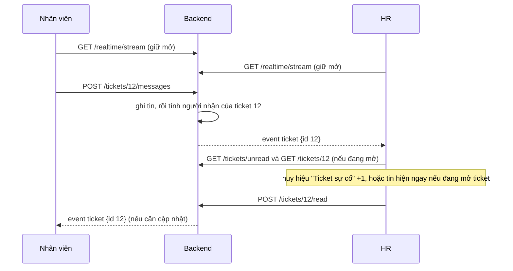

# Kế hoạch: số tin chưa đọc và nhận tin ngay cho ticket (bản 2 gọn, 05/10/2026)

> **Chỉ là kế hoạch, chưa sửa mã.** Bản 1 đề xuất thiết kế lại cả giao diện chat; anh muốn **đơn giản thôi**, nên bản này chỉ giữ bốn việc anh nêu, phần còn lại dời xuống mục 8 ("để sau").

## 1. Anh muốn gì (viết lại cho chắc đã hiểu đúng)

| # | Yêu cầu | Hiểu là |
|---|---|---|
| A | Bên kia nhắn tới thì **hiện số chưa đọc** ở chỗ **"Yêu cầu"** (nhân viên) và **"Ticket sự cố"** (HR); bấm vào ticket nào đã xem thì **trừ 1** | Chấm đỏ có số ở mục menu; số = **số ticket đang có tin chưa xem** (mỗi ticket mở xong trừ 1, không đếm từng tin) |
| B | Hai bên đang nhắn thì **nhận ngay, không cần tải lại trang** | Đẩy tin xuống trình duyệt khi có tin mới (SSE) |
| C | Trang **Nhân viên** của HR: **bỏ nút "Nhắn"** | Gỡ nút đang bị khóa ("Sắp có") cùng chuỗi dịch của nó |
| D | Khu nhân viên: hai cột bên trái ("Các ngày", "Việc trong Ngày 1") **nền trắng** như vùng lộ trình | Đổi nền cột từ xám nhạt sang trắng |

## 2. Hiện trạng đã đọc

| Điểm | Ở đâu | Hệ quả |
|---|---|---|
| Chuông và ticket hỏi lại mỗi **60 giây** | `JourneyProvider` (`TICKET_POLL_MS`), `useJourneyNotices` | Trễ đến 1 phút; chưa có số chưa đọc |
| Ticket **chưa có "đã đọc"** | `model/ticket_message.py` | Cần bảng mới để biết tin nào chưa xem |
| Caddy AWS đã có `flush_interval -1` cho `/api/*`; backend chạy một tiến trình | `deploy/aws/Caddyfile`, `backend/Dockerfile` | Truyền luồng được, bộ phát tin trong bộ nhớ là đủ |
| Nút "Nhắn" đang `disabled` với chú thích "Sắp có" | `EmployeesPage.tsx`, chuỗi `portalEmployees.nudge`, `soon` | Gỡ gọn, không ảnh hưởng chức năng khác |
| Nền hai cột trái là `var(--app-surface-2)` | `DayRail.module.scss` dòng 10 (và `.rail` của `TaskPage`) | Đổi thành `var(--app-surface)` |

## 3. Số chưa đọc (A)

**Dữ liệu:** bảng `ticket_reads (ticket_id, user_id, last_read_message_id, updated_at)`, khóa chính `(ticket_id, user_id)`.

**Một ticket "chưa đọc" với một người khi** có tin nhắn **của người khác** có `id` lớn hơn `last_read_message_id` của người đó (chưa có dòng đọc thì tính từ 0).

| Ai | Ticket nào được đếm |
|---|---|
| Nhân viên | Ticket **của mình** có tin **của HR** chưa xem |
| HR | Ticket **của phòng ban mình** (hàng đợi chung) có tin **của nhân viên** chưa xem; ticket mới tạo cũng tính |
| Admin | Như HR, mọi phòng ban |

| API | Việc |
|---|---|
| `GET /api/v1/portal/tickets/unread` | `{ "count": 2, "ticket_ids": [12, 15] }` |
| `POST /api/v1/portal/tickets/{id}/read` | Đánh dấu đã xem tới tin cuối, trả `count` mới |
| Hai danh sách ticket hiện có | Thêm `unread: bool` cho từng ticket để hiện chấm và chữ đậm |

**Giao diện:** huy hiệu số ở mục **"Yêu cầu"** (thanh trên của nhân viên) và **"Ticket sự cố"** (thanh bên của HR); ở danh sách ticket, ticket chưa đọc có chấm và tiêu đề đậm. **Mở một ticket** thì gọi `read` và số giảm 1; đang mở sẵn ticket mà có tin mới thì tự đánh dấu đã xem (số không nhảy lên rồi tụt xuống).

## 4. Nhận tin ngay (B)

Dùng **SSE (Server-Sent Events)**: trình duyệt giữ một kết nối `GET /api/v1/realtime/stream`; máy chủ đẩy một sự kiện nhỏ `{"type":"ticket","id":12}` khi có tin mới hoặc đổi trạng thái. Trình duyệt nhận thì **gọi lại API thường** (`/tickets/12`, `/tickets/unread`) để lấy nội dung. Kênh đẩy **không chở nội dung tin nhắn**.

| Việc | Chi tiết |
|---|---|
| Bộ phát tin | Hàng đợi trong bộ nhớ theo người dùng; **người nhận do máy chủ tính** (người tạo ticket, HR cùng phòng ban, Admin), không nhận mã từ trình duyệt |
| Nhịp tim | Mỗi 20 giây một dòng chú thích để các lớp trung gian không cắt khi im lặng |
| Phát sự kiện ở | `ticket_service`: tạo ticket, thêm tin, nhận xử lý, đổi trạng thái |
| Nối lại | `EventSource` tự nối; nối lại thì tải lại số chưa đọc và ticket đang mở để bù tin đã lỡ |
| **Lưới an toàn** | Giữ vòng hỏi thưa **30–60 giây** như hiện nay. Realtime hỏng thì chỉ chậm hơn, không sai |
| Tab ẩn | Đóng luồng khi tab ẩn quá vài phút, mở lại và tải lại khi quay về |

## 5. Ảnh hưởng đến triển khai AWS và Vercel

| Thành phần | Ảnh hưởng |
|---|---|
| **AWS (EC2, cổng 443, Caddy, Docker)** | **Không đổi**; không thêm container, không sửa Dockerfile hay compose, **0 USD thêm** |
| **CI/CD** | Không đổi |
| **Vercel** | **Một điểm chưa chắc, phải thử:** frontend gọi `/api/*` qua rewrite Vercel sang AWS. Tài liệu Vercel (tra 05/10/2026) cho biết WebSocket và SSE chạy tốt cho máy chủ *trên* Vercel, nhưng **không nói rõ** rewrite sang origin ngoài có giữ luồng SSE dài và không đệm hay không. **Tôi chưa thử trên bản Vercel của anh** |
| **Cách thử (nửa ngày, bước R-0)** | Thêm điểm cuối `ping-stream` gửi một dòng mỗi 5 giây; thử cục bộ, qua Vercel và thẳng `vsf-assistant.duckdns.org`; đo dòng đến từng cái một hay bị đệm, kết nối sống bao lâu |
| **Dự phòng nếu qua Vercel không ổn** | Trình duyệt xin **vé 60 giây** qua API thường (`POST /realtime/ticket`, có cookie) rồi nối **thẳng** `https://vsf-assistant.duckdns.org/api/v1/realtime/stream?ticket=…`; kiểm `Origin`; Caddy không phải đổi |
| **Dev cục bộ** | Chạy được; `proxyTimeout` 60 giây của Next dev có thể cắt luồng mỗi phút, tự nối lại nên chấp nhận được |
| **Hetzner VPS (nếu dùng)** | Caddy route cả `/api/*`, không qua Vercel nên SSE chạy thẳng |
| **Nhiều tiến trình sau này** | Khi tăng `--workers` thì thêm Postgres `LISTEN/NOTIFY` (DB đã có) để chuyển sự kiện giữa các tiến trình; hiện chưa cần |

**Vì sao SSE chứ không WebSocket:** ticket chỉ cần máy chủ đẩy xuống, gửi tin vẫn là `POST`. WebSocket phức tạp hơn (xác thực, nối lại) và chưa chắc chạy qua rewrite Vercel. Chỉ nên làm WebSocket nếu sau này cần "đang gõ…".

## 6. Các bước làm

| Bước | Việc | Kiểm chứng |
|---|---|---|
| **R-0** | Thử luồng thử (mục 5), chốt qua rewrite hay nối thẳng AWS | Báo cáo đo ngắn |
| **R-1** | Bảng `ticket_reads` + migration; `GET /tickets/unread`, `POST /tickets/{id}/read`; thêm `unread` vào danh sách | Test: nhân viên và HR đếm đúng; mở ticket thì trừ 1; người ngoài phòng ban không đếm; HR khác không bị ảnh hưởng |
| **R-2** | Bộ phát tin + `GET /realtime/stream` + nhịp tim; phát sự kiện ở `ticket_service` | Test: hai người dùng, A gửi thì B nhận; người ngoài không nhận; giới hạn kết nối mỗi người |
| **R-3** | Frontend: hook `useRealtime` và provider số chưa đọc; huy hiệu ở hai menu; danh sách ticket có chấm; khung ticket đang mở tự tải tin mới và tự đánh dấu đã xem | Hai trình duyệt thật: gửi ở một bên, bên kia cập nhật **dưới 2 giây** không tải lại |
| **R-4** | **Gỡ nút "Nhắn"** (C) và chuỗi `nudge`, `soon` ở trang Nhân viên của HR | Chụp màn hình; test trang Nhân viên cập nhật |
| **R-5** | **Nền trắng hai cột trái** (D): `DayRail.module.scss` và `.rail` của `TaskPage` đổi sang `var(--app-surface)`, giữ viền mảnh bên phải và viền thẻ để các mục vẫn tách rõ; kiểm cả chế độ tối | Chụp màn hình sáng và tối |
| **R-6** | Triển khai AWS + Vercel, thử đầu-cuối trên bản thật | Đo độ trễ qua Vercel |

R-4 và R-5 là thay đổi nhỏ, độc lập, **làm được ngay** không phụ thuộc phần realtime.

## 7. Rủi ro

| Rủi ro | Cách xử lý |
|---|---|
| Vercel đệm hoặc cắt luồng | R-0 thử trước; có phương án nối thẳng bằng vé |
| Mất tin khi rớt kết nối | Sự kiện chỉ là "hãy tải lại"; nối lại thì tải lại; vòng hỏi thưa làm lưới an toàn |
| Số chưa đọc nhảy sai khi đang mở ticket | Ticket đang mở thì tự đánh dấu đã xem ngay khi tin tới |
| Nhiều tab một người | Giới hạn số kết nối mỗi người; tab ẩn đóng luồng |
| Rò thông tin | Kênh chỉ chở loại và mã; người nhận do máy chủ quyết định; nội dung vẫn đi qua API có kiểm quyền |

## 8. Để sau (không làm đợt này, trừ khi anh muốn)

- Giao diện chat đầy đủ: bong bóng hai phía, gom tin theo người, vạch ngày, ô soạn cố định đáy, gửi lạc quan, dấu "Đã xem" (bản 1 của tài liệu này).
- "Đang gõ…" và trạng thái online (cần cân nhắc WebSocket).
- Đưa tiến độ việc nền (tạo task AI, nạp tài liệu) về cùng kênh sự kiện, thay vòng hỏi mỗi giây.
- Gộp thông báo chuông của nhân viên (ticket, thay đổi lộ trình) về một kênh.

## 9. Cần anh chốt

1. **Đếm theo ticket hay theo tin?** Đề xuất **theo ticket** (mỗi ticket có tin chưa xem là 1, mở ra thì trừ 1), đúng như anh mô tả.
2. **HR chia sẻ hàng đợi:** một HR mở ticket thì HR khác **vẫn thấy chưa đọc** (mặc định đề xuất, mỗi người một trạng thái đọc), hay coi là đã đọc cho cả phòng?
3. **Cách nối realtime:** thử trước qua rewrite Vercel, không ổn thì nối thẳng AWS bằng vé. Đồng ý?
4. **Làm R-4 và R-5 trước** (gỡ nút "Nhắn" và nền trắng hai cột), vì nhỏ và độc lập?
