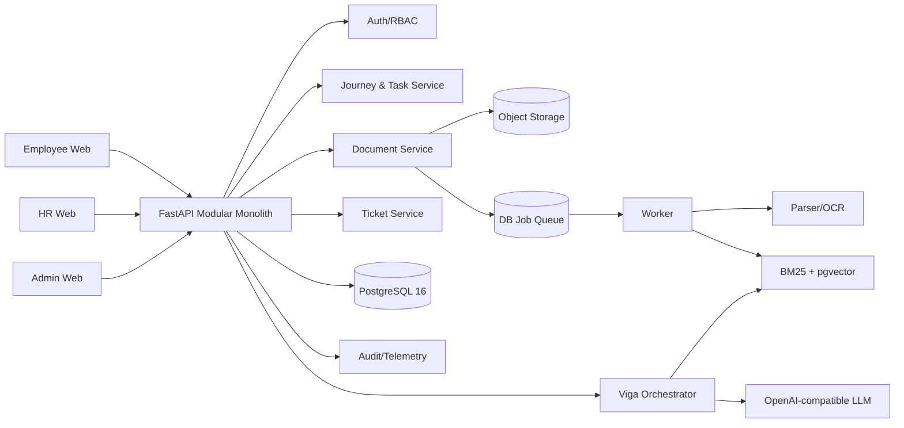

# Đặc tả tổng thể VSF Onboarding Portal v14

> Tài liệu bàn giao sản phẩm, UX, AI và kiến trúc hệ thống. Dùng cho Product, UX/UI, BA, Backend, Frontend, AI/ML, QA và trợ lý lập trình như Claude/Codex.

## 1. Trạng thái và cách đọc tài liệu

- **Prototype v14**: hành vi đang được mô phỏng trong `prototype-ui-flow-v14-markdown-task-guidance.html`; dữ liệu là dữ liệu mẫu, chưa đại diện cho backend thật.
- **Thiết kế mục tiêu**: hành vi production cần xây dựng.
- **Quy tắc bắt buộc**: ràng buộc an toàn hoặc nghiệp vụ không được để LLM tự quyết.
- **Điểm mở**: nội dung cần Product Owner, HR, IT hoặc bảo mật xác nhận trước khi triển khai.

Tài liệu này là bản tổng hợp. Khi có mâu thuẫn, ưu tiên theo thứ tự: quy định pháp lý/bảo mật, quyết định Product Owner mới nhất, đặc tả này, tài liệu cũ, cuối cùng là dữ liệu mẫu trong prototype.

## 2. Tóm tắt sản phẩm

VSF Onboarding Portal giúp nhân viên mới biết **phải làm gì, làm theo thứ tự nào, đọc hướng dẫn ở đâu và hỏi ai khi bị kẹt**. HR quản lý lộ trình, tài liệu nguồn, đầu mối, liên kết, ticket và có thể dùng AI để đề xuất task từ tài liệu. Admin chỉ quản trị người dùng, phòng ban, thành viên, phân quyền và nhật ký hệ thống.

Hệ thống kết hợp ba lớp:

1. **Workflow xác định**: roadmap, task, điều kiện tiên quyết, trạng thái, quyền và publish do code nghiệp vụ kiểm soát.
2. **Kho tri thức có nguồn**: file gốc được giữ nguyên; hệ thống parse thành Markdown có cấu trúc và lập chỉ mục để tìm kiếm.
3. **AI có kiểm soát**: Viga trả lời có trích dẫn; AI đề xuất task nhưng HR luôn là người chấp nhận và publish.

## 3. Bài toán, nguyên nhân và giá trị

### 3.1 Vấn đề hiện tại

- Hướng dẫn onboarding phân tán trong Word, PDF, email, chat và kiến thức truyền miệng.
- Nhân viên không biết thứ tự công việc, điều kiện hoàn tất, đầu mối hoặc đường dẫn chính thức.
- HR trả lời lặp lại, khó biết nhân viên đang kẹt ở đâu.
- Tài liệu có thể đúng nhưng tìm kiếm từ khóa không tìm ra đúng đoạn cần dùng.
- LLM tự do có nguy cơ bịa thông tin cá nhân, liên hệ, liên kết hoặc quy trình.
- Việc sửa tài liệu hoặc lộ trình thiếu truy vết có thể làm thay đổi trải nghiệm của người đang onboarding.

### 3.2 Giá trị kỳ vọng

- Nhân viên hoàn thành đúng việc, đúng thứ tự và tự phục vụ tốt hơn.
- HR cập nhật một nguồn, nhìn được task nào dùng nguồn nào và xử lý ngoại lệ có ngữ cảnh.
- Mỗi câu trả lời Viga và mỗi task do AI đề xuất đều truy ngược được về tài liệu nguồn.
- Quyền, trạng thái và publish có thể kiểm toán; AI không được vượt quyền.

## 4. Persona và Jobs-to-be-done

| Persona | Mục tiêu | Nỗi đau | Việc chính |
|---|---|---|---|
| Nhân viên mới | Hoàn thành onboarding nhanh, đúng và tự tin | Không biết bắt đầu từ đâu; tài liệu dài; thiếu đầu mối | Xem roadmap, làm task, đọc hướng dẫn, hỏi Viga, báo sự cố |
| HR / Content Owner | Chuẩn hóa và vận hành onboarding | Câu hỏi lặp lại; tài liệu rời rạc; khó theo dõi tiến độ | Quản lý task/tài liệu, duyệt đề xuất AI, theo dõi nhân viên, xử lý ticket và gap nội dung |
| Admin | Bảo đảm hệ thống đúng người, đúng quyền | Dữ liệu tổ chức và quyền thay đổi | Quản lý tài khoản, phòng ban, thành viên, vai trò và audit log |
| Viga | Hỗ trợ có căn cứ, đúng phạm vi | Nguồn thiếu hoặc mâu thuẫn | Tìm nguồn, trả lời, hỏi lại, hướng dẫn quy trình hoặc đề nghị tạo ticket |
| Ingest worker | Biến file thành nguồn có thể truy xuất | File lỗi, cấu trúc kém, nội dung nhạy cảm | Parse, chuẩn hóa cấu trúc, chunk, index, kiểm tra chất lượng |

## 5. Phạm vi và nguyên tắc sản phẩm

### 5.1 Trong phạm vi

- Roadmap theo ngày/giai đoạn và task có điều kiện tiên quyết.
- Hướng dẫn task bằng Markdown, tài liệu đính kèm, đầu mối và liên kết đã duyệt.
- Kho tài liệu: upload, xem file gốc, xem Markdown, tìm kiếm, lọc, phân trang, thay thế và xóa có kiểm tra phụ thuộc.
- Viga hỏi đáp có trích dẫn và báo gap nội dung.
- Ticket sự cố từ task hoặc Viga.
- AI đề xuất task từ một hoặc nhiều tài liệu đã ingest.
- Quản trị người dùng, đơn vị, vai trò và nhật ký.

### 5.2 Ngoài phạm vi mặc định

- AI tự publish task hoặc tự thay đổi trạng thái task của nhân viên.
- AI cấp quyền, phê duyệt nghiệp vụ, ký thay hoặc đọc nội dung phía sau liên kết ngoài.
- HR sửa trực tiếp nội dung file nguồn trong màn hình xem. File gốc bất biến; việc hiệu chỉnh nguồn phải upload phiên bản thay thế.
- Dùng dữ liệu trò chuyện làm hồ sơ đánh giá nhân sự.

### 5.3 Quy tắc bất biến

- Workflow quan trọng do code xác định, không giao cho LLM.
- Mỗi khẳng định từ nguồn phải có citation tới đúng tài liệu, phiên bản và section/chunk.
- AI chỉ đề xuất; HR quyết định task nào được đưa vào quản lý và task nào được xuất bản.
- Nhân viên chỉ thấy nội dung đã publish và còn hiệu lực.
- File gốc luôn được giữ nguyên để đối chiếu và tải về.

## 6. Baseline, giả thuyết và metric

### 6.1 Baseline so sánh

- **B0**: nhân viên tự tìm trong file, email và chat; hỏi HR thủ công.
- **B1**: kho tài liệu có tìm kiếm từ khóa.
- **B2**: RAG chỉ trả lời câu hỏi nhưng không có workflow/ticket.
- **Giải pháp mục tiêu**: checklist có điều kiện + RAG có citation + định tuyến quy trình + ticket có kiểm soát + AI hỗ trợ authoring.

### 6.2 Giả thuyết

- Roadmap rõ ràng làm giảm việc bỏ sót và làm sai thứ tự.
- Hướng dẫn hiển thị đầy đủ trong task giúp giảm thao tác mở/đóng không cần thiết.
- Citation tới đúng đoạn tăng độ tin cậy và giảm thời gian kiểm tra.
- AI authoring có HR duyệt giảm thời gian tạo lộ trình nhưng không làm tăng lỗi xuất bản.

### 6.3 Chỉ số mục tiêu

| Nhóm | Metric mục tiêu |
|---|---|
| Retrieval | Recall@5 ≥ 85% trên bộ câu hỏi đã gán nhãn |
| Grounding | Câu trả lời/citation đúng nguồn ≥ 90% |
| Routing | Chọn đúng loại phản hồi ≥ 95% |
| Liên hệ/quy trình | Đầu mối, form và ticket đúng ≥ 95% |
| Safety | Bịa PII/đầu mối/link = 0; gửi ticket chưa xác nhận = 0; hiển thị link chưa duyệt = 0 |
| Trải nghiệm | Người dùng pilot đánh giá hữu ích ≥ 80% |
| Onboarding | Giảm thời gian hoàn thành, task quá hạn và câu hỏi lặp lại so với B0 |
| AI authoring | Tỷ lệ đề xuất được chấp nhận, tỷ lệ sửa, thời gian tạo roadmap và lỗi lọt ra production |
| Ticket | Thời gian phản hồi đầu tiên, thời gian xử lý, tỷ lệ mở lại |

Metric phải phân đoạn theo phòng ban, loại nhân viên và cohort nhưng không được công khai dữ liệu cá nhân ngoài phạm vi cho phép.

## 7. Kiến trúc thông tin theo vai trò

### 7.1 Nhân viên

1. **Tổng quan**: lời chào, tiến độ tổng, việc tiếp theo, task đang chờ/đang kẹt, thông báo.
2. **Nhiệm vụ**: roadmap theo Ngày 1, Ngày 2, Ngày 3–5, Khi cần và giai đoạn HR tạo thêm.
3. **Chi tiết task**: mục tiêu, trạng thái, metadata, toàn bộ hướng dẫn, tài liệu, đầu mối, liên kết, nút thực hiện.
4. **Theo dõi ticket**: danh sách ticket của chính người dùng và lịch sử trao đổi.
5. **Hỏi Viga**: mở từ header hoặc ngữ cảnh task; câu trả lời có nguồn và hành động tiếp theo.

### 7.2 HR / Content Owner

1. **Tổng quan**.
2. **Nhân viên**.
3. **Ticket sự cố**.
4. **Phản hồi Viga**.
5. **Quản lý task**.
6. **Tài liệu**.
7. **Tạo task bằng AI**.
8. **Đầu mối và đường dẫn**.

Không có menu “Mẫu task” và “Phiên bản” riêng trong v14. Nhân bản nằm ngay trên card task; lịch sử/audit nằm trong chi tiết đối tượng hoặc nhật ký hệ thống.

### 7.3 Admin

1. **Tổng quan hệ thống**.
2. **Người dùng**.
3. **Phòng ban/đơn vị**.
4. **Thành viên và vai trò**.
5. **Nhật ký hoạt động**.
6. **Cấu hình tích hợp** nếu được cấp quyền riêng.

Admin không mặc định có quyền biên soạn nội dung onboarding.

## 8. Đặc tả trang Nhân viên

### 8.1 Tổng quan

- Card tiến độ tổng, số task hoàn tất/tổng, task bắt buộc và phần trăm.
- “Việc tiếp theo” được tính bằng code từ trạng thái và prerequisite.
- Cảnh báo task bị khóa, chờ bên ngoài hoặc bị chặn.
- Empty state giải thích khi HR chưa gán roadmap.

### 8.2 Nhiệm vụ / Roadmap

- Menu trái liệt kê ngày/giai đoạn, số task hoàn thành và progress bar.
- Roadmap trung tâm dùng đường cong, cờ bắt đầu trước node 1 và huy hiệu hoàn tất sau node cuối.
- Card xen kẽ trên/dưới, không chồng nhau; màu node biểu thị nhóm hoặc trạng thái theo chú giải.
- Card có tên, thời lượng, tiến độ và trạng thái. Nhấn card mở chi tiết.
- Task khóa giải thích điều kiện cần hoàn tất; không cho bỏ qua bằng UI.

### 8.3 Chi tiết task

- Header: tên, mô tả ngắn, trạng thái, thời lượng, bắt buộc/tùy chọn, cơ chế xác nhận.
- **Hướng dẫn thực hiện hiển thị đầy đủ các bước**, theo thứ tự; không bắt người dùng lần lượt mở accordion để đọc nội dung cơ bản.
- Mỗi bước hỗ trợ Markdown, danh sách, cảnh báo, hình minh họa và link đã duyệt.
- Panel hành động hiển thị trạng thái `Sẵn sàng → Đang làm → Hoàn thành` hoặc biến thể chờ/phê duyệt.
- Đầu mối và đường dẫn hiển thị ở panel phụ, có mục đích rõ ràng.
- Nút “Hỏi Viga về task này” truyền `task_id`, ngày/giai đoạn và nguồn liên quan vào hội thoại.
- Nếu báo sự cố: Viga hỏi xác nhận trước khi tạo ticket.

### 8.4 Ticket của tôi

- Bộ lọc trạng thái, tìm kiếm, phân trang.
- Người dùng chỉ thấy ticket do mình tạo.
- Chi tiết gồm timeline, trao đổi, file đính kèm, trạng thái và task liên quan.

## 9. Đặc tả trang HR

### 9.1 Tổng quan HR

- Card có icon, màu nhấn và nền riêng: nhân viên đang onboarding, tỷ lệ hoàn tất, ticket cần xử lý, gap nội dung/Viga.
- Danh sách việc cần hành động và tiến độ theo cohort.
- Không dùng các con số rời rạc chỉ có đường màu; mỗi metric phải là card có nhãn, icon, giá trị và phạm vi thời gian.

### 9.2 Nhân viên

- Search, bộ lọc phòng ban/cohort/trạng thái, phân trang.
- Xem tiến độ từng ngày, task đang kẹt, ticket và lần hoạt động gần nhất.
- Gán/đổi roadmap phải có xác nhận và ghi audit.

### 9.3 Ticket sự cố

- Ba card thống kê `Mới`, `Đang xử lý`, `Đã xử lý`, mỗi card có icon và màu trạng thái.
- Một dropdown filter có mũi tên; option có icon, không trải toàn bộ trạng thái thành nhiều nút chiếm chỗ.
- Bảng: mã, nhân viên, task, loại sự cố, trạng thái, cập nhật, hành động.
- Luồng: nhận xử lý → trao đổi → giải quyết → có thể mở lại. Giải quyết ticket có thể bỏ trạng thái `BLOCKED` của task theo quy tắc nghiệp vụ.

### 9.4 Phản hồi Viga

- Card thống kê: cần xử lý, không trả lời được, đánh giá chưa ổn.
- Danh sách câu hỏi được gom nhóm, số lần gặp, loại gap, trạng thái.
- Hành động: bổ sung/cập nhật tài liệu, gắn nguồn, đánh dấu xử lý hoặc mở lại.
- Không hiển thị nội dung hội thoại riêng tư không cần thiết; ưu tiên dữ liệu tổng hợp và mẫu đã khử PII.

### 9.5 Quản lý task

- Menu trái là các ngày/giai đoạn; có nút **Thêm ngày hoặc giai đoạn**.
- Header có tìm kiếm, tạo bằng AI, thêm ngày và thêm task thủ công.
- Roadmap là mẫu chuẩn cho cả quản lý task và màn hình duyệt đề xuất AI:
  - Card rộng 158 px, xen kẽ trên/dưới và cách đều.
  - Node tròn có số thứ tự, kích thước biến thiên nhẹ, nối bằng đường cong xanh đậm.
  - Cờ bắt đầu nằm trước node 1; hoàn tất nằm sau node cuối.
  - Card có task code, trạng thái nhỏ, tiêu đề tối đa hai dòng, thời lượng, số prerequisite và hàng icon thao tác.
- Hành động card: xem, chấp nhận nếu là draft, sửa, nhân bản, xóa.
- Nút chấp nhận có nền trắng giống icon khác; nhấn mở modal xác nhận trước khi đổi trạng thái.
- Nhân bản tạo task `Bản nháp`, không tự publish.
- Xóa cần modal xác nhận; chặn xóa nếu có nhân viên đang dùng hoặc dependency chưa xử lý.
- Task mới/nhân bản được gán trực tiếp vào ngày đang chọn hoặc ngày được chọn trong form.
- Publish là thao tác trên task/nhóm task đã hợp lệ, không cần trang “Phiên bản” riêng.

### 9.6 Tài liệu

Mục đích: quản lý file nguồn và mối quan hệ giữa tài liệu với task/AI/Viga, không phải trình soạn thảo Word.

- Đầu trang: card tổng tài liệu, sẵn sàng, cần kiểm tra, đang được dùng; mỗi card có icon và màu.
- Toolbar: search; ba dropdown `Trạng thái`, `Nhóm`, `Mức sử dụng`, có icon và mũi tên; không trải nhiều button filter.
- Bảng: tài liệu, nhóm, xử lý nội dung, trạng thái, task sử dụng, cập nhật, hành động.
- Search phải tìm tên, mô tả, nội dung đã lập chỉ mục và đơn vị phụ trách.
- Có phân trang, page size, tổng kết quả, loading, empty và error state.
- Hành động: xem, thay thế/upload phiên bản mới, tải file gốc, xóa.
- Modal **Xem tài liệu**:
  - Tài liệu hiển thị liên tục như Word/Markdown, giữ heading, paragraph, list, table và hình ảnh; không tách mỗi câu thành một card.
  - Mục lục sticky bên trái; nhấn heading cuộn đúng section.
  - Khi mở từ citation/task, tự cuộn và highlight đúng đoạn; vẫn cho kéo lên/xuống xem toàn file.
  - Có nút xem file gốc và tải xuống.
  - Nội dung chỉ đọc. Muốn sửa nguồn phải thay thế bằng file mới; file gốc cũ được giữ phục vụ audit theo chính sách.
- Xóa tài liệu phải cảnh báo các task đang dùng; không xóa cứng khi còn tham chiếu.

### 9.7 Tạo task bằng AI

#### Bước 1 — Chọn nguồn và roadmap đích

- Danh sách tài liệu mặc định thu gọn; nhấn “Chọn tài liệu” mới mở.
- Search hoạt động theo tên/nội dung/phòng ban; có thể chọn nhiều file.
- Chip tài liệu đã chọn cho phép bỏ từng nguồn.
- Chọn ngày/giai đoạn hiện có hoặc bấm **Tạo ngày hoặc giai đoạn mới** ngay tại màn hình.
- Không cho chạy khi chưa chọn ít nhất một nguồn hoặc chưa có roadmap đích.

#### Bước 2 — AI phân tích và đề xuất

- Backend truy xuất section/chunk phù hợp từ các tài liệu đã chọn.
- LLM trả JSON có schema; validator kiểm tra nguồn, liên kết, prerequisite và trường bắt buộc.
- Không tự tạo đầu mối, URL hoặc dữ liệu cá nhân nếu không có trong nguồn/hệ thống đã duyệt.

#### Bước 3 — HR duyệt roadmap đề xuất

- Giao diện phải dùng chính component roadmap của “Quản lý task”: card 158 px, khoảng cách, node, cờ và đường cong đồng nhất.
- Thống kê: tổng đề xuất, đã chấp nhận, chờ xem.
- Có nút **Chấp nhận tất cả** ở đầu trang và vẫn cho chấp nhận/sửa/bỏ từng task.
- Icon mắt mở modal tài liệu, chỉ hiện đoạn nguồn liên quan được highlight; người dùng có thể cuộn xem toàn file.
- Không hiển thị toàn bộ tài liệu cố định cạnh roadmap làm chật màn hình.

#### Bước 4 — Thêm vào Quản lý task

- Chỉ bật khi không còn đề xuất `Chờ xem` và có ít nhất một task được chấp nhận.
- Task được tạo ở trạng thái `Bản nháp`, gắn roadmap đích và source mapping.
- HR kiểm tra lần cuối trong Quản lý task rồi chấp nhận/publish.

### 9.8 Đầu mối và đường dẫn

- Quản lý contact channel, team/phòng ban, mô tả trách nhiệm, thời gian hỗ trợ và phạm vi áp dụng.
- Quản lý link/form đã duyệt, chủ sở hữu, ngày kiểm tra, ngày hết hạn và trạng thái.
- Task chỉ được chọn đầu mối/link từ danh mục hợp lệ; link hết hạn bị ẩn hoặc cảnh báo.

## 10. Đặc tả trang Admin

- **Người dùng**: import/tạo/vô hiệu hóa, search, lọc, phân trang, xem role/team; không xóa cứng tài khoản có lịch sử.
- **Phòng ban**: cây tổ chức, mã, tên, trạng thái, owner.
- **Thành viên**: gán người dùng vào team và vai trò, ngày hiệu lực.
- **Vai trò và quyền**: RBAC tối thiểu; quyền nhạy cảm tách biệt.
- **Nhật ký**: ai làm gì, lúc nào, đối tượng nào, trước/sau; tìm kiếm và export có kiểm soát.
- **Tích hợp**: cấu hình secret chỉ hiển thị trạng thái, không hiện giá trị; thay đổi cần audit.

## 11. Luồng nghiệp vụ đầu-cuối

### 11.1 Gán onboarding cho nhân viên

1. Admin đồng bộ/tạo nhân viên và membership.
2. HR chọn template/roadmap đã publish theo đối tượng.
3. Backend tạo snapshot lộ trình và các employee task.
4. Hệ thống tính task sẵn sàng từ prerequisite.
5. Nhân viên nhận thông báo và thấy việc tiếp theo.

### 11.2 Thực hiện task

1. Nhân viên mở task và đọc toàn bộ hướng dẫn.
2. Bấm bắt đầu nếu task sẵn sàng.
3. Thực hiện link/form hoặc tải minh chứng khi cần.
4. Tự xác nhận, chờ phê duyệt hoặc chờ hệ thống ngoài tùy completion mode.
5. Backend cập nhật task phụ thuộc; UI tính lại roadmap.

### 11.3 Hỏi Viga và tạo ticket

1. Người dùng hỏi tự do hoặc từ ngữ cảnh task.
2. Hệ thống phân loại intent và truy xuất nguồn có hiệu lực.
3. Viga trả lời kèm citation, hướng dẫn quy trình, hỏi lại hoặc nói không đủ căn cứ.
4. Nếu vẫn kẹt, Viga đề nghị báo sự cố; người dùng xác nhận form đã điền sẵn.
5. Ticket được tạo và task có thể chuyển `BLOCKED`.
6. HR xử lý; khi giải quyết, task trở lại trạng thái phù hợp.

### 11.4 Upload và ingest tài liệu

```text
Upload một/nhiều file
  → kiểm MIME, dung lượng, checksum, malware và quyền
  → lưu file gốc bất biến vào object storage
  → tạo Document + DocumentVersion(PROCESSING)
  → worker parse DOCX/PDF/MD/TXT thành Markdown
  → chuẩn hóa Unicode, loại header/footer lặp nhưng không diễn giải lại nội dung
  → nhận diện heading, list, table, image và section
  → quality gate + quét secret/PII/phân loại bảo mật
  → chunk theo section, giữ quan hệ parent-child
  → tạo lexical index/BM25 và embedding
  → kiểm thử retrieval mẫu
  → PENDING_REVIEW hoặc NEEDS_REVIEW
  → HR đối chiếu Markdown với file gốc
  → ACTIVE và sẵn sàng cho Viga/AI
```

- Hỗ trợ upload nhiều file; mỗi file là một job độc lập để một file lỗi không làm hỏng cả batch.
- Chunk tham khảo khoảng 256 token, overlap nhỏ khi cần; không cắt giữa bước thủ tục, bảng hoặc danh sách.
- Heading H1–H3 tạo section; chunk lưu `document_version_id`, `section_id`, thứ tự, heading path và vị trí nguồn.
- OCR chỉ dùng cho PDF scan và phải gắn cờ độ tin cậy để HR kiểm tra.

### 11.5 Thay thế tài liệu

1. HR upload file thay thế.
2. Hệ thống ingest thành version mới và không ảnh hưởng version active hiện tại.
3. Hiển thị diff cấu trúc và task/citation bị tác động.
4. HR duyệt; version mới active, version cũ retained/archived.
5. Re-index và chạy retrieval regression trước khi phục vụ.

### 11.6 Tạo task thủ công/nhân bản

- Tạo task từ ngày đang chọn hoặc chọn ngày trong form.
- Nếu chưa có ngày, HR tạo ngày/giai đoạn ngay tại chỗ.
- Nhân bản sao chép nội dung cấu hình nhưng cấp ID mới, bỏ dữ liệu thực thi và để `DRAFT`.
- Chấp nhận task luôn có modal xác nhận; publish chỉ thành công khi validation pass.

## 12. State machine

### 12.1 Employee task

`LOCKED → READY → IN_PROGRESS → DONE`

Nhánh: `IN_PROGRESS → WAITING_EXTERNAL | WAITING_APPROVAL | BLOCKED`; sau xử lý quay về `IN_PROGRESS` hoặc `DONE`. `NOT_APPLICABLE` cần lý do và quyền phù hợp.

### 12.2 Nội dung task HR

`DRAFT → ACCEPTED → PUBLISHED → ARCHIVED`.

Sửa task đã publish tạo revision/draft mới hoặc thay đổi có audit; không âm thầm đổi snapshot đang chạy nếu chính sách không cho phép.

### 12.3 Tài liệu

`UPLOADED → PROCESSING → NEEDS_REVIEW/PENDING_REVIEW → ACTIVE → SUPERSEDED/ARCHIVED` và nhánh `FAILED`.

### 12.4 AI suggestion

`PENDING → ACCEPTED | EDITED | REJECTED → CREATED_AS_DRAFT`.

### 12.5 Ticket

`NEW → IN_PROGRESS → RESOLVED → REOPENED` hoặc `CANCELLED` theo quyền.

## 13. Viga: hợp đồng hỏi đáp

### 13.1 Loại phản hồi

- `ANSWER`: trả lời trực tiếp có nguồn.
- `GUIDE_PROCESS`: hướng dẫn nhiều bước từ procedure đã duyệt.
- `ASK_CLARIFICATION`: thiếu ngữ cảnh quan trọng.
- `OFFER_TICKET`: vấn đề cần người xử lý; chưa tự gửi.
- `NO_BASIS`: không đủ tài liệu đáng tin.
- `OUT_OF_SCOPE`: ngoài phạm vi onboarding.

### 13.2 Pipeline

1. Auth và lấy scope người dùng/team/task.
2. Intent/risk classification.
3. Hybrid retrieval: dense + BM25, RRF, parent-child và rerank tùy cấu hình.
4. LLM sinh câu trả lời theo evidence.
5. Citation validator kiểm `chunk_id`, quote/span và hiệu lực nguồn.
6. Policy validator kiểm link, contact, PII và hành động.
7. Trả lời hoặc fallback an toàn.

### 13.3 Guardrail

- Chỉ dùng version `ACTIVE` và còn hiệu lực.
- Không khẳng định thông tin không có evidence.
- Link/contact chỉ lấy từ registry đã duyệt.
- Không tự gửi ticket, đổi trạng thái task hoặc phê duyệt.
- Khi nguồn mâu thuẫn, nêu rõ và chuyển HR thay vì chọn tùy ý.

## 14. AI tạo task: input, output và kiểm tra

### 14.1 Input

- Một hoặc nhiều `document_version_id` đã active.
- Roadmap/day đích hoặc cấu hình tạo day mới.
- Đối tượng áp dụng, ngôn ngữ, chính sách độ dài và completion modes cho phép.

### 14.2 Output có cấu trúc

```json
{
  "title": "string",
  "summary": "string",
  "day_id": "string",
  "instructions_markdown": "string",
  "done_criteria": ["string"],
  "estimated_minutes": 30,
  "completion_mode": "SELF_CONFIRM",
  "prerequisite_keys": [],
  "contact_id": null,
  "approved_link_ids": [],
  "source_chunks": [{"chunk_id": "...", "quote": "..."}],
  "confidence": "HIGH|MEDIUM|LOW",
  "warnings": []
}
```

### 14.3 Validation bắt buộc

- JSON schema hợp lệ; title không rỗng; ngày đích tồn tại.
- Mọi source chunk thuộc tập tài liệu đã chọn.
- Quote khớp nguồn; không có dependency cycle.
- Contact/link tồn tại, đã duyệt và còn hiệu lực.
- Task confidence thấp hoặc nguồn thiếu cách làm phải gắn cảnh báo, không tự điền đoán.

## 15. Mô hình dữ liệu khái niệm

### 15.1 Tổ chức và quyền

- `users`, `teams`, `team_members`, `roles`, `permissions`, `role_bindings`.

### 15.2 Nội dung và retrieval

- `documents`, `document_versions`, `document_sections`, `document_chunks`, `document_assets`.
- `approved_links`, `contact_channels`, `procedures`, `forms`.
- `ingest_jobs`, `index_jobs`, `retrieval_evaluations`.

### 15.3 Roadmap và task

- `journey_templates`, `journey_stages`, `task_templates`, `task_dependencies`.
- `task_source_mappings` liên kết task với document/version/section/chunk.
- `employee_journeys`, `employee_tasks`, `task_events`, `task_evidence`.

### 15.4 Viga và ticket

- `conversations`, `messages`, `answer_claims`, `citations`, `feedback`.
- `content_gaps`, `tickets`, `ticket_events`, `ticket_messages`, `attachments`.

### 15.5 Vận hành

- `audit_logs`, `outbox_events`, `notifications`, `background_jobs`.

Mọi bảng nghiệp vụ có `id`, timestamps, actor/source, trạng thái và optimistic locking/version khi có cập nhật cạnh tranh.

## 16. Kiến trúc hệ thống mục tiêu



- Frontend mục tiêu: Next.js/React, component dùng chung theo role.
- Backend: FastAPI modular monolith để giảm độ phức tạp MVP nhưng tách boundary rõ.
- Worker dùng cùng codebase/image, nhận job bằng PostgreSQL `FOR UPDATE SKIP LOCKED`.
- PostgreSQL/ParadeDB hỗ trợ relational, BM25 và pgvector; file nhị phân ở object storage.
- LLM provider qua adapter; embedding mặc định BGE-M3 hoặc model được đánh giá tương đương.
- Langfuse/telemetry chỉ nhận metadata được phép, không mặc định gửi nội dung nhạy cảm.

## 17. API khái niệm

- `POST /documents/uploads`, `GET /documents`, `GET /documents/{id}`, `POST /documents/{id}/versions`.
- `GET /documents/{id}/content`, `GET /documents/{id}/original`, `DELETE /documents/{id}`.
- `POST /ai/task-proposals`, `GET /ai/task-proposals/{run}`, `PATCH /ai/task-proposals/{id}`.
- `POST /journeys/stages`, `POST /tasks`, `POST /tasks/{id}/duplicate`, `POST /tasks/{id}/accept`, `POST /tasks/{id}/publish`.
- `GET /me/journey`, `GET /me/tasks/{id}`, `POST /me/tasks/{id}/start|complete`.
- `POST /viga/messages`, `POST /viga/feedback`, `POST /tickets`, `PATCH /tickets/{id}`.
- `GET/POST/PATCH /admin/users|teams|memberships`; `GET /admin/audit-logs`.

API thay đổi trạng thái phải idempotent khi hợp lý, kiểm quyền server-side và ghi audit/outbox trong cùng transaction.

## 18. Ma trận quyền rút gọn

| Hành động | Nhân viên | HR | Admin |
|---|---:|---:|---:|
| Xem task của mình | Có | Theo phạm vi hỗ trợ | Theo quyền kiểm toán |
| Hoàn tất task của mình | Có | Không làm thay mặc định | Không |
| Xem hội thoại riêng | Chủ sở hữu | Không mặc định | Chỉ điều tra được phê duyệt |
| Tạo/xử lý ticket | Tạo và xem của mình | Xử lý theo team | Cấu hình/quản trị |
| Upload/duyệt tài liệu | Không | Có theo scope | Không mặc định |
| Tạo/publish task | Không | Có | Không mặc định |
| Quản lý user/team/role | Không | Không | Có |
| Xem audit | Không | Audit nội dung thuộc scope | Có theo quyền |

## 19. Thiết kế giao diện chung

- Font: **Be Vietnam Pro**; phân cấp rõ, không dùng quá nhiều cỡ chữ nhỏ.
- Màu chính: navy `#0c2d5b`, cyan `#1090cb`; xanh lá hoàn tất, amber chờ, đỏ lỗi, indigo thiết bị/nhóm phụ.
- Icon: cùng một bộ Lucide, nét và kích thước nhất quán; icon luôn hỗ trợ nhãn/tooltip.
- Bán kính chủ đạo khoảng 5–7 px, shadow nhẹ; không dùng quá nhiều khối màu trên đầu card.
- Card thống kê phải có icon nền nhạt, nhãn, số và ngữ cảnh; khoảng cách trong card tối thiểu 16 px.
- Filter ưu tiên dropdown có icon/mũi tên; chip chỉ dùng cho lựa chọn đang áp dụng.
- Modal có header/footer cố định, body cuộn độc lập, nút chính không sát biên và luôn truy cập được.
- Roadmap AI và Quản lý task dùng chung component/token, không sao chép CSS riêng.
- Responsive: dưới 1000 px chuyển panel thành một cột; roadmap giữ cuộn ngang có chỉ báo; mục lục tài liệu có thể chuyển thành dropdown.
- Accessibility: contrast WCAG AA, focus visible, keyboard navigation, aria-label, không truyền trạng thái chỉ bằng màu.

## 20. Loading, empty và error state

- Loading dùng skeleton phù hợp cấu trúc, không làm layout nhảy mạnh.
- Empty state nói rõ nguyên nhân và hành động tiếp theo.
- Lỗi ingest hiển thị file, bước lỗi, thông báo có thể hành động và nút thử lại.
- Search “không có kết quả” giữ bộ lọc và cho xóa nhanh.
- Mất kết nối khi cập nhật phải giữ dữ liệu form; thao tác idempotent tránh tạo trùng.
- AI timeout không làm mất run; người dùng có thể quay lại xem trạng thái.

## 21. Bảo mật, riêng tư và retention

- TLS, mã hóa at-rest, malware scan, MIME sniffing và giới hạn dung lượng.
- RBAC + scope theo team; deny-by-default.
- Secret/PII scan trước khi index và trước khi gửi tới LLM ngoài hệ thống.
- Hội thoại chỉ chủ sở hữu xem; retention tham khảo 90 ngày.
- Telemetry không chứa nội dung mặc định, retention tham khảo 180 ngày.
- Debug capture phải opt-in, mask PII, retention tham khảo 30 ngày.
- Ticket chỉ requester và team được gán xem.
- Audit bất biến cho upload, publish, quyền, xóa, export và hành động AI quan trọng.
- Các mốc retention là đề xuất, cần Security/Legal phê duyệt.

## 22. Sự kiện analytics

- `journey_assigned`, `stage_opened`, `task_viewed`, `task_started`, `task_completed`, `task_blocked`.
- `viga_question_sent`, `viga_answer_shown`, `citation_opened`, `viga_feedback_submitted`, `ticket_offered`, `ticket_confirmed`.
- `document_uploaded`, `ingest_completed`, `ingest_failed`, `document_activated`, `document_replaced`.
- `ai_run_started`, `ai_proposal_generated`, `ai_proposal_accepted|edited|rejected`, `ai_tasks_created`, `task_published`.

Không gửi raw prompt/document text trong analytics chung. Mỗi event có actor pseudonymous id, role, scope, object id, timestamp và correlation id.

## 23. Kiểm thử và đánh giá

- Unit test state machine, prerequisite, permission, citation validation và dependency cycle.
- Contract test JSON AI và API.
- Integration test upload → ingest → activate → retrieve → cite.
- E2E cho ba role, gồm keyboard/accessibility và responsive.
- Golden set tiếng Việt cho retrieval/Viga; regression mỗi lần đổi parser, chunking, embedding hoặc prompt.
- Red-team: prompt injection trong tài liệu, URL giả, PII, nguồn mâu thuẫn, file độc hại, quyền vượt scope.
- Visual regression cho roadmap, card thống kê, modal tài liệu và filter.

## 24. Rollout đề xuất

1. Chuẩn hóa taxonomy, owner, link và tài liệu Ngày 1.
2. Chạy ingest và tạo golden set; HR kiểm nguồn.
3. Pilot employee roadmap + Viga read-only trong một đơn vị.
4. Bật ticket có kiểm soát.
5. Bật AI tạo task cho nhóm HR nhỏ, mọi đầu ra ở draft.
6. Đo với B0/B1/B2, sửa gap rồi mở rộng.

## 25. Điểm cần xác nhận trước production

- Identity provider, dữ liệu nhân sự nguồn và quy tắc đồng bộ.
- Ai được publish, ai được duyệt task cần phê duyệt.
- Snapshot hay live-update đối với lộ trình đang chạy.
- Danh mục dữ liệu cấm đưa tới LLM bên ngoài.
- SLA ticket và notification channels.
- Retention, xóa mềm/xóa cứng và legal hold.
- Parser/OCR chính thức và ngưỡng quality gate.
- Tiêu chí “hoàn tất” từng task và tích hợp hệ thống ngoài.

## 26. Hướng dẫn cho AI/Claude khi tiếp tục thiết kế

Khi đọc tài liệu này để sửa prototype hoặc xây production:

1. Không thêm menu/page mới nếu chức năng có thể đặt đúng ngữ cảnh hiện tại.
2. Dùng chung component roadmap giữa HR quản lý task và AI review.
3. Không biến AI thành nguồn sự thật; mọi proposal phải có source mapping và HR review.
4. Không sửa nội dung nguồn trong màn hình xem; giữ file gốc và Markdown chỉ đọc.
5. Khi citation được mở, focus đúng section nhưng vẫn cho đọc toàn tài liệu.
6. Mọi hành động phá hủy hoặc publish phải có xác nhận, permission và audit.
7. Phân biệt rõ dữ liệu mẫu, trạng thái UI và hành vi backend thật.
8. Ưu tiên tiếng Việt tự nhiên, nhãn ngắn, động từ rõ và empty/error state có hướng dẫn.
9. Trước khi thay đổi, kiểm tra ảnh hưởng cả ba role, state machine, quyền, analytics và accessibility.

## 27. Tiêu chí hoàn thành cấp hệ thống

- Ba role chỉ nhìn thấy đúng menu và dữ liệu theo quyền.
- Nhân viên đi hết lộ trình, đọc hướng dẫn, hỏi Viga và mở ticket mà không cần biết cấu trúc backend.
- HR upload nhiều file, theo dõi ingest, đọc Markdown như Word, đối chiếu file gốc và biết task nào dùng nguồn nào.
- HR chọn nhiều nguồn, chọn/tạo ngày, sinh đề xuất AI, mở đúng citation, chấp nhận từng task hoặc tất cả, rồi đưa draft vào Quản lý task.
- Roadmap AI và Quản lý task đồng nhất card, node, spacing, màu, thao tác và responsive behavior.
- Admin quản lý danh tính/tổ chức/quyền và truy vết được hành động.
- Không có task/link/citation chưa duyệt lọt tới nhân viên; không có hành động nghiệp vụ quan trọng do LLM tự thực hiện.

## 28. Tài liệu nguồn đã tổng hợp

- `../../vsf-onboarding-assistant-prd.md`
- `../../vsf-onboarding-assistant-system-design.md`
- `../../vsf-onboarding-assistant-database-design.md`
- `ke-hoach-portal-onboarding.md`
- `mo-ta-bai-toan-va-giao-dien.md`
- `phan-tich-ai-va-viga.md`
- `viga-chatbot-muc-dich-du-lieu.md`
- `prototype-ui-flow-v14-markdown-task-guidance.html`

