# Database Design — VSF Onboarding Assistant

> Thiết kế cơ sở dữ liệu chi tiết cho `vsf-onboarding-assistant-system-design.md` (mục 4). Nguồn chuẩn về hành vi sản phẩm: `vsf-onboarding-assistant-prd.md` (6 loại phản hồi, quy trình/link/đầu mối/form có cấu trúc, ticket nội bộ tối thiểu). Kiểu dữ liệu theo PostgreSQL 16 (ParadeDB: pgvector + pg_search). Schema chỉ được thay đổi qua Alembic; một chuỗi migration tuyến tính.
>
> Phạm vi: **toàn bộ bảng dưới đây thuộc MVP** (chat, ingest, registry, ticket nội bộ, phản hồi, riêng tư). Ticket **không** tích hợp sang hệ thống VSF thật.
>
> Các thay đổi so với bản trước: nhiều bản `ACTIVE` với chặn chồng hiệu lực (ngày theo giờ VN); tách `document_sections` (parent) khỏi `document_chunks` (child); thêm **registry có cấu trúc** (`procedures`, `approved_links`, `forms`, `teams`, `contact_channels`); ticket vào MVP; ngữ cảnh hội thoại (`conversations.context`); 6 loại phản hồi; ba loại dữ liệu riêng tư tách biệt (lịch sử chat, telemetry, bản chụp gỡ lỗi).

## 1. Quy ước chung

| Chủ đề | Quy ước | Lý do |
|---|---|---|
| Tên | bảng và cột `snake_case`, bảng số nhiều (`users`, `document_versions`), khóa chính là `id`, khóa ngoại `<bảng_đơn>_id` | Ralion đặt `user_id`, `version_id`… gây nhầm khi join |
| File model | Một file một thực thể trong `src/model/<tên>.py` (giống Ralion), cộng `base.py` và `enums.py` | Đồng nhất với cấu trúc thư mục backend |
| Khóa chính | `BIGINT GENERATED ALWAYS AS IDENTITY`; riêng `conversations.id` là `UUID` (`gen_random_uuid()`) | Id hội thoại xuất hiện ở URL/SSE nên không dùng số đoán được |
| Thời gian | `TIMESTAMPTZ` (UTC), `created_at DEFAULT now()`, `updated_at` cập nhật ở tầng ứng dụng | Ralion dùng `datetime` không múi giờ |
| Ngày hiệu lực | `DATE`, hiểu là **ngày theo múi giờ `Asia/Ho_Chi_Minh`**; "hôm nay" khi lọc luôn là tham số `as_of` do ứng dụng tính theo múi giờ này, không dùng `CURRENT_DATE` của phiên UTC | 17:00 UTC đã là 00:00 ngày mới ở Việt Nam |
| Enum | `VARCHAR(n)` + `CHECK (col IN (...))` (SQLAlchemy `Enum(native_enum=False, create_constraint=True)`) | Thêm giá trị mới chỉ cần đổi CHECK, tránh `ALTER TYPE` và merge migration |
| Chuỗi | `VARCHAR(n)` cho giá trị ngắn có giới hạn nghiệp vụ, `TEXT` cho nội dung dài | Giới hạn rõ ràng cho cột dùng để lọc/đánh chỉ mục |
| JSON | `JSONB` cho cấu hình có schema kiểm ở ứng dụng (ngữ cảnh hội thoại, trường form, các bước quy trình, chẩn đoán) | Không dùng cho dữ liệu cần truy vấn thường xuyên |
| Hash | `CHAR(64)` (sha256 hex) | Độ dài cố định |
| Xóa | Dữ liệu nghiệp vụ không xóa cứng; dùng `status = 'ARCHIVED'`. Dữ liệu riêng tư (chat, bản chụp gỡ lỗi, telemetry) bị **xóa theo hạn lưu** bằng job dọn dữ liệu (mục 6) | Trích dẫn lịch sử phải còn; riêng tư yêu cầu có hạn |
| Ràng buộc | Đặt tên theo convention SQLAlchemy (`pk_`, `fk_`, `uq_`, `ix_`, `ck_`, `ex_`) | Alembic autogenerate không lệch tên |
| Extension | `vector`, `pg_search` (ParadeDB), `btree_gist` (exclusion constraint theo khoảng ngày); hàm UUID có sẵn từ Postgres 13 | `btree_gist` cần kiểm tra có trong image ParadeDB ở bước M0 |

## 2. Class diagram

```mermaid
classDiagram
    direction LR

    class User {
        +bigint id PK
        +varchar(255) email UK "unique theo lower(email)"
        +varchar(120) display_name
        +text password_hash
        +varchar(16) role "USER | HR | ADMIN"
        +varchar(16) status "ACTIVE | INACTIVE"
        +boolean must_change_password
        +timestamptz session_invalid_before "nullable"
        +timestamptz last_login_at "nullable"
        +bigint created_by FK "nullable"
        +timestamptz created_at
        +timestamptz updated_at
    }

    class Team {
        +bigint id PK
        +varchar(32) code UK "IT | HR | VINSOC"
        +varchar(120) name
        +text description "nullable"
        +varchar(8) ticket_prefix UK "nullable, ví dụ IT"
        +boolean is_active
        +timestamptz created_at
        +timestamptz updated_at
    }

    class TeamMember {
        +bigint team_id PK FK
        +bigint user_id PK FK
        +timestamptz created_at
    }

    class ContactChannel {
        +bigint id PK
        +bigint team_id FK
        +varchar(16) kind "EMAIL | PHONE | CHAT | PORTAL | IN_PERSON"
        +varchar(120) label
        +text value
        +text note "nullable"
        +varchar(16) status "ACTIVE | ARCHIVED"
        +bigint verified_by FK "nullable"
        +timestamptz verified_at "nullable"
        +timestamptz created_at
        +timestamptz updated_at
    }

    class DocumentCategory {
        +bigint id PK
        +varchar(64) slug UK
        +varchar(120) name
        +text description "nullable, điểm neo miền khi định tuyến"
        +integer sort_order
        +boolean is_active
        +timestamptz created_at
        +timestamptz updated_at
    }

    class Document {
        +bigint id PK
        +varchar(255) title
        +bigint category_id FK
        +bigint owner_id FK
        +varchar(16) content_kind "GENERAL | PROCEDURE_GUIDE"
        +varchar(16) confidentiality "PUBLIC | INTERNAL"
        +varchar(255) source_key UK "nullable, định danh ổn định"
        +varchar(8) language "mặc định vi"
        +text[] tags
        +varchar(16) status "ACTIVE | ARCHIVED"
        +timestamptz archived_at "nullable"
        +timestamptz created_at
        +timestamptz updated_at
    }

    class DocumentVersion {
        +bigint id PK
        +bigint document_id FK
        +varchar(32) version_label "nhãn từ tài liệu, ví dụ 2.0"
        +integer revision_no "tăng đơn điệu theo tài liệu"
        +varchar(20) status "PROCESSING | PENDING_REVIEW | ACTIVE | ARCHIVED | FAILED"
        +varchar(255) original_filename
        +varchar(127) mime_type
        +bigint size_bytes
        +text storage_key
        +char(64) file_checksum
        +char(64) content_checksum "sha256 của markdown đã che"
        +integer page_count "nullable"
        +varchar(32) parser "markitdown | ocr | markdown"
        +text markdown
        +jsonb quality_report "cảnh báo parse, kết quả hồi quy tìm kiếm"
        +text summary "nullable, gợi ý tìm kiếm, HR sửa được"
        +text[] sample_questions "câu hỏi giả định"
        +text[] aliases "viết tắt, cách gọi thân mật"
        +date effective_from "nullable"
        +date effective_to "nullable"
        +varchar(64) embedding_model_version
        +text failure_reason "nullable"
        +bigint uploaded_by FK
        +bigint reviewed_by FK "nullable"
        +timestamptz reviewed_at "nullable"
        +timestamptz activated_at "nullable"
        +timestamptz created_at
    }

    class DocumentSection {
        +bigint id PK
        +bigint version_id FK
        +integer section_index
        +text heading "nullable"
        +text section_path "nullable"
        +integer page_start "nullable"
        +integer page_end "nullable"
        +text content "nguyên văn, parent đưa cho LLM"
        +integer token_count
        +timestamptz created_at
    }

    class DocumentChunk {
        +bigint id PK
        +bigint section_id FK
        +bigint version_id FK "phi chuẩn hóa để lọc nhanh"
        +integer chunk_index
        +text heading "nullable"
        +integer page_start "nullable"
        +integer page_end "nullable"
        +text anchor "nullable"
        +text content "child, nguyên văn"
        +text embedding_text "tiền tố + gợi ý + nội dung"
        +text lexical_text "đã tách từ tiếng Việt"
        +char(64) content_hash
        +integer token_count
        +varchar(64) embedding_model_version
        +vector(1024) embedding "nullable"
        +timestamptz created_at
    }

    class ApprovedLink {
        +bigint id PK
        +varchar(64) code "khóa ổn định, ví dụ L-IT-PORTAL, quy trình tham chiếu bằng code"
        +integer version_no "tăng dần theo từng code"
        +text url "chỉ https"
        +varchar(200) label
        +text description "nullable"
        +bigint owner_id FK
        +varchar(16) status "DRAFT | PENDING_REVIEW | APPROVED | REVOKED"
        +boolean requires_security_review
        +jsonb security_review "reviewer_team, result, reviewed_at, reference"
        +bigint verified_by FK "nullable"
        +timestamptz verified_at "nullable"
        +date effective_from "nullable"
        +date effective_to "nullable"
        +bigint source_document_version_id FK "nullable"
        +timestamptz created_at
        +timestamptz updated_at
    }

    class Form {
        +bigint id PK
        +varchar(64) code
        +integer version_no
        +varchar(200) name
        +text description "nullable"
        +jsonb fields "danh sách trường: key, label, type, required, options, help"
        +bigint team_id FK "hàng đợi nhận mặc định"
        +varchar(20) status "DRAFT | PENDING_REVIEW | ACTIVE | ARCHIVED"
        +date effective_from "nullable"
        +date effective_to "nullable"
        +bigint owner_id FK
        +bigint reviewed_by FK "nullable"
        +timestamptz reviewed_at "nullable"
        +timestamptz created_at
        +timestamptz updated_at
    }

    class Procedure {
        +bigint id PK
        +varchar(64) code
        +integer version_no
        +varchar(255) title
        +text trigger_text "khi nào áp dụng"
        +bigint category_id FK
        +jsonb conditions "điều kiện rẽ nhánh: slot, toán tử, giá trị"
        +jsonb steps "thứ tự bước: text, link_codes, contact_ids"
        +bigint responsible_team_id FK
        +boolean ticket_required
        +varchar(64) form_code "nullable"
        +text next_step "nullable"
        +bigint source_document_version_id FK "nullable, để trích dẫn"
        +text[] sample_questions
        +text[] aliases
        +text search_text
        +text lexical_text
        +vector(1024) embedding "nullable"
        +varchar(64) embedding_model_version "nullable"
        +varchar(20) status "DRAFT | PENDING_REVIEW | ACTIVE | ARCHIVED"
        +date effective_from "nullable"
        +date effective_to "nullable"
        +bigint owner_id FK
        +bigint reviewed_by FK "nullable"
        +timestamptz reviewed_at "nullable"
        +timestamptz created_at
        +timestamptz updated_at
    }

    class Job {
        +bigint id PK
        +varchar(32) kind "INGEST_VERSION | REINDEX | EMBED_RECORD | RETENTION_PURGE | INTEGRITY_CHECK"
        +varchar(16) status "PENDING | RUNNING | SUCCEEDED | FAILED"
        +jsonb payload
        +varchar(128) idempotency_key
        +integer attempts
        +integer max_attempts
        +timestamptz run_after
        +varchar(64) locked_by "nullable"
        +timestamptz locked_at "nullable"
        +bigint document_version_id FK "nullable"
        +text last_error "nullable"
        +timestamptz created_at
        +timestamptz started_at "nullable"
        +timestamptz finished_at "nullable"
    }

    class Conversation {
        +uuid id PK
        +bigint user_id FK
        +varchar(200) title "nullable"
        +varchar(16) status "ACTIVE | ARCHIVED"
        +jsonb context "ngữ cảnh người dùng tự khai: bộ phận, địa điểm, thiết bị"
        +jsonb pending_clarification "nullable"
        +timestamptz last_message_at
        +timestamptz created_at
        +timestamptz updated_at
    }

    class ChatMessage {
        +bigint id PK
        +uuid conversation_id FK
        +integer turn_index
        +varchar(16) role "USER | ASSISTANT"
        +text content
        +varchar(20) response_type "ANSWER | GUIDE_PROCESS | ASK_CLARIFICATION | OFFER_TICKET | NO_BASIS | OUT_OF_SCOPE, nullable"
        +varchar(32) reason_code "nullable, mã phụ của NO_BASIS"
        +jsonb payload "nullable: procedure_id, link_codes, contact_ids, form_code, ticket_id, câu hỏi làm rõ"
        +char(64) question_fingerprint "nullable, dòng USER"
        +text retrieval_query "nullable, dòng USER"
        +varchar(32) trace_id "nullable"
        +timestamptz created_at
    }

    class AnswerClaim {
        +bigint id PK
        +bigint message_id FK
        +smallint claim_index
        +text text
    }

    class Citation {
        +bigint id PK
        +bigint claim_id FK
        +bigint chunk_id FK
        +text quote
        +real relevance_score
    }

    class MessageFeedback {
        +bigint id PK
        +bigint message_id FK "nullable, SET NULL khi dọn dữ liệu"
        +bigint user_id FK
        +varchar(20) response_type "sao chép để đo chỉ số sau khi tin nhắn bị xóa"
        +smallint rating "1 hữu ích | -1 không hữu ích"
        +varchar(500) comment "nullable"
        +boolean wants_debug_capture
        +timestamptz created_at
    }

    class LlmCallLog {
        +bigint id PK
        +varchar(32) trace_id
        +varchar(64) langfuse_trace_id "nullable"
        +uuid conversation_id "nullable"
        +bigint message_id "nullable"
        +bigint user_id "nullable"
        +varchar(20) response_type
        +varchar(32) reason_code "nullable"
        +varchar(32) outcome
        +jsonb stage_timings_ms
        +integer total_latency_ms
        +integer llm_call_count
        +integer prompt_tokens
        +integer completion_tokens
        +varchar(32) provider
        +varchar(128) model
        +numeric(10,6) cost_usd
        +integer candidate_count
        +integer accepted_count
        +bigint[] selected_chunk_ids
        +bigint[] selected_section_ids
        +bigint procedure_id "nullable"
        +varchar(32) prompt_version
        +varchar(32) retrieval_config_version
        +varchar(64) error_stage "nullable"
        +varchar(64) error_code "nullable"
        +timestamptz created_at
    }

    class DebugCapture {
        +bigint id PK
        +bigint feedback_id FK
        +bigint user_id FK
        +timestamptz consent_at
        +jsonb content "câu hỏi, câu trả lời, ngữ cảnh, id nguồn; đã che PII"
        +timestamptz expires_at
        +timestamptz created_at
    }

    class ContentGap {
        +bigint id PK
        +char(64) fingerprint UK
        +text sample_text_masked
        +varchar(32) reason_code "no_evidence | expired_only | insufficient_evidence | conflicting_sources"
        +integer occurrences
        +integer distinct_users
        +varchar(16) status "OPEN | ADDRESSED | IGNORED"
        +bigint addressed_by FK "nullable"
        +text note "nullable"
        +timestamptz first_seen_at
        +timestamptz last_seen_at
        +timestamptz updated_at
    }

    class ContentGapHit {
        +bigint gap_id PK FK
        +char(64) user_hash PK "sha256 của user id kèm khóa bí mật"
        +timestamptz seen_at
    }

    class Ticket {
        +bigint id PK
        +varchar(20) code UK "ví dụ IT-0042"
        +bigint requester_id FK
        +uuid conversation_id FK "nullable, SET NULL"
        +bigint message_id FK "nullable, SET NULL"
        +bigint procedure_id FK "nullable"
        +bigint form_id FK "phiên bản form đã dùng"
        +bigint team_id FK "hàng đợi nhận"
        +varchar(200) title
        +jsonb payload "giá trị các trường form người dùng đã xác nhận"
        +text body "bản nháp đã hiển thị"
        +varchar(16) status "DRAFT | SUBMITTED | IN_PROGRESS | RESOLVED | CANCELLED"
        +bigint assignee_id FK "nullable"
        +text resolution "nullable"
        +timestamptz confirmed_at "bắt buộc khi khác DRAFT"
        +timestamptz resolved_at "nullable"
        +timestamptz created_at
        +timestamptz updated_at
    }

    class TicketEvent {
        +bigint id PK
        +bigint ticket_id FK
        +bigint actor_id FK "nullable"
        +varchar(16) from_status "nullable"
        +varchar(16) to_status
        +text note "nullable"
        +timestamptz created_at
    }

    class TicketCounter {
        +bigint team_id PK FK
        +integer last_number
    }

    class AuditLog {
        +bigint id PK
        +bigint actor_id FK "nullable"
        +varchar(64) action
        +varchar(32) entity_type
        +varchar(64) entity_id
        +jsonb before "nullable"
        +jsonb after "nullable"
        +varchar(32) trace_id "nullable"
        +timestamptz created_at
    }

    User "1" --> "0..*" Document : owns
    User "1" --> "0..*" Conversation : owns
    User "1" --> "0..*" TeamMember : joins
    Team "1" --> "0..*" TeamMember : has
    Team "1" --> "0..*" ContactChannel : reachable via
    Team "1" --> "0..*" Procedure : responsible for
    Team "1" --> "0..*" Form : receives
    DocumentCategory "1" --> "0..*" Document : groups
    DocumentCategory "1" --> "0..*" Procedure : groups
    Document "1" --> "1..*" DocumentVersion : has
    DocumentVersion "1" --> "0..*" DocumentSection : split into
    DocumentSection "1" --> "0..*" DocumentChunk : split into
    DocumentVersion "1" --> "0..*" Job : processed by
    DocumentVersion "1" --> "0..*" Procedure : cited by
    DocumentVersion "1" --> "0..*" ApprovedLink : cited by
    Procedure "0..*" --> "0..*" ApprovedLink : steps reference
    Procedure "0..*" --> "0..*" ContactChannel : steps reference
    Procedure "0..*" --> "0..1" Form : requires by form_code
    Conversation "1" --> "0..*" ChatMessage : contains
    ChatMessage "1" --> "0..*" AnswerClaim : states
    AnswerClaim "1" --> "1..*" Citation : supported by
    DocumentChunk "1" --> "0..*" Citation : cited as
    ChatMessage "1" --> "0..*" MessageFeedback : rated by
    MessageFeedback "1" --> "0..1" DebugCapture : may attach
    ChatMessage "1" --> "0..1" LlmCallLog : summarised in
    ContentGap "1" --> "1..*" ContentGapHit : counted by
    User "1" --> "0..*" Ticket : requests
    Ticket "1" --> "1..*" TicketEvent : logs
    Form "1" --> "0..*" Ticket : filled by
    Procedure "1" --> "0..*" Ticket : originates
    Team "1" --> "0..1" TicketCounter : numbers
    User "1" --> "0..*" AuditLog : acts
```



## 3. Ràng buộc và chỉ mục

### 3.1 Bất biến

| Mã | Bất biến | Cách đảm bảo |
|---|---|---|
| INV1 | Các bản `ACTIVE` của một tài liệu **không chồng khoảng hiệu lực** (cho phép nhiều bản `ACTIVE` nếu khoảng ngày rời nhau) | `ALTER TABLE document_versions ADD CONSTRAINT ex_document_versions_active_no_overlap EXCLUDE USING gist (document_id WITH =, daterange(effective_from, effective_to, '[]') WITH &&) WHERE (status = 'ACTIVE')`. Ngày trống nghĩa là không giới hạn, nên khi không nhập ngày hành vi vẫn là "một bản ACTIVE" |
| INV2 | Kích hoạt bản mới và điều chỉnh bản cũ trong **một transaction** | Nếu `effective_from` bản mới ≤ hôm nay (giờ VN) thì bản chồng lên bị `ARCHIVED`; nếu ở tương lai thì bản cũ giữ `ACTIVE` và được đặt `effective_to` = ngày trước đó. Không sửa đè bản đã `ACTIVE`; sửa nội dung = version mới |
| INV3 | Chỉ chunk của bản `ACTIVE` và **đang hiệu lực tại `as_of`** được tìm | Truy vấn retrieval join `document_versions` với `status = 'ACTIVE' AND (effective_from IS NULL OR effective_from <= :as_of) AND (effective_to IS NULL OR effective_to >= :as_of)`; `:as_of` là ngày hôm nay theo `Asia/Ho_Chi_Minh` do ứng dụng truyền vào, đặt tùy ý khi test/eval |
| INV4 | Bản, section, chunk cũ được giữ | Khóa ngoại `ON DELETE RESTRICT`; không có luồng xóa cứng dữ liệu nghiệp vụ |
| INV5 | Cùng nhãn phiên bản không có nội dung khác | `UNIQUE (document_id, version_label)`; nạp lại cùng nhãn với `content_checksum` khác bị từ chối ở service |
| INV6 | Trích dẫn trỏ vào chunk đã truy xuất trong lượt đó | Validator (ứng dụng); `selected_chunk_ids` ở `llm_call_logs` để đối soát |
| INV7 | Vector so sánh cùng phiên bản model | `embedding_model_version` trên chunk/procedure; truy vấn lọc theo model hiện hành; đổi model = job `REINDEX` |
| INV8 | Không secret trong nội dung | Che ở pipeline trước khi chunk; `markdown`, `content` chỉ lưu bản đã che |
| INV9 | Chỉ nhận tài liệu ít nhạy cảm | `CHECK (confidentiality IN ('PUBLIC','INTERNAL'))` |
| INV10 | Không hai job cùng khóa chạy chồng | `CREATE UNIQUE INDEX uq_jobs_active_idempotency ON jobs (idempotency_key) WHERE status IN ('PENDING','RUNNING')` |
| INV11 | Thứ tự lượt chat bất biến | `UNIQUE (conversation_id, turn_index, role)` |
| INV12 | Ngày hiệu lực hợp lệ | `CHECK (effective_to IS NULL OR effective_from IS NULL OR effective_to >= effective_from)` (áp dụng cho `document_versions`, `procedures`, `forms`, `approved_links`) |
| INV13 | **Gợi ý tìm kiếm không bao giờ là nguồn trích dẫn** (`summary`, `sample_questions`, `aliases`, tiền tố ngữ cảnh) | Ứng dụng: quote của `Citation` phải là chuỗi con nguyên văn của `document_sections.content` đã đưa vào prompt; test bắt buộc |
| INV14 | Mỗi chunk thuộc đúng một section cùng phiên bản | FK `section_id` + kiểm tra ở service `chunk.version_id = section.version_id`; `UNIQUE (version_id, section_index)`, `UNIQUE (version_id, chunk_index)` |
| INV15 | **Chỉ link `APPROVED` và đang hiệu lực được hiển thị cho người dùng** | `CHECK (url ~* '^https://')`; `CHECK (status <> 'APPROVED' OR (verified_by IS NOT NULL AND verified_at IS NOT NULL))`; `CHECK (NOT (status = 'APPROVED' AND requires_security_review AND COALESCE(security_review->>'result','') <> 'PASSED'))`; validator ở đầu ra chat phân giải mọi `link_code` thành bản `APPROVED` đang hiệu lực tại `as_of` (chi tiết ở mục 4); job `INTEGRITY_CHECK` phát hiện quy trình `ACTIVE` đang tham chiếu link bị `REVOKED`/hết hạn |
| INV16 | Ticket chỉ rời `DRAFT` sau khi người dùng xác nhận | `CHECK (status = 'DRAFT' OR confirmed_at IS NOT NULL)` |
| INV17 | Các bản `ACTIVE` của cùng `code` (procedure, form) và các bản `APPROVED` của cùng `code` (approved_link) không chồng hiệu lực | `EXCLUDE USING gist (code WITH =, daterange(effective_from, effective_to, '[]') WITH &&) WHERE (status = 'ACTIVE')` trên `procedures` và `forms`; cùng dạng với `WHERE (status = 'APPROVED')` trên `approved_links`; `UNIQUE (code, version_no)` trên cả ba bảng |
| INV18 | Quy trình đòi ticket phải có form | `CHECK (NOT ticket_required OR form_code IS NOT NULL)` trên `procedures`; kích hoạt kiểm tra thêm `form_code` có bản `ACTIVE` |
| INV19 | Mã ticket duy nhất và tăng tuần tự theo đội | `UNIQUE (code)`; cấp số bằng `UPDATE ticket_counters SET last_number = last_number + 1 WHERE team_id = :t RETURNING last_number` trong cùng transaction tạo ticket; mã = `ticket_prefix` + số đệm 4 chữ số |
| INV20 | Ticket dùng đúng phiên bản form đã hiển thị | `tickets.form_id` trỏ tới `forms.id` (phiên bản) và `payload` được kiểm theo `forms.fields` lúc xác nhận |
| INV21 | **Riêng tư theo ba loại dữ liệu** | `llm_call_logs` không có cột nội dung; `debug_captures.consent_at NOT NULL` và `expires_at NOT NULL`; lịch sử chat chỉ chủ người dùng đọc, HR không đọc (kiểm ở service và test) |
| INV22 | Ngữ cảnh chọn nhánh luôn có nguồn gốc | `CHECK (jsonb_typeof(context) = 'object')`; ứng dụng kiểm mỗi slot có `value`, `source` (`USER_STATED`), `turn_index`; **không bao giờ** coi là đã xác minh |
| INV23 | Loại phản hồi chỉ nằm ở tin nhắn của bot | `CHECK (role = 'ASSISTANT' OR response_type IS NULL)`; `CHECK (reason_code IS NULL OR response_type = 'NO_BASIS')`; `response_type IN (6 giá trị)` |

### 3.2 Chỉ mục

| Bảng | Chỉ mục | Mục đích |
|---|---|---|
| `users` | `UNIQUE (lower(email))` | Đăng nhập không phân biệt hoa thường |
| `team_members` | PK `(team_id, user_id)`, `(user_id)` | Xác định người xử lý của hàng đợi |
| `documents` | `(category_id)`, `(status)`, GIN `(tags)` | Lọc theo mục/thẻ |
| `document_versions` | `(document_id, revision_no)` unique, `(status)`, `(content_checksum)`; GiST `ex_document_versions_active_no_overlap` | Duyệt, phát hiện trùng, chặn chồng hiệu lực |
| `document_sections` | `(version_id, section_index)` unique | Lấy parent theo thứ tự |
| `document_chunks` | `(version_id, chunk_index)` unique, `(section_id)`; HNSW `(embedding vector_cosine_ops)` `m=16, ef_construction=64`; BM25 `USING bm25 (id, lexical_text, heading) WITH (key_field='id')`; `(content_hash, embedding_model_version)` | Tìm dense/từ khóa, gộp về parent, cache embedding theo lô |
| `procedures` | `UNIQUE (code, version_no)`, `(status)`, `(responsible_team_id)`; GiST `ex_procedures_active_no_overlap`; HNSW `(embedding)`; BM25 `(id, lexical_text)` | Tìm quy trình bằng hybrid trên `search_text`, chặn chồng hiệu lực |
| `approved_links` | `UNIQUE (code, version_no)`, `(status)`, `(effective_to)`; GiST `ex_approved_links_approved_no_overlap` | Phân giải `code` → bản `APPROVED` đang hiệu lực, chặn chồng hiệu lực, phát hiện hết hạn |
| `forms` | `UNIQUE (code, version_no)`, `(status)`; GiST `ex_forms_active_no_overlap` | Chọn form ACTIVE theo `form_code` |
| `contact_channels` | `(team_id, status)` | Đầu mối theo đội |
| `jobs` | `(status, run_after)` | Worker lấy job bằng `FOR UPDATE SKIP LOCKED` |
| `conversations` | `(user_id, last_message_at DESC)`, `(last_message_at)` | Danh sách của user; job dọn dữ liệu theo hạn lưu |
| `chat_messages` | `(conversation_id, id)`; `(question_fingerprint)` khi `response_type = 'NO_BASIS'` (partial) | Nạp lịch sử; gom câu bị từ chối |
| `citations` | `(claim_id)`, `(chunk_id)` | Hiển thị nguồn, thống kê chunk |
| `message_feedback` | `UNIQUE (message_id, user_id)`, `(created_at)` | Một đánh giá mỗi lượt, đo chỉ số pilot |
| `llm_call_logs` | `(trace_id)`, `(created_at)`, `(outcome)` | Truy vết, báo cáo, dọn theo hạn |
| `debug_captures` | `(expires_at)` | Dọn bản chụp hết hạn |
| `content_gaps` | `UNIQUE (fingerprint)`, `(status, distinct_users DESC)` | Danh sách thiếu tài liệu |
| `tickets` | `UNIQUE (code)`, `(requester_id, created_at DESC)`, `(team_id, status)` | Danh sách của tôi, hàng đợi đội xử lý |
| `ticket_events` | `(ticket_id, created_at)` | Lịch sử trạng thái |
| `audit_logs` | `(entity_type, entity_id)`, `(created_at)` | Truy vết thay đổi |

### 3.3 Khóa ngoại và hành vi xóa

| Từ | Đến | Hành vi |
|---|---|---|
| `documents.category_id`, `procedures.category_id` | `document_categories.id` | `RESTRICT` |
| `documents.owner_id`, `*.owner_id`, `*.uploaded_by`, `*.reviewed_by`, `*.verified_by` | `users.id` | `RESTRICT` (user chỉ chuyển `INACTIVE`) |
| `document_versions.document_id` | `documents.id` | `RESTRICT` |
| `document_sections.version_id`, `document_chunks.section_id`, `document_chunks.version_id` | tương ứng | `RESTRICT` |
| `procedures.responsible_team_id`, `forms.team_id`, `contact_channels.team_id`, `tickets.team_id` | `teams.id` | `RESTRICT` |
| `procedures.source_document_version_id`, `approved_links.source_document_version_id` | `document_versions.id` | `SET NULL` |
| `jobs.document_version_id` | `document_versions.id` | `SET NULL` |
| `conversations.user_id` | `users.id` | `RESTRICT` |
| `chat_messages.conversation_id` | `conversations.id` | `CASCADE` (dọn dữ liệu xóa cả tin nhắn) |
| `answer_claims.message_id`, `citations.claim_id` | tương ứng | `CASCADE` |
| `citations.chunk_id` | `document_chunks.id` | `RESTRICT` |
| `message_feedback.message_id` | `chat_messages.id` | `SET NULL` (giữ đánh giá để đo chỉ số) |
| `debug_captures.feedback_id` | `message_feedback.id` | `CASCADE` |
| `tickets.conversation_id`, `tickets.message_id` | tương ứng | `SET NULL` (ticket là bản ghi nghiệp vụ, sống lâu hơn hội thoại) |
| `tickets.form_id`, `tickets.procedure_id` | `forms.id`, `procedures.id` | `RESTRICT` |
| `ticket_events.ticket_id` | `tickets.id` | `RESTRICT` |
| `content_gap_hits.gap_id` | `content_gaps.id` | `CASCADE` |

## 4. Chi tiết thiết kế đáng lưu ý

### 4.1 Tài liệu và tìm kiếm

- **`document_categories` là bảng, không phải enum.** HR thêm/sửa/ẩn mục (an ninh, bảo mật, lương, nghỉ phép…) không cần sửa code; mô tả của mục được embed làm điểm neo miền cho định tuyến. Mục không giới hạn quyền xem.
- **`documents.confidentiality` chỉ cho `PUBLIC`/`INTERNAL`.** Không có ACL tài liệu (PRD chuẩn), nên cổng upload từ chối tài liệu Bí mật/Tối mật và tài liệu chứa dữ liệu cá nhân; HR chọn cấp khi nạp.
- **`documents.content_kind`** (`GENERAL` | `PROCEDURE_GUIDE`) chỉ phục vụ chunk: tài liệu hướng dẫn quy trình giữ trọn các bước. **Dữ liệu quy trình thật nằm ở `procedures`**, không phải trong tài liệu.
- **Nhiều bản `ACTIVE` bằng exclusion constraint.** Ràng buộc "một bản ACTIVE" hỏng ở ca chính sách có hiệu lực tương lai. Ví dụ v2023 (12 ngày, từ 1/1/2023) và v2024 (15 ngày, từ 1/1/2025): service đặt `effective_to = 31/12/2024` cho v2023; hỏi ngày 20/12/2024 chỉ thấy v2023, từ 1/1/2025 chỉ thấy v2024, không cần job đổi trạng thái.
- **Hết hiệu lực mà chưa có bản kế tiếp:** một truy vấn chẩn đoán riêng (không dùng để sinh nội dung) phát hiện "có tài liệu nhưng đã hết hạn" và trả `reason_code = 'expired_only'`.
- **Bản ban hành trễ (hiệu lực lùi về quá khứ)** làm bản chồng bị `ARCHIVED`; lịch sử "tại ngày X đáp án là gì" không truy vấn được; luôn ghi `audit_logs`.
- **Hai checksum**: `file_checksum` phát hiện upload trùng, `content_checksum` là cơ sở INV5 và idempotency ingest.
- **`markdown` lưu trong `document_versions`** cho HR xem bản chuyển đổi và diff trước khi duyệt, và re-chunk không cần parse lại.
- **`quality_report`** ghi cổng chất lượng (độ dài, ký tự lạ, OCR, cảnh báo "nghi ngờ bảng") và kết quả **hồi quy tìm kiếm** cho các câu hỏi vàng liên quan.
- **Parent-child**: child (~256 token) được embed/BM25 để tìm; parent (cả mục, tới ~2048 token) là nội dung đưa cho LLM và là nơi validator kiểm quote. `version_id` phi chuẩn hóa trên chunk để lọc hiệu lực nhanh.
- **Gợi ý tìm kiếm** (`summary`, `sample_questions`, `aliases`) sinh bằng LLM ở ingest, HR sửa được lúc duyệt, ghép vào `embedding_text` và BM25; **không bao giờ dùng làm nguồn trích dẫn (INV13)**.
- **`lexical_text`** riêng với `content`: văn bản đã tách từ bằng `underthesea` cho BM25; `content` giữ nguyên để hiển thị và trích dẫn.
- **Section/chunk lưu `page_start/page_end`** (PDF) và `section_path`/`anchor` (Markdown/Word); trích dẫn hiển thị "mục" hoặc "trang" và mở được trang gốc (file gốc chỉ HR tải).

### 4.2 Registry: quy trình, link, đầu mối, form

Đây là phần thực thi PRD mục 6 (`title`, `owner`, `version`, `status`, `effective_from/to`, `topic`, `conditions`, `approved_links`; và cho quy trình: `trigger`, `steps`, `responsible_team`, `contact_channel`, `ticket_required`, `form_fields`, `next_step`).

| PRD | Lưu ở |
|---|---|
| `title`, `owner`, `version`, `status`, `effective_*`, `topic` | `procedures` (`title`, `owner_id`, `version_no`, `status`, `effective_*`, `category_id`) |
| `conditions` | `procedures.conditions` (JSONB: danh sách `{slot, op, value}`, ví dụ `department = 'Vinmec'`); rỗng nghĩa là áp dụng chung |
| `trigger` | `procedures.trigger_text` cùng `sample_questions`, `aliases`, `search_text` để tìm bằng hybrid |
| `steps` | `procedures.steps` (JSONB có thứ tự: `{order, text, link_codes[], contact_ids[]}`) |
| `responsible_team`, `contact_channel` | `procedures.responsible_team_id` → `teams`; `contact_channels` theo đội; bước có thể chỉ tới `contact_ids` cụ thể |
| `approved_links` | `approved_links` (trạng thái duyệt, kiểm tra bảo mật, người/ngày xác nhận, hiệu lực); bước tham chiếu bằng `link_codes` (khóa ổn định `code`, không phải `id` của từng phiên bản) |
| `ticket_required`, `form_fields` | `procedures.ticket_required`, `procedures.form_code` → `forms.fields` (bản `ACTIVE`) |
| `next_step` | `procedures.next_step` |

- **Vòng đời chung** cho `procedures`, `forms`, `approved_links`: `DRAFT → PENDING_REVIEW → ACTIVE → ARCHIVED` (link: `APPROVED`/`REVOKED`); người duyệt và ngày duyệt lưu ở bản ghi, thay đổi ghi `audit_logs`. Đổi nội dung = tạo `version_no` mới (cùng `code`); không sửa đè bản `ACTIVE`/`APPROVED`.
- **Link có `code` và `version_no` như quy trình và form.** Quy trình tham chiếu link bằng `code`; khi cần, hệ phân giải `code` → bản `APPROVED` đang hiệu lực tại `as_of`. Nhờ vậy HR đổi URL bằng cách tạo phiên bản mới của link một lần, không phải sửa từng quy trình trỏ tới nó. Khóa `key` trong dữ liệu seed (`data/registry/approved_links.json`, ví dụ `L-IT-PORTAL`) chính là `code`.
- **Link và quy trình đổi độc lập với văn bản.** Đó là lý do registry là bản ghi riêng: đổi một link không cần upload lại tài liệu, và validator kiểm được bằng `code`.
- **Tham chiếu trong JSONB (`link_codes`, `contact_ids`) không có khóa ngoại.** Bù bằng ba lớp: (1) kiểm tra khi kích hoạt quy trình (mọi `link_code` phải có một bản `APPROVED` đang hiệu lực, mọi đầu mối `ACTIVE`); (2) validator ở đầu ra chat kiểm lại mọi `link_code` và `contact_id` lúc hiển thị (INV15); (3) job `INTEGRITY_CHECK` hằng đêm báo quy trình `ACTIVE` đang trỏ tới link bị `REVOKED`/hết hạn hoặc đầu mối đã `ARCHIVED`. Chọn JSONB để HR sửa từng bước trên giao diện đơn giản; nếu thực tế cần ràng buộc cứng thì tách thành bảng `procedure_steps` và bảng nối.
- **Link phải qua kiểm tra bảo mật khi cần.** `requires_security_review = true` (ví dụ quy trình cài phần mềm do VinSOC quét) thì chỉ `APPROVED` khi `security_review.result = 'PASSED'`. Không suy diễn một link an toàn chỉ vì xuất hiện trong hội thoại.
- **`forms.fields`** (JSONB) là danh sách `{key, label, type, required, options?, help?, max_length?}`; kiểu cho phép cố định ở ứng dụng (văn bản ngắn/dài, số, ngày, lựa chọn). Ticket lưu `form_id` (phiên bản đã dùng) và `payload` (giá trị người dùng xác nhận) nên form đổi sau này không làm sai ticket cũ.
- **Tìm quy trình** dùng chính hạ tầng hybrid của tài liệu: `procedures.embedding` (vector 1024) và BM25 trên `lexical_text` (từ `title`, `trigger_text`, `sample_questions`, `aliases`). Bảng nhỏ nên truy vấn nhẹ.
- **`teams` + `team_members`** cho biết ai xử lý hàng đợi nào (VinSOC, IT, HR); `contact_channels` là kênh ở mức đội (email, cổng, số máy, trực tiếp). Đầu mối theo từng cá nhân (tên/số của người) **chưa** nằm trong MVP vì là dữ liệu cá nhân (câu hỏi mở 3).

### 4.3 Hội thoại, ngữ cảnh và phản hồi

- **`conversations.context`** (JSONB) lưu ngữ cảnh người dùng tự khai để chọn nhánh, ví dụ `{"department": {"value": "Vinmec", "source": "USER_STATED", "turn_index": 3}}`. Nằm **ngoài** cửa sổ 4–6 message nên không bị quên; luôn mang nhãn "tự khai, chưa xác minh" (INV22). Các slot cho phép (bộ phận, địa điểm, loại thiết bị…) do cấu hình, ứng dụng kiểm.
- **`conversations.pending_clarification`** giữ câu hỏi làm rõ đang chờ (slot, số lượt đã hỏi) để tối đa 2 lượt làm rõ liên tiếp rồi chuyển `NO_BASIS`.
- **`chat_messages.response_type`** là 6 loại của PRD: `ANSWER`, `GUIDE_PROCESS`, `ASK_CLARIFICATION`, `OFFER_TICKET`, `NO_BASIS`, `OUT_OF_SCOPE`. `reason_code` là mã phụ của `NO_BASIS`: `no_evidence`, `expired_only`, `insufficient_evidence`, `conflicting_sources`. Lỗi hệ thống và `validator_fail` **không** phải loại phản hồi; đó là sự kiện `error` và ghi ở `llm_call_logs.error_*`.
- **`chat_messages.payload`** (JSONB) chứa hợp đồng có cấu trúc của phản hồi: `procedure_id`, `link_codes`, `contact_ids`, `form_code`, `ticket_id`, và câu hỏi làm rõ. Câu chữ hiển thị do LLM diễn đạt, nhưng link/đầu mối/form luôn do code dựng từ bản ghi đã duyệt.
- **`question_fingerprint`** (sha256 câu hỏi đã chuẩn hóa, dòng USER) dùng gom câu hỏi lặp bị từ chối.
- **Cửa sổ ngữ cảnh chat**: 4–6 message gần nhất theo cặp hỏi-đáp hoàn chỉnh, bỏ dòng USER không có phản hồi, chỉ để viết lại câu nối tiếp.
- **`message_feedback`** (MVP) phục vụ chỉ số "hữu ích ≥ 80%"; sao chép `response_type` để vẫn đo được sau khi tin nhắn bị dọn.

### 4.4 Ticket nội bộ tối thiểu

- Luồng: bot dựng bản nháp từ `procedure` + `form` (`DRAFT`) → hiển thị cho người dùng → người dùng xác nhận (`confirmed_at`, chuyển `SUBMITTED`) → đội nhận đổi trạng thái (`IN_PROGRESS`, `RESOLVED`, ghi chú) trên hàng đợi. **Không gửi sang hệ thống VSF thật.**
- Mã theo đội (`IT-0042`) cấp bằng `ticket_counters`. `ticket_events` ghi mỗi lần đổi trạng thái. `tickets.team_id` lấy từ `procedures.responsible_team_id`/`forms.team_id`.
- Ticket là bản ghi nghiệp vụ nên **không xóa theo hạn lưu hội thoại**; liên kết tới hội thoại/tin nhắn được `SET NULL` khi dọn dữ liệu. Người xem: người yêu cầu và thành viên đội nhận (`team_members`).

### 4.5 Nhật ký, kiểm toán

- **`llm_call_logs` không có cột nội dung**: chỉ metadata (thời gian, token, chi phí, id chunk/section/quy trình, lý do). `langfuse_trace_id` liên kết sang giao diện trace.
- **`audit_logs`** ghi thay đổi tài liệu, phiên bản, registry (ai duyệt, khi nào), danh mục, vai trò; không ghi nội dung chat.
- **`jobs`** dùng chung cho tác vụ nền (`kind` phân biệt); gồm `RETENTION_PURGE` và `INTEGRITY_CHECK`.

## 5. Ánh xạ sang mã (SQLAlchemy 2.0)

Cấu trúc thư mục backend theo kiểu Ralion (chi tiết ở system design mục 3): mỗi thực thể một file trong `src/model/`, DTO ở `src/dto/{request,response}`, logic ở `src/services/`.

```text
src/model/  base.py  enums.py
  user  team  team_member  contact_channel
  document_category  document  document_version  document_section  document_chunk
  approved_link  form  procedure
  job
  conversation  chat_message  answer_claim  citation  message_feedback
  llm_call_log  debug_capture  content_gap  content_gap_hit
  ticket  ticket_event  ticket_counter
  audit_log
```

```python
class Base(DeclarativeBase):
    metadata = MetaData(naming_convention={
        "pk": "pk_%(table_name)s",
        "fk": "fk_%(table_name)s_%(column_0_name)s_%(referred_table_name)s",
        "uq": "uq_%(table_name)s_%(column_0_N_name)s",
        "ix": "ix_%(table_name)s_%(column_0_N_name)s",
        "ck": "ck_%(table_name)s_%(constraint_name)s",
        "ex": "ex_%(table_name)s_%(constraint_name)s",
    })

TimestampTZ = DateTime(timezone=True)
Embedding   = Vector(1024)            # pgvector.sqlalchemy
Json        = JSONB
```

- Toàn bộ model được import ở `alembic/env.py` để autogenerate thấy đủ.
- Exclusion constraint và extension `btree_gist` khai báo bằng `ExcludeConstraint` và thao tác Alembic thủ công (autogenerate không phát hiện đầy đủ); có test riêng kiểm tra hai bản chồng ngày bị từ chối.
- Không dùng SQLite cho test: exclusion constraint, `pgvector`, BM25, `SKIP LOCKED` chỉ có nghĩa trên Postgres thật (Ralion phải viết `sqlite_where` song song).

## 6. Riêng tư, thời hạn lưu và câu hỏi mở

### 6.1 Ba loại dữ liệu tách biệt (Quyết định)

| Loại | Bảng | Nội dung | Ai xem | Hạn lưu (cấu hình) |
|---|---|---|---|---|
| **Lịch sử chat** | `conversations`, `chat_messages`, `answer_claims`, `citations` | Có nội dung câu hỏi/đáp | **Chỉ chủ người dùng** (HR, ADMIN không đọc) | 90 ngày từ `last_message_at` (`RETENTION_CHAT_DAYS`) |
| **Telemetry** | `llm_call_logs` | **Không** có nội dung; metadata, chi phí, độ trễ, id nguồn | ADMIN | 180 ngày (`RETENTION_TELEMETRY_DAYS`) |
| **Bản chụp gỡ lỗi** | `debug_captures` (qua `message_feedback.wants_debug_capture`) | Có nội dung, đã che PII; chỉ tạo khi người dùng bấm "báo sai" **và** đồng ý | Chỉ ADMIN/đội kỹ thuật | 30 ngày (`RETENTION_DEBUG_DAYS`), `expires_at` bắt buộc |
| Thiếu tài liệu | `content_gaps`, `content_gap_hits` | Câu hỏi đã chuẩn hóa và che, không kèm danh tính | HR/ADMIN, **chỉ khi có ≥ `CONTENT_GAP_MIN_USERS` (mặc định 2) người khác nhau** hỏi | Đến khi `ADDRESSED` + 90 ngày |
| Ticket | `tickets`, `ticket_events` | Nội dung form người dùng đã xác nhận | Người yêu cầu và thành viên đội nhận | Chưa chốt (đề xuất 365 ngày) |
| Phản hồi | `message_feedback` | Đánh giá, bình luận ngắn | ADMIN (tổng hợp) | 180 ngày |

- **Job `RETENTION_PURGE`** chạy hằng đêm: xóa hội thoại quá hạn (kéo theo tin nhắn, claim, citation), bản chụp gỡ lỗi quá hạn, dòng `llm_call_logs` quá hạn.
- **Danh sách thiếu tài liệu không đọc lịch sử chat.** Khi một lượt bị `NO_BASIS`, service tính fingerprint, cập nhật `content_gaps` và ghi một `content_gap_hits` với `user_hash` (băm, không phải id gốc). HR chỉ thấy `sample_text_masked` sau khi đủ số người dùng khác nhau. Việc che chỉ bắt được email/số điện thoại/mã số, **không bắt được tên riêng**; đây là rủi ro còn lại và là lý do có ngưỡng số người.

### 6.2 Dung lượng

Corpus pilot vài chục tài liệu, khoảng 10³ chunk; mỗi vector 1024 chiều `float4` ≈ 4 KB, dưới 10 MB. Bảng tăng nhanh nhất là `chat_messages` và `llm_call_logs`, bị chặn bởi hạn lưu. Không cần phân vùng ở giai đoạn này.

### 6.3 Câu hỏi mở

1. **Hạn lưu ticket** (đề xuất 365 ngày) và ai được xem ticket cũ.
2. **Ngưỡng `CONTENT_GAP_MIN_USERS`** và cách che PII đủ tốt (tên riêng chưa che được); chốt với mentor.
3. **Đầu mối theo cá nhân** (tên/số của người phụ trách, mentor): chưa nằm trong MVP vì là dữ liệu cá nhân; nếu cần thì bảng riêng do HR sở hữu và có đồng ý của người được nêu.
4. **Ai duyệt link và bằng chứng kiểm tra bảo mật** (VinSOC ghi nhận thế nào: mã phiếu, ngày, kết quả) để điền `security_review` đúng thực tế.
5. **Các kiểu trường form** được phép (danh sách hiện đề xuất: văn bản ngắn/dài, số, ngày, lựa chọn).
6. `documents.source_key` (định danh ổn định giữa các lần upload) lấy từ mã tài liệu trong header hay tên file: chốt khi có tài liệu thật.
7. ~~Kiểm tra ở M0: `btree_gist` có trong image ParadeDB không~~ **Đã kiểm (2026-09-21, image `paradedb/paradedb:v0.25.4-pg16`, PostgreSQL 16.15): có.** `btree_gist 1.7`, `pg_search 0.25.4`, `vector 0.8.4` đều có sẵn (`vector` và `pg_search` được image cài sẵn; `btree_gist` cần `CREATE EXTENSION`, nằm trong `0001_core`). Ràng buộc `EXCLUDE USING gist (code WITH =, daterange(...) WITH &&) WHERE (status = 'ACTIVE')` chạy đúng và từ chối bản chồng ngày (có test tích hợp `backend/tests/integration/test_database.py`). Không cần phương án dự phòng partial unique index.
8. Cỡ child/parent và có cần parent-child ngay không: chốt bằng A/B trên bộ câu hỏi vàng (heading-only → thêm parent-child → thêm gợi ý tìm kiếm).
9. Bảng `procedure_steps` riêng (ràng buộc cứng) thay cho JSONB `steps` khi nào: xem lại sau khi HR dùng thử giao diện quản lý.

## 7. Thứ tự migration

1. `0001_core`: extension (`vector`, `pg_search`, `btree_gist`), `users`, `teams`, `team_members`, `document_categories`, `documents`, `document_versions` (kèm exclusion constraint), `document_sections`, `document_chunks` (kèm HNSW, BM25), `jobs`, `audit_logs`.
2. `0002_registry`: `contact_channels`, `approved_links`, `forms`, `procedures` (kèm exclusion constraint, HNSW, BM25).
3. `0003_chat`: `conversations` (có `context`, `pending_clarification`), `chat_messages` (6 loại, `payload`), `answer_claims`, `citations`, `message_feedback`, `llm_call_logs`, `debug_captures`, `content_gaps`, `content_gap_hits`.
4. `0004_tickets`: `tickets`, `ticket_events`, `ticket_counters`.

Cả bốn thuộc MVP. Mỗi migration chạy `alembic upgrade head` rồi `alembic check` trên đúng image ParadeDB trong CI; không sửa migration đã áp dụng.

**Không có bảng `sessions`:** phiên đăng nhập là cookie ký HMAC, thu hồi bằng `users.session_invalid_before` (xem system design mục 8). Vì vậy xác thực dùng lại các bảng `users`, `teams`, `team_members` của `0001_core`, không cần migration riêng cho phiên.

**Thời điểm áp dụng theo kế hoạch xây dựng** (xem `plan/master-plan.md`): `0001_core` viết đầy đủ một lần ở Phase 2; `0002_registry` ở Phase 6; `0003_chat` và `0004_tickets` ở Phase 7. Các phase khác chỉ dùng lại bảng đã có, không sửa migration đã áp dụng.
