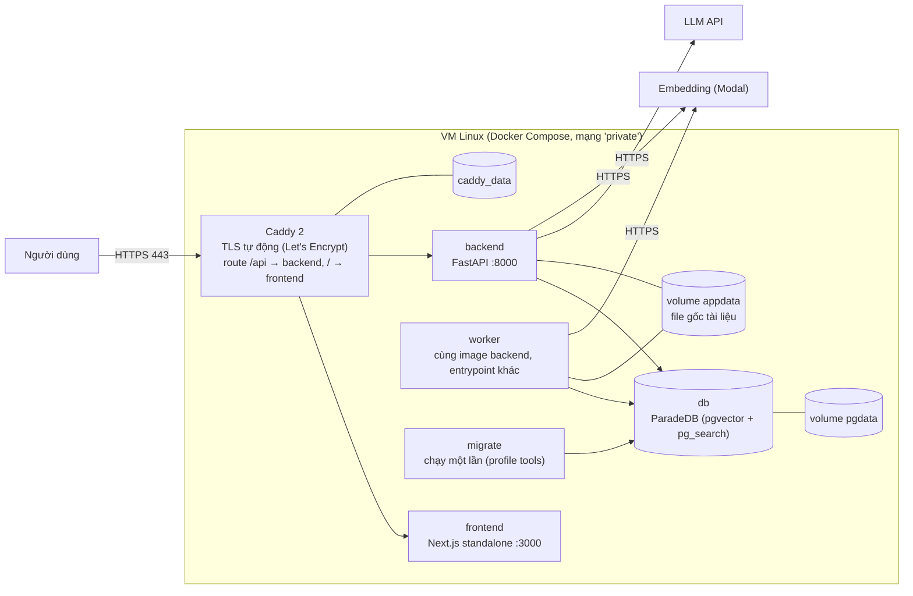
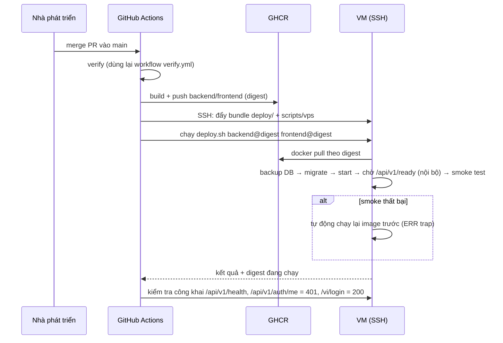

# Deployment & CI — VSF Onboarding Assistant

> Thiết kế triển khai và CI/CD cho `vsf-onboarding-assistant-system-design.md` (nguồn chuẩn về hành vi sản phẩm: `vsf-onboarding-assistant-prd.md`), kế thừa cách làm của Ralion (image theo digest qua GHCR, deploy kéo về VM qua SSH, Caddy TLS, migrate một lần, smoke test, rollback về image trước) và sửa các điểm yếu đã khảo sát. Phần 1–9 là deploy, CI ở phần 10–11.
>
> **Không phải điều kiện để bắt đầu chat và ingest, nhưng nằm trong lịch 4 tuần** (xem `plan/master-plan.md`): khung triển khai làm ở Phase 1b với giới hạn cứng 1 ngày; deploy thủ công bản cuối và cấu hình an toàn ở Phase 11a (bắt buộc); tự động hóa, rollback tự động và diễn tập khôi phục ở Phase 11b (stretch). Với một người làm, "song song" nghĩa là **không chặn** các phase khác, không phải chạy đồng thời. Có thể tạo repo, dựng local bằng docker-compose và CI rồi làm chat + ingest bằng dữ liệu giả lập trước; VM, tên miền, GHCR, sao lưu ngoài VM và cảnh báo có thể dựng sau. Các câu hỏi mở về hạ tầng (mục 15) không chặn việc phát triển tính năng.
>
> Ký hiệu: **Quyết định** = đã chốt; **Đề xuất** = cần xác nhận; giá trị bí mật chỉ ghi tên, không ghi nội dung.

## 0. Nguyên tắc

1. **Walking skeleton khi có máy chủ.** Khi VM sẵn sàng, đưa một bản `/api/v1/health` + trang frontend rỗng lên máy chủ thật bằng pipeline tự động có smoke test; mọi bước sau chỉ là thêm vào pipeline đã chạy. **Nhưng việc này không chặn phát triển:** repo, local compose và CI (kiểm chứng trên runner GitHub, dữ liệu giả lập) đi trước; deploy là nhánh song song.
2. **Image bất biến, deploy theo digest.** Build một lần, đẩy lên registry, máy chủ kéo đúng `@sha256:<digest>`. Không build trên máy chủ.
3. **Không bí mật trong image và trong repo.** Bí mật chạy chỉ nằm ở file env trên máy chủ; GitHub chỉ giữ thông tin để deploy.
4. **Mọi deploy có đường lui.** Tự động chạy lại image trước khi smoke test thất bại; không downgrade DB (dùng migration mở rộng-rồi-thu hẹp).
5. **Một môi trường thật trước** (staging đồng thời là môi trường pilot/demo). Production tách riêng chỉ khi có lý do (mục 12).
6. **CI chạy trên runner do GitHub cung cấp**, không phụ thuộc runner tự dựng của một tổ chức (điểm yếu lớn nhất của Ralion).

## 1. Môi trường

| Môi trường | Chạy ở đâu | Dùng để |
|---|---|---|
| **Local** | `docker compose up` (ParadeDB, backend, worker, frontend dev) | Phát triển |
| **CI** | Runner GitHub + service container Postgres/ParadeDB, compose e2e tạm | Kiểm chứng mỗi PR |
| **Staging / Pilot** | 1 VM Linux (Ubuntu 24.04) chạy Docker Compose sau Caddy | Demo cho mentor, pilot 5–10 người |
| **Production** *(sau)* | Cùng mẫu, VM khác | Chỉ khi VSF có yêu cầu vận hành thật |

**Đề xuất về máy chủ:** VM 2 vCPU / 4 GB RAM / 30 GB đĩa (tương đương e2-medium của Ralion) là đủ vì embedding chạy dịch vụ ngoài (Modal) và LLM là API. Nếu chạy embedding cục bộ thì cần thêm RAM (xem 13). **Không dùng lại VM của Ralion:** runbook của Ralion đặt hạn phá hủy tài nguyên vào 2026-11-08 (hết credit GCP), nên hệ thống mới phải có máy chủ và ngân sách riêng.

## 2. Topology chạy trên máy chủ



| Container | Image | Ghi chú |
|---|---|---|
| `caddy` | `caddy:2.x-alpine` (ghim phiên bản) | Cổng công khai duy nhất: 80, 443, udp 443; HSTS và header bảo mật; route theo hợp đồng ở system design mục 9.1 (`/api/*` → backend, còn lại → frontend; **chặn `/api/v1/ready*` từ bên ngoài**); health check nội bộ qua `/api/v1/ready` |
| `frontend` | `ghcr.io/<org>/vsf-frontend@sha256:…` | Next.js `output: standalone`, người dùng không root |
| `backend` | `ghcr.io/<org>/vsf-backend@sha256:…` | `expose 8000`, không publish ra host |
| `worker` | cùng image `backend` | Lệnh `python -m vsf.worker`; cùng env, không nhận HTTP |
| `db` | `paradedb/paradedb:<một phiên bản duy nhất>-pg16` | `expose 5432`, không publish; volume `pgdata` |
| `migrate` | cùng image `backend` | `alembic upgrade head`; profile `tools`, chạy một lần mỗi deploy |

**Quyết định — frontend chạy chung máy chủ sau Caddy, không dùng Vercel.** Ralion dùng Vercel vì phải rewrite `/api` để cookie session là first-party; cùng máy chủ với Caddy làm việc đó tự nhiên (`/api/*` → backend, còn lại → frontend, cùng một origin), bớt một nền tảng, một token và một điểm timeout (Ralion phải nâng `proxyTimeout`/`proxyClientMaxBodySize` cho upload). Đổi lại: tự vận hành frontend. Phương án thay thế (Vercel) vẫn khả thi nếu mentor muốn URL Vercel; khi đó giữ nguyên rewrite `/api` như Ralion.

**Mạng và cổng:** một mạng bridge `private`; chỉ Caddy publish cổng. Không cổng Postgres hay backend nào ra ngoài. Log container: `json-file`, 10 MB × 5.

## 3. Cấu trúc thư mục triển khai trong repo

```text
deploy/
  compose.vps.yml            stack chạy trên máy chủ (mọi image ghim theo biến/digest)
  Caddyfile                  route, TLS, header bảo mật
  env/compose.env.example    POSTGRES_*, PUBLIC_HOST, ACME_EMAIL, BACKUP_RETENTION_COUNT, image tag
  env/backend.env.example    APP_ENV, DATABASE_URL, SESSION_SECRET, LLM_*, EMBEDDING_*, CORS_ORIGINS…
  systemd/                   vsf-backup.{service,timer}, vsf-monitor.{service,timer}
scripts/vps/
  bootstrap.sh               cài Docker, ufw, cứng hóa SSH, unattended-upgrades (chạy một lần)
  deploy.sh                  quy trình deploy có khóa + rollback (mục 6)
  rollback.sh                chạy lại image trước
  backup-db.sh  restore-db.sh  smoke-test.sh
infra/                       (tùy chọn) Terraform tạo VM, firewall, IP tĩnh
docker-compose.yml           local
docker-compose.ci.yml        CI: DB tmpfs + e2e
```

**Quyết định — một phiên bản DB duy nhất.** Phiên bản ParadeDB khai báo một chỗ (`PARADEDB_TAG` trong `.env` dùng chung cho local, CI và VPS). Ralion để local v0.25.4 và test/e2e/VPS v0.23.4 lệch nhau.

## 4. Build image

- **Backend** (`backend/Dockerfile`): multi-stage; stage build cài dependency từ lockfile, stage runtime `python:3.12-slim`, người dùng không root (uid cố định), `HEALTHCHECK` gọi `/api/v1/health`. Không chứa model nặng hay secret. Một image dùng cho `backend`, `worker`, `migrate`.
- **Frontend** (`frontend/Dockerfile`): Node LTS, `npm ci`, `next build` với `output: standalone`, runtime chỉ copy `.next/standalone` + `static`, người dùng không root.
- **Nhãn:** `sha-<commit>` (bất biến) và `main` (con trỏ tiện lợi). Deploy luôn dùng digest.
- **Kiến trúc:** `linux/amd64` (khớp VM). Bật provenance và SBOM khi publish như Ralion.
- **Cache:** cache lớp Docker qua registry hoặc cache của GitHub Actions.

## 5. Luồng phát hành



Điều kiện kích hoạt: push vào `main` (deploy staging tự động) và `workflow_dispatch` (deploy lại hoặc rollback có chủ đích). Nhóm concurrency `deploy-staging` đảm bảo một deploy tại một thời điểm.

## 6. Hợp đồng của `deploy.sh`

Chạy trên VM, tham số là digest của từng image; dừng ngay khi có lỗi (`set -euo pipefail`).

1. **Kiểm tra đầu vào:** digest khớp regex `@sha256:[0-9a-f]{64}`, image thuộc đúng tổ chức/repo mong đợi (tham số hóa, không hard-code như `expected_prefix` của Ralion), giữ `flock` chống deploy chồng.
2. **Kéo image** backend, frontend, caddy, db (theo digest hoặc tag ghim).
3. **Khởi động `db`** và chờ healthy.
4. **Backup** trước khi migrate (`backup-db.sh`), bỏ qua ở lần deploy đầu tiên.
5. **Migrate:** `docker compose run --rm migrate` (`alembic upgrade head`).
6. **Khởi động** `backend`, `worker`, `frontend`, `caddy`.
7. **Chờ sẵn sàng:** gọi `/api/v1/ready` **nội bộ** (qua mạng Docker tới `backend:8000`) tối đa 30 lần.
8. **Smoke test** (`smoke-test.sh`): công khai `/api/v1/health` trả `ok`, `/api/v1/auth/me` trả `401` (không đăng nhập), `/vi/login` trả `200`, `/` chuyển hướng tới `/vi`, và `/api/v1/ready` từ bên ngoài trả `404`; nội bộ `/api/v1/ready` trả `ready`.
9. **Ghi trạng thái:** `state/current-image` và `state/previous-image`.
10. **Dọn:** xóa image cũ hơn 168 giờ; `docker logout` (không để token GHCR nằm lại trên VM).

**Rollback:** bẫy `ERR` chạy lại `previous-image` rồi smoke test; thủ công bằng `rollback.sh`. DB không downgrade — mọi migration phải tương thích với image trước đó (mục 9).

## 7. Cấu hình và bí mật

| Nơi | Nội dung (chỉ tên) |
|---|---|
| **GitHub Environment `staging`** (chỉ nhánh `main`) | `VPS_HOST`, `VPS_USER`, `VPS_SSH_KEY`, `VPS_SSH_HOST_KEY` (secrets); `VPS_PORT`, `PUBLIC_URL` (vars) |
| **Trên VM** `/opt/vsf/env/compose.env` | `POSTGRES_USER`, `POSTGRES_PASSWORD`, `POSTGRES_DB`, `PUBLIC_HOST`, `ACME_EMAIL`, `BACKUP_RETENTION_COUNT`, `PARADEDB_TAG` |
| **Trên VM** `/opt/vsf/env/backend.env` | `APP_ENV=production`, `DATABASE_URL`, `SESSION_SECRET`, `LLM_BASE_URL`, `LLM_API_KEY`, `LLM_MODEL`, `EMBEDDING_PROVIDER`, `EMBEDDING_ENDPOINT`, `EMBEDDING_API_KEY`, `STORAGE_PATH`, `UPLOAD_MAX_MB`, `LOG_LEVEL`, `CHAT_HISTORY_MESSAGES` (mặc định 6), `APP_TIMEZONE=Asia/Ho_Chi_Minh` (tính `as_of` cho ngày hiệu lực), `REQUIRE_SECOND_REVIEWER` (mặc định `false`), `LANGFUSE_ENABLED`, `LANGFUSE_HOST`, `LANGFUSE_PUBLIC_KEY`, `LANGFUSE_SECRET_KEY`, `LANGFUSE_CAPTURE_CONTENT` (mặc định `false`), `LANGFUSE_SAMPLE_RATE`, `RETENTION_CHAT_DAYS` (mặc định 90), `RETENTION_TELEMETRY_DAYS` (mặc định 180), `RETENTION_DEBUG_DAYS` (mặc định 30), `CONTENT_GAP_MIN_USERS` (mặc định 2), `CONTENT_GAP_HASH_KEY` (khóa băm danh tính cho danh sách thiếu tài liệu, không đổi tùy tiện) |
| **Repo** | Chỉ `*.env.example` (không giá trị thật) |

- **Mặc định MVP:** `LLM_BASE_URL=https://api.deepseek.com`, `LLM_MODEL=deepseek-flash`, `EMBEDDING_PROVIDER=modal-bge-m3`. Trên VPS dùng **khóa riêng của VSF** có hạn mức chi tiêu, không dùng lại khóa của dự án khác.
- Bí mật runtime **không** đi qua GitHub; đặt lên VM bằng script cấu hình một lần (giống `configure-staging-secrets` của Ralion) qua SSH.
- Image không chứa secret; `docker history` và quét image trong CI phải sạch.
- Validator cấu hình production từ chối khởi động nếu `SESSION_SECRET` yếu/mặc định hoặc còn bypass dev.
- Xoay vòng: đổi `SESSION_SECRET` làm mọi phiên hiện tại hết hiệu lực (chấp nhận được, ghi trong runbook).

## 8. Sẵn sàng, sức khỏe và giám sát

| Endpoint | Ý nghĩa | Dùng bởi |
|---|---|---|
| `GET /api/v1/health` (công khai) | Tiến trình còn sống (không chạm DB) | Docker `HEALTHCHECK`, smoke test công khai, giám sát bên ngoài |
| `GET /api/v1/ready` (**nội bộ**) | DB truy cập được, migration đang ở `head`, extension bắt buộc có mặt (`vector`, `pg_search`, `btree_gist`), cấu hình bắt buộc đủ | Caddy health check, chờ sau deploy (qua mạng Docker) |
| `GET /api/v1/ready/retrieval` (**nội bộ**) | Một truy vấn tìm kiếm mẫu trên kho seed trả về kết quả (dense + BM25) | Kiểm tra sau deploy qua SSH/mạng Docker; không gọi LLM để không tốn phí |

Caddy trả `404` cho `/api/v1/ready*` từ bên ngoài, để không lộ chi tiết nội bộ (phiên bản migration, extension, cấu hình).

- **Dọn dữ liệu theo hạn lưu:** worker chạy job `RETENTION_PURGE` hằng đêm (`vsf-retention.timer` hoặc lịch trong worker) theo `RETENTION_CHAT_DAYS`, `RETENTION_TELEMETRY_DAYS`, `RETENTION_DEBUG_DAYS`; ba loại dữ liệu và quyền xem ở system design mục 8. Job `INTEGRITY_CHECK` hằng đêm báo quy trình đang trỏ tới link/đầu mối không còn hợp lệ. Sao lưu DB có chứa dữ liệu hội thoại nên **bản sao lưu cũng phải bị xóa theo hạn lưu** (giữ tối đa bằng hạn lưu hội thoại, ghi rõ trong runbook).
- **Giám sát:** `vsf-monitor.timer` mỗi 5 phút gọi `/api/v1/health` qua HTTPS công khai, gọi `/api/v1/ready` nội bộ ngay trên máy chủ, và kiểm tra dung lượng đĩa (cảnh báo khi vượt 70%); thất bại ghi `journald` và (đề xuất) gọi webhook thông báo.
- **Log:** JSON có `trace_id`; xem bằng `docker compose logs`. Chưa cần hệ thống log tập trung.
- **Chi phí LLM:** báo cáo từ `llm_call_logs` (không cần công cụ ngoài); `llm_call_logs` là nguồn sự thật, Langfuse chỉ là giao diện xem trace.
- **Langfuse (tùy chọn):** xuất bất đồng bộ qua hàng đợi nền, lỗi Langfuse không làm hỏng lượt chat; nội dung bị che theo mặc định (`LANGFUSE_CAPTURE_CONTENT=false`), chỉ bật ở dev/đánh giá. Nếu dùng bản Langfuse Cloud thì máy chủ chỉ cần ra HTTPS tới dịch vụ đó (chỉ metadata rời hệ thống). Nếu tự host (theo hiểu biết hiện tại cần thêm ClickHouse, Redis, blob storage — kiểm tra lại bản hiện hành) thì đặt trong compose profile `observability` trên **máy chủ riêng**, không chạy chung VM 4 GB của ứng dụng.

## 9. Migration, sao lưu và khôi phục

**Chính sách migration:** mở rộng rồi thu hẹp — bản deploy N phải chạy được với schema của N−1 và ngược lại trong khoảng rollback. Cột mới nullable hoặc có default; xóa/đổi tên cột làm hai lần deploy. CI chạy `alembic upgrade head` và `alembic check` trên Postgres thật, **trên đúng image ParadeDB dùng ở VPS**, và kiểm tra `CREATE EXTENSION btree_gist` cùng test hai bản `ACTIVE` chồng ngày bị từ chối (exclusion constraint, xem tài liệu DB). Nếu `btree_gist` không có trong image thì dùng phương án dự phòng (partial unique index + job chuyển trạng thái theo ngày) và ghi rõ ở tài liệu DB.

**Sao lưu:**

- Hằng đêm (`vsf-backup.timer`, ~02:00 UTC): `pg_dump -Fc` + checksum sha256, giữ 7 bản trên VM; **kèm `tar` volume `appdata`** (file gốc tài liệu, cần để re-ingest).
- **Bản sao ngoài VM tự động** (cải thiện so với Ralion phải tải thủ công hằng tuần): đẩy bản mới nhất lên object storage bằng `rclone`/CLI của nhà cung cấp, giữ ≥ 14 ngày.
- **Diễn tập khôi phục hằng tháng:** khôi phục bản gần nhất vào DB tạm (CI/local) và chạy smoke retrieval.

**Khôi phục:** `restore-db.sh <file> --confirm-restore` — chỉ nhận file trong thư mục backup, kiểm checksum, `pg_restore --clean`, chạy migrate, khởi động lại backend/worker/caddy. Thao tác phá hủy nên bắt buộc cờ xác nhận.

## 10. CI (GitHub Actions)

Quyết định: **trunk-based đơn giản** — nhánh `main` bảo vệ, mọi thay đổi qua PR; không cần nhánh `develop` và guard chuyển nhánh của Ralion. Đề xuất: bắt buộc các check bên dưới trước khi merge.

```text
.github/workflows/
  verify.yml     (reusable: workflow_call) — toàn bộ cổng chất lượng
  ci.yml         PR → main: gọi verify.yml
  release.yml    push main: gọi verify.yml → publish → deploy-staging → post-deploy checks
  eval.yml       workflow_dispatch / lịch đêm: chạy đánh giá với LLM/embedding thật
```

### 10.1 `verify.yml` (dùng chung cho PR và release)

| Job | Nội dung | Ghi chú |
|---|---|---|
| `backend` | `ruff check` + `ruff format --check`; `mypy`; kiểm tra luật phụ thuộc (import-linter); `alembic upgrade head` + `alembic check` trên Postgres/ParadeDB service; `pytest` với ngưỡng coverage | Test dùng Postgres thật, embedding/LLM giả tất định |
| `frontend` | `npm ci`; `eslint`; `tsc --noEmit`; `vitest`; `next build` | Cache npm |
| `images` | Build backend và frontend (không push), chạy container backend và `curl /api/v1/health`; quét lỗ hổng/secret (Trivy hoặc tương đương) | Bắt lỗi Dockerfile trước khi merge |
| `e2e` | Dựng `docker-compose.ci.yml` (DB + backend + worker + frontend) với dữ liệu seed và provider giả, chạy Playwright (đăng nhập → hỏi → thấy trích dẫn → bị từ chối) | Chạy sau `backend` và `frontend` |
| `eval-smoke` | Chạy bộ đánh giá **rút gọn** trên corpus seed với embedding giả để kiểm tra pipeline, so với ngưỡng cấu hình | Không gọi dịch vụ trả phí |

### 10.2 `release.yml`

1. `verify` (gọi lại `verify.yml` — kiểm tra lại trên đúng commit sẽ phát hành).
2. `publish`: buildx đa lớp cache, đẩy `backend` và `frontend` lên GHCR, xuất digest; bật provenance + SBOM.
3. `deploy-staging` (Environment `staging`, concurrency `deploy-staging`): SSH với `StrictHostKeyChecking=yes` và host key ghim, đẩy bundle `deploy/` + `scripts/vps/`, chạy `deploy.sh` với hai digest.
4. `post-deploy`: kiểm tra công khai `/api/v1/health`, `/api/v1/auth/me` = 401, `/vi/login` = 200, `/api/v1/ready` từ ngoài = 404; kiểm tra nội bộ qua SSH `/api/v1/ready` và `/api/v1/ready/retrieval`. Thất bại đánh dấu release lỗi (đã có rollback tự động ở mục 6).

### 10.3 `eval.yml` (thủ công hoặc theo lịch)

Chạy bộ câu hỏi vàng đầy đủ với LLM và embedding thật, xuất báo cáo (Recall@5, Faithfulness, Citation, Route accuracy, False refusal, P90) làm artifact, so với ngưỡng. Tách khỏi PR để kiểm soát chi phí và độ ổn định; kết quả là cơ sở của cổng "0 bịa thông tin cá nhân, 0 dùng bản hết hiệu lực" trước khi pilot.

### 10.4 Chất lượng pipeline CI

- **Cache:** pip/uv (theo lockfile), npm, và cache lớp Docker (`type=gha` hoặc registry).
- **Concurrency:** PR hủy lần chạy cũ; deploy được tuần tự hóa, không bị hủy giữa chừng.
- **Quyền tối thiểu:** `permissions: contents: read` mặc định, chỉ job publish có `packages: write`.
- **PR từ fork:** không có secret; chỉ chạy các job không cần bí mật.
- **Dependabot** cho pip, npm, GitHub Actions, Docker base image.
- **Bảo vệ nhánh `main`:** bắt buộc check `verify`, cấm push trực tiếp, yêu cầu PR.

## 11. Cải thiện so với Ralion

| Điểm yếu ở Ralion | Cách xử lý |
|---|---|
| Toàn bộ CI/deploy chạy trên runner tự dựng dùng chung; runner chạy mã PR và giữ khóa SSH | Runner do GitHub cung cấp; secret chỉ ở Environment giới hạn nhánh `main`; PR fork không có secret |
| PR vào `main` chỉ chạy guard nhánh, kiểm chứng đến sau khi merge (release lỗi không chặn được merge) | PR vào `main` chạy đủ `verify`; release chạy lại trên đúng commit |
| Hai workflow lặp ~100 dòng kiểm chứng, không dùng lại | Một `verify.yml` reusable |
| Không cache trong CI | Cache pip/npm/Docker |
| Phiên bản DB lệch giữa local, test, e2e, VPS; `upgrade heads` và `head` lẫn lộn | Một biến `PARADEDB_TAG`, một `alembic upgrade head` |
| IP tạm thời: đổi VM là phải sửa tay hostname sslip.io, `PUBLIC_URL`, `VPS_HOST`, host key | IP tĩnh hoặc tên miền thật; giá trị ở một chỗ (GitHub vars) |
| `GITHUB_TOKEN` để lại trong cấu hình docker của VM | `docker logout` trong trap sau khi kéo image |
| Bản sao lưu ngoài VM là thao tác tải tay hằng tuần, chỉ 3 bản trên cùng đĩa | Đẩy tự động ra object storage, giữ 7 bản trên VM + ≥ 14 ngày ngoài VM |
| Script và runbook gắn cứng tên tổ chức P-040 | Tham số hóa tổ chức/tên image |
| Tài liệu nhắc workflow `staging-monitor.yml` không tồn tại | Giám sát bằng `systemd timer` trên VM, tài liệu khớp mã |
| Frontend "production" trên Vercel vẫn trỏ về staging, thêm token và điểm timeout | Frontend cùng máy chủ sau Caddy (hoặc, nếu chọn Vercel, ghi rõ giới hạn này) |
| Deploy có gián đoạn ngắn khi tạo lại backend | Chấp nhận cho pilot (ghi rõ); blue/green chỉ khi có yêu cầu |

## 12. Cứng hóa bảo mật máy chủ

- `bootstrap.sh`: cài Docker, `ufw` chỉ mở 22/80/443, SSH chỉ dùng khóa (tắt mật khẩu, tắt root login), `unattended-upgrades`, người dùng deploy riêng.
- **Hạn chế SSH:** giới hạn nguồn nếu có thể (VPN/IP cố định); nếu deploy từ runner GitHub (IP thay đổi) thì dùng khóa riêng chỉ cho việc deploy, host key ghim, và cân nhắc `fail2ban`. Người dùng deploy thuộc nhóm `docker` (tương đương root — ghi nhận rủi ro, không cấp thêm `NOPASSWD sudo` như Ralion nếu không cần).
- Container không root, hệ thống tệp chỉ đọc khi có thể, không publish cổng DB/backend.
- Caddy: HSTS, `X-Content-Type-Options`, `Referrer-Policy`, giới hạn kích thước body cho `/api/v1/documents`.
- Cập nhật: image base và Caddy được ghim, cập nhật qua Dependabot + PR.

## 13. Kích thước, chi phí và hạ tầng dưới dạng mã

- **Kích thước khởi điểm:** 2 vCPU / 4 GB / 30 GB. Backend + worker + frontend + ParadeDB + Caddy nằm vừa khi embedding và LLM đều là dịch vụ ngoài. Nếu chạy embedding cục bộ (BGE-M3 trên CPU) cần thêm ≥ 4 GB RAM và chấp nhận độ trễ cao hơn.
- **Chi phí định kỳ:** VM + đĩa + IP tĩnh + lưu trữ backup + gọi LLM/embedding (đo bằng `llm_call_logs`). Nên đặt cảnh báo ngân sách ở nhà cung cấp cloud.
- **Terraform (tùy chọn):** mô tả VM, firewall, IP tĩnh trong `infra/`; ghi rõ ngày hết credit/hết hạn nếu dùng credit thử nghiệm và đặt lịch dọn dẹp. Ở giai đoạn đầu có thể tạo VM thủ công rồi chạy `bootstrap.sh`, bổ sung Terraform khi cần lặp lại.

## 14. Kế hoạch deploy (D0–D5 và ánh xạ sang các phase)

**Thứ tự làm (ánh xạ sang `plan/master-plan.md`):** Phase 1a: repo + local compose + CI (`verify.yml`), thuộc bước M0; Phase 1b: D0–D2 (VM, Caddy, `deploy.sh` tay, `/api/v1/health` qua HTTPS) với giới hạn 1 ngày, quá hạn thì dời sang 11a; Phase 2–9: chat + ingest bằng dữ liệu giả lập, deploy thủ công khi cần demo; Phase 11a: cấu hình an toàn và deploy bản cuối; Phase 11b (stretch): D3 (`release.yml`, rollback tự động) và diễn tập khôi phục của D4. D4 đầy đủ (timer sao lưu, đẩy ra ngoài máy chủ) và D5 (giám sát, cảnh báo) làm sau MVP. Không cần VM, tên miền hay GHCR để bắt đầu phát triển tính năng.


| Bước | Việc | Tiêu chí xong |
|---|---|---|
| D0 | Chọn nhà cung cấp và tạo VM, IP tĩnh, tên miền/hostname; chạy `bootstrap.sh` | SSH bằng khóa, `ufw` bật, Docker chạy |
| D1 | Repo + `verify.yml` tối thiểu (lint, build, `pytest` rỗng, `/api/v1/health`) | PR xanh |
| D2 | `deploy/compose.vps.yml`, Caddyfile, `deploy.sh`, `smoke-test.sh`; thiết lập Environment `staging` và secrets | Chạy tay `deploy.sh` với image; `/api/v1/health` trả `ok` qua HTTPS |
| D3 | `release.yml`: publish GHCR + deploy tự động + post-deploy checks | Merge vào `main` tự đưa bản mới lên VM; cố tình làm hỏng smoke test → rollback tự động chạy |
| D4 | `backup-db.sh`, timer sao lưu, đẩy ra ngoài VM, `restore-db.sh`, diễn tập khôi phục | Khôi phục thành công vào DB tạm |
| D5 | `vsf-monitor.timer` + thông báo lỗi | Tắt backend thử → có cảnh báo trong 5–10 phút |

Sau D3, mỗi bước M1–M6 của lộ trình build (system design mục 15) chỉ cần merge vào `main` là tự lên staging. Nếu D0–D3 chưa xong khi cần demo, chạy `docker compose up` ở local hoặc trên một máy tạm.

## 15. Câu hỏi mở

1. **Máy chủ của VSF ở đâu?** VM cloud tự thuê (GCP/khác) hay hạ tầng nội bộ của VSF? Nếu nội bộ VSF, có thể không dùng GHCR/Let's Encrypt/SSH từ GitHub mà cần kênh triển khai khác (mục 2, 5, 12 sẽ đổi).
2. **Frontend:** cùng máy chủ sau Caddy (đề xuất) hay Vercel như Ralion?
3. **Tên miền:** có tên miền/hostname nào cố định không, hay dùng tên miền con miễn phí như `duckdns.org` với IP tĩnh? (Không dùng `sslip.io` cho HTTPS: hạn mức chứng chỉ Let's Encrypt dùng chung của nó đã từng cạn.)
4. **Dịch vụ LLM/embedding** dùng nhà cung cấp nào và ngân sách hằng tháng bao nhiêu? Ảnh hưởng cấu hình `backend.env` và cảnh báo chi phí.
   **Langfuse:** dùng Cloud (chỉ metadata ra ngoài, nội dung bị che) hay tự host trên máy chủ riêng, hay bỏ qua ở pilot? Cần hỏi mentor về chính sách dùng dịch vụ bên thứ ba cho dữ liệu nội bộ VSF.
   **`btree_gist`:** kiểm tra image ParadeDB được chọn có extension này không ở bước D1/M0.
5. **Object storage cho backup:** dùng dịch vụ nào và ai giữ khóa truy cập?
6. **Thông báo lỗi giám sát:** gửi tới kênh nào (email, Teams, Telegram)?
