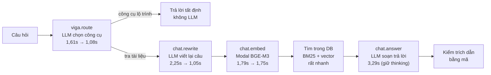

# Báo cáo benchmark: giảm độ trễ và chi phí LLM của Viga (tắt thinking theo từng bước)

Ngày đo: 06/10/2026. Người đo: Claude, trên máy dev của anh, gọi DeepSeek (`deepseek-flash`) và Modal BGE-M3 thật. Số liệu thô: thư mục `ket-qua/`; bảng tổng hợp: `bang-so-lieu.md`; các câu sai: `phan-tich-cau-loi.md`; mã đo: `scripts/`.

## 1. Tóm tắt

- **Khuyến nghị: tắt thinking ở hai bước `viga.route` và `chat.rewrite` (phương án B), giữ thinking ở bước trả lời.** Trung vị mỗi câu hỏi giảm từ 7,66 giây xuống 5,95 giây (giảm 22%), chi phí LLM giảm 14%, và độ chính xác không tệ đi (75/80 so với 73/80, chênh lệch nằm trong mức dao động tự nhiên của LLM).
- **Không khuyến nghị tắt thinking ở bước trả lời (phương án C)** dù nhanh nhất (trung vị 5,21 giây, giảm 32%, rẻ hơn 26%). Câu nhiều ý trả lời thiếu ý và có một câu tra cứu bị từ chối sai ("Khi nào tôi ký hợp đồng lao động?"). Mẫu còn nhỏ nên đây là dấu hiệu cần đo thêm, chưa phải kết luận chắc chắn.
- **Bước embedding (Modal) mất khoảng 1,75 giây ở cả ba phương án** (đo từ máy dev, mạng lúc đó) và không đổi khi tắt thinking. Đã dựng và đo thử BGE-M3 tự host trên AWS: **vector trùng Modal, truy hồi trùng 100%, một câu hỏi 106 ms so với 1.379 ms của Modal khi đo ở Singapore**. Chi tiết, hạn chế và các việc còn lại: `bao-cao-embedding-tu-host.md`.
- **Phương án B đã được áp dụng vào mã** (truyền `reasoning=False` ở `viga.route` và `chat.rewrite`; 506 test backend qua, thêm 3 test). Chưa chạy lại bộ đo này trên mã đã sửa để xác nhận số.

## 2. Vì sao có thể tắt thinking

Model `deepseek-flash` mặc định suy luận ẩn trước khi trả lời. Phần chữ suy luận bị bỏ khỏi kết quả nhưng vẫn tốn thời gian và tiền. Adapter có công tắc `reasoning=False`, đã dùng ở việc tạo task bằng AI (giảm 126,8 giây xuống 14,5 giây). Ba lời gọi LLM của Viga chưa tắt thinking:

| Bước | Việc | File |
|---|---|---|
| `viga.route` | chọn công cụ trong danh sách đóng | `services/viga/router.py` |
| `chat.rewrite` | viết lại câu hỏi cho bước tìm tài liệu | `services/viga/query_rewrite.py` |
| `chat.answer` | soạn câu trả lời có trích dẫn nguyên văn | `services/viga/answer_service.py` |



Chú thích: mỗi hộp LLM ghi độ trễ trung bình từ phương án A (thinking bật) sang phương án B (tắt ở route và rewrite). Hộp embedding gần như không đổi. Bước answer giữ nguyên ở phương án B.

## 3. Cách đo

| Mục | Giá trị |
|---|---|
| Phương án A | hiện trạng: thinking bật ở cả 3 bước |
| Phương án B | tắt thinking ở `viga.route` và `chat.rewrite` |
| Phương án C | tắt thinking ở cả 3 bước |
| Cách bật/tắt | `scripts/serve_variant.py` bọc `DeepSeekChatCompletion.complete_json` để ép `reasoning=False` theo tên bước; **không sửa mã sản phẩm** |
| Bộ câu hỏi | 40 câu: 26 câu tài liệu (bộ eval có sẵn), 10 câu kiểm định tuyến công cụ, 4 câu nhiều ý (có câu của anh: "chưa có VNeID thì sao, dùng CMND được không, và không đăng nhập Teams được thì sao") |
| Số lượt | mỗi phương án 2 lượt × 40 câu = 80 lượt hỏi; mỗi lượt đo có một câu khởi động bị bỏ |
| Thứ tự | A, B, C chạy tuần tự, mỗi phương án một máy chủ thử mới (cổng 8001) |
| Tài khoản thử | `newhire2` (lộ trình 16 việc); `newhire1` trong DB dev không đăng nhập được nên không dùng |
| Độ chính xác | ✓ đạt (đúng loại và đủ các ý bắt buộc), ~ đúng loại nhưng thiếu ý, ✗ sai loại; cách chấm lấy nguyên từ bộ eval cũ; câu nhiều ý chấm theo số ý được trả lời |
| Độ trễ | đo ở phía người dùng, từ lúc gửi đến lúc có trả lời |
| Token, chi phí | đọc từ bảng `llm_calls` theo `X-Request-ID` của từng câu, không dùng đồng hồ DB; chi phí = token × đơn giá trong cấu hình (0,30 và 1,20 USD mỗi triệu token), embedding = giây GPU × 0,000222 USD |
| Langfuse | tắt trên máy chủ thử để không đưa nội dung bộ thử lên dịch vụ ngoài |

## 4. Kết quả

### 4.1 Độ trễ một câu hỏi (giây)

| Phương án | Trung vị | Trung bình | p95 | Lớn nhất | Số lượt |
|---|---|---|---|---|---|
| A. Hiện trạng | 7,66 | 7,10 | 13,98 | 18,86 | 80 |
| B. Tắt route + rewrite | 5,95 | 5,60 | 10,67 | 22,12 | 80 |
| C. Tắt cả 3 bước | 5,21 | 4,44 | 6,94 | 8,12 | 80 |

So với A: B giảm trung vị 22%, trung bình 21%, p95 24%. C giảm trung vị 32%, trung bình 37%, p95 50%. Lượt chậm nhất của B (22,12 giây) là một đợt chậm đơn lẻ, có thể do DeepSeek hoặc mạng; tôi chưa xác định được nguyên nhân.

### 4.2 Theo từng bước LLM

Độ trễ trung bình mỗi lần gọi (giây):

| Phương án | viga.route | chat.rewrite | chat.embed | chat.answer |
|---|---|---|---|---|
| A | 1,61 | 2,25 | 1,79 | 3,29 |
| B | 1,08 | 1,05 | 1,75 | 3,30 |
| C | 1,11 | 1,12 | 1,73 | 1,63 |

Token đầu ra trung bình mỗi lần gọi (gồm suy luận ẩn) và phần suy luận ẩn trong đó:

| Phương án | route | rewrite | answer | Suy luận ẩn ở route / rewrite / answer |
|---|---|---|---|---|
| A | 151 | 311 | 605 | 108 / 275 / 442 |
| B | 43 | 33 | 621 | 0 / 0 / 460 |
| C | 44 | 33 | 149 | 0 / 0 / 0 |

Ở phương án A, **phần lớn token đầu ra là suy luận ẩn**: 72% ở route (108/151), 88% ở rewrite (275/311), 73% ở answer (442/605). Token đầu vào gần như không đổi (route khoảng 1.200, rewrite khoảng 370, answer khoảng 7.500).

### 4.3 Chi phí LLM mỗi câu hỏi

| Phương án | Tổng (mili-USD/câu) | route | rewrite | embed | answer | USD cho 1.000 câu |
|---|---|---|---|---|---|---|
| A | 3,461 | 0,501 | 0,366 | 0,297 | 2,296 | 3,46 |
| B | 2,971 | 0,374 | 0,109 | 0,286 | 2,201 | 2,97 |
| C | 2,560 | 0,376 | 0,109 | 0,283 | 1,792 | 2,56 |

B rẻ hơn A 14%, C rẻ hơn A 26%. Đây là chi phí **ước tính từ đơn giá cấu hình**, không phải hóa đơn thật, và chưa tính tiền Modal chạy không tải.

### 4.4 Độ chính xác

| Phương án | 26 câu tài liệu | 10 câu định tuyến | 4 câu nhiều ý | Tổng đạt ✓ |
|---|---|---|---|---|
| A | 47/52 ✓, 5 ~, 0 ✗ | 18/20 ✓, 0 ~, 2 ✗ | 8/8 ✓ | **73/80 (91,2%)** |
| B | 50/52 ✓, 2 ~, 0 ✗ | 18/20 ✓, 0 ~, 2 ✗ | 7/8 ✓, 1 ~ | **75/80 (93,8%)** |
| C | 47/52 ✓, 4 ~, 1 ✗ | 18/20 ✓, 0 ~, 2 ✗ | 6/8 ✓, 2 ~ | **71/80 (88,8%)** |

**Dao động tự nhiên:** cùng một phương án, hai lượt chạy khác nhau ở 3/40 câu (A), 1/40 (B), 1/40 (C). Vì vậy chênh lệch 2 đến 4 câu giữa các phương án nằm trong khoảng nhiễu và **không đủ để nói B "tốt hơn" A**; chỉ đủ để nói B không tệ đi.

Số câu đổi kết quả so với A (cùng câu, cùng lượt): B đổi 4 (3 tốt lên, 1 tệ đi); C đổi 6 (2 tốt lên, 4 tệ đi).

**Các câu đáng chú ý (chi tiết ở `phan-tich-cau-loi.md`):**

| Câu | Kết quả | Ý nghĩa |
|---|---|---|
| #201 "VNeID, CMND, Teams" (câu nhiều ý của anh) | A: 3/3 ý cả hai lượt. B: 2/3 ở lượt 1, 3/3 ở lượt 2. C: 1/3 ở lượt 1, 2/3 ở lượt 2 | Tắt thinking ở bước trả lời làm câu nhiều ý trả lời thiếu ý. Đây là lý do chính không chọn C |
| #6 "Khi nào tôi ký hợp đồng lao động?" | C lượt 2 trả lời "chưa có căn cứ" dù tài liệu có đáp án; A và B đạt | Một lần sai thật của C; mẫu 1 lần nên chưa kết luận |
| #110 "Hôm nay thời tiết ở Hà Nội thế nào?" | **Sai ở cả ba phương án, cả hai lượt** (trả về loại INFO thay vì từ chối) | Lỗi có sẵn của luật lối tắt, **không liên quan thinking**. Cần sửa riêng |
| #24 "Check-in ngày đầu làm thế nào?" | ~ ở cả ba phương án (trả "chưa có căn cứ") | Tài liệu mẫu không có đủ nội dung check-in; không liên quan thinking |

## 5. Hạn chế của phép đo (nói thẳng)

- **Mẫu nhỏ:** 40 câu × 2 lượt trên 2 tài liệu mẫu. Số p95 chỉ mang tính tham khảo; chênh 2 đến 4 câu là nhiễu.
- **Một máy, một mạng, một tài khoản:** đo từ máy dev ở Việt Nam. Độ trễ gọi DeepSeek và Modal phụ thuộc đường mạng nên số tuyệt đối sẽ khác khi chạy trên AWS.
- **DeepSeek không cố định kết quả** nên chạy lại có thể ra số hơi khác.
- **Chi phí là ước tính** từ đơn giá cấu hình, chưa đối chiếu hóa đơn.
- **Máy chủ thử ghi hội thoại và log vào DB dev** (giống bộ eval cũ); Langfuse tắt trong lúc đo.
- **Chưa đo phương án gộp route và rewrite thành một lần gọi** (cần sửa mã sản phẩm). Từ số liệu, nếu gộp được thì có thể bỏ thêm khoảng 1 giây của bước rewrite, nhưng đó là suy luận, chưa kiểm chứng.
- Bộ câu hỏi và cách chấm có thể chấm hơi nghiêm hoặc hơi lỏng ở vài câu "ANY"; tôi giữ nguyên cách chấm cũ để so được với các lần đo trước.

## 6. Khuyến nghị và việc tiếp theo

1. **Áp dụng phương án B** (truyền `reasoning=False` ở `viga.route` và `chat.rewrite`): nhanh hơn khoảng 22% mà không thấy tệ đi về độ chính xác. Thay đổi nhỏ; cần anh duyệt và nên chạy lại bộ này một lần sau khi sửa để xác nhận.
2. **Giữ thinking ở `chat.answer`** cho tới khi có bộ câu nhiều ý lớn hơn chứng minh C không làm tệ đi.
3. **Sửa riêng lỗi #110** (câu hỏi thời tiết bị luật "hôm nay" bắt nhầm).
4. **Giảm bước embedding** (mục 7): đây là phần còn lại lớn nhất không phụ thuộc LLM.
5. Thử gộp route và rewrite sau khi áp dụng B, đo lại bằng đúng bộ này.

## 7. Embedding: Modal và tự host BGE-M3

Kết quả đầy đủ: `bao-cao-embedding-tu-host.md`. Kế hoạch gốc: `ke-hoach-tu-host-bge-m3-tren-aws.md`. Tóm tắt:

| Việc | Trạng thái |
|---|---|
| Dịch vụ `bge-m3-embedder` (cùng hợp đồng `/embed` với Modal) | đã chạy trên máy `vsf-embedder` (`m7i-flex.large`, Singapore), chế độ `bf16` |
| Tạo máy bằng Terraform | đã làm: **2 thêm, 0 sửa, 0 xóa**; hạ tầng cũ so trước/sau **giống hệt** |
| Độ chính xác so với Modal | cosine 1,0000 (`fp32`) hoặc ≥ 0,99976 (`bf16`); top-5 truy hồi trùng 100%; hit@5 19/19 |
| Độ trễ một câu (đo ở Singapore) | Modal 1.379 ms; tự host `fp32` 298 ms; `bf16` 106 ms |
| Nhúng lô 32 đoạn | Modal khoảng 3 giây; tự host `bf16` 4,65 giây; `fp32` 16,2 giây (chậm hơn, chỉ ảnh hưởng lúc nạp tài liệu) |
| Chuyển backend thật sang dùng máy này | **chưa làm**, cần anh quyết (cần vào máy chính) |
| Build thử trên máy dev | bỏ: tải mô hình ~2,3 GB quá chậm (đo được khoảng 0,2 đến 0,3 MB/giây); máy AWS tự tải nhanh hơn nhiều |

Một phát hiện về hạ tầng hiện có: `terraform plan` đầy đủ còn đề nghị **xóa luật SSH `3.0.5.32/29`** (dải EC2 Instance Connect, thêm tay ngoài Terraform) khỏi nhóm bảo mật máy chính. Tôi đã sửa `embedder.tf` để chỉ đọc nhóm bảo mật đó chứ không tham chiếu tài nguyên, nên kế hoạch của máy embedding không kéo thay đổi này theo. Anh nên biết việc này khi tự chạy `terraform apply` toàn bộ sau này.

## 8. Cách chạy lại

```bash
# từ thư mục backend, dùng venv; mỗi phương án một máy chủ thử riêng
python ../docs/value/benchmark-modal-llm-viga/scripts/serve_variant.py --off "" --port 8001            # A
python ../docs/value/benchmark-modal-llm-viga/scripts/serve_variant.py --off "viga.route,chat.rewrite" --port 8001   # B
python ../docs/value/benchmark-modal-llm-viga/scripts/run_benchmark.py --label B_tat_route_rewrite --runs 2
python ../docs/value/benchmark-modal-llm-viga/scripts/tong_hop.py          # bảng tổng hợp
python ../docs/value/benchmark-modal-llm-viga/scripts/phan_tich_cau_loi.py # các câu sai và đổi kết quả
```
