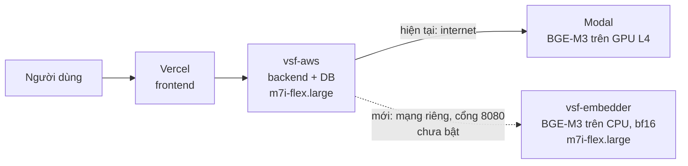

# Báo cáo: tự host BGE-M3 trên AWS so với Modal (độ trễ chính, độ chính xác)

Ngày đo: 06/10/2026. Số liệu thô: `ket-qua/embedding_*.json` (bản chạy lỗi đầu tiên với chuỗi phiên bản sai đã bỏ). Kế hoạch gốc: `ke-hoach-tu-host-bge-m3-tren-aws.md`. Báo cáo LLM: `bao-cao-benchmark-llm-viga.md`.

## 1. Tóm tắt

- **Máy embedder đã chạy trên AWS** (`vsf-embedder`, `m7i-flex.large`, 2 vCPU/8 GiB, không GPU, cùng AZ với máy chính). Hạ tầng cũ **không bị thay đổi** (đã so trước và sau mỗi lần thay đổi).
- **Độ chính xác không đổi:** với `fp32`, vector **trùng hệt** vector của Modal (cosine 1,0000 trên 25 câu hỏi và trên 58 đoạn tài liệu đã lưu trong DB); top-5 đoạn truy hồi trùng 100%, và 19/19 câu có đáp án đều tìm đúng đoạn ở cả hai nguồn. Với `bf16`, cosine thấp nhất vẫn 0,99976, top-5 trùng 100%, 19/19. **Không cần nhúng lại tài liệu.**
- **Độ trễ một câu hỏi, đo trên máy cùng vùng Singapore với máy chính:** Modal **1.379 ms**, tự host `fp32` **298 ms**, tự host `bf16` **106 ms** (giảm 13 lần). Đây là số gần nhất với những gì backend trên `vsf-aws` sẽ thấy.
- **Đổi lại, nhúng hàng loạt chậm hơn:** lô 32 đoạn mất 4,65 giây (`bf16`) hoặc 16,2 giây (`fp32`) so với 2,7 đến 3,1 giây của Modal. Việc này chỉ ảnh hưởng lúc nạp tài liệu, không ảnh hưởng câu hỏi của người dùng.
- **Hạn chế quan trọng về vị trí đo:** Modal đo từ máy dev ở Việt Nam (mạng hiện tại) chỉ mất khoảng **400 ms**, nhanh hơn nhiều so với 1.379 ms đo từ Singapore. Nên mức lợi ở môi trường dev nhỏ hơn nhiều so với trên máy chính. Nguyên nhân khác biệt này tôi **chưa xác định được**.
- **Chưa chuyển backend thật sang dùng máy này.** Việc đổi cấu hình trên `vsf-aws` cần anh quyết (mục 7).

## 2. Hạ tầng đã tạo

Chú thích: đường nét liền là luồng đang chạy thật; đường nét đứt là đường mới đã dựng sẵn nhưng chưa chuyển backend sang.

| Mục | Giá trị | Nguồn |
|---|---|---|
| Máy | `i-0b24bf7c927984e2e`, `m7i-flex.large`, `ap-southeast-1b`, IP riêng `172.31.26.137` | `terraform output`, `describe-instances` |
| Cách tạo | `terraform apply` chỉ 2 tài nguyên: máy và nhóm bảo mật (2 thêm, 0 sửa, 0 xóa) | `infra/aws/embedder.tf` |
| Nhóm bảo mật | cổng 8080 chỉ nhận từ nhóm bảo mật của máy chính; cổng 22 chỉ từ IP vận hành | `describe-security-groups` |
| Cài đặt | cloud-init: Docker, build ảnh, tải mô hình từ Hugging Face; xong trong khoảng 10 phút | log máy |
| Mô hình | `BAAI/bge-m3`, bản `5617a9f6…` (chính là bản Modal đã dùng để nạp tài liệu), `bf16` | `docker logs`, cột DB |
| Tài nguyên khi chạy | RAM dùng khoảng 2,4/7,8 GiB; đĩa 12/38 GB | `free`, `df` |
| Tải mô hình | 2,3 GB tải thẳng về máy AWS, không đi qua máy anh | cloud-init |

**Kiểm tra hạ tầng cũ không bị đụng:** tôi chụp nhóm bảo mật của máy chính, thông tin máy chính, Elastic IP và file trạng thái Terraform trước khi tạo, rồi so lại sau mỗi lần `apply`: nhóm bảo mật máy chính **giống hệt** ở cả 3 lần so, luật SSH EC2 Instance Connect `3.0.5.32/29` vẫn còn, máy `vsf-aws` vẫn `running`. Tôi không dùng lệnh `apply` toàn bộ vì kế hoạch đầy đủ muốn **xóa luật Instance Connect đó** (luật thêm tay ngoài Terraform).

## 3. Cách đo

| Mục | Giá trị |
|---|---|
| Nguồn so sánh | Modal (đang dùng) và máy tự host, cùng hợp đồng `/embed` |
| Độ trễ trên máy AWS | `scripts/bench_from_vsf_aws.py` chạy **trên máy embedder** (Singapore, cùng vùng với máy chính): 10 câu × 5 lần, xen kẽ hai nguồn, bỏ một lần làm ấm; tự host gọi qua `localhost`, Modal qua internet |
| Độ trễ từ máy dev | `scripts/bench_embedding.py` qua đường hầm SSH tới máy AWS: 25 câu × 1 lần |
| Độ chính xác vector | cosine giữa vector hai nguồn cho cùng câu hỏi; và giữa vector **đã lưu trong DB** (do Modal nhúng lúc nạp) với vector tự host nhúng lại cùng đoạn văn (`embedding_text`), 58 đoạn |
| Độ chính xác truy hồi | với 25 câu golden, top-5 đoạn gần nhất trong DB theo vector của từng nguồn: độ trùng top-5 và hit@5 (top-5 có chứa ít nhất một ý bắt buộc của câu, chỉ tính 19 câu có đáp án) |
| Lô lớn | 32 đoạn dài, 3 lần |

## 4. Kết quả

### 4.1 Độ trễ

Đo **trên máy AWS Singapore** (gần nhất với đường backend sẽ gọi), một câu hỏi, mili giây:

| Nguồn | p50 | p95 | Trung bình | Số lượt |
|---|---|---|---|---|
| Modal | 1.379 | 1.418 | 1.383 | 50 |
| Tự host `fp32` | 298 | 343 | 303 | 50 |
| **Tự host `bf16`** | **106** | **119** | **107** | 50 |

Lô 32 đoạn dài (giây, trung vị): Modal 3,1 (lần đo `fp32`) và 2,7 (lần đo `bf16`); tự host `fp32` 16,2; tự host `bf16` 4,65.

Đo **từ máy dev ở Việt Nam** qua đường hầm SSH (25 câu × 1 lần), mili giây p50:

| Nguồn | p50 | p95 |
|---|---|---|
| Modal | 400 đến 408 | 427 đến 438 |
| Tự host `fp32` | 484 | 503 |
| Tự host `bf16` | 267 | 297 |

Lô 32 đoạn từ máy dev: Modal khoảng 3,0 giây; tự host `bf16` 5,6 giây; `fp32` 17,0 giây.

**Cách đọc hai bảng:** từ máy dev, tự host nhanh hơn Modal ít (267 so với 400 ms với `bf16`) vì đường đi tới Singapore chiếm phần lớn thời gian. Từ máy AWS cùng vùng, tự host nhanh hơn Modal 13 lần. Tôi **không biết vì sao Modal nhanh hơn khi gọi từ Việt Nam** so với gọi từ Singapore (có thể do định tuyến mạng hoặc vị trí máy chủ Modal; chưa kiểm chứng). Hệ quả: lợi ích thật phụ thuộc backend chạy ở đâu; số đáng tin nhất cho môi trường chạy thật là số trên máy AWS.

Các lần đo bước `chat.embed` trong báo cáo LLM (khoảng 1,75 giây) được thực hiện trên mạng trước khi anh đổi mạng, nên không so thẳng được với số 400 ms ở trên.

### 4.2 Độ chính xác

| Chế độ | Cosine câu hỏi (trung bình / thấp nhất) | Cosine 58 đoạn đã lưu (trung bình / thấp nhất) | Trùng top-5 | Hit@5 (Modal / tự host) |
|---|---|---|---|---|
| `fp32` | 1,00000 / 1,00000 | 1,00000 / 1,00000 | 100% | 19/19 / 19/19 |
| `bf16` | 0,99994 / 0,99992 | 0,99992 / 0,99976 | 100% | 19/19 / 19/19 |

`fp32` cho vector **trùng hệt** Modal nên có thể thay thế trực tiếp. `bf16` lệch cỡ phần chục nghìn, không đổi thứ hạng truy hồi trên bộ thử này.

### 4.3 Một lỗi tôi đã gặp và sửa

DB lưu `embedding_model_version = BAAI/bge-m3@5617a9f6…` và truy hồi của backend **lọc đúng theo chuỗi này**. Bản đầu của dịch vụ tự host trả `bge-m3`, nếu chuyển backend sang nó thì tìm kiếm sẽ **trả rỗng**. Phép đo truy hồi đầu tiên cho 0/19 ở cả hai nguồn nhờ vậy mới lộ ra (đó là lỗi của script đo, vì tôi ghi cứng chuỗi `bge-m3`). Đã sửa cả hai: dịch vụ tự lấy `BAAI/bge-m3@<mã bản>` từ bộ nhớ đệm Hugging Face (đúng dạng Modal trả), và script đo đọc chuỗi từ DB. Bản sửa đã chạy trên máy.

## 5. Hạn chế (nói thẳng)

- **Mẫu nhỏ:** 25 câu golden, 10 câu × 5 lần cho số liệu độ trễ trên AWS. Chưa đo dưới tải đồng thời (nhiều người hỏi cùng lúc): máy chỉ 2 vCPU, một lần suy luận một lúc, nên có thể hàng đợi khi tải cao. Chưa đo.
- **Độ trễ trên AWS đo trên chính máy embedder** (tự host qua `localhost`, thiếu khoảng 1 ms mạng riêng), không phải từ máy chính `vsf-aws` vì tôi không vào được máy chính. Hợp lý nhưng chưa phải đo trực tiếp đường thật.
- **Chưa chạy bộ Viga đầy đủ với embedding tự host** (backend thật chưa chuyển). Vì truy hồi trùng 100%, tôi kỳ vọng câu trả lời không đổi, nhưng chưa kiểm chứng đầu-cuối.
- **Hit@5 chỉ đo 19 câu**, và dùng từ khóa bắt buộc làm đại diện cho "tìm đúng đoạn".
- **Chi phí chưa tra:** giá theo giờ của `m7i-flex.large` thứ hai và việc nó có nằm trong ưu đãi Free Plan hay không chưa được xác minh. Máy đang chạy tính tiền từ lúc tạo (khoảng 15:07 giờ VN).
- **Số đo Modal không ổn định giữa các vị trí và các mạng** (400 ms đến 1.800 ms trong ngày hôm nay), nên chênh lệch trong báo cáo LLM và báo cáo này không cộng trừ trực tiếp được.
- **Bảo mật:** khóa API nằm trong `user_data` của máy (người có quyền đọc thuộc tính máy EC2 xem được) và trong file `600` của máy. Luật SSH cho IP vận hành đang mở (mục 7).

## 6. Khuyến nghị

1. **Dùng `bf16`** cho đường trả lời câu hỏi: nhanh nhất, truy hồi không đổi. Dùng `fp32` nếu cần vector trùng tuyệt đối với Modal (nạp tài liệu mới bằng cùng một nguồn cho đơn giản).
2. **Chuyển backend trên `vsf-aws` sang máy này** là việc cho lợi ích lớn nhất (khoảng 1,3 giây mỗi câu hỏi theo số đo trên AWS), nhưng cần thử trước và có đường quay lại (mục 7).
3. **Để Modal lo việc nạp tài liệu lớn** nếu nạp hàng loạt thường xuyên (vector hai nguồn tương thích nên dùng lẫn được).
4. **Quyết định giữ hay tắt máy** sau khi tra giá. Nếu không chuyển backend, nên tắt hoặc xóa máy để khỏi tốn credit: `terraform destroy -target=aws_instance.embedder -target=aws_security_group.embedder`.

## 7. Việc cần anh quyết hoặc làm (tôi chưa làm)

| Việc | Vì sao tôi chưa làm |
|---|---|
| Đổi `EMBEDDING_ENDPOINT` thành `http://172.31.26.137:8080` và `EMBEDDING_API_KEY` thành khóa tự host trên `vsf-aws`, rồi khởi động lại backend | Cần vào máy chính (tôi không vào được) và đây là thay đổi trên hệ thống đang dùng thật. Giữ nguyên giá trị Modal cũ để quay lại bằng một lần đổi lại |
| Tắt `embedding_keep_warm_enabled` khi dùng tự host | Cơ chế giữ ấm GPU Modal không còn cần; chưa đổi |
| Sửa thống kê chi phí | Mã hiện ghi cứng nhà cung cấp `modal` và tính tiền theo giây GPU `0,000222 USD`; với tự host chi phí thật là tiền thuê máy theo giờ. Chưa sửa mã |
| Thu hồi luật SSH cho IP của anh trên nhóm bảo mật máy embedder | Luật đổi IP liên tục theo mạng; nên thu hồi khi không dùng (một lệnh Terraform nhỏ, chỉ nhóm bảo mật mới) |
| Commit (benchmark, mã phương án B, `infra/aws/embedder*`) | Anh chưa yêu cầu |
