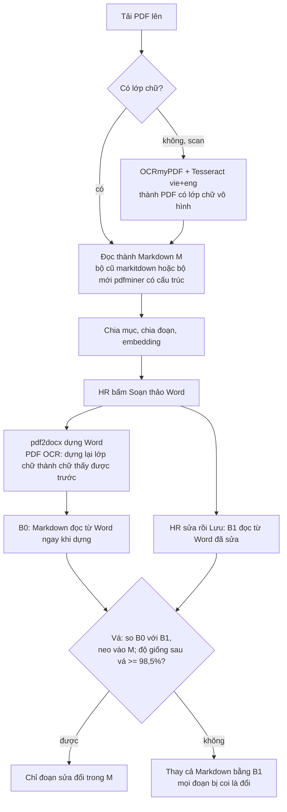

# Báo cáo benchmark: OCR, đọc PDF thành Markdown, PDF sang Word và bước vá Markdown

Ngày đo: 10/10/2026, máy dev (Docker, giới hạn 2 CPU cho OCR, 4 CPU cho phần đọc PDF; ảnh `vsf-onboarding-backend`). Mọi con số trong báo cáo là **số đo thật** trừ chỗ ghi rõ "chưa đo". Mã đo nằm ở `scripts/`, kết quả thô ở `ket-qua/*.json`.

## 1. Tóm tắt

| Việc | Kết quả đo | Nhận xét ngắn |
|---|---|---|
| OCR văn xuôi dài (luật, thông tư), scan sạch 200 dpi | CER 0,6–2,2%, sai số liệu 0 trên 51 | Dùng được, vẫn cần người soát |
| OCR trang bảng/nội quy ngắn | CER 1,6–11,1%, mất 6/15 số liệu ở trang tệ nhất | **Yếu ở bảng**: thứ tự đọc và số liệu sai nhiều |
| OCR scan xuống cấp (150 dpi, nghiêng, mờ, JPEG 40) | CER trung bình 6,4% (so với 3,7% ở bản sạch) | Xuống cấp làm sai gần gấp đôi |
| Phóng ảnh to hơn (1,5 lần, 2 lần, 300 dpi) | Không tốt hơn 200 dpi | Không cần phóng to |
| Bộ đọc PDF có cấu trúc (mới) so với bộ đọc phẳng (cũ) | Số tiêu đề tìm đúng: Word gốc 18 mục, PDF cũ 3 mục, PDF mới 19 mục | Tách mục tốt hơn rõ trên 22 PDF mẫu |
| **Bước vá Markdown khi HR sửa một chỗ (PDF → Word → lưu)** | Với bộ đọc mới vá được **5/19** PDF; với bộ đọc cũ vá được **8/19** | **Bất ngờ: bộ đọc mới vá kém hơn bộ cũ** (xem mục 5) |

## 2. Luồng đã đo

## 3. OCR: Tesseract (vie+eng)

Phương pháp: lấy lớp chữ của PDF mẫu làm đáp án (pdfminer), vẽ trang thành ảnh theo ba điều kiện, OCR bằng Tesseract (`--psm 3`, 2 luồng), so sau khi chuẩn hóa Unicode NFC và **bỏ mọi khoảng trắng** (để không phạt khác biệt ngắt dòng). 8 trang × 3 điều kiện = 24 lượt. Số liệu = các chuỗi có chữ số trong đáp án.

Phiên bản đo: Tesseract 5.3.0 (bản của Debian bookworm trong ảnh Docker), gói ngôn ngữ `vie.traineddata` nặng 0,5 MB (bản nhẹ của Debian; chưa so với bản `tessdata_best`).

| Điều kiện | CER TB | CER trung vị | CER xấu nhất | CER bỏ dấu TB | WER TB | Số liệu đúng | Giây/trang (trung vị) | Giây/trang (lớn nhất) |
|---|---|---|---|---|---|---|---|---|
| Sạch 200 dpi | 3,66% | 2,13% | 11,13% | 2,68% | 6,10% | 86,6% | 2,37 | 2,76 |
| Sạch 300 dpi | 3,75% | 2,06% | 11,86% | 2,68% | 6,27% | 86,6% | 3,10 | 5,77 |
| Xuống cấp (150 dpi, nghiêng 1,5°, mờ, JPEG 40) | 6,36% | 4,80% | 16,01% | 5,14% | 9,30% | 75,6% | 2,05 | 4,38 |

RAM đỉnh của một tiến trình Tesseract: 118 MB.

### Theo loại trang (CER, sạch 200 dpi → xuống cấp)

| Trang | Loại | CER sạch | CER xuống cấp | Số liệu đúng (sạch → xuống cấp) |
|---|---|---|---|---|
| PUB_R03 tr.5 | luật, văn xuôi | 0,60% | 1,32% | 13/13 → 13/13 |
| PUB_R03 tr.12 | luật, văn xuôi | 1,14% | 1,67% | 10/10 → 9/10 |
| PUB_R03 tr.18 | luật, văn xuôi | 2,15% | 1,96% | 17/17 → 16/17 |
| PUB_R04 tr.6 | thông tư, điều khoản | 2,11% | 2,58% | 11/11 → 11/11 |
| SYN_D05 tr.1 | chính sách (có bảng) | 4,62% | 8,76% | 9/15 → 8/15 |
| SYN_P02 tr.1 | bảng lịch | 11,13% | 16,01% | 10/15 → 9/15 |
| SYN_E02 tr.1 | bảng số liệu | 1,63% | 7,03% | 23/23 → 16/23 |
| SYN_D10 tr.1 | chính sách | 5,93% | 11,57% | 10/15 → 8/15 |

**Đọc kết quả:**
- Văn xuôi dài rất ổn; lỗi dấu là chính (CER bỏ dấu của luật chỉ 0,05–0,4%).
- Các trang SYN có bảng hoặc bố cục nhiều khối sai nhiều hơn. **Lưu ý cách đo:** CER so chuỗi liền theo thứ tự đọc, nên lệch thứ tự đọc của bảng (pdfminer so với Tesseract) làm CER bị thổi phồng. Số liệu đúng (không phụ thuộc thứ tự) cho thấy mất thật: 6/15 ở trang tệ nhất.
- Thời gian 2–3 giây mỗi trang trên 2 CPU, không phụ thuộc nhiều vào độ phân giải.

### Đo thêm trên bản scan của bạn (`Huong_dan_ngay_1_onboarding_co_header_scan.pdf`, 4 trang, 765 từ)

| Phép đo | Kết quả |
|---|---|
| Từ đúng cả dấu | 95,6% |
| Từ đúng khi bỏ dấu | 99,3% |
| Phóng ảnh 1,5 lần / 2 lần | 91,5% / 93,7% (không tốt hơn) |
| Lỗi nhìn thấy | ký hiệu "•" đọc thành "e", "®", "¢"; "Lý lịch" → "Ly lịch"; "Căn cước" → "Can cước" |

Nghĩa là chữ cái gần như đúng, **lỗi chủ yếu ở dấu tiếng Việt và ký hiệu đầu dòng**.

## 4. Đọc PDF có chữ thành Markdown: bộ cũ so với bộ có cấu trúc

Đo trên 22 PDF mẫu của dự án (gồm một bản PDF do trình soạn thảo lưu ra) (`ket-qua/doc-pdf-va-va.json`). "Mục" là số mục chia được bằng đúng code chia mục đang chạy (`analyze_structure`).

| Tệp | Mục cũ → mới | Chất lượng cũ → mới | Từ vựng giữ lại | Giây cũ → mới |
|---|---|---|---|---|
| Hướng dẫn ngày 1 (PDF xuất từ Word, bản Word gốc có **18 mục**) | 3 → 19 | Trung bình → Tốt | 99,8% | 0,29 → 0,13 |
| SYN_D02 Nội quy trang phục | 22 → 21 | Trung bình → Tốt | 98,6% | 1,22 → 0,46 |
| SYN_D03a Nghỉ phép | 27 → 28 | Trung bình → Tốt | 98,7% | 1,31 → 0,37 |
| SYN_D05 Phúc lợi, bảo hiểm | 35 → 33 | Trung bình → Tốt | 98,6% | 1,54 → 0,86 |
| SYN_D08a/b Mật khẩu | 24 → 26; 31 → 32 | Trung bình → Tốt | 98,3%; 97,9% | 0,76 → 0,34; 0,78 → 0,73 |
| SYN_D10, D11, E10 | 34 → 34; 21 → 23; 16 → 17 | Trung bình → Tốt | 97,5–98,5% | |
| SYN_P02, P04, P07, P09 | 20 → 20; 21 → 22; 34 → 37; 35 → 37 | Trung bình → Tốt | 97,0–98,3% | |
| SYN_E02 Bảng thưởng | 11 → 11 | Trung bình → Tốt | 94,5% | 0,28 → 0,15 |
| PUBSUM_V02 | 1 → 7 | Kém → Tốt | 99,0% | |
| SYN_E04 Lịch nghỉ lễ | 1 → 2 | Kém → Trung bình | 99,8% | |
| PUB_R01 Bộ luật Lao động (220 điều) | 66 → 215 | Trung bình | 100% | 47,5 → 22,0 |
| PUB_R02 Luật BHXH | 479 → 173 | Trung bình | 98,5% | 85,4 → 29,1 |
| PUB_R03 Luật Công đoàn | 136 → 50 | Trung bình | 98,1% | 4,4 → 1,8 |
| PUB_R04 Thông tư 10/2020 | 26 → 59 | Trung bình | 99,6% | 7,0 → 5,1 |

**Đọc kết quả:**
- Bộ mới nhanh hơn 1,1–3 lần (cùng thư viện pdfminer nhưng bỏ phần dựng Markdown của markitdown).
- Với PDF xuất từ Word: tìm đúng tiêu đề (3 → 19 mục, bản Word gốc 18). Với luật: 215 mục cho Bộ luật Lao động khớp với số điều; bộ cũ chia thành 66.
- Số mục của luật thay đổi rất lớn giữa hai bộ đọc (66 → 215, 479 → 173, 136 → 50). Chưa kiểm xem số nào đúng hơn cho từng luật ngoài Bộ luật Lao động; cần người kiểm.
- Lỗi đã gặp và sửa trong lúc đo: PUB_R04 ban đầu giữ chỉ 51% chữ vì bộ đọc bỏ sót chữ nằm trong khung (form XObject); đã sửa (nay 99,6%).

## 5. Bước vá Markdown khi HR sửa (PDF → Word → Lưu)

Phép thử: dựng Word bằng pdf2docx, sửa **một từ**, rồi vá vào Markdown gốc `M`. "Vá được" nghĩa là giữ nguyên phần chưa sửa của `M`; "không vá được" nghĩa là hệ thống dùng nguyên Markdown đọc từ Word (đổi cả tài liệu). Bỏ qua 2 PDF dài (R01, R02) vì pdf2docx vượt giới hạn 30 trang của phép đo, và bản PDF do trình soạn thảo lưu ra (không phải tệp mẫu); còn lại 19 PDF.

| | Bộ đọc cũ | Bộ đọc mới |
|---|---|---|
| Số PDF vá được trên 19 PDF | **8** (42%) | **5** (26%) |
| PDF vá được | D08b, P04, P07, E02, E04, E08, R03, R04 | Hướng dẫn ngày 1, E04, E08, R03, R04 |

Với các PDF vá được bằng bộ mới, số dòng của Markdown gốc bị đổi: Hướng dẫn ngày 1: 2/175 dòng; E04: 2/161; R03: 2/1559; R04: 4/808; E08: 0/15.

**Điều bất ngờ cần nói thẳng:** trên 4 PDF (D08b, P04, P07, E02) bộ cũ vá được còn bộ mới thì không. Nghĩa là bộ đọc mới làm bước vá **kém hơn** trên các tệp này, dù tách mục tốt hơn. Chưa tìm nguyên nhân. Giả thuyết chưa kiểm: thứ tự khối, cách nối đoạn và ký hiệu danh sách của bộ mới khác pdf2docx nhiều hơn bộ cũ. Cũng cần lưu ý đây chỉ là phép thử sửa **một từ** trên 19 PDF; chưa đo với sửa nhiều chỗ.

**Lỗi gốc ở hai bộ chuyển:** ngoài PDF xuất bằng ONLYOFFICE (thiếu ký tự dấu cách giữa một số từ, nên chữ dính "bịhồsơ"), hai bộ đọc (pdfminer cho Markdown gốc, PyMuPDF trong pdf2docx cho Word) quyết định chỗ có dấu cách khác nhau. Đã thêm bước tách lại từ dính theo từ vựng; số liệu trên đã gồm bước này.

## 6. PDF sang Word (pdf2docx)

| Phép đo | Kết quả | Nguồn |
|---|---|---|
| Thời gian chuyển PUB_R03, 25 trang | 4,8 giây | đo ngày 09/10/2026 |
| Số trang sau khi mở trong trình soạn thảo | 27 trang (gốc 25) | cùng ngày |
| Bản scan SYN_E01 đã OCR, dựng lại lớp chữ rồi chuyển | Giữ đúng tiêu đề, dòng, đoạn; mất chữ đậm; font thành DejaVu | đo ngày 10/10/2026 |
| Chuyển bằng ONLYOFFICE (so sánh) | Ra khoảng 1.700 khung chữ trôi nổi, không sửa như Word được | đo ngày 09/10/2026 |

## 7. Đã chọn gì và vì sao, đã đo hay chưa

| Thành phần | Dùng cho | Lý do chọn | Đã so với phương án khác chưa |
|---|---|---|---|
| Tesseract + OCRmyPDF | OCR PDF scan | Chạy CPU ngay trong backend, không gửi tài liệu ra ngoài, miễn phí (Apache-2.0). CER văn xuôi 0,6–2,2%, 2–3 giây/trang | **Chưa**: RapidOCR/PP-OCRv5, EasyOCR, PaddleOCR-VL, MinerU, LLM đọc ảnh đều **chưa đo** (việc cài thư viện để đo đã bị dừng theo yêu cầu) |
| pdf2docx (MIT) + PyMuPDF (AGPL) | PDF sang Word giữ bố cục | Ra đoạn văn và bảng thật; tốt hơn ONLYOFFICE (khung chữ trôi nổi) | Đã so với ONLYOFFICE; **chưa so** bộ chuyển thương mại (Adobe, ABBYY, Aspose). Cần quyết định pháp lý vì PyMuPDF là AGPL |
| pdfminer.six (qua markitdown; bộ mới dùng trực tiếp) | Đọc PDF có chữ | Đã có sẵn trong dự án, không thêm giấy phép | Đã so hai cách dùng (mục 4); chưa so PyMuPDF/pypdf |
| ONLYOFFICE Docs (AGPL, tự host) | Soạn thảo Word trong trang, chuyển Word sang PDF | Có sẵn trình soạn thảo đầy đủ, chuyển định dạng chính xác | Chưa so với Collabora Online |
| pdf.js (Apache-2.0) | Xem "Bản gốc" | Vẽ PDF trong trang, tự thiết kế giao diện; thay khung PDF của trình duyệt | Chưa đo thời gian vẽ; chưa so với react-pdf |
| BGE-M3 (tự host) | Embedding | Đo ở báo cáo riêng: `../benchmark-modal-llm-viga/bao-cao-embedding-tu-host.md` | Có (so với Modal), xem báo cáo đó |
| DeepSeek flash | Trả lời, định tuyến, tạo task | Đo ở `../benchmark-modal-llm-viga/bao-cao-benchmark-llm-viga.md` (tắt thinking: 75/80 đúng, trung vị 5,95 giây) | Chỉ so các cấu hình thinking, **không** so nhà cung cấp khác |

## 8. Hạn chế của phép đo (nói thẳng)

- OCR đo trên **trang scan giả** (PDF có lớp chữ vẽ lại thành ảnh), 8 trang, một lần mỗi điều kiện. Chưa đo scan thật (`PUB_R05` 39 trang, không có đáp án), ảnh chụp điện thoại, chữ viết tay.
- CER so chuỗi theo thứ tự đọc nên **thổi phồng** với bảng và bố cục nhiều khối.
- Chưa đo độ chính xác với `tessdata_best` của tiếng Việt (có thể giảm lỗi dấu); GitHub không truy cập được từ máy dev lúc đo.
- Phép thử bước vá chỉ sửa một từ; chưa đo sửa nhiều chỗ, xóa đoạn, thêm đoạn.
- Số mục "tốt hơn" ở mục 4 chỉ được kiểm bằng mắt với tài liệu ngày 1 và Bộ luật Lao động; các luật khác chưa kiểm số mục đúng.
- Các thư viện thay thế (mục 7) chưa được đo, nên chưa thể kết luận "tốt nhất"; chỉ có thể nói "đạt yêu cầu và ít hạ tầng nhất".
- Tesseract trong ảnh Docker hiện là 5.3.0; tài liệu `soan-thao-word-va-embedding-local/pdf-sang-word-va-ocr.md` ghi 5.5 (cần chỉnh lại).

## 9. Việc tiếp theo đề xuất (chưa làm)

1. Tìm nguyên nhân bộ đọc mới vá kém hơn bộ cũ trên D08b, P04, P07, E02 trước khi bật `PDF_STRUCTURE_ENABLED`.
2. Đo OCR trên vài trang scan thật và ảnh chụp điện thoại.
3. Đo `tessdata_best` cho tiếng Việt.
4. Nếu cần kết luận "chọn đúng engine": đo RapidOCR/EasyOCR và một mô hình thị giác trên cùng 24 lượt này.
