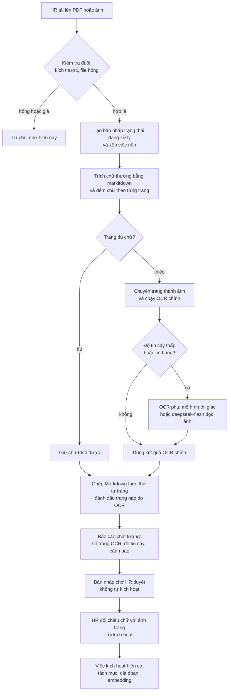
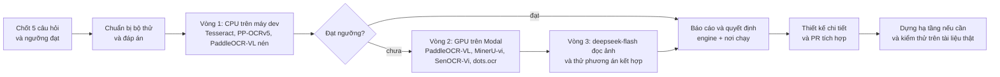

# Kế hoạch: benchmark OCR và đưa OCR vào luồng nạp tài liệu

Ngày viết: 08/10/2026. Trạng thái: **chỉ là kế hoạch**. Chưa sửa mã, chưa dựng máy, chưa chạy phép đo nào. Mọi con số "đo" trong tài liệu này là phép phân tích tệp mẫu đã làm hôm nay; mọi con số khác ghi rõ là ước lượng hoặc lấy từ nguồn ngoài.
> **Kết quả đo đã có:** xem `bao-cao-benchmark-ocr-va-doc-pdf.md` (ngày 10/10/2026). Tài liệu này vẫn là kế hoạch gốc; mới đo Tesseract, chưa đo các ứng viên khác.

## 1. Vì sao làm

HR nạp tài liệu nguồn qua trang `/admin/documents`. Hôm nay hệ thống **không đọc được** tài liệu dạng ảnh:

- PDF scan bị từ chối với thông báo "nội dung quá ngắn … có thể là file scan; OCR chưa bật" (`backend/src/services/ingest/parser.py`).
- Ảnh `.png`, `.jpg` không nằm trong danh sách đuôi được nhận.
- Ảnh nhúng trong `.docx` (ảnh chụp màn hình, sơ đồ có chữ) chỉ được cảnh báo, chữ trong ảnh **mất hẳn**, nên câu hỏi về nội dung đó Viga không trả lời được.

Trong repo đã có đúng hai ca này: `SYN_E01_Thong_bao_dot_tiep_nhan_ban_scan.pdf` (1 trang) và `PUB_R05_Nghi_dinh_13-2023_ND-CP_ban_scan.pdf` (39 trang, 12 MB). Cả hai trích ra **0 ký tự**.

**Mục tiêu**
1. Chọn phương án OCR cho tiếng Việt vừa đủ chính xác, vừa vừa túi tiền và hạ tầng hiện có.
2. Thiết kế cách nối OCR vào luồng nạp tài liệu mà **giữ nguyên các nguyên tắc của dự án** (xem mục 7.3).

**Ngoài phạm vi (làm sau nếu cần)**: chữ viết tay, dựng lại bố cục như tài liệu gốc, OCR theo thời gian thực trong khung chat, dùng LLM tự "sửa chính tả" văn bản OCR (làm vậy phá nguyên văn, xem mục 9).

## 2. Hiện trạng đã kiểm trong mã

| Mục | Hiện trạng | Nơi trong mã |
|---|---|---|
| Đọc file | `markitdown` (PDF qua `pdfminer`), chỉ lấy chữ có sẵn | `backend/src/services/ingest/parser.py` |
| Đuôi file nhận | `.docx`, `.pdf`, `.md`; tối đa 20 MB | `ALLOWED_SUFFIXES`, `MAX_FILE_SIZE_BYTES` |
| Cổng chất lượng | cả tài liệu dưới 200 ký tự thì từ chối (`MIN_TEXT_LENGTH`) | `parser.py` |
| Ảnh nhúng `.docx` | chỉ dò và cảnh báo | `_has_embedded_images` |
| Parse chạy lúc nào | **ngay trong yêu cầu upload** (`asyncio.to_thread(parse_document, …)`) | `document_version_service.create_draft_from_upload` |
| Việc nền | có sẵn hệ thống job với phần trăm tiến độ: `INGEST_VERSION`, `ACTIVATE_VERSION`, `AI_TASK_PROPOSAL`, … | `model/enums.py` (`JobKind`), `job_service` |
| Duyệt trước khi dùng | upload chỉ tạo **bản nháp**, HR xem nội dung rồi mới kích hoạt | `portal_document_router.py` |
| Trích dẫn | quote phải khớp **nguyên văn** với chữ đã lưu (`quote_matches`) | `services/text_match.py` |
| Thư viện ảnh | `pypdfium2`, `pillow`, `onnxruntime` có trong container nhưng **không khai báo** trong `requirements.txt` (đến gián tiếp) | `pip list` trong container dev |
| Ghi chú ngoài phạm vi | giao diện cho chọn `.txt` nhưng backend không có xử lý `.txt` nào (tìm trong `backend/src` không thấy) | `DocumentsListPage.tsx` so với `parser.py` |

Hai hệ quả quan trọng cho thiết kế:
- **OCR chậm** (39 trang có thể mất hàng chục phút) nên **không thể** chạy trong yêu cầu upload như `parse_document` hiện nay; phải chuyển sang việc nền.
- Vì trích dẫn so với chữ đã lưu, **chữ OCR sai sẽ trở thành "sự thật" của hệ thống** và không còn cơ chế nào bắt lỗi. Phải có bước người duyệt (mục 7).

## 3. Dữ liệu mẫu có sẵn

Đã phân tích ngày 08/10/2026 trong container backend dev (`pdfminer` + `pypdfium2`):

| Nhóm | Tệp | Trang | Chữ trích được | Vai trò trong bộ thử |
|---|---|---|---|---|
| **Scan thật** | `real_public/PUB_R05_…_ban_scan.pdf` (12 MB) | 39 | **0** | scan thật, chữ in; **không có đáp án** |
| **Scan tổng hợp** | `ingest_defects/SYN_E01_…_ban_scan.pdf` | 1 | **0** | scan nhỏ |
| Ít chữ | `ingest_defects/SYN_E08_…_co_secret.pdf` | 1 | 529 | ca ranh giới (có chữ nhưng ít) |
| Có lớp chữ (làm đáp án) | `real_public/PUB_R01` đến `R04` | 54, 88, 25, 19 | 34 nghìn đến 192 nghìn | luật và thông tư tiếng Việt thật; **rasterize rồi so với lớp chữ** |
| Có lớp chữ | `core/*.pdf` (13 tệp), `format_edge/*.pdf` (2 tệp) | 1 đến 8 | 1,5 nghìn đến 21 nghìn | tài liệu nội quy, bảng biểu |
| **Phải tiếp tục bị từ chối** | `SYN_E11_File_PDF_bi_hong.pdf`, `SYN_E12_Tep_gia_dang_PDF.pdf` | | | OCR **không được** che mất lỗi file hỏng hoặc giả mạo |

Bộ câu hỏi `golden_set.json` của benchmark LLM chỉ phủ hai tài liệu `.docx` của ngày đầu, **không phủ** các PDF ở trên, nên chỉ số truy hồi (mục 6.2) phải soạn thêm khoảng 20 câu cho `PUB_R03` và `PUB_R04`.

## 4. Câu hỏi cần chốt (kèm giả định nếu chưa trả lời)

| # | Câu hỏi | Giả định tạm |
|---|---|---|
| 1 | HR sẽ nạp loại gì: PDF scan, ảnh chụp tài liệu giấy, hay ảnh nhúng trong `.docx`? | PDF scan và ảnh chụp, chữ in đánh máy |
| 2 | Khối lượng mỗi tháng? | dưới 200 trang/tháng |
| 3 | Dữ liệu được gửi tới đâu? | chỉ DeepSeek (đã nhận nội dung tài liệu qua prompt hiện nay), không thêm bên thứ ba khác; tự host thì chạy trong AWS hoặc Modal của bạn |
| 4 | Có chữ viết tay không? | không |
| 5 | Sai chữ đến mức nào thì chấp nhận được? | ngưỡng ở mục 6.3, bạn chốt |

Câu 2 và 3 quyết định có nên host riêng hay chỉ gọi API.

## 5. Ứng viên

Giấy phép và tính hỗ trợ tiếng Việt dưới đây **lấy từ kết quả tìm kiếm hoặc từ trí nhớ, chưa xác nhận trên trang chính thức**. Phải xác nhận trước khi dùng cho sản phẩm.

| Nhóm | Ứng viên | Chạy ở đâu | Điểm mạnh | Rủi ro / chưa biết |
|---|---|---|---|---|
| Cổ điển | **Tesseract** (gói `vie`) | CPU, vài trăm MB RAM | nhẹ, miễn phí, mốc so sánh | kém ở ảnh mờ, bảng, bố cục nhiều cột; dấu tiếng Việt dễ sai |
| Cổ điển | **PaddleOCR PP-OCRv5** (bản ONNX qua RapidOCR) | CPU, ~1–2 GB RAM | nhanh, hơn 100 ngôn ngữ; 1,75–3,1 giây/ảnh trên CPU nhiều nhân (nguồn ngoài) | trên 2 vCPU chưa có số đo; độ chính xác tiếng Việt chưa kiểm |
| Mô hình thị giác | **PaddleOCR-VL 0,9B** (bản nén GGUF qua llama.cpp, hoặc GPU) | CPU hoặc GPU nhỏ | đứng đầu bảng so sánh mã nguồn mở, hiểu bảng và bố cục | tốc độ trên CPU 2 nhân chưa có số đo; giấy phép nhớ là Apache-2.0 |
| Mô hình thị giác | **MinerU2.5-Pro-1.2B-vi-ocr-v2**, **SenOCR-Vi** | GPU nhỏ | đã tinh chỉnh cho tiếng Việt | giấy phép MinerU nhớ là AGPL; độ tin cậy bản tinh chỉnh chưa rõ |
| Mô hình thị giác | **dots.ocr** (1,7B), **DeepSeek-OCR-2** (3B), **olmOCR** (7B) | GPU | chính xác cao | nặng; chạy CPU không thực tế |
| API sẵn có | **`deepseek-flash` đọc ảnh** | gọi API đang dùng | không cần hạ tầng; trang giá chính thức ghi hỗ trợ ảnh | model có thể đọc sai hoặc bịa chữ; chất lượng tiếng Việt chưa kiểm; tốn token |
| **Loại trước** | `jina-ocr-v1` | | | giấy phép CC BY-NC 4.0 (phi thương mại); chưa thấy tài liệu nói hỗ trợ tiếng Việt |
| **Loại trước** | AWS Textract | | | theo kết quả tìm kiếm không thấy hỗ trợ tiếng Việt (chưa chắc, có thể xác nhận bằng một cuộc gọi thử) |

Thứ tự đo chia ba vòng (mục 8) để khỏi tốn tiền và công khi vòng đầu đã đủ.

## 6. Cách đo

### 6.1 Bộ thử (3 tầng)

**Tầng A, scan tổng hợp có đáp án** (chủ lực, đo được số liệu khách quan): lấy các PDF có lớp chữ, chuyển trang thành ảnh bằng `pypdfium2`, rồi tạo biến thể xuống cấp:

- độ phân giải 150, 200, 300 dpi;
- nghiêng 1 đến 3 độ, nhiễu hạt, mờ nhẹ, tương phản thấp, nén JPEG chất lượng 40;
- mô phỏng ảnh chụp điện thoại (phối cảnh, bóng).

Tệp nguồn: `PUB_R03` và `PUB_R04` (luật, thông tư: đoạn văn dài, điều khoản, số hiệu), cùng 6 tệp `core` đa dạng (bảng, danh sách, tiêu đề in hoa) và `SYN_E02` (bảng thưởng hiệu suất). Đáp án là lớp chữ của PDF, chuẩn hóa trước khi so (Unicode NFC, bỏ khác biệt khoảng trắng và xuống dòng, nối từ bị ngắt cuối dòng).

**Tầng B, scan thật**: `SYN_E01` và 5 trang chọn từ `PUB_R05` (trang tiêu đề, trang điều khoản, trang có bảng hoặc số liệu, trang cuối có chữ ký và dấu). Cần **gõ tay đáp án** cho các trang này (ước lượng khoảng 1 giờ). Nếu không gõ được thì chỉ so mức đồng thuận giữa các công cụ và soát tay.

**Tầng C, ảnh chụp thật** (tùy chọn): 5 đến 10 trang tài liệu giấy chụp bằng điện thoại, nếu HR có mẫu thật.

### 6.2 Chỉ số

| Chỉ số | Ý nghĩa |
|---|---|
| **CER** (tỉ lệ sai ký tự) và WER | độ chính xác chung, tính sau chuẩn hóa |
| **Lỗi dấu tiếng Việt** | so khi giữ dấu và khi bỏ dấu: tách lỗi "sai chữ cái" khỏi lỗi "sai dấu thanh, dấu mũ" (dễ đổi nghĩa) |
| **Lỗi số liệu** | số, ngày, tiền, số hiệu văn bản sai là lỗi nguy hiểm nhất; đếm riêng trên khoảng 30 số mẫu |
| Cấu trúc | giữ đúng thứ tự "Điều, Khoản, Điểm", tiêu đề, bảng; thứ tự đọc |
| **Chữ bịa** (với mô hình thị giác và LLM) | chữ xuất hiện trong kết quả mà không có trong ảnh |
| Tốc độ | giây mỗi trang, trung vị và p95 |
| Tài nguyên | RAM đỉnh, mức dùng CPU, thời gian khởi động và nạp mô hình |
| Chi phí | USD mỗi trang |
| Độ ổn định | tỉ lệ lỗi, treo, kết quả rỗng |
| **Chỉ số cuối: truy hồi** | nạp văn bản OCR vào ingest thử (DB tạm hoặc DB test), chạy ~20 câu hỏi soạn cho `PUB_R03` và `PUB_R04`, so `hit@5` và tỉ lệ trích dẫn khớp với văn bản gốc |

### 6.3 Ngưỡng đạt (đề xuất, bạn chốt)

| Điều kiện | Ngưỡng đề xuất |
|---|---|
| Scan sạch 200 dpi: CER | không quá 2% |
| Lỗi dấu tiếng Việt | không quá 1,5% |
| Số liệu | sai không quá 1 trên 30 số mẫu |
| Truy hồi | `hit@5` thấp hơn bản gốc không quá 5 điểm phần trăm |
| Tốc độ (việc nền, CPU) | p95 không quá 30 giây mỗi trang |
| Tệp hỏng hoặc giả | vẫn bị từ chối như hiện nay |

Nếu không phương án đơn lẻ nào đạt thì chuyển sang **phương án kết hợp** (mục 7.2): OCR nhẹ cho trang sạch, mô hình mạnh hơn cho trang khó.

### 6.4 Môi trường đo và an toàn

- **Vòng 1 trên máy dev của bạn** (Docker đang có 8 CPU và 9,6 GiB RAM; CPU i5-11300H, có AVX-512, không có AMX): chạy trong container tạm bằng `docker run` (không sửa `docker-compose`), không đụng DB, không cần khóa. Đo **từng công cụ một** (để không tranh CPU), mỗi phép đo lặp 3 lần lấy trung vị, ghi rõ phiên bản và số luồng.
- **Vòng 2 trên GPU Modal**: ứng dụng tạm, đặt trần chi phí, xóa sau khi xong. Chưa cần tạo máy EC2 GPU (tránh vướng hạn mức G của tài khoản).
- **Vòng 3 gọi API** (`deepseek-flash` đọc ảnh): chỉ dùng tài liệu mẫu **tổng hợp hoặc công khai**, không dùng tài liệu nội bộ thật.
- **Chỉ đo trên `vsf-aws` khi cần xác nhận tốc độ CPU 2 nhân**, vào giờ vắng, có giới hạn CPU và `nice`, một container, theo đúng quy trình SSH tạm đã dùng (chụp nhóm bảo mật trước, gỡ luật sau, so lại).
- Kết quả lưu ở `docs/value/benchmark-ocr/ket-qua/*.json`, mã đo ở `scripts/`, báo cáo ở `bao-cao-benchmark-ocr.md` cùng thư mục.

## 7. Thiết kế tích hợp đề xuất (sẽ chốt sau khi có số đo)

### 7.1 Luồng

### 7.2 Nơi chạy OCR (chọn sau khi đo)

| Phương án | Chi phí tham khảo | Khi nào hợp |
|---|---|---|
| Chạy cùng `vsf-aws` (container, giới hạn CPU) | 0 USD thêm | OCR nhẹ (Tesseract, PP-OCRv5), khối lượng nhỏ; chấp nhận tranh CPU với backend ở mức giới hạn |
| EC2 CPU riêng (`m7i-flex.large`) | khoảng 87 USD/tháng nếu chạy 24/7 (giá 0,1197 USD/giờ, nguồn tổng hợp bên thứ ba); chỉ tốn theo giờ nếu tự bật khi có việc rồi tắt | cần cô lập khỏi backend nhưng vẫn CPU; bài học từ máy embedder: **không để máy rảnh chạy 24/7** |
| EC2 GPU (`g4dn.xlarge`, T4) | khoảng 0,736 USD/giờ, tức khoảng 535 USD/tháng nếu 24/7 | chỉ khi khối lượng rất lớn; tài khoản mới có hạn mức máy GPU mặc định bằng 0 nên phải xin tăng trước |
| Modal (GPU tính theo giây) | rất thấp khi dùng ít (mã đang ghi đơn giá L4 0,000222 USD/giây, tra 05/10/2026) | mô hình thị giác 1–3B, khối lượng thấp đến vừa, không muốn quản máy |
| Gọi API (`deepseek-flash` đọc ảnh) | tính theo token (giá flash: input 0,15–0,30, output 0,60–1,20 USD mỗi 1 triệu token, theo trang giá chính thức) | không muốn hạ tầng mới; chấp nhận rủi ro đọc sai |

Giả thuyết ban đầu cần kiểm: **OCR nhẹ trên CPU cho trang sạch, kết hợp mô hình mạnh hơn cho trang khó**. Có thể sai nếu đo cho thấy OCR nhẹ không đạt ngưỡng tiếng Việt.

### 7.3 Nguyên tắc phải giữ

1. **Chữ không bị sửa sau OCR**: không dùng LLM "làm đẹp" hay sửa chính tả văn bản OCR (phá nguyên văn, và trích dẫn sẽ khớp với chữ sai).
2. **Có người duyệt**: tài liệu có OCR luôn dừng ở bản nháp; không cho "Tải và kích hoạt luôn".
3. **Minh bạch**: gắn cờ trang nào do OCR, hiện cảnh báo chất lượng ở giao diện và ghi vào báo cáo chất lượng của phiên bản.
4. **Không lộ dữ liệu ngoài phạm vi đã chấp nhận** (câu hỏi 3 ở mục 4); ghi vào tài liệu bảo mật cùng với nguyên tắc INV8.
5. **Tệp hỏng hoặc giả vẫn bị từ chối**; chỉ tệp "ít chữ vì là ảnh" mới đi vào OCR.
6. **Không OCR trang đã đủ chữ** (giữ hành vi và tốc độ hiện tại cho PDF thường).

## 8. Lộ trình

Ước lượng thời gian (chỉ là ước lượng, có thể lệch):

| Pha | Việc | Ước lượng |
|---|---|---|
| P0 | bạn trả lời câu hỏi, chốt ngưỡng | trong ngày |
| P1 | dựng bộ thử, tạo biến thể, gõ đáp án cho vài trang scan thật, soạn ~20 câu hỏi | 0,5 đến 1 ngày |
| P2 | vòng 1 trên CPU | 0,5 đến 1 ngày |
| P3 | vòng 2 trên Modal | 0,5 ngày |
| P4 | vòng 3 và thử kết hợp | 0,5 ngày |
| P5 | báo cáo, bảng so sánh, quyết định | 0,5 ngày |
| P6 | thiết kế chi tiết và PR tích hợp, kể cả chuyển parse nặng sang việc nền | 2 đến 4 ngày |
| P7 | dựng hạ tầng (nếu không chạy chung `vsf-aws`), kiểm thử | 1 đến 2 ngày |

Mỗi pha dừng lại để bạn xem kết quả rồi mới sang pha sau.

## 9. Việc thay đổi mã dự kiến (chưa làm)

- `backend/src/services/ingest/parser.py`: trích chữ theo từng trang; gắn điểm nối OCR; giữ nguyên lỗi cho tệp hỏng hoặc giả; nới `ALLOWED_SUFFIXES` thêm `.png`, `.jpg`, `.jpeg` (và `.tif` nếu cần).
- Cổng OCR theo mẫu đã dùng cho embedding (`OcrPort` và các adapter: Tesseract/PaddleOCR cục bộ, dịch vụ HTTP riêng, LLM đọc ảnh); khai báo `pypdfium2` và `pillow` vào `requirements.txt` vì hiện chỉ đến gián tiếp.
- `document_version_service.py` và `job_handlers`: chuyển phần parse nặng sang việc nền có phần trăm ("OCR trang 12/39"), có trạng thái bản nháp "đang xử lý", có thể hủy; giới hạn số trang và kích thước.
- DTO upload và giao diện: thêm cờ "có OCR", số trang OCR, độ tin cậy; cảnh báo; tùy chọn hiện ảnh trang cạnh văn bản khi HR duyệt.
- `config.py` và `backend.env.example`: bật tắt OCR, chọn engine, địa chỉ dịch vụ, giới hạn trang.
- Triển khai: container hoặc dịch vụ OCR (theo mục 7.2), cập nhật compose và Terraform nếu tạo máy riêng.
- Kiểm thử: đơn vị (định tuyến từng trang), tích hợp với OCR giả, **hồi quy**: `SYN_E11` và `SYN_E12` vẫn bị từ chối, PDF có lớp chữ không đổi kết quả và không bị OCR.
- Tài liệu: ghi nguyên tắc ở mục 7.3 vào tài liệu bảo mật.

## 10. Rủi ro và cách giảm

| Rủi ro | Cách giảm |
|---|---|
| OCR sai chữ, hệ thống tin là đúng | bản nháp bắt buộc duyệt, đối chiếu ảnh, cảnh báo trang kém, chỉ số lỗi số liệu trong benchmark |
| Mô hình thị giác bịa chữ | đo "chữ bịa", cho OCR phụ chỉ chạy trên trang cần, so chéo với OCR chính |
| OCR chiếm CPU làm chậm Viga (nếu chạy chung `vsf-aws`) | giới hạn CPU, một việc một lúc, `nice`, chạy việc nền |
| Chi phí máy chạy 24/7 | tự bật tắt theo việc, hoặc Modal tính theo giây, hoặc chạy chung |
| Hạn mức máy GPU bằng 0, Free Plan có thể hạn chế | không dựng EC2 GPU ở giai đoạn đo; xin tăng hạn mức sớm nếu cần |
| Giấy phép (MinerU nhớ là AGPL, jina-ocr-v1 phi thương mại) | xác nhận trước khi chọn; loại jina-ocr-v1 |
| Dữ liệu nội bộ đi ra dịch vụ ngoài | chốt câu hỏi 3, dùng dữ liệu mẫu tổng hợp hoặc công khai khi đo |
| Tệp lớn làm job chạy rất lâu | giới hạn số trang, hiện tiến độ, cho hủy |

## 11. Những điều chưa biết (nói thẳng)

- Chưa có số đo tốc độ và độ chính xác tiếng Việt của bất kỳ ứng viên nào trên phần cứng của dự án. Mọi con số tốc độ ở mục 5 là từ nguồn ngoài hoặc ước lượng.
- Chưa biết loại tài liệu và khối lượng HR sẽ thực sự nạp (mục 4).
- Chưa biết máy dev có GPU rời hay không; vòng 2 dùng Modal nên không phụ thuộc điều này.
- Chưa xác nhận giấy phép và hỗ trợ tiếng Việt chính thức của từng mô hình.
- Chưa biết Free Plan của tài khoản AWS có cho phép máy GPU hay không (tài khoản `terraform-deployer` không đọc được Service Quotas).
- Chưa biết số credit Modal còn lại (ghi chú cũ trong báo cáo triển khai là khoảng 28,7 USD, đã lâu).
- Giá các hãng khác lấy từ trang tổng hợp bên thứ ba, chưa kiểm trên trang chính thức.

## 12. Tiêu chí quyết định

1. Loại các phương án không đạt ngưỡng ở mục 6.3.
2. Trong các phương án còn lại, ưu tiên **ít hạ tầng mới nhất** (chạy chung `vsf-aws` hoặc API trước khi tạo máy riêng).
3. Nếu chỉ có phương án GPU đạt: ưu tiên Modal (tính theo giây) trước EC2 GPU cố định, trừ khi khối lượng rất lớn hoặc dữ liệu bắt buộc ở trong AWS.
4. Hòa nhau thì chọn phương án có giấy phép rõ ràng và ít lỗi dấu tiếng Việt hơn.

## 13. Bảng kết quả (điền sau khi đo)

| Ứng viên | CER 200 dpi sạch | CER xuống cấp | Lỗi dấu | Lỗi số liệu (trên 30) | `hit@5` | giây/trang p50 | giây/trang p95 | RAM đỉnh | USD/trang | Kết luận |
|---|---|---|---|---|---|---|---|---|---|---|
| Tesseract `vie` | | | | | | | | | | |
| PP-OCRv5 (RapidOCR) | | | | | | | | | | |
| PaddleOCR-VL nén (CPU) | | | | | | | | | | |
| PaddleOCR-VL (GPU) | | | | | | | | | | |
| MinerU-vi / SenOCR-Vi | | | | | | | | | | |
| `deepseek-flash` đọc ảnh | | | | | | | | | | |
| Kết hợp (nhẹ + thị giác) | | | | | | | | | | |

## 14. Nguồn

- Giá DeepSeek: [api-docs.deepseek.com/quick_start/pricing](https://api-docs.deepseek.com/quick_start/pricing) (đọc 08/10/2026).
- So sánh OCR mã nguồn mở: [Roboflow](https://blog.roboflow.com/best-open-source-ocr-models/), [Unstract](https://unstract.com/blog/best-opensource-ocr-tools/), [khảo sát OCR tiếng Việt](https://arxiv.org/html/2506.05061v1).
- PaddleOCR-VL: [InsiderLLM](https://insiderllm.com/guides/paddleocr-vl-local-document-ocr/), [DEV Community](https://dev.to/czmilo/2025-complete-guide-paddleocr-vl-09b-baidus-ultra-lightweight-document-parsing-powerhouse-1e8l); PP-OCRv5: [tài liệu PaddleOCR](https://www.paddleocr.ai/latest/en/version3.x/algorithm/PP-OCRv5/PP-OCRv5.html).
- jina-ocr-v1: [jina.ai](https://jina.ai/fr/news/jina-ocr-v1-faster-document-parsing-on-low-budget-gpus/), [llmrun.dev](https://llmrun.dev/model/jinaai-jina-ocr-v1); SenOCR-Vi: [Hugging Face](https://huggingface.co/VietAlphaLabs/SenOCR-Vi).
- Textract: [AWS pricing](https://aws.amazon.com/fr/textract/pricing/).
- Giá máy: [m7i-flex.large](https://aws-pricing.com/m7i-flex.large.html), [g4dn.xlarge ap-southeast-1](https://www.doit.com/compute/spot/ap-southeast-1/g4dn.xlarge); hạn mức G: [AWS re:Post](https://repost.aws/questions/QUSPetOgBLTQuxHpy_ffhiAg/instance-launch-failed).
- Mã và dữ liệu trong repo: `backend/src/services/ingest/parser.py`, `backend/src/services/portal/document_version_service.py`, `docs/chatbot-vsf/data/documents/`.
