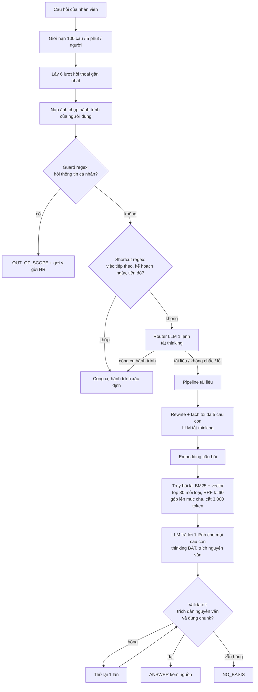

# Kế hoạch khảo sát và tối ưu chat Viga (cá nhân hóa, độ trễ, chất lượng truy hồi)

Ngày viết: 10/10/2026. Trạng thái: **chỉ là kế hoạch và khảo sát code, chưa viết code, chưa chạy phép đo mới nào.** Các con số "đã đo" lấy từ báo cáo ngày 06/10/2026 (`docs/value/benchmark-modal-llm-viga/`); các con số về code lấy từ việc đọc mã ngày 10/10/2026. Ngoài ra là ước lượng hoặc lấy từ blog bên ngoài và đã ghi rõ.

## 1. Mục tiêu

1. Biết Viga hiện làm gì ở từng bước và **chậm ở đâu** (nhất là lúc LLM nhận ngữ cảnh rồi trả lời).
2. Đo bằng metric xem **tối ưu theo hướng nào đáng làm nhất** (cá nhân hóa, chất lượng truy hồi, hay độ trễ), trước khi code tính năng.
3. Không sửa code sản phẩm trong giai đoạn đo: các phương án được thử bằng script bên ngoài.

## 2. Viga hiện tại (đã đọc code)

Các điểm chính (xem `backend/src/services/viga/service.py`, `router.py`, `pipeline.py`, `answer_service.py`, `validator.py`, `services/retrieval/hybrid_search.py`):

| Bước | Số liệu / hành vi |
|---|---|
| Router | 1 lệnh LLM, tắt thinking, ngưỡng tin cậy 0,55; dưới ngưỡng quay về tài liệu |
| Rewrite | 1 lệnh LLM, tắt thinking, tối đa 5 câu con, mỗi câu ≤ 300 ký tự |
| Truy hồi | BM25 (pg_search, tách từ underthesea) + vector (pgvector), top 30 mỗi loại, RRF k=60; không có ngưỡng điểm; `rerank.py` là hàm rỗng, không được gọi |
| Trả lời | 1 lệnh LLM, thinking **bật**, không stream, không đặt temperature |
| Kiểm trích dẫn | Trích dẫn phải nằm nguyên văn trong đúng mục đã truy hồi; hỏng thì thử lại 1 lần |
| Lịch sử | 6 lượt cố định, chỉ dùng cho router và rewrite; không dùng cho bước trả lời; không tóm tắt; hết hạn sau 90 ngày |
| Cache | Không có cache cho câu trả lời, embedding câu hỏi hay kết quả router |

**Điểm mạnh:** trích dẫn nguyên văn được kiểm tra cơ học; hai đường (hành trình riêng và tài liệu); phản hồi 👍👎; ghi lại câu chưa có căn cứ cho HR; chuyển ticket.

## 3. Vì sao LLM nhận context rồi trả lời lâu

Số đã đo ngày 06/10/2026 (40 câu × 2 lượt, thinking bật ở bước trả lời; nguồn `bang-so-lieu.md`):

| Bước | Giây trung bình | Token vào trung bình | Token ra | Trong đó suy luận ẩn |
|---|---|---|---|---|
| Route | 1,08 | 1.176 | 43 | 0 |
| Rewrite | 1,05 | 359 | 33 | 0 |
| Embed | 1,75 | | | |
| **Trả lời** | **3,30** | **7.465** | **621** | **460 (74%)** |
| Tổng một câu (trung vị) | 5,95 | | | |

Đọc kết quả:
- Bước trả lời chiếm khoảng **46% độ trễ** và nhận khoảng **7.500 token ngữ cảnh**, gấp 6 lần bước route.
- 3/4 token đầu ra là **suy luận ẩn**: phần "nghĩ lâu" trong trace của LLM. Tắt thinking ở bước trả lời cho giây trung bình 1,63 (nhanh gần gấp đôi) nhưng câu nhiều ý bị mất ý (88,8% đúng so với 93,8%).
- Chưa tách được "thời gian đọc ngữ cảnh" với "thời gian suy nghĩ": Viga không stream, mà các cột `first_token_ms`, `reasoning_ms` trong `llm_calls` chỉ có khi stream. Cần đo thêm (mục 6).
- Còn các nguồn chậm khác: tối đa 3 lệnh LLM nối tiếp (route, rewrite, trả lời) và một lệnh thử lại nếu validator từ chối; embedding có thể mất khoảng 20 giây khi máy lạnh (đã ghi trong cấu hình); hàng đợi `LlmGate` (tối đa 9 lệnh cùng lúc) có thể thêm thời gian chờ khi nhiều người hỏi.

## 4. Điểm yếu thấy trong code (căn cứ cho các phương án thử)

| # | Điểm yếu | Hệ quả dự đoán |
|---|---|---|
| 1 | Prompt trả lời **không có ngữ cảnh người dùng** (team, giai đoạn, task đang mở); router chỉ thấy danh sách task, không thấy team | Câu mơ hồ ("nhận laptop thế nào?") trả lời giống nhau cho mọi người |
| 2 | Truy hồi **không ưu tiên theo task/team**; `task_source_mappings` (task → tài liệu/mục/trích dẫn) có sẵn nhưng không dùng; tài liệu "Hỏi đáp bổ sung" của team nào ai cũng thấy | Bỏ sót tài liệu liên quan đúng việc đang làm |
| 3 | Không có ngưỡng điểm tối thiểu; `rerank` rỗng | Mục không liên quan có thể lọt vào ngữ cảnh làm dài prompt |
| 4 | Thinking bật ở bước trả lời; 3–4 lệnh LLM nối tiếp | Chậm (mục 3) |
| 5 | Luật regex: "hôm nay … làm gì" bắt cả câu thời tiết (lỗi đã biết #110); `_PERSONAL_TOPICS` có thể chặn nhầm hoặc lọt | Trả lời sai loại |
| 6 | Câu nhiều ý chỉ truy hồi theo câu con; lịch sử 6 lượt cứng, không tóm tắt, không nhớ giữa các cuộc trò chuyện | Mất ý, quên ngữ cảnh dài |
| 7 | Câu hỏi người dùng nhúng thẳng vào prompt trả lời, lịch sử (có cả lời Viga) không bọc thẻ chống chèn lệnh | Rủi ro chèn lệnh (validator vẫn là lớp chặn cuối) |
| 8 | Dữ liệu chẩn đoán thiếu: `llm_calls` không có `message_id`; không lưu mục đã truy hồi, điểm, câu đã viết lại, số lần validator từ chối; 242 câu golden (`golden_dev/test`) **chưa có script nào chạy** | Khó biết vì sao một câu sai |

Dữ liệu có sẵn mà chưa dùng để cá nhân hóa: team, hành trình và task của từng người, `last_opened_task_id` (task vừa mở), `task_group`, `body_markdown` của task, `sample_questions`/`aliases`/`summary` của phiên bản tài liệu (chỉ được ghi, chưa dùng), phản hồi 👍👎 và content gap (chỉ cho HR xem). Thiếu: vị trí văn phòng, ngày vào làm, chức danh, người hướng dẫn, và cột team/audience trên tài liệu.

## 5. Cách làm chuẩn trên mạng (tham khảo, nguồn là blog và tài liệu nhà cung cấp)

- **Đánh giá RAG tách truy hồi và sinh:** Precision/Recall@k cho truy hồi; faithfulness và answer relevancy cho sinh. Cố định mô hình chấm, hiệu chỉnh bằng nhãn người, theo dõi xu hướng và đưa vào kiểm tra hồi quy. Faithfulness không bắt được tài liệu cũ hoặc sai. ([RAGAS guide](https://qaskills.sh/blog/ragas-faithfulness-answer-relevancy-guide), [DEV Community](https://dev.to/kuldeep_paul/how-to-evaluate-your-rag-system-a-complete-guide-to-metrics-methods-and-best-practices-18ne))
- **Truy hồi:** lai BM25 + embedding, thêm **ngữ cảnh hóa từng đoạn (Contextual Retrieval)** và rerank. Báo cáo của Anthropic nêu giảm lỗi truy hồi khoảng 49% (không rerank) và khoảng 67% (có rerank); lấy khoảng 20 đoạn đầu cho kết quả tốt hơn ít đoạn; kho dưới khoảng 200.000 token có thể đưa thẳng vào prompt. Đây là số của một bộ thử nội bộ qua bài tóm tắt, cần đọc bản gốc trước khi dựa vào. ([Analytics Vidhya](https://www.analyticsvidhya.com/blog/2024/12/contextual-rag-systems-with-hybrid-search-and-reranking/), [DataCamp](https://www.datacamp.com/tutorial/contextual-retrieval-anthropic))
- **Nhiều lượt:** viết lại câu hỏi thành độc lập rồi mới truy hồi; giữ cả câu gốc lẫn câu viết lại cho kết quả tốt hơn; đánh đổi là thêm một lệnh LLM (độ trễ). ([NVIDIA RAG](https://docs.nvidia.com/rag/2.6.0/multiturn.html))
- **Chatbot onboarding và HR:** lọc theo metadata từ định danh đã xác thực (vai trò, vùng, phòng ban), áp quyền ở truy hồi chứ không ở giao diện; ép trả lời chỉ từ ngữ cảnh, nói "chưa có căn cứ" và chuyển người. ([Snowflake handbook bot](https://interworks.com/blog/2026/04/15/ask-your-handbook-anything-building-a-rag-chatbot-with-snowflake-cortex/), [AWS Bedrock metadata filtering](https://aihub.hkuspace.hku.hk/?p=2287))
- **Chỉ số vận hành:** tỉ lệ chuyển người, CSAT, tỉ lệ "không hiểu", và **tỉ lệ giải quyết** (tốt hơn tỉ lệ "né vé"). ([Geosurge](https://www.geosurge.ai/corpus/gen-4116/human-ai-interaction/designing-human-ai-escalation-and-handoff-experiences-for-enterprise-assistants.html), [4Spot](https://4spotconsulting.com/ai-for-hr-achieve-40-less-tickets-elevate-employee-support/))

Không tìm thấy nguồn đáng tin về hiệu quả của gợi ý chủ động (đề xuất câu hỏi liên quan): cần thử nghiệm A/B trên chính người dùng của VSF.

## 6. Bộ metric đề xuất

| Nhóm | Metric | Cách đo |
|---|---|---|
| Truy hồi | Hit@k, MRR trên mục đúng; tỉ lệ câu có mục đúng trong ngân sách 3.000 token | Đáp án = mục chứa trích dẫn chuẩn của từng câu |
| Sinh | Đúng / một phần / sai (thang ✓/~/✗ hiện dùng); đúng loại phản hồi; tỉ lệ bịa thông tin cá nhân (mục tiêu 0) | `viga_eval.py` đã có cách chấm; thêm chấm tay mẫu |
| Trích dẫn | Tỉ lệ qua validator ngay lần đầu; tỉ lệ phải thử lại; faithfulness (LLM chấm từng ý) | Ghi từ pipeline; LLM chấm cố định mô hình, kiểm tay ~20% |
| Cá nhân hóa | Độ nhạy theo người (cùng câu, khác persona: đáp án có đổi và đổi đúng không); tỉ lệ dùng đúng ngữ cảnh (tên task, giai đoạn) | Bộ câu mới × 3 persona |
| Độ trễ | p50/p95 từng bước; **thời gian tới token đầu** và **thời gian suy luận** của bước trả lời (đo ở chế độ stream); token ngữ cảnh ↔ thời gian tới token đầu | Harness gọi stream, ghi thời gian từng giai đoạn |
| Chi phí | USD mỗi câu, số lệnh LLM mỗi câu, tỉ lệ thử lại | `llm_calls` theo `request_id` |
| Vận hành (sau này) | Tỉ lệ 👍, tỉ lệ chuyển HR, tỉ lệ giải quyết, content gap theo tuần | Đã có dữ liệu; chưa lên dashboard |

Nhiễu đã biết: chạy lại cùng một phương án, 1–3 câu trên 40 đổi kết quả; chênh dưới mức đó coi là nhiễu, nên mỗi phương án chạy 2 lượt.

## 7. Phương án sẽ thử (chỉ trong script đo, không sửa sản phẩm)

| Mã | Phương án | Kỳ vọng | Rủi ro |
|---|---|---|---|
| V0 | Hiện tại (đối chứng) | | |
| V1 | Thêm team, giai đoạn, task đang mở, tiến độ vào prompt trả lời và bước rewrite | Câu mơ hồ trả lời đúng theo người; ít hỏi lại | Prompt dài hơn (chậm hơn), lộ thông tin giữa persona nếu viết sai |
| V2 | Nâng điểm mục/tài liệu gắn với task đang mở (`task_source_mappings`); ưu tiên tài liệu bổ sung đúng team | Hit@k cao hơn cho "việc của tôi" | Chỉ giúp câu liên quan task; thiên lệch nếu task đang mở không phải điều đang hỏi |
| V3 | Ngưỡng điểm; rerank; ngữ cảnh hóa từng đoạn trước khi embed | Truy hồi chính xác hơn, ngữ cảnh ngắn hơn (nhanh hơn) | Rerank bằng LLM thêm một lệnh; Contextual Retrieval tốn chi phí lúc nạp |
| V4 | Giảm độ trễ: giảm ngữ cảnh (ít mục, ít token), thinking bật chỉ khi nhiều ý, đặt phần cố định ở đầu prompt để tận dụng cache của DeepSeek (`cached_input_tokens` đã được ghi), gộp route + rewrite, embed song song router, stream câu trả lời, bỏ rewrite cho câu ngắn đứng riêng | Giảm độ trễ cảm nhận; đo xem mất bao nhiêu độ chính xác | Câu nhiều ý mất ý (đã gặp khi tắt thinking) |

Sau khi có số, kết hợp phương án thắng và đo lại một lần.

## 8. Bộ dữ liệu thử (tái dùng, thêm mới)

- 40 câu của `docs/value/benchmark-modal-llm-viga/scripts/run_benchmark.py` (26 tài liệu, 10 định tuyến, 4 nhiều ý).
- 25–30 câu chọn từ `docs/chatbot-vsf/data/eval/golden_dev.jsonl` (followup, personal, abbreviation, no_basis, injection, câu có `as_of`), quy đổi sang loại phản hồi hiện tại (bộ golden viết cho thiết kế PRD cũ).
- **Bộ cá nhân hóa mới (khoảng 30 câu × 3 persona):** persona lấy từ `docs/chatbot-vsf/data/registry/users.json` (newhire1 đến 3 thuộc team HR_ONBOARDING, it.staff, soc.staff, fac.staff). Câu như "tôi cần nộp gì tiếp theo", "task đang mở có cần VPN không", cùng một câu mơ hồ ở các team khác nhau. Đáp án viết tay từ tài liệu mẫu `day1` và `core`.
- Tài liệu nạp vào **DB tạm riêng** (kiểu `vsf_test`), không đụng DB dev hoặc production.

## 9. Việc sẽ làm khi được duyệt tiếp (chưa làm gì dưới đây)

1. Đọc nốt chỗ gọi hàm để bọc đúng: `services/viga/{prompt_builder,query_rewrite,snapshot,tools}.py`, `answer_service.py`.
2. Dựng harness trong `docs/value/optimize-chatviga/scripts/` (chạy trong venv backend, DB tạm, gọi trực tiếp pipeline, mỗi phương án bọc bằng monkeypatch), `bo-cau-hoi/`, `ket-qua/` (JSON thô).
3. Chạy V0 trước và so với số cũ (75/80 ✓ ở biến thể B, trung vị 5,95 giây) để chắc harness không lệch, rồi V1 đến V4, mỗi phương án 2 lượt.
4. Viết `bao-cao.md`: bảng metric, biểu đồ luồng, kết luận phương án nào đáng làm, mức cải thiện, độ trễ và chi phí tăng/giảm, thứ tự đề xuất cho tính năng.

## 10. Chi phí, rủi ro, hạn chế

- Gọi DeepSeek thật: khoảng 0,003 USD mỗi câu (đo 06/10/2026). Phạm vi vừa (khoảng 70 câu × 5 phương án × 2 lượt) ước vài USD. **Cần bạn đồng ý trước khi chạy.** Tài khoản chỉ cho 11 yêu cầu đồng thời.
- Dữ liệu là tổng hợp, không chứng minh đúng quy trình VSF thật.
- Persona dev chỉ khác nhau ở team và hành trình; không có vị trí, loại laptop, chức danh.
- Tài liệu chưa có cột team/audience, nên V2 chỉ mô phỏng qua liên kết task; thêm cột là việc sản phẩm sau này.
- LLM chấm có thiên lệch (chấm bằng cùng họ mô hình với mô hình trả lời); cần cố định và kiểm tay.
- Số liệu độ trễ phụ thuộc mạng và tải của DeepSeek tại thời điểm đo; so sánh các phương án chỉ có ý nghĩa khi chạy xen kẽ trong cùng khoảng thời gian.

## 11. Cần bạn chốt

1. Phạm vi chạy thật: nhỏ (khoảng 40 câu × 3 phương án), vừa (khuyến nghị), hay lớn (242 câu golden)?
2. Đồng ý chi phí DeepSeek ước vài USD và DB tạm riêng?
3. Thứ tự ưu tiên khi bắt đầu: cá nhân hóa (V1, V2) hay độ trễ (V4)? Bạn đã nhắc bước LLM trả lời lâu nên tôi nghiêng về đo **độ trễ của bước trả lời** trước (rẻ và có số ngay), rồi mới đo cá nhân hóa.
