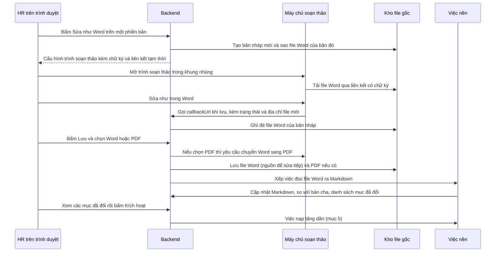
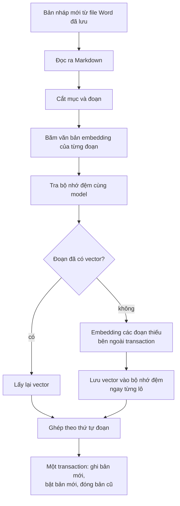
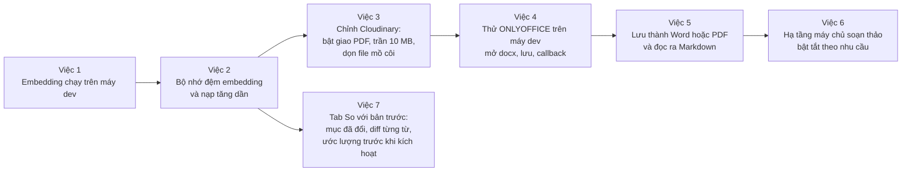
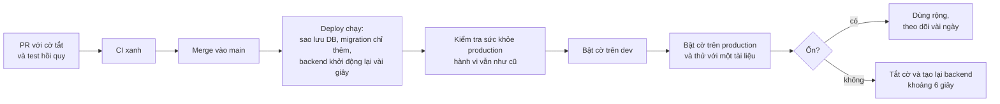

# Kế hoạch: soạn thảo tài liệu như Word, nạp tăng dần, và chạy embedding trên máy dev

Ngày viết: 08/10/2026. Trạng thái: **chỉ là kế hoạch**. Chưa sửa mã, chưa dựng máy, chưa đổi cấu hình. Số liệu "đo" lấy từ các phép đo đã làm trong ngày (nguồn ghi kèm); mọi giấy phép và yêu cầu phần cứng của phần mềm bên ngoài trong tài liệu này lấy từ kết quả tìm kiếm, **cần xác nhận trên trang chính thức trước khi quyết định**.

Phạm vi: ba việc bạn nêu. **Mục 7 trả lời câu hỏi "merge vào `main` có ảnh hưởng production không"** và đặt ra quy tắc phát hành an toàn cho mọi việc trong tài liệu. Phần "tối ưu tốc độ nạp file nặng" (đọc PDF song song, xếp lô) **chưa làm bây giờ**, vẫn nằm ở `docs/value/optimite-ingest-document/`. OCR vẫn hoãn (`docs/value/benchmark-ocr/`).

## 1. Ba việc và kết luận ngắn

| # | Việc | Kết luận ngắn |
|---|---|---|
| A | Chạy embedding trên máy dev, không phụ thuộc Modal | Làm được: build ảnh embedder ngay trên máy bạn (khoảng 10 phút) và chạy bằng `docker run`. Kéo ảnh từ `vsf-aws` cũng được nhưng không đáng. **Không** dùng bản nén kiểu llama.cpp/GGUF vì vector khác với vector đã lưu (mục 3) |
| B | Soạn thảo như ứng dụng Word, lưu thành Word hoặc PDF, đẩy lên kho lưu trữ, rồi đọc ra Markdown để embedding; "Xem file gốc" mở đúng file vừa lưu | Làm được bằng **máy chủ soạn thảo tài liệu** nhúng vào trang (khuyến nghị ONLYOFFICE). Có điều kiện: cần máy chủ riêng. Kho file gốc **tạm thời vẫn là Cloudinary** (quyết định của bạn ngày 08/10/2026, mục 4.6); chuyển S3 để sau |
| C | Sửa một mục thì chỉ xóa và tính lại đúng mục đó; sửa nhiều thì sao | Hiệu quả tương đương mà **an toàn hơn**: bản mới dùng lại vector của đoạn không đổi và chỉ tính đoạn mới. Sửa càng nhiều càng gần "nạp lại từ đầu", không bao giờ tệ hơn hiện nay (mục 5) |

## 2. Hiện trạng liên quan (đã kiểm trong mã)

| Mục | Hiện trạng |
|---|---|
| Hai nguồn sự thật | File gốc (Cloudinary) và Markdown trong DB là **hai thứ tách rời**. HR sửa Markdown nhưng file gốc không đổi; giao diện đã ghi rõ "file gốc thuộc bản được sao chép, không phản ánh phần đã sửa" |
| Soạn thảo | ô văn bản thô Markdown, tab "Xem trước" (`DocumentVersionsModal.tsx`) |
| Cách có sẵn để dùng Word thật | "Tải file thành phiên bản mới": HR sửa file Word trên máy rồi tải lên thành phiên bản mới |
| Đọc file | `markitdown` (`parser.py`): `.docx` qua Mammoth, PDF qua `pdfplumber` và `pdfminer`; nhận `.docx`, `.pdf`, `.md`, tối đa 20 MB |
| Lưu file gốc | Cloudinary (`storage.py`, `resource_type="raw"`), DB lưu `secure_url`; địa chỉ **công khai** |
| Giới hạn Cloudinary đã thấy | trang Security báo "Maximum raw file size: **10 MB**" (ứng dụng cho phép 20 MB); PDF bị chặn giao (lỗi 401) cho tới khi bật "Allow delivery of PDF and ZIP files" |
| Kích hoạt | job nền: cắt mục và đoạn, embedding **toàn bộ** đoạn, ghi lại toàn bộ mục và đoạn của bản đó (`job_handlers.run_activate_version`); bản nháp "tạo từ bản đang chạy" chưa có đoạn nào nên tính lại hết |
| Cache embedding | bảng `document_chunks` có chỉ mục `(content_hash, embedding_model_version)` ghi chú "tra cache embedding theo lô" nhưng **chưa có mã nào dùng** |
| Phiên bản | bất biến theo từng bản: mỗi bản có mục và đoạn riêng; task trích dẫn đúng mục của đúng bản |
| Embedding dev hiện tại | `.env` trỏ tới Modal (endpoint cũ của Ralion); đã kiểm 08/10/2026 vẫn chạy, lần đầu khởi động nguội mất khoảng 28 đến 36 giây |

## 3. Phần A: chạy embedding trên máy dev

### 3.1 Điều kiện bắt buộc

Cơ sở dữ liệu dev đã lưu chuỗi `embedding_model_version = BAAI/bge-m3@5617a9f6…` và truy hồi **lọc đúng theo chuỗi này**. Vì vậy embedding chạy local phải:
- dùng **đúng mô hình và đúng bản** `BAAI/bge-m3` (cùng mã bản `5617a9f6…`), qua cùng `sentence-transformers`, trả cùng chuỗi `model_version`;
- cho vector **gần như trùng** vector Modal (đo trước: cosine 1,000000 giữa Modal và embedder tự host cùng bản).

Hệ quả: các bản nén (GGUF qua llama.cpp, int8) hay mô hình "tương tự" **không dùng được** cho DB đang có: vector khác nhẹ và `model_version` khác, truy hồi sẽ trả rỗng hoặc phải nạp lại toàn bộ.

### 3.2 Phương án

| Phương án | Cách làm | Ưu | Nhược |
|---|---|---|---|
| **A1. Build tại máy bạn** (khuyến nghị) | dùng `deploy/aws/embedder/` (đã có `server.py`, `Dockerfile`), thêm cố định mã bản `5617a9f6…`, `docker run` chạy `fp32` | không đụng AWS, không tốn băng thông, đúng mã nguồn đang chạy ở production | lần đầu mất khoảng 10 phút và khoảng 9 GB đĩa (có khoảng 10 GB bộ nhớ đệm build, dọn bằng `docker builder prune`) |
| A2. Kéo ảnh từ `vsf-aws` | `docker save` rồi truyền qua SSH rồi `docker load` | không phải build | cần mở SSH tạm vào máy production, tốn CPU máy chính lúc nén, kéo 8 đến 9 GB (có thể có phí truyền dữ liệu ra internet), không nhanh hơn build |
| A3. Chạy trực tiếp bằng Python trên Windows | `pip install sentence-transformers torch` | không cần Docker | cài đặt nặng, dễ lệch phiên bản thư viện so với production |
| A4. Giữ Modal | không đổi | không tốn công | nguội 30 giây mỗi lần cách quãng, trừ credit, phụ thuộc dịch vụ ngoài |

Khuyến nghị **A1**, giữ A4 làm đường lùi. Không làm theo quy tắc của bạn: **không sửa `docker-compose.yml`**; chạy bằng `docker run` (có thể gói thành script riêng trong thư mục `scripts/dev/`, là tệp mới, không đụng tệp cũ).

### 3.3 Các bước dự kiến

1. Thêm biến cố định bản mô hình lúc build (ví dụ truyền mã bản `5617a9f6…` vào bước tải mô hình) để chắc **không** kéo bản mới hơn nếu Hugging Face đã cập nhật. Ghi chú: bộ nhớ đệm trong ảnh production từng có **hai** bản (`5617a9f6…` dạng `pytorch_model.bin` và một bản khác chỉ có `model.safetensors`); chuỗi phiên bản lấy từ `refs/main`, phải kiểm lại sau khi build.
2. Build: `docker build` ảnh `vsf-embedder:local` từ thư mục embedder.
3. Chạy: `docker run -d -p 127.0.0.1:8080:8080` với `DTYPE=fp32` và một khóa đặt tùy ý cho môi trường dev. CPU máy dev (i5-11300H) **không có AMX** nên không dùng `bf16`.
4. Trỏ dev tới embedder local: trong `.env` đặt `EMBEDDING_ENDPOINT=http://host.docker.internal:8080` và khóa tương ứng, rồi tạo lại backend dev. Giữ bản sao `.env` đang dùng Modal để quay lại.
5. Một script đổi qua lại **Modal hoặc local** (đổi hai dòng trong `.env`, tạo lại backend), để không phải sửa tay.

### 3.4 Kiểm chứng (điều kiện chấp nhận)

| Kiểm tra | Đạt khi |
|---|---|
| Chuỗi `model_version` của embedder local | giống hệt chuỗi trong DB dev (`BAAI/bge-m3@5617a9f6…`) |
| Cosine vector local so với Modal trên 4 câu hỏi và một lô 32 đoạn | không thấp hơn 0,9999 |
| Truy hồi trên dev | hỏi lại các câu trong `golden_set.json` cho kết quả tương đương Modal |
| Tốc độ (ghi lại, không có ngưỡng cứng) | một câu hỏi, lô 32 đoạn dài; so với Modal (một câu khoảng 0,4 đến 1,4 giây, lô 32 đoạn khoảng 3 giây) |
| Tài nguyên | RAM đỉnh dưới 4 GB trong 9,6 GiB mà Docker đang có; CPU không làm máy dev đơ |

**Ước lượng** (chưa đo trên máy bạn): `fp32` trên CPU này khoảng vài trăm mili giây cho một câu và vài chục giây cho một lô 32 đoạn dài, tức nạp tài liệu **chậm hơn Modal**, hỏi đáp thì không chậm hơn. Số đo thật sẽ được ghi lại khi làm việc 1.

### 3.5 Rủi ro

| Rủi ro | Cách giảm |
|---|---|
| Hugging Face đã có bản mới hơn, chuỗi phiên bản khác DB | cố định mã bản lúc build, kiểm `model_version` như trên |
| Vector lệch nhẹ do `fp32` khác `bf16` | chỉ dùng `fp32` ở dev; đo cosine, không đạt thì dừng |
| Tranh tài nguyên với các container dev khác | đo RAM, đặt giới hạn CPU cho container |
| Quên đang trỏ vào local khi tắt Docker | script đổi qua lại, kiểm tra sức khỏe trước khi nạp |

## 4. Phần B: soạn thảo như Word, lưu thành Word hoặc PDF

### 4.1 Luồng bạn mô tả

HR mở tài liệu trong một trình soạn thảo giống Word, sửa, bấm lưu và chọn Word hoặc PDF; file đó được đẩy lên kho lưu trữ; hệ thống đọc file đó ra Markdown rồi embedding; "Xem file gốc" mở đúng file vừa lưu. Điểm hay: **một nguồn sự thật duy nhất là file**, Markdown chỉ là bản đọc ra từ file, không còn lệch nhau như bây giờ.

### 4.2 Các cách nhúng

| Cách | Giống Word | Chạy ở đâu | Điểm cần lưu ý (cần xác nhận) |
|---|---|---|---|
| **ONLYOFFICE Docs** (khuyến nghị) | cao nhất; dùng định dạng Word (`docx`) gốc, đọc và ghi trực tiếp | **máy chủ riêng** (Docker); nhúng bằng iframe, cấu hình `callbackUrl` để nhận file đã lưu | giấy phép AGPL v3 (dùng như một dịch vụ riêng, cần xác nhận về mặt pháp lý nội bộ); yêu cầu tối thiểu theo trang chính thức khi chạy Docker: **4 GB RAM trở lên**, 2 nhân, 40 GB đĩa, swap 4 GB; theo một bài viết, bản 9.4 đã bỏ giới hạn 20 kết nối của bản Community (cần xác nhận phiên bản); có sẵn chuyển Word sang PDF |
| Collabora Online (CODE) | khá; dựng trên LibreOffice nên bố cục Word phức tạp **có thể lệch** | máy chủ riêng, giao thức WOPI | giấy phép MPL 2.0; nhẹ hơn (theo một bài so sánh, tối thiểu khoảng 1 GB RAM); phải viết thêm các điểm cuối WOPI trong backend; bản miễn phí cho sản xuất chưa rõ điều kiện hỗ trợ (cần xác nhận) |
| SuperDoc (thư viện chạy trong trình duyệt) | khá, không cần máy chủ tài liệu | trình duyệt | **AGPL-3.0**: nhúng vào giao diện riêng có thể kéo theo nghĩa vụ công bố mã (cần xin ý kiến pháp lý); độ trưởng thành chưa kiểm |
| Syncfusion Document Editor, Nutrient (PDFTron) | cao | trình duyệt | **thương mại** (Syncfusion có giấy phép cộng đồng cho tổ chức nhỏ, điều kiện chưa kiểm; Nutrient tính phí) |
| Word trực tuyến của Microsoft | tuyệt đối | dịch vụ của Microsoft | cần giấy phép và đăng ký đối tác, không thực tế cho dự án này |
| **Đường có sẵn**: tải file về, sửa bằng Word thật, tải lên thành phiên bản mới | tuyệt đối | máy của HR | không cần làm gì thêm; chậm cho sửa nhỏ; nên thêm nút "Tải về để sửa" |

**Khuyến nghị:** ONLYOFFICE Docs, vì giữ nguyên định dạng Word, có chuyển PDF sẵn, và là cách nhúng bằng iframe quen thuộc. Đường "tải về, sửa, tải lên" vẫn giữ song song.

### 4.3 Luồng đề xuất

### 4.4 Chọn "Word hoặc PDF" nghĩa là gì

- **Luôn giữ file Word làm nguồn để sửa tiếp.** PDF không sửa được như Word, nên nếu chỉ lưu PDF thì lần sửa sau phải dựng lại Word từ văn bản và mất định dạng.
- Chọn **Word**: file Word là "file gốc" để xem và tải.
- Chọn **PDF**: hệ thống tạo PDF từ file Word (bằng dịch vụ chuyển đổi của máy chủ soạn thảo) và dùng PDF làm "file gốc" để xem trong trình duyệt, nhưng **vẫn giữ file Word** để sửa tiếp.
- Đọc ra Markdown **luôn từ file Word** (cấu trúc rõ hơn nhiều so với đọc ngược từ PDF).

### 4.5 Theo loại file nguồn

| Tài liệu đang có | Cách mở trong trình soạn thảo |
|---|---|
| `.docx` | mở **chính file đó** (giữ nguyên định dạng) |
| `.pdf` có lớp chữ | dựng file Word từ Markdown đang lưu (Pandoc) hoặc chuyển PDF sang Word bằng dịch vụ của máy chủ soạn thảo; định dạng sẽ **không giống bản gốc**, phải báo rõ cho HR |
| `.md` | dựng file Word từ Markdown |
| PDF scan, ảnh | không sửa được cho tới khi có OCR (hoãn); chỉ xem và thay bằng bản mới |

### 4.6 Kho lưu file gốc: tạm thời vẫn dùng Cloudinary

**Quyết định (08/10/2026): giữ Cloudinary** để lưu file gốc. Chuyển sang S3 riêng là việc để sau (có ghi ở mục 6 và 10).

**Vì sao ONLYOFFICE vẫn chạy được với Cloudinary:** máy chủ soạn thảo **không bao giờ ghi trực tiếp vào kho**. Nó chỉ (a) tải file Word qua một địa chỉ, và (b) khi HR lưu thì gọi `callbackUrl` của **backend** kèm địa chỉ file mới. Backend là bên tải file đó về rồi **tự tải lên Cloudinary** (đường tải lên đã chạy ổn hôm nay). Nên kho chỉ cần phục vụ file `.docx` qua một địa chỉ đọc được; việc ghi luôn do backend làm.

Cách làm cụ thể trên Cloudinary:
- Mỗi lần lưu tạo **file mới** theo tên là băm của file (cách đặt tên hiện có: `public_id` theo checksum), nên địa chỉ mới cho mỗi lần lưu, không dính bản đệm cũ của CDN. Cái giá: các bản đã bị thay vẫn nằm lại trên Cloudinary (file mồ côi), cần quy tắc dọn (ví dụ xóa bản trung gian của một phiên sửa khi HR lưu bản cuối, giữ bản đã kích hoạt).
- Mã tài liệu của trình soạn thảo (`document.key`) đổi theo mỗi lần lưu.

**Ba giới hạn của Cloudinary phải xử lý (không cần S3):**

| Giới hạn | Tác động | Cách xử lý tạm |
|---|---|---|
| PDF bị chặn giao (lỗi 401 khi "Xem file gốc") | chọn "lưu thành PDF" rồi xem sẽ lỗi | bạn bật "Allow delivery of PDF and ZIP files" ở Settings, Security (cuối trang) |
| File thô tối đa **10 MB** (ứng dụng đang cho 20 MB) | file từ 10 đến 20 MB lỗi lúc lưu file gốc, kể cả file Word sau khi sửa nếu phình to | hạ trần tải lên của ứng dụng xuống 10 MB (sửa nhỏ trong cấu hình), hoặc báo rõ cho HR; file lớn hơn thì chưa hỗ trợ cho tới khi chuyển S3 |
| Địa chỉ **công khai** (ai có đường dẫn đều tải được tài liệu nội bộ) | rủi ro lộ tài liệu; trình soạn thảo cũng nhận địa chỉ này | chấp nhận trong giai đoạn đầu vì tên file là băm 64 ký tự (khó đoán, nhưng vẫn là công khai); ghi vào danh sách rủi ro; S3 sẽ gỡ hẳn |

Có một lựa chọn trung gian chưa kiểm: loại file `authenticated` của Cloudinary (chỉ giao qua địa chỉ có chữ ký). **Không chắc** việc chặn giao PDF có áp dụng cho kiểu này không; chỉ thử nếu muốn hết công khai mà chưa muốn đổi sang S3.

Hệ quả cho kế hoạch: **việc 3 (S3) bỏ khỏi đường găng**; thay bằng một việc nhỏ "chỉnh Cloudinary" (bật giao PDF, đặt trần 10 MB, quy tắc dọn file mồ côi).

### 4.7 Bảo mật và vận hành

- Cấu hình trình soạn thảo và các lần gọi `callbackUrl` phải được ký bằng JWT chung giữa backend và máy chủ soạn thảo; backend chỉ nhận callback hợp lệ.
- Chỉ HR và ADMIN mở được chế độ sửa; mỗi phiên sửa gắn với **một bản nháp** (không bao giờ sửa trực tiếp bản đang áp dụng).
- Khóa sửa: khi bản nháp đang mở trong trình soạn thảo thì chặn kích hoạt hoặc buộc lưu và đóng trước; ngược lại, khi đang kích hoạt (trạng thái đang xử lý) thì không cho mở sửa.
- Liên kết tải và ghi file hết hạn sau vài phút; đặt mã tài liệu (`document.key`) đổi theo từng lần lưu để trình soạn thảo không dùng bản đệm cũ.
- Tài liệu nội bộ qua máy chủ soạn thảo: máy này phải nằm trong tài khoản AWS của dự án (không dùng dịch vụ ngoài).

### 4.8 Hạ tầng và chi phí

- ONLYOFFICE cần **từ 4 GB RAM** (theo trang chính thức khi chạy Docker). `vsf-aws` (8 GB) đã dùng khoảng 2,7 GB cho backend, DB, embedder, nên **không nên** cho chạy chung. Cần một máy riêng.
- Máy `m7i-flex.large` (8 GB, giá tham khảo 0,1197 USD/giờ từ trang tổng hợp bên thứ ba) chạy 24/7 khoảng 87 USD/tháng. Việc sửa tài liệu thưa và theo đợt, nên **tự bật khi có người bấm Sửa và tắt sau thời gian rảnh** (khởi động mất vài phút, phải báo cho HR "đang chuẩn bị trình soạn thảo"). Đây là bài học từ máy embedder đã bỏ.
- Collabora nhẹ hơn (khoảng 1 GB theo một bài so sánh) nên có thể chạy chung `vsf-aws`, nhưng đánh đổi độ giống Word và phải viết thêm WOPI.
- Môi trường dev: chạy ONLYOFFICE bằng một container trên máy dev (Docker đang có 9,6 GiB RAM), không tốn tiền.

### 4.9 Thay đổi mã dự kiến (chưa làm)

| Hạng mục | Nơi dự kiến |
|---|---|
| **Giữ Cloudinary:** trần tải lên 10 MB, quy tắc dọn file mồ côi, tải file từ callback rồi tải lên Cloudinary | `parser.py` (`MAX_FILE_SIZE_BYTES`), `storage.py`, router mới nhận callback |
| *Giai đoạn sau:* kho file gốc S3, liên kết tạm thời, đổi cách "Xem file gốc" | `storage.py`, `ingest_bridge.py`, router tải file gốc, Terraform bucket và quyền IAM, di chuyển file đã có |
| Nút "Sửa như Word", khung nhúng trình soạn thảo | `DocumentVersionsModal.tsx`, thành phần mới, trang tải `api.js` của máy chủ soạn thảo |
| Cấp cấu hình trình soạn thảo (JWT, liên kết, mã tài liệu), nhận `callbackUrl`, ghi đè file nháp | router mới trong `portal_document_router.py`, `document_version_service.py` |
| Lưu thành Word hoặc PDF, gọi dịch vụ chuyển đổi | dịch vụ mới `document_export_service`, giao diện chọn định dạng |
| Dựng Word từ Markdown cho tài liệu không phải `.docx` | Pandoc hoặc thư viện tạo `.docx`, kèm cảnh báo lệch định dạng |
| Đọc Word ra Markdown sau mỗi lần lưu | dùng lại `parser.py`; chuyển sang việc nền nếu file lớn |
| Danh sách mục đã đổi so với bản cha | endpoint so sánh theo mục (dùng chung với mục 5) |
| Khóa sửa, trạng thái bản nháp "đang sửa" | `VersionStatus` và các nơi hiển thị |
| Hạ tầng máy chủ soạn thảo | Terraform (máy riêng, bật tắt theo nhu cầu), cấu hình JWT, mạng chỉ cho `vsf-aws` và trình duyệt qua HTTPS |
| Kiểm thử | đơn vị, tích hợp với máy chủ soạn thảo giả, kiểm tra Word đi và về không mất nội dung trên bộ tài liệu mẫu |

## 5. Phần C: sửa một mục hoặc nhiều mục

### 5.1 Vì sao không "xóa mục và đoạn cũ rồi thay tại chỗ"

Phiên bản là bất biến (mục 2): mỗi bản có mục và đoạn riêng, task trích dẫn đúng mục của đúng bản, ngày hiệu lực gắn với từng bản. Sửa tại chỗ bản đang chạy sẽ phá lịch sử và các trích dẫn. Còn **bản nháp** thì chưa có mục và đoạn nào trong DB, nên không có gì để xóa.

Cái bạn muốn (chỉ tính lại phần đổi, tính trước rồi thay thế an toàn) vẫn đạt được bằng cách:
1. Cắt mục và đoạn cho bản mới như hiện nay (rất nhanh, dưới 0,03 giây).
2. Với mỗi đoạn, **tra bộ nhớ đệm embedding** theo băm của văn bản embedding (tiêu đề cộng nội dung) và model. Đoạn không đổi lấy lại vector cũ.
3. **Chỉ đoạn thiếu mới gọi embedding** (tính xong ở bên ngoài transaction).
4. Ghi toàn bộ mục và đoạn của bản mới **trong một transaction** rồi bật bản mới, đóng bản cũ. Lỗi giữa chừng thì bản cũ vẫn chạy (đúng như hiện nay).

Kết quả của bản mới **giống hệt** nạp từ đầu về nội dung đoạn, thứ tự và vector.

### 5.2 Sửa ít và sửa nhiều

| Thay đổi | Cái được tính lại |
|---|---|
| Sửa một câu trong một mục | chỉ các đoạn của mục đó (mục khác giữ vector vì cắt đoạn làm theo từng mục) |
| Đổi tiêu đề một mục | mục đó (tiêu đề nằm trong văn bản embedding) |
| Chèn hoặc xóa đoạn giữa mục | mục đó (ranh giới đoạn khoảng 256 từ có thể dịch) |
| Thêm mục mới | chỉ mục mới |
| Xóa mục | không phải tính gì |
| Tạo bản nháp từ bản đang chạy, không sửa gì | **không gọi embedding lần nào** |
| **Sửa rất nhiều chỗ** | chi phí tăng tỉ lệ với số đoạn đổi; cùng lắm bằng nạp lại toàn bộ như hiện nay. **Không cần ngưỡng đặc biệt**: tra đệm không tốn gì dù đổi bao nhiêu |
| Đổi số điều khoản hàng loạt (ví dụ chèn "Điều 5" làm "Điều 6..." thành "Điều 7...") | nhiều mục đổi tiêu đề nên nhiều đoạn bị tính lại; đây là trường hợp "sửa nhiều" thực tế cho luật và nội quy |
| Đổi model embedding | tính lại toàn bộ (đúng, vector khác model không dùng chung) |

Giao diện nên báo **trước khi kích hoạt**: "đã sửa N trên M mục, cần tính lại K đoạn, ước khoảng X giây" (dựa trên số đoạn thiếu trong đệm và tốc độ đo được).

### 5.3 Bộ nhớ đệm

- Bảng riêng `embedding_cache(text_hash, model_version, vector, created_at)`, khóa là băm của **văn bản embedding đầy đủ**. Lý do không dùng `content_hash` hiện có: nó băm nội dung, không băm tiêu đề, nên cùng nội dung ở mục khác tiêu đề sẽ có vector khác.
- Lưu vector từng lô ngay khi xong, nên job lỗi giữa chừng chạy lại không mất phần đã tính.
- Hạn dùng hoặc giới hạn số dòng (mỗi vector khoảng 4 KB).
- Tùy chọn giai đoạn sau: **tính trước khi HR bấm lưu** (nền, sau khi lưu từ trình soạn thảo, chỉ cho các mục đổi), để lúc kích hoạt gần như tức thì. Chưa làm ở bước đầu vì có thể tốn lời gọi nếu HR còn sửa tiếp cùng mục.

### 5.4 Điều kiện giữ độ chính xác

- Khóa đệm gồm **cả model và văn bản đầy đủ**; test "đổi một ký tự thì phải tính lại", "đổi model thì không dùng đệm".
- So bản mới (dùng đệm) với nạp từ đầu trên bộ tài liệu mẫu: danh sách mục và đoạn **giống hệt**; vector lấy từ đệm **bằng tuyệt đối** vector đã tính trước đó.
- Truy hồi `hit@5` không thấp hơn và trích dẫn khớp nguyên văn vẫn 100%.

### 5.5 Cách nhận biết phần đã đổi

Hệ thống **không theo dõi thao tác sửa** của HR (không ghi "câu này vừa bị đổi"), nên không phụ thuộc vào việc sửa bằng công cụ nào. Nó so **nội dung**: cắt mục và đoạn cho bản mới, rồi tính mã băm (SHA-256) của văn bản embedding của từng đoạn (tiêu đề cộng nội dung) cùng tên model và tra bộ nhớ đệm. Trùng thì lấy lại vector, không trùng thì tính mới.

Ví dụ: mục "Điều 5" có 3 đoạn, HR sửa một từ ở đoạn 2. Đoạn 1 trùng mã băm nên giữ vector; đoạn 2 đổi nên tính lại; đoạn 3 thường giữ, trừ khi đoạn 2 dài hay ngắn đi đến mức ranh giới khoảng 256 từ dịch chuyển (khi đó đoạn 3 cũng đổi). Các mục khác không tính gì. Cách này **mịn hơn mức mục**.

### 5.6 Xem thay đổi so với bản trước (diff)

Làm được, và nên có: HR thấy chính xác mình (hoặc người khác) đã sửa gì trước khi kích hoạt, và xem lại lịch sử sau này.

**Ba mức hiển thị trong tab "So với bản trước" của cửa sổ phiên bản:**

| Mức | Nội dung |
|---|---|
| 1. Danh sách mục | mỗi mục mang nhãn: **thêm mới**, **đã sửa**, **đã xóa**, **giữ nguyên**; lọc nhanh chỉ xem mục đã đổi; thống kê "đã sửa N trên M mục" |
| 2. Chi tiết trong mục | hiện **từng từ** thêm (nền xanh) và xóa (nền đỏ, gạch ngang) như chế độ theo dõi thay đổi của Word; có chế độ hai cột "trước và sau" |
| 3. Ảnh hưởng embedding | "cần tính lại K đoạn, ước khoảng X giây" (số đoạn thiếu trong đệm; chỉ để báo trước, không ảnh hưởng độ đúng) |

**Cách tính:**
- **So với bản nào:** với bản nháp tạo từ một bản khác thì so với bản cha (`parent_version_id`); với bản tải lên mới của cùng tài liệu thì so với bản đang áp dụng; tài liệu mới hoàn toàn thì không có gì để so (hiện "tài liệu mới").
- **Mức mục:** ghép hai danh sách mục theo (tiêu đề, mã băm nội dung) bằng thuật toán so khớp chuỗi (kiểu `difflib.SequenceMatcher`) để nhận ra mục thêm, xóa, sửa kể cả khi mục dịch chỗ.
- **Mức từ trong mục đã sửa:** so khớp theo từ (kiểu `difflib` hoặc thư viện `jsdiff` ở giao diện).
- Văn bản nhỏ (cả luật hơn 40 nghìn từ vẫn chỉ là vài nghìn mục), nên tính **theo yêu cầu** ở backend khi mở tab, không cần lưu sẵn.
- Dữ liệu so lấy từ Markdown của hai phiên bản, nên giống nhau dù HR sửa bằng trình soạn thảo, bằng tải file lên, hay bằng cách nào khác.

**Giới hạn cần nói thẳng**
- Chỉ so **nội dung chữ** (qua Markdown), **không so định dạng** (phông, màu, đậm nghiêng trong Word, ngắt trang). Muốn xem thay đổi định dạng thì dùng chế độ theo dõi thay đổi có sẵn của chính trình soạn thảo ONLYOFFICE (chưa thử).
- Bảng lớn hay danh sách dài so theo từng ô và dòng có thể khó đọc.
- Tài liệu đánh số lại hàng loạt (ví dụ chèn "Điều 5") cho nhiều mục đổi tiêu đề: diff sẽ "ồn". Có thể thêm bộ lọc "bỏ qua khác biệt chỉ ở số thứ tự".
- Chỉ là chức năng hiển thị; sai ở đây không làm sai dữ liệu hay vector.

**Có thể dùng lại sau:** cùng bản so sánh này có thể làm nội dung thông báo cho nhân viên "tài liệu X vừa đổi những mục nào" (chưa nằm trong phạm vi).

**Công việc dự kiến:** endpoint backend trả danh sách mục kèm trạng thái và diff từng mục (khoảng 1 ngày, có test), giao diện tab và hiển thị diff (khoảng 1 đến 2 ngày), ghi vào việc 7 ở mục 6.

## 6. Thứ tự làm và ước lượng

| Việc | Nội dung | Ước lượng (chỉ là ước lượng) |
|---|---|---|
| 1 | build và chạy embedding local, kiểm chứng ở mục 3.4, script đổi qua lại | 0,5 ngày |
| 2 | bộ nhớ đệm embedding, nạp tăng dần, bộ kiểm chứng ở mục 5.4 | 1 đến 2 ngày |
| 3 | chỉnh Cloudinary: bạn bật giao PDF, đặt trần tải lên 10 MB, quy tắc dọn file mồ côi (**S3 để giai đoạn sau**, 1 đến 2 ngày khi làm) | 0,5 ngày |
| 4 | thử nhúng ONLYOFFICE trên máy dev: mở `docx`, sửa, nhận callback, ghi đè file nháp | 1 đến 2 ngày |
| 5 | lưu Word hoặc PDF, đọc ra Markdown, dựng Word từ Markdown cho tài liệu không phải `.docx` | 2 đến 3 ngày |
| 6 | máy chủ soạn thảo trên AWS, bật tắt theo nhu cầu, JWT, mạng, theo dõi chi phí | 1 đến 2 ngày |
| 7 | tab "So với bản trước": danh sách mục thêm, sửa, xóa; diff từng từ trong mục (mục 5.6); ước lượng đoạn cần tính lại trước kích hoạt | 2 đến 3 ngày |

Việc 2 độc lập với phần soạn thảo và mang lại lợi lớn nhất cho mọi kiểu sửa (kể cả sửa bằng cách tải file Word lên như hiện nay), nên nên làm trước. Mỗi việc dừng lại để bạn xem kết quả rồi mới sang việc sau.

## 7. Ảnh hưởng đến production và cách phát hành an toàn

### 7.1 Hôm nay

Chưa có mã nào thay đổi. Ba thư mục kế hoạch (`benchmark-ocr`, `optimite-ingest-document`, `soan-thao-word-va-embedding-local`) mới nằm trong thư mục làm việc, **chưa commit**. Production không bị ảnh hưởng gì.

### 7.2 Những điều cần biết về đường phát hành (đã kiểm trong mã và trong các lần deploy trước)

| Điều | Hệ quả |
|---|---|
| Workflow `release-aws` chạy **mỗi lần push vào `main`**, không lọc theo thư mục | Ngay cả một PR **chỉ có tài liệu** khi merge cũng chạy verify, đóng gói ảnh backend rồi deploy. Deploy sao lưu DB, chạy migration (không có file mới thì không đổi gì) và **tạo lại container backend**: API ngắt khoảng vài giây (PR chỉ có Terraform và tài liệu hôm 08/10 đã cho thấy backend khởi động lại sau khi merge) |
| Frontend tự lên Vercel khi vào `main` | Người dùng thấy giao diện mới **ngay**, còn backend lên theo workflow riêng; hai bên **không lên cùng lúc** |
| Migration chạy tự động lúc deploy, và `rollback.sh` **không hạ cấp DB** | Migration phải **chỉ thêm** (bảng mới, cột mới có giá trị mặc định); không đổi tên, không xóa, không siết ràng buộc của thứ đang dùng. Deploy tự sao lưu DB trước khi migrate |
| Cấu hình production nằm **ngoài repo** (`/opt/vsf-aws/env/*.env`) | Bật hay tắt một tính năng bằng cờ chỉ cần sửa file đó và tạo lại backend (khoảng 6 giây), **không cần deploy** |
| `deploy.sh` build lại ảnh embedder khi băm của `deploy/aws/embedder/Dockerfile`, `requirements.txt`, `server.py` đổi | Sẽ build khoảng 10 phút ngay trên máy chính (tranh CPU, thêm khoảng 9 GB đĩa) rồi tạo lại container embedder (embedding gián đoạn khoảng 1 phút). **Vì vậy ba tệp này không được sửa trong các PR thường** |
| Cột `document_versions.status` có **ràng buộc CHECK trong DB** (`check_in("status", VersionStatus)`) | Thêm một trạng thái mới (ví dụ "đang sửa") phải sửa ràng buộc bằng migration, **không** phải thao tác chỉ-thêm. Nên dùng cột hoặc bảng khóa riêng để đánh dấu "đang mở trong trình soạn thảo" |
| Chưa có điểm cuối nào báo cho frontend biết backend bật những tính năng nào | Cần thêm một điểm cuối nhỏ "khả năng" (capabilities) để giao diện chỉ hiện nút khi backend đã bật |

### 7.3 Quy tắc phát hành

1. **Một PR một việc**, mỗi PR tự an toàn khi đứng một mình.
2. **Tính năng mới mặc định tắt**, bằng cờ trong cấu hình (cùng kiểu với `langfuse_enabled`, `structure_llm_enabled`...), mặc định `false`. Merge xong hành vi production **không đổi**.
3. **Migration chỉ thêm**; thử trên bản sao DB; có kiểm thử chạy migration trên DB trống (CI đã làm).
4. **API chỉ cộng thêm và tương thích ngược**; giao diện hỏi "khả năng" của backend trước khi hiện chức năng mới. Nhờ đó dù frontend lên trước backend hay ngược lại cũng không hỏng.
5. **Bật từng bước**: máy dev, rồi production với một tài liệu thử, rồi theo dõi (Langfuse, nhật ký, RAM), rồi mới dùng rộng.
6. **Đường lùi sẵn**: tắt cờ và tạo lại backend (khoảng 6 giây). Dữ liệu mới thêm (bảng đệm) để lại vô hại.
7. **Kiểm thử chặn lỗi**: CI xanh, test hồi quy (tệp hỏng và giả vẫn bị từ chối, truy hồi không giảm, trích dẫn khớp), và kiểm chứng "giống hệt" ở mục 5.4.
8. **Hạ tầng**: máy mới tạo bằng Terraform **có chọn lọc** (`-target`), tuyệt đối không `apply` toàn bộ vì kế hoạch đầy đủ còn muốn xóa luật SSH `3.0.5.32/29` và chính sách IAM `temporary-runner-ssh`.
9. **Không động vào ba tệp của embedder** trong `deploy/aws/embedder/` (xem 7.2); phần chạy local đặt ở thư mục riêng (ví dụ `scripts/dev/`) và dùng cùng mã nguồn bằng tham số build.

### 7.4 Ảnh hưởng theo từng việc

"Khi merge" là lúc cờ còn tắt; "khi bật" là lúc đã bật cờ trên production.

| Việc | Chạm vào đâu | Khi merge (cờ tắt) | Khi bật | Rủi ro chính | Đường lùi |
|---|---|---|---|---|---|
| 1. Embedding trên máy dev | tệp mới trong `scripts/dev/`, hướng dẫn; **không** sửa `deploy/aws/embedder/` | Không đổi gì ở production (chỉ chạy deploy chung như mọi lần merge) | Chỉ ảnh hưởng máy dev | lệch phiên bản mô hình so với DB dev | quay về Modal bằng script đổi qua lại |
| 2. Bộ nhớ đệm và nạp tăng dần | migration thêm bảng `embedding_cache`; sửa `run_activate_version` **sau cờ**; không đụng bảng đang dùng | Tạo một bảng rỗng; kích hoạt vẫn chạy như cũ | Kích hoạt tra đệm và chỉ tính đoạn thiếu; ghi thêm dữ liệu (khoảng 4 KB mỗi vector) | dùng nhầm vector nếu khóa sai; DB phình nếu không dọn | tắt cờ; bảng giữ lại; có thể nạp sẵn đệm từ các đoạn hiện có (chỉ đọc `document_chunks`) |
| 3. Chỉnh Cloudinary | một hằng số trần tải lên 10 MB (`parser.py`); các cài đặt khác nằm trên Cloudinary, không phải repo | File từ 10 đến 20 MB bị từ chối **ngay** với thông báo rõ (trước đây lỗi 502 lúc lưu) | Không | thấp | trả hằng số về 20 MB |
| 4. ONLYOFFICE | máy mới (Terraform có chọn lọc); điểm cuối mới (chỉ thêm); nút giao diện ẩn khi cờ tắt | Không đổi gì với người dùng | HR thấy nút "Sửa như Word"; phát sinh chi phí máy | callback bị giả, mất file nháp, hai người cùng sửa | tắt cờ, tắt máy; bản nháp cũ không bị đụng |
| 5. Lưu Word hoặc PDF, đọc ra Markdown | mã mới, dùng lại `parser.py`; chỉ chạy trong luồng "bản nháp từ trình soạn thảo" | Luồng tải lên hiện tại **không đổi** | Bản nháp từ trình soạn thảo có file Word và PDF | Word đã sửa đọc ra khác bản gốc; file Cloudinary mồ côi tích tụ | tắt cờ; dọn file theo quy tắc |
| 6. Máy chủ soạn thảo trên AWS | Terraform (máy riêng, tự bật tắt) | Không ảnh hưởng `vsf-aws` | Chi phí theo giờ bật | JWT, mạng, HTTPS, tên miền | tắt hoặc xóa máy bằng `-target` |
| 7. Tab so với bản trước | điểm cuối **chỉ đọc** và giao diện; không ghi DB | Không đổi gì | HR thấy tab mới | tính diff nặng với tài liệu lớn | giới hạn kích thước, chạy trong luồng riêng; ẩn tab bằng cờ |
| Khóa sửa bản nháp | cột hoặc bảng **mới** (không thêm giá trị vào `VersionStatus` vì có ràng buộc CHECK) | Thêm một cột hoặc bảng, không đổi cái cũ | Chặn kích hoạt khi đang sửa | quên giải phóng khóa khi trình duyệt đóng đột ngột | khóa có hạn dùng tự hết |

### 7.5 Trình tự phát hành đề xuất cho mỗi việc

### 7.6 Câu trả lời cho câu hỏi "merge có ảnh hưởng gì không"

- **Chính các tài liệu kế hoạch**: không ảnh hưởng dữ liệu hay chức năng; chỉ có việc deploy chung chạy lại và backend khởi động lại vài giây như mọi lần merge.
- **Các PR mã sau này**: nếu làm đúng 7.3, merge **không đổi hành vi** của production; ảnh hưởng chỉ xuất hiện khi chủ động bật cờ, và tắt cờ là lùi được ngay.
- Điểm cần cẩn thận nhất: **migration** (không lùi được tự động), **ba tệp của embedder** (làm deploy build lại ảnh 9 GB trên máy chính), và **frontend lên Vercel ngay** (cần giao diện tự ẩn chức năng khi backend chưa bật).

## 8. Rủi ro

| Rủi ro | Cách giảm |
|---|---|
| Giấy phép AGPL của ONLYOFFICE hoặc SuperDoc | xin ý kiến pháp lý nội bộ trước khi chọn; chạy ONLYOFFICE như dịch vụ riêng, không sửa mã của nó |
| Máy chủ soạn thảo tốn 87 USD/tháng nếu bật 24/7 | tự bật tắt theo nhu cầu; đo số lần HR sửa thực tế trước khi quyết |
| Đọc Word ra Markdown mất chi tiết (ảnh, bảng gộp ô, định dạng) | đo trên bộ tài liệu mẫu; file Word gốc vẫn là nguồn để xem; ảnh nhúng chưa được đọc chữ (OCR hoãn) |
| Tài liệu PDF dựng Word lại bị lệch định dạng | báo rõ cho HR trước khi mở; khuyên dùng tải về sửa với bản Word gốc nếu có |
| Hai người cùng sửa một bản nháp | khóa theo bản nháp hoặc dùng đồng soạn sẵn có của máy chủ soạn thảo; luôn một bản nháp một phiên sửa |
| Callback bị giả mạo | JWT, chỉ nhận từ mạng của máy chủ soạn thảo, kiểm trạng thái bản nháp |
| Dùng lại vector sai cho văn bản đã đổi | khóa theo băm văn bản đầy đủ và model; các test ở mục 5.4 |
| Merge làm deploy build lại ảnh embedder 9 GB trên máy chính | không sửa `deploy/aws/embedder/Dockerfile`, `requirements.txt`, `server.py` trong PR thường (mục 7.2) |
| Frontend lên Vercel trước backend, hoặc ngược lại | API chỉ cộng thêm, giao diện hỏi "khả năng" của backend (mục 7.3) |
| Migration lỗi hoặc không lùi được tự động | chỉ thêm, thử trên bản sao DB, deploy tự sao lưu trước khi migrate |
| Embedding local lệch phiên bản mô hình | cố định mã bản, kiểm `model_version` và cosine ở mục 3.4 |
| Cloudinary: file mồ côi tích tụ sau mỗi lần lưu, vượt hạn mức miễn phí | quy tắc dọn; theo dõi dung lượng và băng thông trên bảng điều khiển |
| Cloudinary: địa chỉ công khai, giới hạn 10 MB, chặn PDF | xử lý như bảng ở mục 4.6; khi cần dứt điểm thì chuyển S3 (giai đoạn sau) |
| Khi chuyển S3 sau này làm mất file | di chuyển có kiểm băm; giữ Cloudinary cho tới khi xong |

## 9. Những điều chưa biết (nói thẳng)

- Chưa thử ONLYOFFICE, Collabora hay SuperDoc; mọi yêu cầu phần cứng và giấy phép là từ kết quả tìm kiếm. Phải xác nhận trên trang chính thức, nhất là AGPL và điều kiện bản miễn phí.
- Chưa đo chất lượng "Word qua lại Markdown" (đọc Word ra Markdown rồi dựng Word từ Markdown) trên tài liệu mẫu.
- Chưa biết HR sửa tài liệu thường xuyên đến mức nào (quyết định có đáng thuê máy chủ soạn thảo không).
- Chưa đo tốc độ embedding `fp32` trên máy dev; các con số ở mục 3.4 là ước lượng.
- Chưa biết Free Plan và tài khoản AWS có giới hạn gì đối với máy mới ngoài `m7i-flex.large`.
- Chưa rõ Syncfusion có giấy phép cộng đồng phù hợp tổ chức của bạn không.

## 10. Cần bạn quyết

1. **Trình soạn thảo:** đồng ý thử ONLYOFFICE (máy chủ riêng) làm hướng chính? Hay muốn so với Collabora (nhẹ hơn, chạy chung `vsf-aws` được nhưng lệch định dạng Word nhiều hơn)?
2. **Chi phí:** chấp nhận một máy chủ soạn thảo tự bật tắt (khoảng 87 USD/tháng nếu bật liên tục, ít hơn nhiều nếu bật theo giờ dùng) hay chỉ giữ cách "tải về, sửa bằng Word, tải lên"?
3. **Chọn PDF:** đồng ý nguyên tắc "luôn giữ file Word để sửa tiếp, PDF chỉ để xem"?
4. ~~Kho file~~ **Đã quyết (08/10/2026): tạm thời vẫn dùng Cloudinary**, S3 để sau. Còn cần bạn: bật "Allow delivery of PDF and ZIP files" trên Cloudinary, và chốt hạ trần tải lên xuống 10 MB hay giữ 20 MB (file từ 10 đến 20 MB sẽ lỗi lúc lưu).
5. **Phát hành an toàn:** đồng ý quy tắc ở mục 7.3 (mặc định tắt cờ, bật từng bước, mỗi PR một việc)?
6. **Embedding local:** làm việc 1 ngay (nhanh, độc lập, không ảnh hưởng production), có dùng được bản dựng trên máy dev không?

## 11. Nguồn

- ONLYOFFICE: [yêu cầu hệ thống khi chạy Docker](https://helpcenter.onlyoffice.com/installation/docs-community-sys-reqs-docker.aspx), [callback handler](https://api.onlyoffice.com/docs/Docs%20API/Usage%20API/Callback%20handler), [dịch vụ chuyển đổi](https://api.onlyoffice.com/editors/conversion), [bản 9.4 bỏ giới hạn 20 kết nối](https://www.it-connect.tech/onlyoffice-docs-9-4-drops-the-20-connection-limit-and-updates-its-open-source-license/).
- So sánh Collabora và ONLYOFFICE: [Elest.io](https://blog.elest.io/collabora-online-vs-onlyoffice-which-self-hosted-office-suite-after-the-euro-office-fork/), [selfhosting.sh](https://selfhosting.sh/compare/collabora-vs-onlyoffice/).
- Trình soạn thảo DOCX trong trình duyệt: [Syncfusion](https://www.syncfusion.com/docx-editor-sdk/react-docx-editor), [Nutrient](https://www.nutrient.io/sdk/react-docx-editor/), [SuperDoc](https://gitblind.noratr.app/superdoc/docx-editor).
- Lỗi PDF Cloudinary: [cộng đồng Cloudinary](https://community.cloudinary.com/discussion/comment/1299), [tích ô cho phép giao PDF](https://community.cloudinary.com/discussion/comment/1690).
- Giá máy: [m7i-flex.large](https://aws-pricing.com/m7i-flex.large.html).
- Mã và số đo trong repo: `backend/src/services/portal/job_handlers.py`, `document_version_service.py`, `ingest/parser.py`, `ingest/chunker.py`, `model/document_chunk.py`, `deploy/aws/embedder/`; kế hoạch liên quan `docs/value/optimite-ingest-document/ke-hoach-toi-uu-nap-tai-lieu.md` (số đo đọc PDF và embedding).
