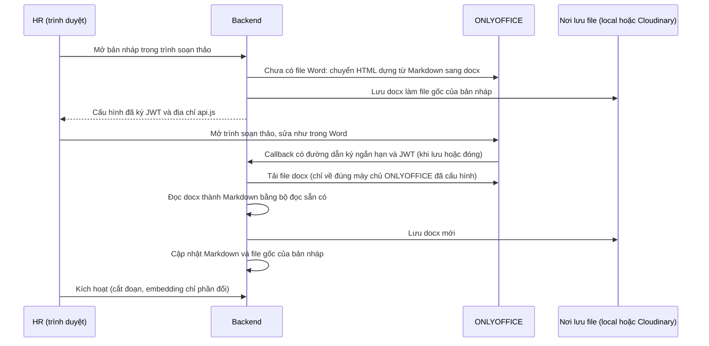

# Kết quả làm thử ở máy dev: embedding local, chỉ tính lại phần đã sửa, so sánh phiên bản, soạn thảo kiểu Word

Ngày 08/10/2026. Làm theo `ke-hoach-soan-thao-word-va-embedding-local.md`. **Chưa commit, chưa push, chưa động tới production.** Mọi tính năng mới tắt mặc định (không đặt biến môi trường thì chạy y như cũ).

## 1. Tóm tắt

| Việc | Kết quả đo thật ở máy dev | Bật bằng |
|---|---|---|
| Embedding BGE-M3 chạy local | cùng `model_version` với DB (`BAAI/bge-m3@5617a9f6…`), cosine so với Modal = 1,000000 (32 chuỗi); khoảng 0,31 giây mỗi chuỗi; 1,3 đến 1,7 GiB RAM | `scripts/dev/embedding-switch.sh local` |
| Chỉ tính lại đoạn đã sửa | tài liệu 9 đoạn, sửa 1 chữ ở Điều 5: dùng lại 8 đoạn, tính 1 đoạn, kích hoạt 3,1 giây (bản đầu 16,5 giây); vector lưu giống hệt cách tính toàn bộ | `EMBEDDING_CACHE_ENABLED=true` |
| Tab "So với bản trước" | hiện mục mới, sửa, xóa; từng từ đổi; ước lượng số đoạn phải tính lại; đã xem trên giao diện thật | luôn có (chỉ đọc) |
| Soạn thảo kiểu Word (ONLYOFFICE) | mở bản nháp, lưu về hệ thống, đọc lại thành Markdown, "Xem file gốc" ra đúng file Word vừa lưu, xuất PDF; trình soạn thảo tốn khoảng 0,85 đến 1,05 GiB RAM, chuyển đổi 1 đến 2 giây | `WORD_EDITOR_ENABLED=true` + 4 biến `ONLYOFFICE_*` |

Kiểm tra: backend 544 test đạt (1 bỏ qua), frontend 330 đạt, `ruff`, `mypy`, `tsc`, `eslint` sạch.

## 2. Luồng soạn thảo đã chạy thật

## 3. Điều tìm ra khi làm thật

- **Không gọi chuyển đổi lồng bên trong lúc ONLYOFFICE đang chờ tải file.** Lần đầu tôi dựng file Word ngay trong đường dẫn mà ONLYOFFICE đang tải, kết quả là quá giờ (nhật ký ONLYOFFICE ghi `ETIMEDOUT`). Sửa: dựng và lưu file Word **trước** khi mở trình soạn thảo.
- **Không dùng đường chuyển Markdown sang docx của ONLYOFFICE.** Nó đặt tên kiểu chữ lạ (`text-3`), bộ đọc của ta không nhận ra tiêu đề. Dùng đường HTML sang docx: tiêu đề thành "Heading 1/2", bộ đọc nhận đúng.
- **Địa chỉ trong callback là địa chỉ công khai của ONLYOFFICE** (`localhost:8081` ở dev). Backend đổi sang địa chỉ nội bộ khi tải, và từ chối mọi địa chỉ khác để chống gọi ra ngoài trái phép.
- **Chưa gõ chữ thật được trong Chrome headless** (khung soạn thảo vẽ bằng canvas, không nhận phím). Phần "sửa" trong thử nghiệm là bấm đổi kiểu chữ của đoạn đầu: đủ để tạo thay đổi thật và chạy trọn đường lưu. **Bạn cần tự thử gõ chữ** (xem mục 5).
- Tài liệu tải từ file Word thật còn được giữ nguyên định dạng gốc khi mở lại, vì file Word đang lưu được dùng lại nếu còn khớp nội dung.

## 4. Giới hạn còn lại (nói thẳng)

- **Chưa có khóa chống hai người cùng sửa một bản nháp.** Nút "Sửa nháp" Markdown bị chặn khi đang mở trình soạn thảo, nhưng người khác vẫn có thể mở cùng bản nháp ở máy khác; ONLYOFFICE tự gộp khi cùng mở, nhưng nếu ai đó kích hoạt bản nháp giữa chừng thì phần lưu sau đó bị bỏ qua.
- **Chưa thử trên EC2 và Cloudinary thật.** Đọc lại file Word từ Cloudinary (`secure_url`) chưa chạy thật; mỗi lần lưu tạo một file mới (tên theo checksum), file cũ không tự dọn.
- **ONLYOFFICE ở production cần https công khai** (trang chạy https trên Vercel không tải được script http), và cần máy riêng, chưa dựng. Giấy phép bản Community: AGPL, giới hạn số kết nối đồng thời; chưa đọc kỹ điều khoản để chốt.
- **Chưa làm:** chạy tiếp khi job kích hoạt chết giữa chừng (các lô đã tính chưa được lưu), dọn file mồ côi, và tự bật tắt máy soạn thảo để tiết kiệm.
- Tab "So với bản trước" chỉ so chữ, không so định dạng Word; số ước lượng đoạn cần tính lại chỉ xét bản so sánh, thực tế có thể ít hơn vì tra được cả các phiên bản khác.

## 5. Cách bạn tự thử ở máy dev

1. Docker đang chạy sẵn `vsf-embedder-local` (cổng 8080) và `vsf-onlyoffice-local` (cổng 8081). Nếu tắt: `scripts/dev/embedder-local/run.sh start`; ONLYOFFICE: `docker run -d --name vsf-onlyoffice-local -p 127.0.0.1:8081:80 -e JWT_ENABLED=true -e JWT_SECRET=dev-onlyoffice-secret -e ALLOW_PRIVATE_IP_ADDRESS=true -e ALLOW_META_IP_ADDRESS=true onlyoffice/documentserver:latest`.
2. `.env` ở thư mục gốc đã có các biến bật tính năng cho dev; backend dev đã dựng lại.
3. Vào trang Tài liệu, mở một tài liệu, chọn bản nháp: có nút **Soạn thảo kiểu Word**. Sửa chữ, bấm **Lưu ngay** rồi **Xong**; mở lại tab "Nội dung" và "So với bản trước" để thấy phần đã đổi, bấm **Xem file gốc** để mở file Word vừa lưu.
4. Kích hoạt bản nháp rồi xem kết quả công việc: số đoạn dùng lại hiện ở `reused_chunks`.

## 6. Khi merge vào main

- Mọi cờ tắt mặc định, không có migration mới, nên code mới nằm im khi chưa đặt biến.
- Thay đổi duy nhất chạm production khi deploy: thêm gói `markdown-it-py` vào `backend/requirements.txt` (ảnh backend được dựng lại như mọi lần phát hành) và tab "So với bản trước" xuất hiện cho HR.
- Giao diện Vercel và backend có thể lên lệch nhau vài phút: tab so sánh khi đó chỉ báo "không so sánh được" trong tab, phần còn lại vẫn dùng bình thường.
- Không động vào `deploy/aws/embedder/*` nên deploy không dựng lại ảnh embedder.
